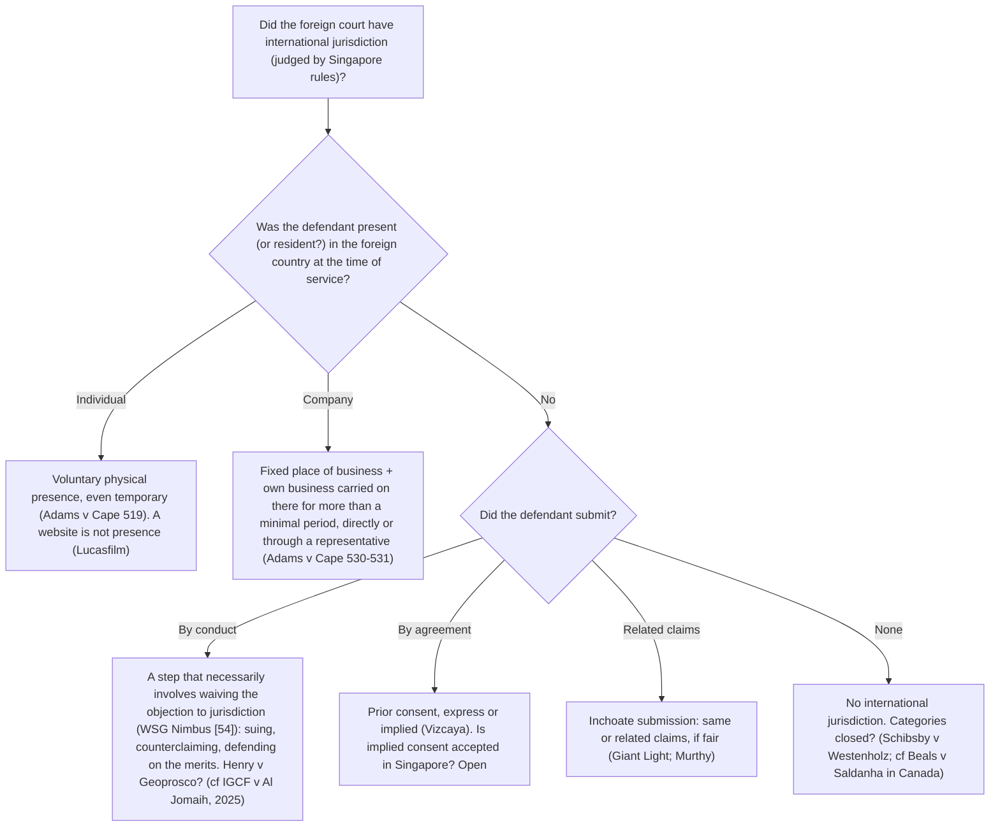

# LAW302 Commercial Conflict of Laws: Week 12

## Foreign Judgments (Part I): Principles of Recognition and Enforcement

### Learning Journey + MCQ Bank (every option has a right/wrong explanation)

> **Built from:** the Week 12 handout (AY2026-27), the FJ Part 1 slides (Dr Adeline Chong), Chong & Yip Ch 5 (Sections A, B and D, with in-scope material from E and G), and every case and statute on the Week 12 reading list **that is in the project**. Two required secondary readings are missing; see Part B.
>
> **Companion file:** Week 13 (defences, anti-enforcement injunctions, CCAA Part 3). It uses the same structure, so the two can be merged into one app.
>
> **Abbreviations:** C&Y = Chong & Yip, *Singapore Private International Law: Commercial Issues and Practice*; CL = common law; REFJA = Reciprocal Enforcement of Foreign Judgments Act 1959; CCAA = Choice of Court Agreements Act 2016; RECJA = Reciprocal Enforcement of Commonwealth Judgments Act (repealed); FLPA = Foreign Limitation Periods Act 2012; LA = Limitation Act 1959; MoG = Memorandum of Guidance; FNC = forum non conveniens; SG = Singapore. Paragraph pinpoints are in [square brackets].

---

---

## PART A: BUILD NOTES

This file uses the shared LAW302 content model, format 2 (lessons with the questions inside them). `tools/law302_import.py` turns it into the app's data.

- **Journey structure:** Stages (0 to 6) are made up of Modules. A stage with no modules is one lesson; a stage's introduction before its first module is an overview lesson; each module is a lesson.
- **Inside a lesson** (in this order, roughly):
  - `**Objective:**` and an optional `**Big idea:**`.
  - **Steps** (`##### Title`). Each step teaches one idea: a `> **ELI5:**` analogy, plain-English body paragraphs, a `**The law**` list with pinpoints, optional `> **Example:**`, `> **Why it matters:**` or `> **Exam tip:**` callouts, and a `**Check:**` line naming the question(s) answered at that point.
  - `**Key takeaways**`, `**Traps**`, and a final `**Practice:**` round. Practice questions are also answered on the lesson page.
  - Status badges at the end of a bullet: `[Open]` (amber: not settled in Singapore), `[Obiter]` and `[Academic view]` (grey: not binding), `[Missing reading]` (red: where the missing secondary readings would most likely add commentary).
- **Question bank structure:** Sets are made up of Questions. Each question has: ID, Set, Level, Tags; Prompt; Options A–D; Correct answer; Feedback for every option (✓ right / ✗ wrong); Hint; Source. Every question appears in exactly one Check or Practice line.
- **Levels:** L1 Foundations; L2 Rules & cases; L3 Apply; L4 Traps & critique.

---

## PART B: SOURCE COVERAGE CHECK

### B1. In the project ✓

- **Statutes:** CCAA ss 2(1), 13, 20, 21; REFJA (the whole Act); FLPA s 5.
- ***Merck Sharp & Dohme Corp v Merck KGaA*** [2021] 1 SLR 1102 (CA): the full judgment.
- ***Ocean Tankers (Pte) Ltd v DGJ*** [2024] 2 SLR 790 [93], [95]–[96].
- ***Poh Soon Kiat v Desert Palace Inc*** [2010] 1 SLR 1129 (CA) [25]–[34], [36]–[54].
- ***Republic of India v Deutsche Telekom AG*** [2024] 1 SLR 56 (CA) [65].
- ***Adams v Cape Industries plc*** [1990] Ch 433 (CA): an extract of the passages on presence and residence, which is the focus the handout asks for.
- ***Lucasfilm Ltd v Ainsworth*** [2010] Ch 503 (CA) [187]–[195].
- ***WSG Nimbus Pte Ltd v Board of Control for Cricket in Sri Lanka*** [2002] 1 SLR(R) 1088.
- ***IGCF SPV 21 Ltd v Al Jomaih Power Ltd*** [2025] UKPC 54.
- ***Giant Light Metal Technology (Kunshan) Co Ltd v Aksa Far East Pte Ltd*** [2014] 2 SLR 545.
- ***Vizcaya Partners Ltd v Picard*** [2016] 3 All ER 181 (PC) [32]–[72].
- ***Lakshmi Anil Salgaocar v Jhaveri Darsan Jitendra*** [2019] 2 SLR 372 (CA) [99]–[105].
- ***Sang Cheol Woo v Spackman*** [2022] SGHC 298 [19]–[48], [106]–[112].
- ***Gonzalo Gil White v Oro Negro Drilling Pte Ltd*** [2024] 1 SLR 307 (CA) [83]–[93].
- **C&Y Ch 5** Sections A, B and D.
- **Slides:** FJ Part 1.

### B2. Missing (both are required secondary readings)

- Yeo, "Common Law Developments Relating to Foreign Judgments", 9th Yong Pung How Professorship of Law Lecture (2016).
- Yeo, "The Changing Global Landscape for Foreign Judgments", Yong Pung How Professorship of Law Lecture (2021).
- **Effect on this file:** the doctrine below is fully sourced from the cases, the statutes, C&Y and the slides. I have **not** seen the lectures. Going by their titles, they are most likely to add commentary on:
  - reciprocity and the rationale for recognition (Module 2);
  - presence versus residence, and the MoGs (Module 3.4);
  - submission and *Henry v Geoprosco* (Module 3.5);
  - non-money judgments (Module 3.3);
  - the Hague Judgments Convention 2019 and the "global landscape" (Stage 1).
- These spots carry a "Missing reading" badge. Treat any academic view stated there as coming from C&Y only.

### B3. Notes on the handout and the textbook

- **REFJA section numbers.** The handout cites older numbering. In the current Act (the version in the project):
  - "s 4(3A)" is now **s 4(4)** (registration of non-money judgments only if "just and convenient");
  - "s 5(2)(a)" and "s 5(2)(a)(iv)" are now **s 5(3)(a)** and **s 5(3)(a)(iv)** (the deemed grounds of jurisdiction).
  - (The Week 13 handout's "s 5(3)(b)" is likewise now s 5(4)(b).) This file uses the current numbering.
- ***WSG Nimbus* citation.** The handout cites the case both as [2002] 1 SLR(R) 1088 and as [2002] 3 SLR 603. These are the same case in two different law reports.
- **C&Y is out of date on two points:**
  - It says the RECJA repeal takes effect "from a yet to be determined future date" (5.01). The slides and *Venetian Macau v Hu* treat the RECJA as already repealed.
  - It says "only Hong Kong SAR is gazetted under the REFJA" (5.151). The handout now lists Hong Kong, Brunei, Australia (Commonwealth, states and territories), India, Malaysia, New Zealand, Pakistan, Papua New Guinea, Sri Lanka and the UK.
  - Follow the handout and the slides on both points.

### B4. Textbook enrichment (this edition)

- The lessons were expanded with in-scope material from **C&Y Ch 5**: Sections A (introduction, corrected as in B3), B.1–B.6 (the common law rules, defences, severance and estoppel), D (REFJA), E (CCAA Part 3) and G (anti-enforcement injunctions).
- Mentioned only, not tested: B.7 (judgments in rem beyond the in personam / in rem distinction), C (the repealed RECJA, where the cases still refer to it) and F (the Hague Judgments Convention 2019).
- Left out as outside the course: H (the Singapore Convention on Mediation).
- Where the textbook (2023) and the course materials differ, the lessons follow the handout, the slides and the later cases.

---

## PART C: LEARNING JOURNEY

### STAGE 0: Why a foreign judgment matters (strategic uses)

**Objective:** Explain what a party can **do** with a foreign judgment in Singapore. This is the handout's first learning objective.

**Big idea:** A foreign judgment can be used as a **sword** (enforced to collect money) or as a **shield** (recognised to stop the other side relitigating). Recognition always comes first. Enforcement is recognition plus extra requirements.

##### Two uses: a sword and a shield

> **ELI5:** A foreign judgment is like a winning ticket from another country. You can **cash it in** (enforcement: make the loser pay), or you can **hold it up as a shield** (recognition: "this was already decided, stop suing me"). Either way, Singapore must first accept that the ticket is genuine.

Mei sued Bob in Country X and won. If Bob has money in Singapore and Mei wants it, she seeks **enforcement**: making the **judgment debtor** (Bob) pay the **judgment creditor** (Mei). If Bob instead sues her here over the same dispute, she wants the court to treat the matter as already decided. That is **recognition**: giving the judgment effect as **res judicata** ("a matter already judged"), usually through an **estoppel**, a rule that stops a party from reopening what has been decided (C&Y 5.08, 5.10).

"Recognition" can mean every effect of a judgment, enforcement included. Chong & Yip use the narrower sense: every effect *except* enforcement (C&Y 5.08). In that sense the two are steps on one staircase. Singapore cannot make Bob pay on a judgment it has not first accepted as having legal effect.

**The law**
- **Recognition** (narrow sense): giving the foreign judgment legal effect, typically as res judicata by way of an estoppel (C&Y 5.08, 5.10).
- **Enforcement:** making the debtor pay.
- **Recognition is a prerequisite to enforcement** (C&Y 5.08–5.09).

**Check:** Q12-0.6

##### One checklist, with an extra box for enforcement

> **ELI5:** Whatever Mei wants to do with the ticket, Singapore runs the same checks. Cashing it in needs one extra thing: the ticket must be for a fixed amount of money.

Sword or shield, the core questions are the same. Is the judgment **on the merits**? Did the foreign court have **international jurisdiction** over Bob by Singapore's rules? Is it **final and conclusive**? Is there **no defence**? (Stage 3; Week 13.) Only enforcement adds the **fresh money judgment** requirement. The reason lies in the form enforcement takes at common law: Mei sues on Bob's obligation to pay, and that obligation is limited to paying a sum of money (C&Y 5.12 n 27, 5.31). A shield involves no debt, so the extra box does not apply.

**The law**
- The same requirements apply to recognition and enforcement: on the merits, international jurisdiction, final and conclusive, no defences (C&Y 5.09, 5.20).
- **One exception:** the **fresh money judgment** requirement (a fixed sum that is not a tax, fine or penalty) applies to **enforcement only** (C&Y 5.09, 5.20).
- Whether **reciprocity** is a further requirement for both is uncertain after *Merck* [39] (C&Y 5.09; Stage 2). [Open]

**Check:** Q12-0.1

##### The shield in action

> **ELI5:** Suppose Mei loses abroad and then brings the same claim in Singapore, hoping for a better result. Bob holds up the foreign judgment: "We have done this already, and I won."

That is Chong & Yip's own example. Nothing automatically stops Mei from issuing the claim here; it is up to Bob to raise the foreign judgment (C&Y 5.10). He pleads it as a **cause of action estoppel**: once a competent court has finally decided a claim between the same parties, neither can bring that claim again (Stage 4). Bob is asking for **recognition**, not enforcement, so he needs no special application or registration. He simply pleads the judgment under the normal pleading rules (C&Y 5.10; *Merck* [35]).

> **Why it matters:** The shield serves the finality of litigation (Stage 2). Without it, a claimant who lost abroad could make the winner fight the same case twice.

**The law**
- **Shield scenario:** A sues B abroad and loses, then sues B again in Singapore on the same cause of action. B pleads the foreign judgment as a defence (or counterclaim), raising a **cause of action estoppel** (C&Y 5.10, 5.105).
- **No special procedure:** the normal pleading rules apply (C&Y 5.10; *Merck* [35]).

**Check:** Q12-0.7

##### No merger: why the winner can sue again

> **ELI5:** When a Singapore court gives judgment, the original claim is "swallowed" by it: from then on you hold the judgment, not the claim. On the Court of Appeal's current (preliminary) view, a foreign win does not swallow the claim. So you can still sue on the original claim and point to the foreign judgment as proof that it has already been decided.

The swallowing is called **merger**. A cause of action merges into a **Singapore** judgment (*Ocean Tankers* [93]), but the Court of Appeal's preliminary view is that merger does not extend to foreign judgments (*Ocean Tankers* [95]–[96]).

Why would a winner sue on the original claim? Because some foreign judgments cannot be enforced here. If Country X (not a REFJA or CCAA country) ordered Bob to transfer shares to Mei, that is not a money judgment (Module 3.3). Mei can instead sue Bob again on the original cause of action and plead the Country X judgment as res judicata. If it meets the requirements for recognition, the merits need not be argued again (C&Y 5.105). **Declaratory judgments**, which only state the parties' rights ("the contract was validly terminated"), work the same way: there is nothing to enforce, but they can found a res judicata (C&Y 5.11).

**The law**
- Merger applies to **Singapore** judgments (*Ocean Tankers* [93]) but **does not extend to foreign judgments**: a preliminary view in *Ocean Tankers* [95]–[96], approving *Malaysia Credit Finance* and matching the English common law.
- **Consequence:** a successful foreign claimant can sue again on the **original** cause of action and plead the judgment as res judicata. This is useful where the judgment cannot be enforced, for example a non-money judgment outside REFJA and the CCAA (C&Y 5.105).
- Prof Tham's suggestion that merger might occur once a judgment is registered under statute was **not decided** (*Ocean Tankers* [95]). [Open]
- **Declaratory judgments** cannot be enforced; their value is in raising res judicata (C&Y 5.11).

**Check:** Q12-0.2

##### In personam or in rem? (a short note)

> **ELI5:** Most judgments settle a quarrel between two people: "Bob owes Mei." A few settle something about a thing, or a person's status, for everyone: "this painting belongs to Mei", whoever asks.

A judgment **in personam** binds the parties (and their privies, those who stand in their shoes). A judgment **in rem** pronounces on rights to a thing, such as title to property, or on a person's status, against the whole world (C&Y 5.127). The label turns on what the judgment is **for**, not on how the foreign court took jurisdiction. The Singapore court decides it by looking at the nature of the foreign proceedings and the effect the foreign court intended (C&Y 5.129). The course focuses on in personam judgments.

**The law**
- **In personam:** binds the parties. **In rem:** pronounces on rights to a thing as against the whole world (handout note; C&Y 5.127–5.128).
- The purpose of the judgment decides this, not how the foreign court took jurisdiction (handout note). One judgment can have both aspects (C&Y 5.127).
- Characterisation is for the Singapore court (C&Y 5.129).

**Check:** Q12-0.3

**Key takeaways**
- A foreign judgment can be a sword (enforcement) or a shield (recognition). Recognition always comes first.
- The requirements are the same for both, except that only enforcement needs a fresh money judgment.
- Recognition needs no special procedure: the judgment is simply pleaded.
- On *Ocean Tankers*' preliminary view there is no merger, so a winner abroad can sue again on the original claim and plead the judgment as res judicata.

**Traps**
- Do not say a foreign judgment "merges" the cause of action. *Ocean Tankers* says it does not.
- Do not apply the money-judgment requirement to recognition.
- Do not treat an unenforceable judgment as useless: non-money and declaratory judgments can still be recognised as res judicata.

**Practice:** Q12-0.8

---

### STAGE 1: The regimes and the common law procedure

**Objective:** Pick the correct regime, explain how the regimes fit together and why registration is the easier route, and describe how enforcement works at common law.

**Big idea:** Try the doors in order: the CCAA, then REFJA, then the common law. The statutes replace a fresh lawsuit with an application, and REFJA, where it applies, is compulsory.

##### Three doors into Singapore

> **ELI5:** Which door do you use? If the judgment comes from a **chosen** court in a Hague Convention country, use the CCAA door. If it comes from a **listed (gazetted)** country, use the REFJA door, where you simply register the judgment. You *must* use that door for judgments it covers. For **everyone else**, use the common law door: start a fresh case in Singapore saying, "they owe me under this judgment."

Two of the doors are statutes, each tied to an international arrangement; the common law catches everything else. Recent reforms, enacting the Hague Choice of Court Convention through the CCAA and widening REFJA in 2019, are part of a broader drive to make Singapore judgments, especially those of the Singapore International Commercial Court (SICC), enforceable abroad. The government hopes to use the amended REFJA to negotiate reciprocal arrangements with more countries (C&Y 5.02).

**The law**
- **CCAA Part 3:** judgments of the **chosen** court (the court named in an exclusive choice of court agreement) of a **Contracting State** (a party to the Hague Convention on Choice of Court Agreements), or of a court it transferred the case to (s 2(1)). On application under s 13 they are recognised and enforced like a General Division judgment; judicial settlements can be enforced (s 20); s 21 preserves other routes. The CCAA prevails over REFJA (next step; Week 13).
- **REFJA:** judgments of **recognised courts** (the courts of a gazetted country that its gazette order covers) of countries **gazetted** (listed by Ministerial order) under s 3, which requires "substantial reciprocity" (s 3(1); C&Y 5.151). For a judgment within its scope, REFJA **bars** any proceedings to recover the sum payable other than registration, so a common law action on it is not allowed (s 7(1)).
- **Gazetted countries** (handout): Hong Kong, Brunei, Australia (Commonwealth, states and territories), India, Malaysia, New Zealand, Pakistan, Papua New Guinea, Sri Lanka and the UK. C&Y 5.151 (only Hong Kong) reflects an earlier position.
- **Common law:** all other judgments.
- **RECJA:** repealed (*Venetian Macau* [29]; FJ Part 1 slide 2); C&Y 5.01 (repeal at a future date) reflects an earlier position. The countries it covered are being moved to REFJA (C&Y 5.02).
- **The global landscape:** the Hague Judgments Convention 2019 sets out indirect rules on jurisdiction and exhaustive grounds for refusal. Singapore took part in the negotiations but has not decided whether to join (C&Y 5.03). [Missing reading]

**Check:** Q12-8.4

##### The order of the doors

> **ELI5:** Picture the doors along a corridor. Try the CCAA door first. If your judgment does not fit, try REFJA. Only if neither fits do you reach the common law. If your judgment fits the REFJA door, the common law door is locked. The picture breaks down at one point: the CCAA door does **not** lock the common law door.

The regimes overlap: a chosen court's judgment from a country that is both a Contracting State and gazetted fits both statutes, and any judgment could in principle be sued on at common law. The statutes settle the order. The CCAA wins over REFJA. REFJA, where it applies, bars any common law action to recover the judgment sum, even after its six-year registration period has passed. The CCAA shuts out nothing, though it is almost always the better choice.

> **Example:** Mei's money judgment comes from a recognised court in Country Y, a REFJA country, and falls within Y's gazette order; there was no choice of court agreement. She must register it; a common law action is barred. Had it come from the chosen court in Country Z, a Contracting State that is also gazetted, she would use the CCAA, not REFJA, and could fall back on the common law if she had to.

**The law**
- **CCAA over REFJA:** REFJA does not apply to any judgment within the CCAA (REFJA s 2A; C&Y 5.173), so if a judgment falls within both, only the CCAA route is available. After a refusal under the CCAA, the creditor cannot register under REFJA (C&Y 5.200).
- **REFJA over the common law:** s 7(1) bars a common law action to recover the sum due under a judgment within REFJA (C&Y 5.173). There is no discretion to allow one, and an expired registration period does not reopen the common law.
- **CCAA and the common law:** the CCAA does not exclude the common law (s 21), though the CCAA is almost always more advantageous: simpler procedure, and non-money judgments are enforceable (C&Y 5.201).
  - After a CCAA refusal, the common law is open in principle, unless pursuing it is an abuse of process, such as re-arguing the same issues (C&Y 5.201). [Academic view]

**Check:** Q12-0.4

##### Why registration is the easier door

> **ELI5:** Suing at common law means starting a whole new case just to collect money a court has already ordered Bob to pay. Registering under REFJA is more like getting the foreign judgment stamped at a counter. Once stamped, it works like a Singapore judgment.

Chong & Yip identify two practical benefits (C&Y 5.149). Once registered, the judgment can be enforced as if it were a Singapore judgment, and Mei needs no court permission to serve notice of the registration on Bob abroad. At common law she would have to start an action, serve it, and, if Bob is overseas, obtain permission to serve him out of Singapore (C&Y 5.13–5.14).

Easier is not automatic. REFJA is modelled on the common law (C&Y 5.147–5.148), and Bob can apply to set the registration aside on the grounds in s 5 (C&Y 5.159; Week 13). What REFJA adds is breadth: since 2019 it reaches many judgments the common law cannot enforce, including orders made before the final judgment and outcomes the parties agreed.

**The law**
- **Benefits** (C&Y 5.149): a registered judgment has, for enforcement, the same force and effect as a local judgment (REFJA s 4(7)(a)); no permission is needed to serve notice of registration abroad (ROC 2021 O 60 r 7(2)).
- **Same basic framework** as the common law: international jurisdiction, final and conclusive, no defences (C&Y 5.148).
- **Scope after 2019:** money and non-money judgments (such as injunctions, specific performance and **freezing orders**, which stop a party moving its assets away), lower-court judgments, **interlocutory judgments** (made before the final judgment, such as orders preserving assets meanwhile), **consent judgments** and orders (on terms the parties agreed), and **judicial settlements** (settlements approved by, or concluded before, a court) (REFJA s 2(1) definition of "judgment", s 3; C&Y 5.152–5.153, 5.178).
- **Gazette orders** are negotiated country by country and may cover less than the Act allows (C&Y 5.151). The handout's list describes "final money judgments of superior courts"; that reflects the gazette orders, not the Act's outer limit.

**Check:** Q12-8.1

##### Registering: time limits, bars and limits

> **ELI5:** The counter has opening hours and house rules. Come within six years. You cannot register a debt that has already been paid. Some items are accepted only in part, or only if the court thinks it sensible.

The registration rules keep Singapore in control of what it enforces. A non-money order, such as an injunction, needs a closer look than a debt, so the court asks whether enforcing it here would be "just and convenient". Damages that go beyond compensating Mei's actual loss, such as punitive damages, are cut back to the compensatory amount.

**The law**
- **Time:** within 6 years of the judgment; if there was an appeal, the appellate judgment may be registered at any time after the last appellate judgment (s 4(1); C&Y 5.150). The High Court has said the 6-year limit should apply to appellate judgments too (C&Y 5.150). [Obiter]
  - Compare the common law: 6 years under LA s 6(1)(a), running from when the judgment became final and conclusive (*Sang Cheol Woo*; Module 3.6).
- **Bars:** no registration if the judgment has been wholly satisfied or discharged, or cannot be enforced in the country of the original court; if partly satisfied, only the balance (s 4(3), (9); C&Y 5.160).
- **No taxes, fines or penalties**; registrable parts can be severed (C&Y 5.154).
- **Non-money judgments:** registered only if enforcement is "just and convenient", otherwise the monetary equivalent may be registered (s 4(4)). Factors include whether Singapore has an equivalent remedy, whether an injunction is territorially limited, and any risk of illegality or breach of privilege (C&Y 5.156).
- **Non-compensatory damages:** registered only for the compensatory amount, considering whether the award covers the costs of the foreign proceedings (s 4(5)–(6); C&Y 5.155).

**Check:** Q12-8.2, Q12-8.6

##### Recognition under REFJA needs no registration

> **ELI5:** Registration is for cashing in. If you only want to hold the judgment up as a shield, REFJA lets you do that without visiting the counter.

REFJA has its own version of the Stage 0 shield. If Bob sues Mei here on a claim he has already lost in a REFJA country, Mei simply pleads that judgment in her defence. She has nothing to collect, so she never needs to register it (C&Y 5.172).

**The law**
- **REFJA s 11(1):** a judgment within the Act is conclusive between the parties in all proceedings founded on the same cause of action, and may be relied on by way of defence or counterclaim, without registration (C&Y 5.172).
- **s 11(2):** the defences that bar enforcement also bar recognition (C&Y 5.172).
- Under the UK equivalent, the judgment must be **on the merits** (*Black-Clawson* (HL); C&Y 5.172).

**Check:** Q12-8.7

##### Memoranda of Guidance

> **ELI5:** A Memorandum of Guidance is like two libraries swapping booklets that explain their own house rules. Visitors know what to expect, but no rule changes.

The Singapore court has signed **Memoranda of Guidance** (MoGs) on enforcing money judgments with various foreign courts. They state each side's existing law and bind no one, so they may seem to achieve little. But they clarify the law and are symbols of judicial **comity**, the respect that courts of different countries show one another (C&Y 5.02). They do not gazette a country (only a Ministerial order under REFJA s 3 does that) and they create no rule of law. That matters for a handout study question: some MoGs describe residence as a common law ground of international jurisdiction.

**The law**
- MoGs are **non-binding**. They state each country's existing law, help clarify it, and are "symbols of judicial comity" (C&Y 5.02; handout study question).
- Some MoGs list residence at commencement as a common law ground of international jurisdiction. Whether that is still good law: see Module 3.4. [Open] [Missing reading]

**Check:** Q12-0.5

##### The common law door: a fresh action on the judgment

> **ELI5:** At common law the foreign judgment works like an IOU. Here the Stage 0 ticket picture needs correcting: Mei does not cash the foreign ticket directly. She starts a Singapore case saying "Bob owes me this sum because of the judgment", obtains a Singapore judgment, and enforces that.

Mei sues on the obligation the foreign judgment creates, treated as an implied debt: the obligation theory from Stage 2 at work. Strictly, then, it is a misnomer to speak of "enforcing" a foreign judgment; what is enforced is the Singapore judgment Mei obtains (C&Y 5.12). And because the obligation sued on is a debt, only an order to pay a fixed sum can be enforced this way (C&Y 5.12 n 27, 5.31). In practice Mei will normally apply for **summary judgment**, a judgment given without a full trial where the defendant has no real defence.

**The law**
- The creditor brings a **fresh action** on the obligation created by the judgment (an implied debt, so money only), usually seeking summary judgment. The resulting **local** judgment is what is enforced (C&Y 5.12–5.13, 5.31; *Poh Soon Kiat* [41]–[42]).
- **Summary judgment:** the creditor bears the burden. The debtor needs only a fair or reasonable chance of a real or bona fide defence to obtain leave to defend (C&Y 5.13).

**Check:** Q12-0.9

##### Serving Bob abroad, and the forum non conveniens question

> **ELI5:** If Bob is overseas, Mei needs the court's permission to bring him into a Singapore case. Normally the court would ask, "Is Singapore the right place for this dispute?" But Mei is not asking Singapore to decide the dispute again; she only wants help collecting. Whether the "right place" question still applies is unsettled.

In legal terms, to serve Bob abroad Mei must show that Singapore "is the appropriate court" (C&Y 5.14). **Forum non conveniens** is the doctrine under which a court declines a case because another forum is clearly more appropriate. In *Rodriguez Licea*, the High Court said it does not arise when a creditor enforces a foreign judgment, because that is not a fresh suit (C&Y 5.15).

England takes a different line. In *Tasarruf Mevduati Sigorta Fonu v Demirel*, a creditor sought to enforce a Turkish judgment against a debtor with no presence or assets in England. The Court of Appeal held that assets were not a prerequisite for service out, but that permission should not ordinarily be given without a **real prospect of a legitimate benefit** to the creditor. On the facts one was shown, chiefly because the debtor had been found to have acted fraudulently, so his assets might be hard to trace (C&Y 5.16).

Chong & Yip see force on both sides. Forum non conveniens picks one forum for the merits, whereas enforcement may need several countries, and the enforcing court only helps to enforce an obligation already decided. Yet a creditor might sue to harass the debtor, or to "launder" the judgment through a Singapore judgment, so some filter is appropriate (C&Y 5.19).

**The law**
- **Service out:** the claimant must show Singapore is the appropriate court (ROC 2021 O 8 r 1(1)); PD para 63(3)(m) supplies the nexus. The preferred English view is that assets are not a prerequisite, though their absence may affect the discretion (C&Y 5.14).
- **Forum non conveniens** (C&Y 5.15–5.19): [Open]
  - *Rodriguez Licea* (HC): it does not arise in enforcement, which is not a fresh suit. Art 13(2) of the Hague Judgments Convention is to the same effect (C&Y 5.15). Prof Yeo has queried whether the court stated a rule of law or a view on the facts (C&Y 5.15 n 35). [Missing reading]
  - *Tasarruf Mevduati Sigorta Fonu v Demirel* (England): a "real prospect of a legitimate benefit" is ordinarily required. It shades into forum (non) conveniens, which the court did not discard (C&Y 5.16–5.17).
  - *Chevron v Yaiguaje* (Canada): no "real and substantial connection" is needed, but the debtor may still argue forum non conveniens (C&Y 5.18).
  - C&Y: some filter is appropriate, but requiring both forum conveniens and a legitimate benefit would be "overkill" (C&Y 5.19). [Academic view]

**Check:** Q12-8.9

**Key takeaways**
- Three regimes: CCAA Part 3, REFJA and the common law. The RECJA is repealed.
- The CCAA prevails over REFJA; REFJA bars a common law action on judgments within it; the CCAA does not.
- A registered judgment works like a local one, and notice can be served abroad without permission. Recognition under REFJA needs no registration.
- At common law the creditor sues on an implied debt, usually by summary judgment. Whether a forum non conveniens or "legitimate benefit" filter applies is open.

**Traps**
- Do not run a common law action on a judgment of a REFJA-gazetted court that falls within the Act. Section 7 bars it.
- Do not apply REFJA s 7(1) to a judgment within the CCAA. REFJA does not apply to it, and the CCAA leaves the common law open.
- Do not treat MoGs as law.
- Do not confuse the Hague Convention on Choice of Court Agreements (enacted by the CCAA) with the Hague Judgments Convention 2019 (not adopted).

**Practice:** Q12-8.3, Q12-8.5, Q12-8.8, Q12-8.10, Q12-8.11

---

### STAGE 2: Why Singapore gives effect to foreign judgments (*Merck* [29]–[33], [39])

**Objective:** State the three rationales the Court of Appeal considered, which one it preferred, and what follows from that choice, including the reciprocity question.

**Big idea:** *Merck* placed comity at the centre. A comity-based rationale is what opens the door to a possible reciprocity requirement.

##### Why respect a foreign court at all?

> **ELI5:** Why should Singapore care what a foreign court said? Three reasons were discussed. First, the loser now owes a duty to obey the judgment (obligation). Second, courts should respect each other (comity). Third, arguments must end at some point (finality).

A foreign judgment has no standing in Singapore unless Singapore recognises it (*Poh Soon Kiat* [41]). So the law needs a reason for giving it effect, and that reason shapes the rules: what is required, how strictly, and whether Singapore asks for anything in return.

In *Merck*, the Court of Appeal had to decide whether an English ruling on a clause in a 1970 co-existence agreement, made by the predecessors of two companies called Merck, bound them in Singapore (Module 4.2). It first asked why foreign judgments are recognised at all.

**The law**
- ***Merck* [29]:** two older theories (implied contract, and allegiance to a foreign sovereign) were rejected long ago. The remaining contenders are **obligation**, **comity** and **finality** (C&Y 5.05).

**Check:** Q12-1.1

##### Obligation: the judgment creates a duty to pay

> **ELI5:** Once a proper court has ordered Bob to pay, Bob has a new duty: to obey that judgment. On this view, Singapore is not obeying Country X. It is holding Bob to his own duty.

The **doctrine of obligation** is the traditional common law basis. If the requirements are met, a foreign judgment creates an obligation that the debtor must obey, independent of the original cause of action (C&Y 5.06). It comes from *Schibsby v Westenholz* (Blackburn J), and it asks whether the debtor voluntarily put itself in a position to be bound (*Merck* [30]).

*Merck* noted two criticisms ([30], citing Harder). The theory presupposes what it is meant to explain: why should a foreign judgment create an obligation at all? And it cannot account for judgments that declare a status, such as a divorce, which impose no obligation on anyone. The Court was unenthusiastic but did **not** reject the theory. It still explains why, at common law, the creditor sues on a debt (C&Y 5.06, 5.12).

**The law**
- **The theory** (*Merck* [30]; *Schibsby v Westenholz*): a judgment of a competent court imposes an obligation to pay, which the forum enforces. The focus is on whether the debtor voluntarily placed itself in a position where it is bound.
- **The criticism** ([30]): it presupposes what it is meant to explain, and it cannot account for declarations of status. Prof Yeo considers the status criticism misplaced (C&Y 5.06 n 17). [Academic view] [Missing reading]
- **The court's attitude:** unenthusiastic, but it did **not** reject the theory, which earlier Singapore decisions support (C&Y 5.06). It still explains the common law procedure, since the creditor sues on an obligation (C&Y 5.12).

**Check:** Q12-1.3

##### Comity and finality

> **ELI5:** Comity is the respect courts of different countries show each other, like neighbours who honour each other's decisions because they expect to live side by side for a long time. Finality is the idea that a dispute, once properly decided, should stay decided.

**Comity** is the respect one country's courts give to the acts of another's. *Godard v Gray* is often read as rejecting comity as the basis for recognition. *Merck* explained that case as rejecting only a thin version of it: comity as mere discretionary politeness, a courtesy a court could give or withhold at will. In its fuller sense comity is now "routinely invoked" ([31]). **Finality**, the policy that litigation must end, serves the recognising state only in the broad sense of enhancing comity ([32]). So comity underlies finality too (C&Y 5.07).

**The law**
- **Comity** ([31]): *Godard v Gray* is explained as rejecting comity only in the sense of mere discretionary politeness. Comity is now "routinely invoked".
- **Finality** ([32]): this serves the recognising state only in the broad sense of enhancing comity. The Court saw comity as underlying finality (C&Y 5.07).

**Check:** Q12-1.5

##### The Court's answer: comity, balanced against the rule of law

> **ELI5:** Respect has limits. Singapore's courts respect foreign courts, but they also have a job at home: protecting the rule of law in Singapore. So respect for foreign courts is always weighed against that job.

The Court concluded that "considerations of transnational comity and reciprocal respect among courts of independent jurisdictions" undergird recognition at common law, including transnational **issue estoppel**, the rule that stops a party re-arguing a particular issue already decided between the same parties (*Merck* [33]; C&Y 5.07). Comity is not unconditional. It is balanced against the Singapore court's constitutional role in safeguarding the rule of law. That is why transnational issue estoppel must be applied with special care ([34]; Module 4.2).

> **Exam tip:** Asked why Singapore recognises foreign judgments, lead with comity (*Merck* [33]), state the counterweight, and add that the obligation theory survives as the explanation for the common law procedure.

**The law**
- ***Merck* [33]:** "transnational comity and reciprocal respect among courts" undergird recognition, including transnational issue estoppel.
- This is **balanced against** the recognising court's constitutional role in safeguarding the rule of law, which is why transnational issue estoppel needs special care ([33]–[34]).

**Check:** Q12-1.2

##### The open question: reciprocity

> **ELI5:** Reciprocity means "I will honour your courts' decisions if your courts honour mine." If the reason for honouring foreign judgments is respect between courts, it is natural to ask whether that respect should run both ways. The Court of Appeal raised that question but did not answer it.

In legal terms, **reciprocity** means that country A's court will recognise or enforce a judgment of country B only if B's courts would do the same for A (C&Y 5.60). It underlies Singapore's statutory schemes and is mandatory in most civil law countries, but it is not a requirement of the common law. So the Court's remarks in *Merck* were "quite unexpected" (C&Y 5.60). The Court saw reciprocity as "entirely consonant" with comity, and observed that the absence of reciprocity would rarely be an obstacle in practice (*Merck* [39]; C&Y 5.61, 5.64 n 174).

Why has the common law not required it? Countries that impose reciprocity usually treat recognition as a matter of sovereignty. The common law treats it as enforcing private rights acquired under foreign law, which is why the obligation theory dominates there (C&Y 5.62). Prof Yeo's caution, which the Court noted, makes the same point. Moving to comity goes hand in hand with talk of reciprocity.

**The law**
- **Reciprocity** ([39]; slide 15): **open**. If adopted, it would affect recognition and enforcement alike (C&Y 5.09). [Open] [Missing reading]
  - **For:** consistent with a comity rationale and with the CCAA, REFJA and the Maintenance Orders (Reciprocal Enforcement) Act (C&Y 5.61).
  - **Prof Yeo's caution:** the common law focuses on personal obligations and the conduct of the party to be bound, while the statutes are concerned with international relations. Strict reciprocity is also falling out of favour worldwide.
  - The common law treats recognition as enforcing private rights, not as a matter of sovereignty (C&Y 5.62).

**Check:** Q12-1.6

##### Should Singapore require it? The critique and the spectrum

> **ELI5:** Even "you must respect us back" can be strict or relaxed. A strict version says: "Show me you have actually honoured one of our judgments." A relaxed version says: "It is enough that you probably would."

Chong & Yip argue against imposing reciprocity. Reciprocity is on the wane worldwide, even in civil law countries. It rarely persuades other countries to recognise the forum's judgments. And it punishes private parties for government policy they cannot control, by making them litigate all over again (C&Y 5.63). If Singapore did adopt it, the version would matter. The options run from strict (a treaty, or proof of actual past recognition) to relaxed (likely recognition, a presumption, or reciprocity in name only), and C&Y read *Merck* as pointing to a liberal version (C&Y 5.64).

> **Example:** Mei sues Bob on a Country X judgment. X's courts have never been asked to enforce a Singapore judgment, but expert evidence shows that X's law would allow it. Under de facto reciprocity Mei would fail; under de jure or presumed reciprocity she would pass. No reciprocity requirement has yet been imposed in Singapore; *Merck* left the point open.

**The law**
- **C&Y critique** (5.60–5.64): [Academic view]
  - imposing reciprocity is contrary to the global trend;
  - it rarely succeeds in persuading other countries to recognise Singapore judgments;
  - it penalises private parties for government policy;
  - if it is ever imposed, expect a *liberal* version of reciprocity (5.64).
- **The spectrum** (C&Y 5.64): a treaty or bilateral agreement; **de facto** (evidence that the foreign court has recognised a judgment of the court addressed); **de jure** (it is likely that it would); presumed unless the contrary is shown; in name only.

**Check:** Q12-1.4

**Key takeaways**
- *Merck* considered obligation, comity and finality, and preferred comity: "transnational comity and reciprocal respect among courts" ([33]).
- Comity is balanced against the Singapore court's role in safeguarding the rule of law, which is why transnational issue estoppel needs special care.
- The obligation theory was not rejected and still explains why the creditor sues on a debt.
- Reciprocity is open. C&Y oppose it and expect a liberal version if it ever comes.

**Traps**
- *Merck* did **not** impose reciprocity.
- *Merck* did **not** abolish the obligation theory.
- The counterweight to comity is the Singapore court's constitutional role, not the foreign court's sovereignty.

**Practice:** Q12-1.7, Q12-1.8

---

### STAGE 3: The common law requirements

**Objective:** Name the common law requirements for giving effect to a foreign judgment, say which applies only to enforcement, and take them in the right order.

**Big idea:** Requirements first, defences second. The party relying on the judgment must tick every box on the checklist before the debtor's complaints (the defences, Week 13) come into play.

##### The checklist at the door

> **ELI5:** Think of a checklist at the door. (1) Was the foreign court allowed to judge this person? (2) Is the decision finished? (3) Did it decide who is right? (4) If you want money, is it a fixed sum? Only when every box is ticked do we move on to the other side's complaints (the defences, in Week 13).

Mei has won a judgment against Bob in Country X, which is not covered by REFJA or the CCAA, so she must use the common law (Stage 1). Before a Singapore court gives her judgment any effect, it must pass a short checklist: the common law requirements for recognition and enforcement, which the Court of Appeal has restated from *Humpuss* (*Ong Han Nam* [48]; *India v Deutsche Telekom* [64]–[65]).

Each box has a purpose. Singapore gives effect to foreign judgments out of comity (respect between the courts of different countries) and to bring disputes to an end (Stage 2), but only on conditions. The foreign court must have been entitled, by Singapore's standards, to call Bob before it (**international jurisdiction**). Its own legal system must treat the decision as settled (**final and conclusive**). It must have decided the dispute itself, not a point of procedure (**on the merits**). And to make Bob pay, the judgment must be for a definite sum of money, because the common law collects foreign judgments as debts.

Notice what is **not** on the list: whether the foreign court got the answer right. The Singapore court is not an appeal court and does not re-examine the merits (C&Y 5.66).

**The checklist** (*Humpuss*, cited in *Ong Han Nam* [48]; *India v Deutsche Telekom* [64]–[65]; C&Y 5.20; slide 3):

1. The judgment is **on the merits**.
2. For enforcement only: a **fresh money judgment** that is not a tax, fine or penalty.
3. The foreign court had **international jurisdiction** under Singapore conflict rules.
4. The judgment is **final and conclusive**.
5. (Reciprocity? This is open.)
6. **No defences** (Week 13).

**Check:** Q12-10.1

##### Sword or shield: recognition asks for less

> **ELI5:** Mei's judgment is like a winning ticket. She can **cash it in** (make Bob pay) or **hold it up as a shield** ("this was already decided, stop suing me"). Holding it up needs only a genuine, finished ticket. Cashing it in also needs a fixed amount of money printed on it.

In legal terms, the shield is **recognition**: the court treats the judgment as res judicata (a matter already decided, which the same parties cannot reopen), usually through an estoppel (a rule that stops a party re-arguing it). The sword is **enforcement**: the court helps Mei collect. Recognition is a prerequisite to enforcement, and the requirements are the same for both except the fresh money judgment requirement (item 2 on the checklist), which applies to enforcement only (C&Y 5.08–5.09, 5.20).

The reason lies in how the common law enforces. Mei sues Bob in Singapore on the obligation the foreign judgment created, as a debt (C&Y 5.12). A debt claim needs a sum of money; recognition needs no debt. So a declaratory judgment, or an order to do something, cannot be enforced but can still be recognised (C&Y 5.11; Module 3.3).

The reciprocity item (5 on the checklist) carries a question mark. Reciprocity (giving effect only to judgments from countries that give effect to Singapore's) was raised in *Merck* [39] but not decided.

**The law**
- Recognition is a prerequisite to enforcement. The same requirements apply to both, except the fresh money judgment requirement, which applies to enforcement only (C&Y 5.09, 5.20).
- Recognition needs no special procedure: the normal pleading rules apply (C&Y 5.10; *Merck* [35]). Declaratory judgments cannot be enforced; their value lies in creating res judicata (C&Y 5.11).
- More specific requirements apply when a party argues an estoppel (C&Y 5.20; Stage 4).
- Reciprocity as an additional requirement, for recognition and enforcement alike, was flagged in *Merck* [39] and left undecided (C&Y 5.09, 5.20; Stage 2). [Open]

**Check:** Q12-10.2

##### The jurisdiction decision tree

> **ELI5:** Was Country X's court allowed to summon Bob at all? Broadly, yes if Bob was **there** when he was served with the case, or if he **agreed** to the court deciding it, by taking part or by promising in advance.

International jurisdiction carries the most law, so it has its own decision tree. Its starting point matters most: Singapore asks whether, by **Singapore's** conflict of laws rules (its rules for cases with a foreign element), the foreign court was entitled to summon this defendant. What the foreign court's own law said about its jurisdiction is irrelevant (*Giant Light* [20]; *India v Deutsche Telekom* [65]). The tree then asks about presence (and, an open question, residence), and failing that about submission: by conduct, by agreement, or to related claims. If neither applies, there was no international jurisdiction. Modules 3.4 and 3.5 work through each branch and its question marks.

**International jurisdiction flowchart**

##### The order of analysis

> **ELI5:** Before a bank pays out on a cheque, the teller checks the basics: is it genuine, signed and for a stated amount? Only if it passes does the bank listen to the account holder saying "stop, I was tricked into writing it". The person presenting the cheque must get it past the checks; the person objecting must prove the objection.

A problem question on a foreign judgment has a natural order.

**First, the regime.** If Mei's judgment comes from a recognised court of a REFJA-gazetted country and falls within the Act, she must register it: REFJA s 7(1) bars other proceedings to recover the sum. The CCAA, by contrast, does not exclude the common law (s 21) (Stage 1).

**Second, the requirements**, which the party relying on the judgment must establish. On a summary judgment application (a request for judgment without a full trial), the burden is on the creditor (C&Y 5.13).

**Third, the defences**, which the judgment debtor must prove (C&Y 5.65; Week 13).

**Fourth, the effect:** an estoppel if Mei uses the judgment as a shield (Stage 4), or a Singapore judgment she can enforce if she sues for money (C&Y 5.12).

A judgment that fails a requirement never needs a defence. That is why Bob's lawyer will test the requirements, above all international jurisdiction, before alleging fraud.

> **Exam tip:** Use the checklist as your headings. For each item, say who must prove it and whether it is genuinely in doubt on the facts. Deal briefly with the easy items, spend your time on the one in dispute, and only then turn to the defences.

**Check:** Q12-10.3

**Key takeaways**
- At common law the judgment must be on the merits, from a court with international jurisdiction under Singapore's rules, final and conclusive, and free of any defence.
- Enforcement adds a fresh money judgment that is not a tax, fine or penalty. Recognition does not need it.
- Reciprocity is an open question, not an established requirement (*Merck* [39]).
- Work in order: regime, requirements (the creditor shows), defences (the debtor proves), effect.

**Traps**
- Do not apply the money requirement to recognition.
- Do not treat a lack of international jurisdiction as a defence for Bob to prove. It is a requirement.
- Do not judge international jurisdiction by the foreign court's own law, or ask whether the foreign court was right.

---

#### Module 3.1: Judgment on the merits (including limitation)

**Objective:** Decide whether a foreign decision is "on the merits", including default judgments, interlocutory decisions and decisions based on limitation.

**Big idea:** Singapore gives effect to a foreign court's answer to the dispute itself. A ruling on procedure alone answers nothing about who is right, so it fails the first item on the checklist.

##### What "on the merits" means

> **ELI5:** Think of a referee's notebook. Some entries record the result: who won, and why. Others are housekeeping: kick-off was moved, a team handed in its line-up late. Singapore only gives effect to the first kind. The foreign court must have actually decided **who is right**, not just a housekeeping point such as how evidence should be filed.

In legal terms, the foreign judgment must be a judgment **on the merits**. The merits are the substance of the dispute: what happened, what the law says about it, and so who is entitled to what. The classic description comes from Lord Brandon in the House of Lords in *The Sennar (No 2)*. A decision on the merits establishes certain facts as proved or not in dispute, states the relevant principles of law, and expresses a conclusion on applying that law to those facts. By contrast, "a decision on procedure alone is not a decision on the merits".

Why insist on this? Singapore recognises foreign judgments out of respect for another court's resolution of a dispute, and to bring that dispute to an end (Stage 2). A ruling about how evidence should be filed resolves nothing between Mei and Bob, so there is nothing for Singapore to respect or treat as settled.

Chong & Yip's fuller formulation from the same case (below) also requires that the judgment cannot be reopened by the court that gave it. That overlaps with finality (Module 3.6), which is why the two are often stated together: "a final and conclusive judgment (on the merits)" (*Ong Han Nam* [48]). Keep one distinction clear, though. "On the merits" asks what **kind** of decision the foreign court made, not whether it was **right** (C&Y 5.66).

**The law**
- **Definition** (C&Y 5.22; *The Sennar (No 2)*, slide 4). Lord Brandon: "a decision on procedure alone is not a decision on the merits". A decision on the merits "establishes certain facts as proved or not in dispute; states what are the relevant principles of law … and expresses a conclusion …".
- C&Y 5.22, quoting *The Sennar (No 2)*: the court has held that it has jurisdiction to adjudicate on an issue raised in the cause of action, and its judgment on that cause of action cannot be varied, reopened or set aside by the court that delivered it or any court of co-ordinate jurisdiction, although it may be subject to appeal to a higher court.
- Whether the decision was correct is irrelevant: Singapore does not review the merits (C&Y 5.66; Week 13).

**Check:** Q12-2.7

##### Default and interlocutory judgments

> **ELI5:** If Bob is told about a match and simply does not turn up, the referee can award the game to Mei. Bob cannot later say "but nobody saw me play". He chose not to. A court that gives judgment because the defendant ignored the case has still decided the claim.

A **default judgment** is one given because the defendant did not defend: he did not appear, or did not file a defence in time. It counts as a judgment on the merits, even though the defendant took no part and the court may not have applied its mind to the evidence (C&Y 5.23). The reason is the one in the analogy: the loser chose not to take part. The analogy assumes Bob was properly told of the case. If he was not, he may have a natural justice defence (a complaint that he was denied a fair hearing: Week 13), but that is a separate question from whether the judgment is on the merits.

> **Why it matters:** Not every legal system agrees. Chong & Yip point to Indian law as a contrast, and note that Singapore courts, aware that a default judgment given without consideration of the evidence may not be enforced abroad, have been prepared to hold a full trial at the claimant's request (C&Y 5.23, n 61).

An **interlocutory** decision is one made along the way, before the final judgment. It can still be on the merits, provided it is not on a "procedural" issue (C&Y 5.23). So a ruling at an interlocutory hearing that finally decides whether a contract clause is valid can qualify; a ruling that extends the time for filing evidence cannot. The Court of Appeal in *Lakshmi* [101] accepted that issue estoppel (a bar on re-arguing a specific point already decided between the same parties) can, in principle, arise from foreign interlocutory decisions. Module 4.2 shows the limits.

> **Exam tip:** When a debtor says "it was only a default judgment", the merits point is a dead end. The live issue is often international jurisdiction. A defendant who stayed away did not submit by conduct in those proceedings, so ask whether he was present in the foreign country, had agreed in advance, or had taken part in earlier proceedings on the same or related claims (inchoate submission: the Chinese judgment in *Giant Light* was a default judgment, yet consent was imputed; Modules 3.4 and 3.5).

**The law**
- **Default judgments** are on the merits, even though the court may not have examined the evidence (C&Y 5.23).
- **Interlocutory judgments** can be on the merits, provided the decision is not on a "procedural" issue (C&Y 5.23). *Lakshmi* [101] accepts that issue estoppel can in principle arise from foreign interlocutory decisions.

**Check:** Q12-2.1

##### Limitation: a time-bar ruling counts (FLPA s 5)

> **ELI5:** A shop that refuses your refund because you came back after the 30-day return window has given you a real answer: no refund. A court that dismisses a claim because it was brought too late has likewise answered the claim. (The analogy is loose: a return window is the shop's own rule, while a limitation period is set by law. The point is only that "too late" is a real answer.)

A **limitation** rule says a claim must be brought within a fixed time; a claim brought later is "time-barred". An older view treated limitation as procedural, which would make a time-bar dismissal look like a decision "on procedure alone". Singapore has settled the point by statute. Under **FLPA s 5**, a foreign court that decided a matter wholly or partly by reference to the law of limitation, whether its own country's, another country's or Singapore's, is *deemed* to have decided it on the merits. This fits the modern view that limitation is a matter of substance (C&Y 5.24).

> **Example:** Bob sues Mei in Country X on a loan. The X court dismisses the claim as time-barred under X law. Bob then sues Mei on the same loan in Singapore. Mei pleads the X judgment as a cause of action estoppel (a bar on suing again on the same claim between the same parties: Stage 4). Under FLPA s 5 the X decision is on the merits, so, if the other requirements are met and no defence applies, Bob's Singapore claim fails.

Without that rule, a claimant who lost abroad for suing too late could simply try again in Singapore. Do not confuse it with a different time limit: the six years Mei has to bring a common law action on a foreign judgment (Module 3.6). That limit governs enforcement actions. It says nothing about whether the foreign decision was on the merits.

**The law**
- **FLPA s 5:** a foreign court that decided a matter wholly or partly by reference to the law of limitation of "that or any other country (including Singapore)" is *deemed* to have decided it on the merits. This fits the modern view that limitation is a matter of substance (C&Y 5.24).
- **A separate rule:** a common law action on a foreign judgment must be brought within six years under LA s 6(1)(a), running from when the judgment became final and conclusive under the foreign law (*Sang Cheol Woo* [43]–[48]). The six-year limit does not apply to recognition (C&Y 5.98).

**Check:** Q12-2.2

**Key takeaways**
- "On the merits" means the foreign court decided the substance: it found facts, stated the law and reached a conclusion (*The Sennar (No 2)*). Procedure alone does not count.
- Default judgments count, even if the court never examined the evidence (C&Y 5.23).
- Interlocutory decisions count if they are not on a procedural issue (C&Y 5.23; *Lakshmi* [101]).
- A foreign decision made by reference to any country's limitation law, Singapore's included, is deemed to be on the merits (FLPA s 5).

**Traps**
- Do not argue that a default judgment fails this requirement because no evidence was heard.
- Do not call a time-bar ruling "procedural" to escape it. FLPA s 5 deems it to be on the merits.
- Do not confuse FLPA s 5 with the six-year limit for suing on a foreign judgment (LA s 6(1)(a)).

**Practice:** Q12-2.8, Q12-2.9

---

#### Module 3.2: A judgment on a judgment

**Objective:** Explain why Singapore is unlikely to enforce a foreign judgment that merely declares another foreign judgment enforceable, and how REFJA deals with such judgments.

**Big idea:** Singapore decides for itself whether the original judgment deserves effect here. It will not let a second foreign court's stamp of approval stand in for that check.

##### What a "judgment on a judgment" is

> **ELI5:** Mei wins against Bob in Country A. She takes that win to Country B, whose court says: "Country A's judgment can be enforced here in B." Then Mei asks Singapore to enforce B's judgment. That is like asking a bank to cash a photocopy of a cheque that a second office has stamped "accepted here". The stamp shows the photocopy was accepted in B. It tells you nothing about whether the original cheque was good.

A judgment on a judgment arises when a second court does nothing more than declare that a first court's judgment can be enforced in the second court's territory. The second court does not hear the dispute again. It only checks that the first judgment passes its own local rules for enforcing foreign judgments (C&Y 5.25, 5.27).

Why would a creditor bring the second judgment to Singapore rather than the first? Usually because the first one has a weakness here: perhaps the first court's jurisdiction over Bob is doubtful by Singapore's standards. The question is whether Singapore should treat the second court's declaration as a fresh judgment it can enforce. The High Court's answer in *Sang Cheol Woo* is no.

That case shows both routes side by side. Woo held a Korean judgment against Spackman. He also obtained a New York judgment declaring the Korean judgment enforceable in New York, against assets there. In Singapore he sued on both. On the Korean judgment, the court rejected Spackman's time-bar, natural justice and public policy objections ([48], [95], [101]). On the New York judgment, it refused enforcement ([106]–[112]).

**The law**
- ***Sang Cheol Woo* [106]–[112]:** the New York judgment only declared the Korean judgment enforceable in New York, against assets in New York. The Singapore High Court **refused** to enforce it.
  - *Morgan Stanley v Pilot Lead* (HK), which allowed a Singapore judgment registering an English judgment to be registered in Hong Kong, was not followed: no principled basis was offered for it [109], and it has been criticised in Hong Kong itself (*Motorola v Uzan*) [111].
  - Countries' recognition requirements differ, so a judgment recognised elsewhere would not necessarily be recognised in Singapore if brought here directly [110].
- **Contrast:** at first instance in *Desert Palace v Poh Soon Kiat*, the High Court saw no difficulty in enforcing a judgment on a judgment at common law, but did not grapple with the conceptual problems. The Court of Appeal reversed that decision on another ground (it was not a fresh money judgment: *Poh Soon Kiat*, Module 3.3) without considering this point (C&Y 5.26).

**Check:** Q12-2.11, Q12-2.3

##### Why Singapore looks past the stamp

> **ELI5:** A second office's stamp only says what that office is willing to accept. It cannot tell another bank whether the original cheque was good. And if stamps counted, anyone holding a doubtful cheque would simply shop around for the office with the sloppiest checks.

Chong & Yip give three reasons against enforcing a judgment on a judgment: two of legal principle and one of policy (C&Y 5.27).

First, it is not a judgment **on the merits**. The second court never asked who was right; it only asked whether the first judgment met its own enforcement rules. Second, the second court decided only what effect the first judgment has **inside its own territory**. Each country decides that question for itself under its own conflict rules, so B's answer cannot bind Singapore. The Court of Appeal made a similar point in *Merck*: a foreign judgment that is territorially limited cannot found an estoppel (a rule that stops a party re-arguing a point already decided). Third, there is a **laundering** risk. A creditor could route a weak judgment through a country with relaxed enforcement rules and present the "clean" result here. Singapore would then be testing jurisdiction, finality and defences against the intermediate judgment rather than the original.

The second reason fits one of the "outer limits" of transnational issue estoppel that the Court of Appeal sketched, provisionally, in *Merck*. Some issues are for the Singapore court alone, including issues that are procedural for conflict of laws purposes. The Court's example is close to ours: a ruling by Country Y's court that Country X's judgment creates an issue estoppel does not bind Singapore (*Merck* [55]; Module 4.2).

> **Example:** Mei's Country A judgment rests on jurisdiction that Singapore does not accept: Bob was never present in Country A and never took part in the case. If Country B's rules are more relaxed and its court declares the judgment enforceable, Mei might hope Singapore will look only at B's judgment. The laundering argument is the reason Singapore should not let her.

**The law**
- **C&Y's three arguments against** (5.27): [Academic view]
  1. A judgment on a judgment is not a judgment on the **merits**.
  2. The second court decided only the first judgment's effect **within its own territory**. Compare *Merck* [56]: a territorially limited judgment cannot create an estoppel.
  3. **Laundering:** Singapore would test jurisdiction, finality and defences against the intermediate judgment instead of the original one.
- *Merck* [55] (a provisional view of the "outer limits"; Module 4.2): an issue that is procedural for conflict of laws purposes is for the forum to decide, so a Country Y ruling that a Country X judgment creates an issue estoppel does not bind Singapore (C&Y 5.110–5.111).
- Concern about laundering is what led the UK to bar registration of judgments on judgments under its 1933 Act (*Clarke v Fennoscandia*; C&Y 5.26).

**Check:** Q12-2.4

##### The statutes close the door

> **ELI5:** The statute simply puts up a sign at its counter: "No stamped photocopies."

REFJA deals with the problem expressly. Registration under REFJA lets a creditor holding a judgment of a recognised court of a gazetted country (a country listed by Ministerial order) have it enforced here without a fresh action (Stage 1). Section 3(4) keeps three kinds of judgment out of that route, and the third is the judgment on a judgment. The UK prohibition prompted by laundering concerns has been carried into the amended REFJA (C&Y 5.26). That leaves the common law as the only place the question can still arise (C&Y 5.27), and *Sang Cheol Woo* has answered it there too.

> **Why it matters:** The creditor's real route is the original judgment. Woo's own case shows it: his New York judgment failed, but his claim on the Korean judgment survived Spackman's objections. If Mei's original judgment cannot pass Singapore's checklist, routing it through Country B will not save it.

**The law**
- **REFJA s 3(4)** excludes three kinds of judgment of a recognised court of a gazetted country (C&Y 5.158):
  - (a) a judgment given on appeal from a court that is not a recognised court;
  - (b) a judgment or other instrument regarded, for enforcement purposes, as a judgment of that court but given or made in another foreign country;
  - (c) a judgment given in proceedings founded on a judgment of a court in another foreign country and having as their object the enforcement of that judgment. This is the judgment on a judgment (slide 21; C&Y 5.25).
- The RECJA has been repealed. Even under the UK model it copied, the English Court of Appeal held a judgment on a judgment was not registrable, because allowing it would let in judgments of non-reciprocating countries, and the Act assumed the registering court could check the proceedings on the merits (*Strategic Technologies*; C&Y 5.135).

**Check:** Q12-2.5

**Key takeaways**
- A judgment on a judgment only declares another judgment enforceable in the second court's territory.
- A Singapore court is unlikely to enforce it at common law: the High Court in *Sang Cheol Woo* refused to, and the Court of Appeal has not decided the point. REFJA excludes it from registration (s 3(4)(c)).
- The reasons: it is not on the merits, it speaks only for the second court's territory, and it would allow laundering (C&Y 5.27).
- The creditor's route is to rely on the **original** judgment, which must itself meet Singapore's requirements.

**Traps**
- Do not treat a foreign court's declaration that another judgment is enforceable as a new judgment on the merits.
- Do not assume that a judgment recognised in one country will be recognised in Singapore.
- Do not cite *Poh Soon Kiat* as Court of Appeal approval of judgments on judgments. The point was not considered on appeal.

**Practice:** Q12-2.6, Q12-2.10

---

#### Module 3.3: A fresh money judgment (enforcement only)

**Objective:** Apply the money-judgment requirement, including to costs orders and to judgments that mix money and non-money orders, and explain what a creditor can do with a non-money judgment.

**Big idea:** At common law Singapore enforces a foreign judgment by letting the creditor sue on it as a debt. A debt claim needs a definite sum of money that the judgment itself orders the debtor to pay. A non-money judgment can still be recognised, if it meets the other requirements, but it cannot be enforced.

##### Why money, and why only for enforcement

> **ELI5:** To cash in at common law, the ticket must show a fixed sum of money, and not a fine or a tax. An order to *do* something, such as handing over shares or stopping some conduct, cannot be cashed in this way, although Singapore can still recognise it.

At common law Mei cannot register the foreign judgment, as she could under REFJA. She sues in Singapore on the obligation it created, as a debt (C&Y 5.12; Stage 1). Historically that action was *indebitatus assumpsit*, an old form of action for recovering a definite sum of money, and the money requirement is its legacy. A debt action can recover a sum. It cannot make Bob hand over shares or stop selling goods.

Recognition involves no debt: it only treats the judgment as res judicata (a matter already decided, which the parties cannot reopen). So the requirement applies to enforcement only (C&Y 5.09, 5.20).

**The law**
- The fresh money judgment requirement applies to enforcement, not recognition (C&Y 5.09, 5.20, 5.28).
- The creditor sues on the obligation created by the foreign judgment. The refusal to enforce non-money judgments traces back to the action of *indebitatus assumpsit* for definite sums (C&Y 5.12, 5.31; *Giant Light* [62]–[63]).

**Check:** Q12-3.11

##### A fixed and ascertainable sum

> **ELI5:** A bill that says "S$100, plus interest at 5% a year until you pay" is still a bill for a fixed sum: anyone with a calculator can work out what is owed on a given day. What matters is that the judgment itself fixes the amount, or a formula for it.

In legal terms, the judgment must be for a **fixed and ascertainable** sum, and simple arithmetic is enough. The Singapore court does not reassess the amount, because that would be reviewing the merits. The sum must also not be a tax, fine or other penalty: Singapore will not act as a foreign State's collector (Week 13 covers this rule).

A **costs order** (an order that one party pay the other's legal costs) can be enforced in its own right if it is final and for a definite sum, even where the main judgment ordered no money at all. So if Bob's claim against Mei in Country X is dismissed and he is ordered to pay her costs in a fixed amount, Mei can sue for those costs in Singapore.

**The law** (C&Y 5.28–5.30)
- The judgment must be for a **fixed and ascertainable** sum, and not a tax, fine or penalty. A sum that can be worked out by simple arithmetic counts as ascertained (C&Y 5.28).
- A final **costs order** for a definite sum is enforceable, even if the main judgment did not order a sum of money (C&Y 5.30; *Giant Light* [74], citing *Russell v Smyth*).
- In *Sang Cheol Woo* [100], the penalty principle was said to concern sums payable to the State. Punitive damages awarded to a private party raise a separate, less settled question (Week 13).

**Check:** Q12-3.1, Q12-3.7, Q12-3.6

##### "Fresh": the judgment itself must order payment (*Poh Soon Kiat*)

> **ELI5:** A letter from your bank saying "you still owe us the balance on your loan" is not a new loan. It only reminds you of the old one. A foreign judgment that merely repeats that an existing debt is still owed does not create a fresh obligation to pay.

In *Poh Soon Kiat*, Desert Palace, which ran a Las Vegas casino, obtained a 1999 default judgment in Nevada against Poh for a US$2m gambling debt, and then a Californian judgment founded on it, also in 1999. In 2001 a Californian court set aside a fraudulent transfer of Poh's interest in a Californian property (a transfer that put it out of the creditor's reach), ordered the interest sold to satisfy the 1999 judgment, and said Poh "shall remain liable" for any shortfall. Desert Palace sued in Singapore on the 2001 judgment. The High Court enforced it; the Court of Appeal overruled the High Court.

Two lessons follow. Look at what the judgment does in substance, not at words that echo a debt. And whether a judgment is a "fresh" money judgment is decided by the law of the court that gave it. (The High Court decision, reported as *Desert Palace*, reappears in Module 3.2: the Court of Appeal reversed it on this point without considering the judgment-on-a-judgment question.)

**The law**
- **"Fresh" money judgment, as determined by the law of the court of origin** (*Poh Soon Kiat*; slide 5; C&Y 5.29).
- **Holding:** the 2001 Californian judgment was **not** a fresh money judgment. In substance it set aside a fraudulent transfer and made consequential orders, and "shall remain liable" was mere surplusage (words that add nothing), because the liability already existed under the 1999 judgment (*Poh Soon Kiat* [27], [30]–[32]).

**Check:** Q12-3.12, Q12-3.2

##### Money mixed with other orders (*Giant Light*)

> **ELI5:** Picture a court unwinding a sale: "you hand back the goods, the seller hands back the price". If the refund does not depend on something you have failed to do, the seller cannot refuse to pay just because the judgment also mentions the goods. The money part can still be cashed in.

That is *Giant Light*. A Chinese company bought two generator sets from a Singapore company, found them unsatisfactory and sued in China. The Chinese court gave a default judgment rescinding the contract: the buyer was to return the sets, and the seller was to refund the price and pay damages. When the buyer sued on the judgment in Singapore, the seller argued that the "return" order meant this was not a judgment for a definite sum. The High Court disagreed. The buyer only had to make the sets available for collection, which it had done, so the seller's duty to pay had fallen due. Reasoning by analogy with costs orders, the court held that a definite sum ordered alongside other orders can found an action in debt. Chong & Yip call the result "surely correct" on those facts (C&Y 5.32).

**The law** (*Giant Light* [55]–[79]; C&Y 5.32)
- The **money order was enforceable**. The buyer's obligation to "return" the sets only meant making them available for collection, which it had done [68]–[71].
- By analogy with costs orders, "where a foreign court makes an order for payment of a definite sum of money … amongst other orders, the order … should be capable of founding an action in debt" [75].
- The seller's argument that the non-money order prevented the judgment being a money judgment was rejected [72]–[76].

**Check:** Q12-3.3

##### Severance: the road not taken in *Giant Light*

> **ELI5:** Severance is like cutting a bruise out of an apple and eating the rest. A court can cut out the objectionable part of a judgment and give effect to the remainder, as long as the parts can be cleanly separated.

Severance usually comes up where part of a judgment offends the rule against enforcing foreign penal, revenue or other public laws; in *Rodriguez Licea* [28], for example, the High Court severed non-compensatory damages and enforced the compensatory damages (Week 13). In *Giant Light* the claimant argued, in the alternative, that the non-money order could be severed. The court did not need severance, and added (obiter) that it would not be appropriate, because the Chinese orders did not engage the penal-law rule.

Chong & Yip ask why the penal-law rule should be the only trigger, since severance makes more judgments enforceable. They accept that refusing it on the facts could be justified: both parties' experts said the obligations were to be performed simultaneously, so they were interdependent. But that was not the court's reason. On the present law, they suggest, a judgment mixing money and non-money orders may not be enforceable where no penal law is involved, and severance should be possible whenever the orders are not interdependent. Read this alongside the main holding, which Chong & Yip endorse (C&Y 5.32): where a definite sum is ordered amongst other orders and payment does not depend on anything the creditor has failed to do, the money order founds an action in debt without any need for severance (*Giant Light* [75]). Severance matters only where that route is not available.

**The law**
- A court may sever a judgment and recognise and enforce only its unobjectionable part, if the parts can be separated and identified. The issue usually arises under the rule against enforcing foreign penal, revenue or other public laws (C&Y 5.99; *Rodriguez Licea* [28]).
- *Giant Light* [77]–[78]: severance was **not** needed, and the court doubted it was available because the non-money order did not engage the rule against enforcing foreign penal laws. [Obiter]
- C&Y 5.101–5.102: severance should be possible whenever the money and non-money orders are not interdependent. Refusing it in *Giant Light* could be justified because the obligations were to be performed simultaneously [71], though that was not the court's reason. [Academic view]
- Under REFJA, only the parts of a judgment that meet the Act's requirements may be registered (C&Y 5.154). Under the CCAA, s 19 requires the court to recognise a severable part (Week 13).

##### Non-money judgments: recognised, not enforced

> **ELI5:** A ticket that says "Bob must hand over the painting" cannot be cashed at the common law counter. But Mei can still show it to prove the point was decided. She can bring her original claim again in Singapore and say: "A court has already decided this, so Bob cannot argue it again." That gets her to much the same place by a longer road.

In legal terms, a non-money judgment, such as an injunction (an order to do or not do something) or an order for specific performance (an order to carry out a contract), cannot be enforced at common law, but it can be recognised. The longer road works because a foreign judgment does not merge the original claim (merger is the rule that a claim is extinguished once it becomes a judgment; on the Court of Appeal's preliminary view it does not extend to foreign judgments). The remedy is then for Singapore law as the lex fori (the law of the court hearing the case): the same relief, or a close local equivalent, is likely but not guaranteed.

**The law**
- **Non-money judgments are not enforceable at common law** (C&Y 5.31). The rule has historical roots in the old action of *indebitatus assumpsit* (*Giant Light* [62]–[63]).
  - They **can** still be recognised.
  - The creditor can sue afresh on the original cause of action and plead the judgment as res judicata (no merger: *Ocean Tankers* [95]–[96]; C&Y 5.105), which gives a similar result by a longer route. Remedies are for the lex fori, so identical relief is likely but not guaranteed (C&Y 5.31).
  - Comparisons:
    - **REFJA s 4(4):** since the 2019 amendments, a non-money judgment (for example a freezing order, which stops a party dealing with its assets, an injunction or an order for specific performance) can be registered if "just and convenient", having regard to the circumstances and the nature of the relief; otherwise the monetary equivalent may be registered, assessed on performance in Singapore. Factors named in Parliament: whether Singapore law has an equivalent remedy; whether an injunction is territorially limited to the foreign country; whether enforcement risks an illegality or a breach of privilege (C&Y 5.153, 5.156).
    - **CCAA:** non-money judgments are covered.
    - **Canada:** *Pro-Swing v Elta* accepts enforcement of non-money judgments in principle, and a handful of other common law courts have followed (C&Y 5.31).
  - **C&Y 5.21 and 5.31:** the common law is "distinctly lagging behind" the statutes. Since much the same result can be reached by the longer route, it would be more efficient to enforce non-money judgments directly, and convergence (compare *Merck* [37] on defences) points the same way. [Academic view] [Missing reading]

**Check:** Q12-3.4

**Key takeaways**
- Enforcement at common law needs a fixed and ascertainable sum that is not a tax, fine or penalty. Simple arithmetic is enough, and final costs orders qualify.
- The judgment itself must impose the obligation to pay, judged by the law of the court of origin (*Poh Soon Kiat*).
- A money order made alongside other orders can be enforced if payment does not depend on something the creditor has failed to do (*Giant Light*).
- Non-money judgments can be recognised but not enforced at common law. REFJA and the CCAA go further.

**Traps**
- Do not say the whole judgment fails just because it contains a non-money order (*Giant Light*).
- Whether the judgment is a "fresh" money judgment is a question for the **foreign** law.
- Do not treat words such as "shall remain liable" as creating a new debt. Look at what the judgment does in substance (*Poh Soon Kiat*).
- Do not apply REFJA's "just and convenient" test in a common law action.

**Practice:** Q12-3.8, Q12-3.9, Q12-3.10, Q12-3.5

---

#### Module 3.4: International jurisdiction (1): presence and residence

**Objective:** Apply the presence and residence ground to individuals and to companies.

**Big idea:** Singapore asks whether, by **Singapore's** conflict rules, the foreign court was entitled to summon this defendant. How the foreign court actually took jurisdiction under its own law is irrelevant (*Giant Light* [20]; *India v DT* [65]).

##### Whose rules decide? Singapore's

> **ELI5:** A referee from another league sends Bob off and fines him. Before Singapore helps collect the fine, it asks: by **our** rulebook, was this referee entitled to take charge of Bob at all? The other league's rulebook may say yes, but every league can write its own rules as widely as it likes.

A foreign court can have jurisdiction under its own law and still lack **international jurisdiction**: jurisdiction that the court asked to recognise its judgment will accept. You will also see it described as being "a court of competent jurisdiction", or having jurisdiction "in the international sense" (C&Y 5.33).

In legal terms, Singapore tests the foreign court's jurisdiction by **Singapore's** private international law (its conflict of laws rules for cross-border cases). The foreign court's own jurisdiction rules do not decide the question, though Module 3.5 shows its procedural rules can explain what a defendant's step meant. One way to see why: if a foreign court's own say-so were enough, any country could make its judgments enforceable here simply by giving its courts wide powers.

The four grounds below come down to two ideas. Either the defendant was **there** (presence, this lesson), or the defendant **accepted** the court, for example by suing there or by fighting the case on the merits (three forms of submission, Module 3.5).

**The law**
- International jurisdiction is judged by Singapore private international law, not by the foreign court's own rules (*Giant Light* [20], citing *Buchanan v Rucker*; *India v DT* [65]; C&Y 5.33).
- ***India v Deutsche Telekom* [65]: four grounds of international jurisdiction:**
  - (a) **presence** in the foreign country;
  - (b) filing a claim or counterclaim there;
  - (c) voluntary submission by appearing;
  - (d) a prior agreement to submit.
- C&Y reduce these to two criteria: the defendant's presence or residence within the foreign court's jurisdiction at the relevant time, or the defendant's submission (C&Y 5.33).

**Check:** Q12-4.1, Q12-4.2

##### Individuals: present when served

> **ELI5:** When you stay at a friend's home, you follow the house rules while you are there, even for a weekend. Countries work the same way. If Bob is in Country X, even on a short trip, X's courts can call him to answer a claim, provided he is served while he is there and he came of his own free will.

The simplest ground is presence. Its rationale is a kind of temporary allegiance: someone in a country has the benefit of its laws, so must accept its courts while there. Three refinements make the rule precise.

**When.** At the date of **service** (formal delivery of the court papers to the defendant), not the date the claimant issued the proceedings.

**How long.** Any length. There is no minimum stay for an individual.

**How it came about.** Voluntarily. Someone tricked or forced into a country has not chosen to put himself under its laws, so the allegiance rationale does not apply.

> **Example:** Mei issues proceedings in Country X on 1 March, while Bob is on holiday there. He flies home on 3 March and is served in Singapore on 5 March. The presence ground fails: by the date of service, Bob had left X.

**The law**
- **Timing:** presence is tested at the time of suit, which means the date of **service**, not the date proceedings were issued (*Adams* at 518; C&Y 5.34).
- **Voluntary presence suffices, even if temporary**, "whether or not accompanied by residence" (*Adams v Cape* at 519). Voluntary means no element of compulsion, fraud or duress (*Adams* at 518–519; C&Y 5.35).
- **Rationale:** temporary allegiance. Someone present in a country has the benefit of its laws and "must take the rough with the smooth" (*Adams* at 519; C&Y 5.37).

**Check:** Q12-4.8

##### Physical presence only: websites and sales do not count

> **ELI5:** Calling across a fence into a neighbour's garden is not the same as walking into it. A business that advertises into a country, sells into it or runs a website that people there can visit is calling across the fence. It is not standing in the garden.

Because the rationale is the allegiance of someone within the country, presence means **physical** presence (C&Y 5.35).

*Lucasfilm v Ainsworth* applied this to the internet. Mr Ainsworth, an English maker of film props, sold props to US customers through a website that quoted prices in US dollars first, and he emailed US customers. The English Court of Appeal held that he was not present in the US, so a US judgment against him could not rest on presence. A website is no different in principle from advertising in a country, and the "omnipresence" of the internet makes it a poor basis for saying its owner is present anywhere in particular ([191]–[194]). Arguing that the site targeted US customers did not help: targeting is still not presence ([190], [192]).

**The law**
- Presence must be **physical**. A website selling into a country, or advertising there, is not presence (*Lucasfilm* [192]–[194]; C&Y 5.35).
- Selling goods into a country, or using travelling salesmen there, is not presence (*Littauer*; *Vogel v Kohnstamm*, both approved in *Adams*).

**Check:** Q12-4.4

##### Residence without presence: an open question

> **ELI5:** Bob lives in Country X but is abroad on a long trip when Mei serves her claim. If a weekend guest is bound by the house rules, surely someone who lives in the house is too? That is the argument for residence. The difficulty is that the leading cases speak of presence, and the Court of Appeal's latest list leaves residence out.

Residence usually signals a deeper connection with a country than a visit does, so you might expect it to count. The authorities below point both ways. Singapore obiter dicta (remarks not needed for the decision, and so not binding) and Chong & Yip's *a fortiori* (all the more so) argument favour it. *Adams* left it open, English law now seems to say no, and *India v DT* [65] lists presence only.

That is why the handout asks whether some Memoranda of Guidance (MoGs: non-binding documents stating a country's existing law on enforcing foreign judgments; Stage 1) are still right to list residence at the start of proceedings as a common law ground. The honest answer is that it is not settled. REFJA reverses the common law's emphasis: residence when the proceedings were instituted counts, and mere presence does not.

**The law**
- **Residence without presence:** [Open] [Missing reading]
  - *Adams* left the point open. English law now seems to say no, given the UK Supreme Court's emphasis on presence (*Rubin* [10]; C&Y 5.36).
  - Singapore cases have mentioned both residence and presence in obiter (*United Malayan Banking Corp v Khoo Boo Hor* [9]; C&Y 5.37). [Obiter]
  - C&Y argue that residence should qualify *a fortiori*, since it is usually a stronger connection than mere presence (C&Y 5.37). [Academic view]
  - *India v DT* [65] lists **presence only** among its four grounds.
  - This is the point behind the handout's question on whether the MoGs' reference to residence is still good law.
- **Contrast REFJA s 5(3)(a)(iv):** jurisdiction is based on **residence** when the proceedings were instituted, or for a company its **principal place of business**. Mere presence does **not** count under REFJA. Section 5(3)(a)(v) adds a ground unknown to the common law: an office or place of business in the foreign country, where the proceedings concerned a transaction effected through or at that office or place (C&Y 5.162–5.163).

**Check:** Q12-4.3

##### Companies: a fixed place of business

> **ELI5:** A company has no body, so it cannot step off a plane. For a company, "being there" means having a base in the country from which **its own** business is done: its own branch, or a representative working from a fixed place on the company's business. A trade-fair stand open for over a week can count. A salesman with an order book in a hotel room for a few days does not.

The ideas of presence and residence translate "somewhat uneasily" to a company (C&Y 5.38). *Adams v Cape* looks for the corporate equivalent of standing in the country: a settled base from which the company's own business is carried on, whether a **branch office** of its own or a **representative's** fixed place of business.

"Fixed place" means reasonably permanent, judged in context. "More than a minimal period" rules out the fleeting visit: unlike an individual, a company is not present just because it was briefly there. The test was built for trading companies, but a non-trading body can be present too, presumably on the same principles.

**The law**
- **Companies: the *Adams v Cape* test** (at 530–531; C&Y 5.38–5.41; slide 8). A company is present only if one of two things is true:
  - **(i) "Branch office":** it has its **own fixed place of business**, maintained at its own expense (as owner or lessee), from which it has carried on **its own business** for more than a minimal period; or
  - **(ii) "Representative":** a representative has, for more than a minimal period, carried on **the company's** business (not the representative's own business) at or from a fixed place of business.
- **What counts as a "fixed place of business":** a reasonably permanent place (*Littauer*). A nine-day trade-fair stand has qualified (*Dunlop Pneumatic Tyre v Cudell*). A few days of taking orders in a hotel room has not (*Littauer*) (C&Y 5.39).
- **Non-trading companies:** the same principles would "presumably" apply, adapted to their corporate activities (*Adams* at 524; C&Y 5.41).

**Check:** Q12-4.5, Q12-4.11

##### Whose business? Representatives and corporate groups

> **ELI5:** A local shop that stocks Bob Pte Ltd's products is running its own shop, not Bob Pte Ltd's. A manager Bob Pte Ltd installs in an office abroad, who signs deals in its name, is running its business. The clearest sign of which you are looking at is whether the local person can commit the company to a contract without checking first.

The representative case is the hard one, because the representative is often a business in its own right. Is it carrying on **its own** business or **the company's**? Of the *Adams* questions below, the court gave significant weight to authority to bind the company.

*Adams* itself shows the test at work. Cape, an English company, faced a judgment of a US federal court in Tyler, Texas. The claimants said Cape was present through two Illinois companies: NAAC, its subsidiary, and CPC, an independently owned company. Each carried on its own business, and neither could bind Cape. Funding CPC's start-up costs did not make CPC's business Cape's (Scott J at 482), and never binding the parent is "a powerful factor pointing against the presence of the overseas corporation" (at 531).

**The law**
- **Factors** for the representative case (*Adams* at 530–531; C&Y 5.40): whether the premises were acquired for the purpose of acting for the company; how the representative is paid; how much control the company has; and, given **significant weight**, whether the representative can **bind the company contractually** without needing prior approval. None is necessarily conclusive.
- A representative who merely acts as a go-between, without authority to bind the company, is not carrying on the company's business (*Vogel v Kohnstamm*; C&Y 5.40).
- **Corporate groups:** there is no general principle that all companies in a group are treated as one. The "single economic unit" and veil-piercing arguments failed in *Adams*. NAAC (a Cape subsidiary) and CPC (an independently owned company) were each carrying on **their own** business, and neither had authority to bind Cape.

**Check:** Q12-4.6

##### Federal states: which "country"?

> **ELI5:** Picture the United States as one building with a main hall and fifty rooms. Federal courts sit in the hall; each state's courts sit in their own room. On the tentative view in *Adams*, being anywhere in the building may be enough for the hall, but a room has authority only over people in it. The picture's weak spot: it assumes the hall really has authority over the whole building.

In a federation, is "the foreign country" the whole federation, or the state where the court sits? In *Adams* the judgment came from a federal court in Texas, while Cape's alleged presence was in Illinois. Cape was not present anywhere in the US, so the point did not need deciding. The Court of Appeal's view, set out below, is therefore obiter, and was expressed with doubt.

Chong & Yip doubt the federal half. It assumes that US federal courts have a national jurisdiction on federal matters, yet a judgment of a federal court in Texas is regarded as a "foreign judgment" in the other states.

> **Exam tip:** With a judgment from a federation, first identify the court. For a federal court, cite the *Adams* dicta, flag that they are obiter and doubted, and look for submission as a safer ground.

**The law**
- **Federal states** (obiter in *Adams* at 557, "with varying degrees of doubt"; C&Y 5.42): [Obiter]
  - presence anywhere in the federation may support the jurisdiction of a **federal** court;
  - a **state** court needs presence in that state: Texas is no less a foreign court for a resident of Illinois "than if Chicago were in France" (*Adams* at 555).
- C&Y question the premise: under US law, a judgment of a federal court in Texas is regarded as a "foreign judgment" in the other states (C&Y 5.42). [Academic view]

**Check:** Q12-4.7

**Key takeaways**
- International jurisdiction is judged by Singapore's rules, not the foreign court's.
- An individual is present if physically and voluntarily in the country when served, even briefly. Selling into the country, online or otherwise, does not count.
- Residence without presence is open at common law; REFJA uses residence, not presence.
- A company is present only through a fixed place of business where **its own** business is done for more than a minimal period, by itself or through a representative (authority to bind weighs heavily).
- In a federation, *Adams* (obiter) says a state court needs presence in that state, and a federal court may rely on presence anywhere in the federation; the federal-court view is doubted.

**Traps**
- A website or targeted sales into a country do not make a seller present there.
- Do not treat a parent company as present through its subsidiary simply because they form a group.
- Under REFJA, the test is residence or principal place of business, not presence.
- Presence is tested at the date of service, not the date of issue. "More than a minimal period" belongs to the company test, not to individuals.
- Presence obtained by fraud, compulsion or duress does not count.

**Practice:** Q12-4.9, Q12-4.10, Q12-4.12, Q12-4.13

---

#### Module 3.5: International jurisdiction (2): submission

**Objective:** Decide whether a defendant submitted to the foreign court, by conduct, by agreement, or by "inchoate" submission.

**Big idea:** Submission is about consent. A defendant who asks the foreign court to decide the dispute in its favour has accepted that court's authority. A defendant who only tells the court it has no authority has not.

##### What submission means

> **ELI5:** Bob was never in Country X. Can X's court still bind him? Yes, if he **accepted** its authority. If you sit down at a chess match and ask the arbiter to rule on a disputed move, you cannot later say the arbiter had no say over your game. Walking up only to say "I never agreed to play" accepts nothing. Agreeing beforehand that this arbiter will settle any dispute also counts.

Submission is the second route to international jurisdiction. It takes two forms: the defendant's **conduct** in the foreign proceedings, and its **agreement**, given in advance, to the foreign court's jurisdiction (C&Y 5.43). It counts because it is fair to hold a party to a process it chose to join. A defendant cannot try for a win on the merits and then, having lost, deny that the court could judge him.

For conduct, the *Nimbus* test below, and the *Rubin* formulation you will meet in the *IGCF* step, come to one question: would a defendant who still rejected the court have taken this step? If not, the step shows consent. As with presence, Singapore law decides.

**The law**
- **The test for submission by conduct** (*WSG Nimbus* [54]; *Giant Light* [24]): has the defendant "taken a step in the proceedings which necessarily involved waiving their objection to the jurisdiction"?
- **Whose law decides?** **Singapore** law (C&Y 5.54).

**Check:** Q12-5.1

##### Protest is not submission: *Nimbus* and *Re Dulles*

> **ELI5:** Telling a referee "you have no right to referee this match" is not agreeing to play. If staying at home and ignoring the match is not consent, turning up only to object cannot be consent either.

In *WSG Nimbus*, the Board of Control for Cricket in Sri Lanka sued Nimbus in the Colombo High Court, although cl 19 of their broadcast-rights agreement included a reference to arbitration in Singapore. Nimbus objected under s 5 of the Sri Lankan Arbitration Act, which removed the court's jurisdiction over a matter covered by an arbitration agreement if the other party objected. The court ruled that cl 19, which allowed a choice between arbitration and litigation, was not an "arbitration agreement". Nimbus took no further part.

In Singapore the Board pleaded an **issue estoppel** (a bar on re-arguing an issue already decided between the same parties) on cl 19, which needed a submission. Its theory that Nimbus had invoked the court's separate jurisdiction to decide its own jurisdiction was rejected as "overly theoretical". Objecting was the only way Nimbus could remove the court's jurisdiction, so it had "obviously" not submitted ([52], [54]).

The court preferred Denning LJ's reasoning in *Re Dulles' Settlement (No 2)*. Letting judgment go by default is not submission, and appearing only to protest is no different in principle. Fighting the merits as well is submission: the defendant invites a decision in his favour, and cannot accept it if he wins and reject it if he loses.

**The law**
- ***WSG Nimbus* [31]–[54]:** Nimbus objected to the Colombo court's jurisdiction under s 5 of the Sri Lankan Arbitration Act, lost on that objection, and took no further part (it started arbitration and obtained injunctions in Singapore instead). It did **not** submit, so the Board could not rely on an issue estoppel on whether cl 19 was an arbitration agreement.
  - The "dual jurisdiction" argument based on *Williams & Glyn's* was rejected; the judge warned against an "overly theoretical" approach (C&Y 5.44–5.45).
- ***Re Dulles' Settlement (No 2)*** (Denning LJ), preferred in *Nimbus* [54]: appearing solely to protest against jurisdiction is not submission; fighting the case on the merits as well is (C&Y 5.48).

**Check:** Q12-5.2, Q12-5.9

##### The clear cases, and a merits defence filed alongside a challenge

> **ELI5:** If Bob starts the case in X, hits back with a counterclaim, or argues that he is not liable, he has asked X's court to judge. He has taken a seat at the table. The awkward case is the defendant who says "you have no power to hear this" and, in the same breath, "and anyway I am not liable".

Suing as claimant is submission, and it extends to related claims brought back against the claimant, such as a counterclaim, cross-action or set-off (a cross-claim that reduces what is owed). A defendant who counterclaims, cross-claims or claims a set-off, or who defends on the merits, submits too.

The hard case is a merits defence filed together with a jurisdiction challenge. Chong & Yip's answer (below) turns on the foreign procedure, and on one idea: was pleading the merits the defendant's free choice? A defendant cannot "have its cake and eat it", keeping a chance of winning on the merits while reserving the right to say it never submitted.

Submission also needs the defendant's **own** step. Being unilaterally included as a creditor in a foreign composition plan (a debt arrangement in foreign insolvency proceedings) is not, in itself, submission.

**The law**
- **Clear examples of submission** (C&Y 5.46): suing as claimant, which extends to related claims brought against the claimant, such as a counterclaim, cross-action or set-off (*Schibsby*; *Malaysia Marine v VLK* [23]); as defendant, counterclaiming, cross-claiming or claiming a set-off; defending on the merits (*Malaysia Marine v VLK* [23]).
- **Defending on the merits alongside a jurisdiction challenge** (C&Y 5.46):
  - If the foreign rules **allowed** but did not require a merits defence at that stage, it is likely to count as submission.
  - If the foreign rules **required** both together and the objection was maintained throughout, it is likely not submission. [Academic view]
  - If the defendant could have withdrawn its merits defence after losing on jurisdiction but did not, it should not be allowed to "have its cake and eat it". [Academic view]
- **Insolvency:** the unilateral inclusion of the judgment debtor as a creditor in a foreign composition plan could not in itself be submission (*Humpuss*; C&Y 5.53).

**Check:** Q12-5.10, Q12-5.11

##### Asking the court not to use its jurisdiction: *Henry v Geoprosco*

> **ELI5:** There is a difference, at least on paper, between telling a court "you have no power to hear this" and "you have the power, but please do not use it". *Henry v Geoprosco* treated the second as accepting the court's power. Critics reply that both requests aim at the same thing: getting out of the court, not into it.

Three terms first. **Service out** is serving a defendant outside the court's territory, which the defendant can apply to **set aside** (cancel). **Forum non conveniens** (FNC) is the argument that another country's courts are the more appropriate forum. A **stay** pauses the proceedings, for example in favour of arbitration.

In *Henry v Geoprosco*, the defendant applied to set aside service out, arguing among other things that Canada was not the forum conveniens, and alternatively sought a stay because of an arbitration clause. The English Court of Appeal held that it had asked the court, in its discretion, not to exercise a jurisdiction it had. That was submission, even though success would have deprived the court of jurisdiction.

*Nimbus* proceeded "on the basis that it is the law" without deciding the point. On that logic an FNC argument may be submission, but a "no nexus" argument (the claim does not fit the ground of service relied on) is not: there is no discretion, as the claim fits or it does not.

Chong & Yip call this line unsatisfactory: it is the kind of "overly theoretical" approach *Nimbus* warned against, and it sits badly with *Re Dulles*. They prefer a simple rule, which would match REFJA: an unsuccessful set-aside application is never submission, whatever the argument.

**The law**
- ***Henry v Geoprosco*** (English Court of Appeal): applying to set aside service out on FNC grounds, or for a stay in favour of arbitration, **invited the court to exercise its discretion** and so counted as submission. Much criticised, and reversed in England by CJJA s 33 (C&Y 5.47).
- **In Singapore:** *Nimbus* proceeded on the basis that it is the law, **without deciding** the point (*Nimbus* [50]; C&Y 5.47–5.48). [Open]
  - On that logic, an FNC argument risks being submission, but a "no nexus" argument does not, as no discretion is involved (C&Y 5.48).
- **Better view** (C&Y 5.49): an unsuccessful application to set aside service should never amount to submission, whatever argument was run. [Academic view] [Missing reading]
- **Contrast REFJA s 5(3)(a)(i)(C):** appearing to invite the foreign court, in its discretion, not to exercise its jurisdiction is **not** submission, so *Geoprosco* does not apply under REFJA (C&Y 5.49, 5.163).

**Check:** Q12-5.3

##### *IGCF v Al Jomaih*: the Privy Council's protest view

> **ELI5:** The Privy Council asked a practical question about the "please do not use your power" request: would a defendant who still rejected the court have any reason to make it? Yes. A defendant who asks for a stay because of an arbitration clause is saying "this dispute belongs somewhere else". That is a protest, however the application is labelled.

In 2025 the Privy Council, on appeal from the Cayman Islands, refused to follow *Geoprosco*: the respondent's stay application and its Order 39 application in Pakistan (the latter in substance a challenge to jurisdiction) were not submission, so the anti-suit injunction (an order restraining a party from pursuing proceedings abroad) stood. Cayman law, as the law of the forum, decided the question; Pakistan law only explained what the steps meant.

> **Exam tip:** If Bob argued FNC or sought a stay for arbitration, run both views: possible submission under *Geoprosco* (assumed in *Nimbus*), a protest under *IGCF*, C&Y's better view and the REFJA analogy. Then say which you prefer and why.

**The law**
- ***IGCF v Al Jomaih* [2025] UKPC 54 (Lord Hamblen; Privy Council on appeal from the Cayman Islands):**
  - *Geoprosco* does not represent Cayman law.
  - Distinguishing between challenging the **existence** of jurisdiction and challenging its **exercise** is "unrealistic and irrational". A stay sought because of an arbitration or jurisdiction clause is a **protest against** jurisdiction, not an acceptance of it.
  - The *Rubin* test applies: a step counts as submission only if it is "only necessary or only useful if" the objection has been waived.
  - On the facts, the respondent's applications in Pakistan (a stay in favour of arbitration, and an application under Order 39 to recall an injunction, relying on the shareholders' agreement) were **not** submission. The appeal was dismissed.
- **Status in Singapore:** persuasive, not binding. [Open]

**Check:** Q12-5.4

##### Singapore's standards: foreign rules as context, no mirror image

> **ELI5:** A raised hand means "I have a question" in a classroom and "I bid" at an auction. To read Bob's step, Singapore looks at how X's procedure treats it, but makes the final call itself. And it judges X's court by a stricter list than it uses for its own courts.

A procedural step only makes sense against the rules of the court where it was taken. So, although Singapore law decides, the foreign rules supply context. *Giant Light* approved Thomas J in *Akai*: the significance of a step "can only be understood by reference to" the foreign law, so if a counterclaim would not count as submission in the foreign court, the forum takes that into account. The context cuts both ways: a foreign rule deeming a step to be submission does not bind Singapore either.

Nor does Singapore use a **mirror image** approach, accepting any basis of jurisdiction it would use itself. A Singapore court can take jurisdiction over a defendant served abroad, but a foreign court asserting jurisdiction over someone outside its territory does not thereby gain international jurisdiction (C&Y 5.50). The list of grounds is narrower, and closed.

**The law**
- **Singapore** law decides. Foreign procedural rules are relevant context, showing what a step meant in that system (*Akai*, approved in *Giant Light* [26]–[27]; C&Y 5.54).
  - It would be strange to find submission where the foreign rules would not, but *Rubin* [161] leaves the possibility open: submission "is to be inferred from all the facts" (C&Y 5.55). *Rubin* calls for a "broader approach" that takes account of the international context (quoted in *IGCF*).
- **Is this the same as submission to the Singapore court's own jurisdiction?** **Not as a mirror image**, and the grounds of international jurisdiction are narrower than Singapore's own (*Schibsby*; C&Y 5.50; slide 13). The general test is similar (*Williams & Glyn's*, adopted in *Rubin* [160]). But the ROC 2021 rule that challenging the *exercise* of Singapore's jurisdiction is not submission (O 6 r 7(6)) does not automatically carry over (C&Y 5.50). [Open]
- **Are the categories closed?** *Schibsby v Westenholz* says yes. Canada's *Beals v Saldanha* adds a "real and substantial connection" ground. In *Giant Light*, the claimant raised *Beals* but the court did not need to decide it [21], [53]. Singapore lists the grounds as closed (*India v DT* [65]).

**Check:** Q12-5.14, Q12-5.8

##### Inchoate submission: consent that carries over

> **ELI5:** Bob defends Mei's claim in Country X. Mei ends that case to try to settle, then files the identical claim again when talks fail. Bob ignores the new case. It would be odd if a new case number wiped out Bob's acceptance of the court. The law can treat his earlier submission as carrying over, if that is fair to both sides.

"Inchoate" means begun but not complete. In *Giant Light*, a Chinese company sued Aksa, a Singapore company, in China over two unsatisfactory generator sets. Aksa defended the 2005 proceedings, which the claimant discontinued while the parties tried to settle. Aksa ignored the identical 2008 proceedings, and judgment went against it in default (C&Y 5.32, 5.51). The High Court held that Aksa had submitted: had the 2005 case been stayed rather than discontinued, no one would have doubted it ([50]).

**The law**
- **Inchoate submission** (*Giant Light* [37]–[52]; *Murthy v Sivajothi*; C&Y 5.51–5.52):
  - A submission to one claim can extend to claims concerning the **same subject matter** or **related claims**, even in later, separate proceedings, if that is **fair** to both sides. "Technical impediments created by procedural rules under both foreign and forum law" are disregarded ([49]).
  - Two inter-related issues: the connection between the later and the original claim ("a matter of degree"), and fairness to both parties (C&Y 5.52).
  - ***Giant Light*:** consent was imputed because "the later proceedings were separate … only because of a technicality."
  - **Contrast *Adams v Cape*:** Cape's limited appearance in Tyler 1 (to record a consent order, after protesting jurisdiction throughout) did **not** extend to Tyler 2, which involved different plaintiffs. Imputing consent there would have been "grossly unfair" (*Giant Light* [40]–[42]).

**Check:** Q12-5.5, Q12-5.16

##### Submission by agreement (*Vizcaya*)

> **ELI5:** Bob may have agreed to X's courts before any dispute arose, in a jurisdiction clause. That is the easy case. The harder question is whether agreement can be read between the lines. Agreeing that a contract follows X's rulebook (X law) is not agreeing that X's referees (X's courts) will decide disputes about it.

A jurisdiction clause in favour of the foreign court is submission by prior agreement. The debate is about **implied** agreement. Singapore High Court decisions on the (now repealed) RECJA required an express agreement (C&Y 5.56).

In *Vizcaya v Picard*, the Privy Council, on appeal from Gibraltar, asked whether Vizcaya had consented in advance to the New York court that gave judgment against it. It held that consent may be implied, and that whether a contract contains such a term is for the **proper law of the contract** (the law that governs it). But choosing New York law and doing business there was not consent, even though it gave the New York court "long arm" jurisdiction (power over defendants outside its territory) under its own rules. As in Module 3.4, what the foreign court's own rules allow is not the test.

*Vizcaya* is persuasive here, not binding, and the Singapore cases pre-date it. Nor does REFJA's wording ("agreed … to submit", s 5(3)(a)(iii)) settle the common law question.

**The law**
- **Submission by agreement** (*Vizcaya* [56]–[72]; C&Y 5.56–5.58):
  - The real question is whether the debtor **consented in advance** to the foreign court's jurisdiction. The consent need not be contractual, and it **may be implied** [56].
  - Whether a term is implied is a question for the **proper law of the contract**, which must be proved by expert evidence on its rules of construction or its implied terms [60]–[61].
  - Consent **cannot** be inferred merely from: being a shareholder or partner; the contract being made, or deemed made, in that country; the contract being performed there; or the contract choosing that country's law [58], [71]; C&Y 5.57.
  - On the facts, choosing New York law and transacting business in New York gave the New York court "long arm" jurisdiction, but was **not** a submission [69]–[72].
- **Singapore:** earlier High Court decisions under RECJA required an **express** agreement. Whether *Vizcaya*'s implied consent will be adopted is open (C&Y 5.58; slide 12). [Open]

**Check:** Q12-5.6, Q12-5.17, Q12-5.7

**Key takeaways**
- Submission by conduct is a step that necessarily waives the objection to jurisdiction (*Nimbus* [54]). Suing, counterclaiming and defending on the merits count; a protest alone does not (*Re Dulles*).
- Asking the court not to exercise its jurisdiction is contested: *Geoprosco* says submission and *Nimbus* assumed it without deciding; *IGCF* (persuasive) treats a stay for arbitration as a protest; C&Y's better view is that an unsuccessful set-aside application is never submission, whatever the argument.
- Singapore law decides, with foreign procedural rules as context. There is no mirror image, and the grounds are closed.
- Submission can carry over to the same or related claims where fair (*Giant Light*), but not where unfair (*Adams*).
- Prior agreement counts. *Vizcaya* accepts implied consent, though not from a choice of law alone; whether Singapore follows it is open.

**Traps**
- Merely contesting jurisdiction and losing is not, by itself, submission (*Nimbus*). The *Geoprosco* line on discretionary challenges (e.g. forum non conveniens) is the contested exception.
- Seeking a stay in favour of arbitration was treated as submission under *Geoprosco* and as a protest under *IGCF*. Know both views and why they differ.
- A choice of a country's law does not by itself mean consent to that country's courts (*Vizcaya*).
- A merits defence filed voluntarily alongside a jurisdiction challenge is likely to be submission, even though the challenge is kept up.

**Practice:** Q12-5.12, Q12-5.13, Q12-5.15, Q12-5.18

---

#### Module 3.6: Final and conclusive

**Objective:** Apply both aspects of finality to a foreign judgment, work out which law decides, and explain what finality means for limitation and for issue estoppel.

**Big idea:** Singapore treats a foreign judgment as final only if it is final at home: the court that gave it cannot change it, and its own legal system treats it as settled.

##### Two aspects of finality

> **ELI5:** Think of a referee's decision. Before Singapore treats Country X's decision as the end of the match, two things must be true. The referee can no longer change the call, and Country X's rulebook treats the call as settled. If that rulebook says a call becomes settled only after a video review, Singapore waits for the review too.

Mei has won a judgment against Bob in Country X and wants Singapore to give it effect. Singapore will do that only for a decision that is truly finished. The reason goes back to Stage 2: Singapore gives effect to foreign judgments out of comity (respect between the courts of different countries) and to bring disputes to an end. Neither aim is served by a decision the foreign court might still change, and it would be unfair to make Bob pay on a judgment that could later vanish at home.

In legal terms, the judgment must be **final and conclusive**, and for a foreign judgment that has two aspects. First, the court that gave the judgment cannot vary, reopen or set it aside. Second, the foreign court must itself regard the judgment as final and conclusive: as res judicata, meaning a matter decided once and for all between the parties, which they cannot reopen. Lord Reid explained why the second aspect matters in *Carl Zeiss*: it would "verge on absurdity" to treat as conclusive something the foreign courts themselves would not.

That tells you which law decides. Res judicata status is something the foreign legal system gives or withholds, so Singapore asks what Country X's law says, proved by expert evidence.

**The law**
- **The two aspects** (*Humpuss* [69]–[70], applied in *Sang Cheol Woo* [31]–[42]):
  1. The judgment cannot be varied, reopened or set aside by the court that gave it (*The Bunga Melati 5* [81]).
  2. **For foreign judgments:** the foreign court must itself regard the judgment as final and conclusive, i.e. as res judicata between the parties. Lord Reid in *Carl Zeiss*: it would "verge on absurdity" to treat as conclusive something the foreign courts themselves would not.
- **Which law decides?** The **law of the foreign court**, proved by expert evidence (*Sang Cheol Woo* [42]; *Giant Light* [66]; C&Y 5.59).

**Check:** Q12-6.5, Q12-6.1

##### Appeals, default judgments and interlocutory rulings

> **ELI5:** An exam result that has been officially released is your result, even though you could still ask for a re-mark. It stays your result unless the re-mark changes it. In the same way, a judgment can be final even while a challenge to it is possible or under way.

Three situations often cause confusion.

**An appeal.** A judgment that is subject to appeal, or actually under appeal, can still be final and conclusive: until a higher court reverses it, it stands in its own system. For convenience, the Singapore court may stay (pause) its enforcement proceedings until the foreign appeal is heard. But if the foreign law itself withholds res judicata status until appeals are exhausted, Singapore follows the foreign law (next step).

**A default judgment** is one given because the defendant did not take part. Suppose Bob ignored the Country X proceedings and judgment was entered against him, which he could still apply to set aside. If it has the effect of finality unless and until it is set aside, it is final, even though the X court is unlikely to have considered Bob's arguments. Chong & Yip suggest that what counts is finality as to the merits, not whether the merits were examined.

**An interlocutory decision**, made along the way before the final judgment, can qualify if it finally determines the parties' rights on a specific issue.

REFJA, the registration statute for gazetted countries (Stage 1), takes the same approach to appeals, with a safety valve built in.

**The law**
- A judgment that is **subject to appeal** can still be final and conclusive. The Singapore court may stay enforcement pending the appeal (*Nouvion v Freeman*; C&Y 5.59).
- **Default judgments** can be final even though they may be set aside, if they have the effect of finality until the defendant succeeds in setting them aside. That the foreign court is unlikely to have considered the defendant's arguments is irrelevant (C&Y 5.59).
  - C&Y suggest the important criterion is that the judgment is final **as to the merits**, not that the merits were examined (5.59). [Academic view]
- An **interlocutory** decision that finally determines the parties' rights on a specific issue can qualify (C&Y 5.59; *Lakshmi* [101]).
- **REFJA:** unless it is interlocutory, the judgment must be final and conclusive (s 3(2)). It is final even if an appeal is pending or the time for appealing has not expired (s 3(5)). The court then has a discretion to set aside the registration, or adjourn an application to set it aside, until the appeal is disposed of or the time for appealing has expired (C&Y 5.157).

**Check:** Q12-6.3, Q12-6.6

##### *Sang Cheol Woo*: when the foreign law says "not yet"

> **ELI5:** In some races the result is announced at the finish line but becomes official only after the stewards rule on any protest. You might even collect a provisional prize straight away. But the record books count the result only once it is official. Singapore asks when the result became official under the foreign country's own rules.

*Sang Cheol Woo* shows the second aspect at work. Mr Woo obtained a judgment against Mr Spackman in the Seoul High Court in September 2011. It could be provisionally executed, that is, enforced at once. The Korean Supreme Court dismissed Mr Spackman's appeal on 31 October 2013, and Mr Woo sued on the judgment in Singapore in February 2019.

Mr Spackman said the action was time-barred, because more than six years had passed since 2011. His argument rested on the first aspect of finality alone: after 2011 the Seoul High Court could no longer vary its judgment. The High Court rejected it as "very strained". Under Korean law the judgment became res judicata only when appeals were exhausted, in October 2013, and provisional execution did not change that. Until then the judgment was not final, so it could not have been enforced in Singapore at all. Time ran from 2013, and the action was in time.

One textbook point to watch. C&Y 5.97 says time runs from the date of the foreign judgment. For this course, follow *Sang Cheol Woo*. The two dates coincide whenever the foreign law treats a judgment as res judicata as soon as it is given.

**The law**
- ***Sang Cheol Woo* [43]–[48]:**
  - Under Korean law, a judgment becomes res judicata only when appeals are exhausted. So the Seoul High Court judgment of 2011 became final and conclusive only when the Korean Supreme Court ruled on **31 October 2013**.
  - The fact that the judgment could be **provisionally executed** did not make it final, since provisional execution can be reversed if an appeal succeeds [44].
  - Spackman's argument, based on the first aspect of finality alone, was "very strained" [31].
  - Consequence: the six-year limitation period under LA s 6(1)(a) ran from 2013, so the 2019 action was **not** time-barred.
  - This matches the treatment of appellate judgments under **REFJA s 4(1)(b)**, and the *Merck* [37] call for convergence [46]–[47].
- C&Y 5.97 says time runs from the date of the foreign judgment. Follow *Sang Cheol Woo*: the six years run from when the judgment became final and conclusive under the foreign law.

**Check:** Q12-6.2

##### Finality of a single issue

> **ELI5:** In some legal systems a judgment is like a sealed verdict: only the final answer binds, not the judge's reasons on the way there. Before you rely on one of those reasons later, check that the foreign law treats it as binding at all.

Finality comes back in Module 4.2 in a sharper form. Issue estoppel lets a party rely on a specific point the foreign court decided, rather than on the judgment as a whole. So it is not enough that the judgment is final: the decision on that specific issue must itself be final and conclusive under the foreign law. This matters most for judgments from civil law countries, where the operative result binds the parties but the reasoning may not. Lord Reid made the same point in *Carl Zeiss*: for issue estoppel, the court must be satisfied that the issue cannot be relitigated in the foreign country (C&Y 5.114).

**The law**
- **For issue estoppel**, the decision on the **specific issue**, not just the judgment as a whole, must be final and conclusive under the law of the court of origin (*Merck* [41]–[43], following *Carl Zeiss*; C&Y 5.109).
  - In some systems (e.g. civil law systems), only the result binds, not the reasoning. In *Mad Atelier*, French law had no issue estoppel, so the French court's findings were not final (*Merck* [43]).

**Check:** Q12-6.4

**Key takeaways**
- "Final and conclusive" has two aspects: the court that gave the judgment cannot vary it, and the foreign law treats it as res judicata.
- The law of the foreign court decides, proved by expert evidence.
- A possible or pending appeal does not by itself prevent finality, and default judgments and some interlocutory decisions can be final. But if the foreign law withholds res judicata status until appeals end, Singapore follows that (*Sang Cheol Woo*).
- At common law, the six years run from when the judgment became final and conclusive under the foreign law; for issue estoppel, the specific issue must be final under that law.

**Traps**
- Do not test finality by Singapore law, or by the first aspect alone (Spackman's "very strained" argument).
- Provisional enforceability is not finality.
- Do not assume "under appeal" means "not final", or the reverse, without checking the foreign law.
- A default judgment is not unfinished just because the defendant could still apply to set it aside, as long as the foreign law gives it effect until it is set aside.

**Practice:** Q12-6.7

### STAGE 4: The effect of a recognised foreign judgment

#### Module 4.1: Cause of action estoppel

**Objective:** Explain the three ways a recognised foreign judgment can stop relitigation in Singapore, and use cause of action estoppel both as a shield for a winning defendant and as a route for a winning claimant whose judgment cannot be enforced.

**Big idea:** Once Singapore recognises a foreign judgment, the same claim between the same parties cannot be fought again. And because a foreign judgment does not swallow the claim, the winner can also sue again and use the judgment to avoid re-arguing the merits.

##### Three ways a judgment closes the door

> **ELI5:** A finished court case is like a closed file. Singapore can keep it closed in three ways. It can stop the loser bringing the **same claim** again. It can stop anyone reopening a **specific point** the file already settled, even inside a different claim. And it can stop parties raising points they **should have put in the file** the first time.

Stage 3 asked whether a foreign judgment qualifies for recognition. Stage 4 asks what recognition does: the judgment becomes res judicata in Singapore, a matter already decided which the parties cannot reopen. The law gets there through estoppel, a rule that stops a party asserting something inconsistent with what has been settled. The three routes match the ELI5: cause of action estoppel (this module), issue estoppel (Module 4.2) and the rule in *Henderson v Henderson* (Module 4.3). Cause of action estoppel and issue estoppel are uses of recognition, not enforcement, so the Stage 3 requirements apply but the fresh money judgment requirement does not (C&Y 5.09, 5.20). *Henderson* works differently, through abuse of process (Module 4.3).

Cause of action estoppel is the bluntest. A cause of action is the set of facts that gives someone a right to sue, such as a particular breach of a particular contract. If the same cause of action comes back between the same parties (or their privies: people whose legal position is tied to a party's, such as a successor), about the same subject matter, the judgment is an absolute bar on every point it decided, unless fraud or collusion is alleged (fraud is covered in Week 13). The policy is finality: litigation must end, and a party who has won once should not have to win again.

**The law**
- A foreign judgment can be res judicata in Singapore through **cause of action estoppel**, **issue estoppel** or the rule in ***Henderson v Henderson*** (C&Y 5.103).
  - Cause of action and issue estoppel are forms of estoppel per rem judicatam, the traditional doctrine of res judicata. *Henderson* is the "extended doctrine" and is primarily concerned with abuse of process.
- **Cause of action estoppel** arises where the cause of action in the later proceedings is identical to that in the earlier proceedings, the earlier proceedings were between the same parties or their privies, and they involved the same subject matter. The bar is then **absolute** as to every point decided, unless fraud or collusion is alleged such as to justify setting aside the earlier judgment (C&Y 5.104, quoting *Arnold v National Westminster Bank*).
  - It can arise even if one action was brought in rem (against a thing) and the other in personam (against a person) (C&Y 5.104).
- Estoppel is a use of **recognition**. The fresh money judgment requirement does not apply (C&Y 5.09, 5.20). Declaratory judgments cannot be enforced, and their value lies precisely in creating res judicata (C&Y 5.11).

**Check:** Q12-7.10

##### Shield and second bite

> **ELI5:** If Mei sued Bob abroad and lost, Bob can hold up the foreign judgment as a **shield** when she tries again in Singapore. If Mei won abroad but cannot cash the judgment in here, for example because it orders Bob to hand over shares rather than pay money, she can **start again** in Singapore on her original claim and hold up the judgment to show that the question has already been answered.

**The shield.** Mei sues Bob in Country X and loses, then sues him in Singapore on the same cause of action. Bob pleads the X judgment in his defence. He is asking the court to recognise it, not enforce it, and the ordinary pleading rules are enough. Why could Mei even try again? A Singapore judgment swallows the cause of action it decides (lawyers call this merger), but on the Court of Appeal's preliminary view in *Ocean Tankers*, merger does not extend to foreign judgments. So only the estoppel stops her.

**The second bite.** The same gap helps a winning claimant. Suppose Mei's X judgment orders Bob to transfer shares rather than pay money. It cannot be enforced at common law (Module 3.3), and if Country X is outside REFJA and the CCAA, no statute helps her. But Mei can sue Bob again in Singapore on her original cause of action and plead the X judgment as res judicata. If the judgment meets the requirements for recognition, Bob is bound and the merits are not argued afresh. It is a longer route than enforcement, but it gets her to a similar place.

> **Example:** Mei's Country X judgment orders Bob to transfer shares to her under their contract. Bob ignores it. Mei sues Bob in Singapore for breach of the same contract and pleads the X judgment. If the X court had international jurisdiction over Bob, its judgment is final and on the merits, and no defence applies, Bob cannot re-argue whether he breached the contract.

**The law**
- **How cause of action estoppel is used** (C&Y 5.105):
  - (i) the defendant who won abroad pleads the judgment as a defence (or counterclaim) when the losing claimant sues again in Singapore on the same cause of action;
  - (ii) the claimant who won abroad sues again in Singapore on the original cause of action and pleads the judgment as res judicata, for example where it is a non-money judgment outside REFJA and the CCAA, which cannot be enforced at common law. If the judgment meets the recognition requirements, it binds the parties and the merits need not be engaged afresh.
- Route (ii) is possible, and route (i) is needed, because there is **no merger** with foreign judgments (*Ocean Tankers* [95]–[96], a preliminary view approving *Malaysia Credit Finance*; C&Y 5.10). Prof Tham's suggestion that merger might occur once a judgment is registered under statute was **not decided** ([95]). [Open]
- No special procedure is needed: the normal pleading rules apply (C&Y 5.10; *Merck* [35]).

**Check:** Q12-7.11

##### REFJA judgments as a shield

> **ELI5:** REFJA is the fast lane for enforcing judgments from listed countries: you register the judgment instead of suing on it. But you do not need a fast-lane ticket just to hold the judgment up as a shield. Pleading it in your defence is enough.

Stage 1 showed that REFJA is exclusive for collecting money: if a judgment falls within the Act, s 7(1) bars any proceedings to recover the sum other than registration. That rule is about collecting. It says nothing against using a REFJA judgment defensively.

REFJA in fact provides for recognition directly. A judgment within its scope is recognised as conclusive between the parties in all proceedings founded on the same cause of action, and may be relied on by way of defence or counterclaim. So if Bob wins against Mei in a gazetted country and Mei sues again in Singapore, Bob can plead the judgment without registering it. The defences that would bar enforcement also bar recognition, so Mei can still raise, for example, fraud or public policy (Week 13).

**The law**
- A judgment within REFJA is recognised as **conclusive** between the parties in all proceedings founded on the same cause of action, and may be relied on by way of **defence or counterclaim**. It need not be registered to have this effect, and the same defences that bar enforcement bar recognition (C&Y 5.172).
- REFJA s 7(1) bars proceedings to **recover a sum** under such a judgment other than by registration (C&Y 5.173). It does not stop a party relying on the judgment as res judicata.

**Check:** Q12-7.12

##### A promise not to rely: cross-estoppel

> **ELI5:** If Bob tells Mei, "I won't use that foreign judgment against you", he may be held to what he said. The judgment gives Bob one estoppel; his own statement can give Mei another, which blocks the first.

Estoppel can cut both ways. A party who has represented that it would not rely on a foreign judgment may be prevented from raising the judgment as res judicata. Chong & Yip call this cross-estoppel: an estoppel per rem judicatam (from the judgment) met by an estoppel by representation (from what the party represented). The Court of Appeal noted the same possibility in *Merck* [36], when discussing conflicting judgments (Week 13). The policy is fairness: having represented that he will not rely on the judgment, Bob should not be able to ambush Mei with it later. This course does not go into the detailed requirements of estoppel by representation, so know the idea and its effect.

**The law**
- **Cross-estoppel:** a party may be prevented from raising res judicata if it has represented that it would not rely on the foreign judgment. An estoppel per rem judicatam is met by an estoppel by representation (C&Y 5.103, citing *Showlag v Mansour* and *Republic of India v India Steamship*; *Merck* [36]).

**Check:** Q12-7.13

**Key takeaways**
- A recognised foreign judgment can be res judicata through cause of action estoppel, issue estoppel or *Henderson v Henderson* (C&Y 5.103).
- Cause of action estoppel needs the same cause of action, the same parties (or privies) and the same subject matter. It is then an absolute bar on the points decided, unless fraud or collusion is alleged.
- It works as a shield for the winning defendant and as a second route for the winning claimant, because there is no merger with foreign judgments (*Ocean Tankers*).
- Estoppel is recognition: no money judgment, no registration and no special procedure is needed, even for a REFJA judgment. A party who represented that it would not rely on the judgment may be met by a cross-estoppel.

**Traps**
- Do not say a foreign judgment "merges" the cause of action. *Ocean Tankers* says it does not.
- Do not apply the fresh money judgment requirement to an estoppel.
- Do not read REFJA s 7(1) as barring a defensive use of a REFJA judgment. It bars only recovery proceedings other than registration.
- Where the claims differ but share a point, the tool is issue estoppel (Module 4.2), not cause of action estoppel.

**Practice:** Q12-7.14

#### Module 4.2: Transnational issue estoppel (*Merck*)

**Objective:** Apply the elements, the extra cautions and the "outer limits" of transnational issue estoppel, and decide which kinds of foreign ruling can bind the parties in Singapore.

**Big idea:** A specific point finally decided abroad between the same parties binds them in Singapore, but the court applies the doctrine with special care and keeps some questions for itself.

##### The elements, and why Singapore takes care

> **ELI5:** Even in a case about a different claim, if a foreign court has already decided a specific point between the same parties (for example, what a contract clause means), you usually cannot re-argue that point in Singapore. Singapore is careful, though, because it is trusting a court whose procedure it may not know well.

Issue estoppel is narrower and subtler than cause of action estoppel (Module 4.1). The claims in the two cases differ, but one point overlaps: an issue that was a necessary ingredient of the first claim, litigated and decided there, comes up again in a different claim between the same parties (or their privies: people whose legal position is tied to a party's).

*Merck*, the Court of Appeal's leading decision, sets out three elements. They are the same as for a domestic judgment, but must be applied with special care. Why? Comity (respect between the courts of different countries) supports transnational issue estoppel, but it is balanced against the Singapore court's constitutional role in safeguarding the rule of law (Stage 2). There are practical worries too, voiced by Lord Reid in *Carl Zeiss*. A Singapore judge may not know the foreign procedure well enough to be sure what was decided, and a defendant may sensibly not fight a trivial foreign case with full force.

**The law**
- **Issue estoppel** arises where a particular issue forming a necessary ingredient in a cause of action has been litigated and decided, and in later proceedings between the same parties involving a different cause of action, to which the same issue is relevant, one party seeks to reopen it (C&Y 5.106, quoting *Arnold v National Westminster Bank*).
- **The elements** (*Merck* [35], [40]; C&Y 5.107):
  - (1) a foreign judgment **capable of recognition**;
  - (2) **identity of issues**;
  - (3) **identity of parties**: only common parties (or their privies) can be bound (C&Y 5.108).
  - These are the same elements as for a domestic judgment, but they must be applied with **special care** [34]. They match the requirements the House of Lords set out in *The Sennar (No 2)* (C&Y 5.107).
- **Why the care:** comity and reciprocal respect among courts, balanced against the recognising court's constitutional role in safeguarding the rule of law (*Merck* [33]). Lord Reid's cautions in *Carl Zeiss* clearly influenced *Merck* (C&Y 5.114).

**Check:** Q12-7.1

##### Is it really the same issue?

> **ELI5:** Before treating a foreign court's answer as settled, Singapore reads the judgment closely. Did the court really need to decide this point, or did it only mention it in passing? And does that country's law treat the reasons, not just the result, as binding?

The heart of the doctrine is identity of issues. A remark the result did not depend on is merely collateral and binds no one. A finding that the foreign law does not treat as binding cannot bind here either (Module 3.6). And it matters whether the party had a real chance to argue the point abroad.

There is also a limit on the kind of issue. Issue estoppel stops the parties relitigating what was decided about **their** dispute. A pure question of law, a statement of the law that does not affect the parties' rights, cannot found an estoppel. Applying the law to the parties' facts, as the English court did in *Merck*, can.

**The law**
- **Cautions on identity of issues** (*Merck* [40]–[43]):
  - Work out exactly what the foreign court decided, and whether the issue was **necessary** to its decision, not merely collateral (C&Y 5.108).
  - The decision on the **specific issue** must be **final and conclusive under the foreign law**. In some systems (e.g. civil law systems), only the result binds, not the reasoning. In *Mad Atelier*, French law had no issue estoppel, so the French court's findings were not final [43].
  - Ask whether the party had the **occasion or opportunity** to raise the issue.
- **A pure question of law** that does not affect the parties' rights cannot found an issue estoppel. Applying law to facts, as in *Merck*, can ([51], agreeing with Prof Yeo).

**Check:** Q12-7.5

##### The *Merck* story

> **ELI5:** Two companies argued in England about what one clause of their old agreement meant, and the English court answered. In Singapore, one side tried to reopen the meaning by pointing to other clauses and saying the English ruling only covered the UK. The Court of Appeal held it to the English answer.

Merck US (Merck Sharp & Dohme) and Merck KGaA were bound by a 1970 co-existence agreement made by their predecessors. The English Court of Appeal had interpreted cl 7, applying German principles of interpretation. In Singapore, Merck US said it was not bound: more clauses (cll 5 and 6) were now pleaded, and the English decision covered only the UK. Both arguments failed, and one of them also ran into *Henderson v Henderson* (Module 4.3).

The lesson for problem questions: separate the issue that was decided (here, interpretation) from the issues that may differ between countries (here, breach).

**The law**
- ***Merck* [46]–[50]:** the English Court of Appeal's **interpretation of cl 7** of the 1970 co-existence agreement (applying German principles of interpretation) bound Merck US in Singapore.
  - Pleading further clauses did not change the issue: how cl 7 should be **interpreted** was identical [47]. The argument about the relationship between cll 5 and 6 was barred by *Henderson v Henderson* [47].
  - The English references to the UK concerned **breach**, not interpretation [48].
  - Applying German law to the facts was not a "pure" question of law, so it could found an estoppel [51].

**Check:** Q12-7.2

##### Same words, different law: *Gonzalo Gil White*

> **ELI5:** Two courts can discuss the same rule and still answer different questions. One asks, "Is this rule valid under our constitution?" The other asks, "Did you break this rule as a term of your contract?" Same name on the label, different question inside.

*Gonzalo Gil White* shows how identity of issues works when foreign law is involved. The Mexican courts had decided issues about Art 115A by reference to Mexican law and public policy, including its constitutionality. In Singapore, Art 115A had been incorporated into a contract, and the question was whether it had been breached, under Singapore law. There was no identity of issues, for issue estoppel or for abuse of process: matching words, or even matching consequences, are not enough. As the Court put it, "while Art 115A featured in both … that was where the commonality ended".

**The law**
- ***Gonzalo Gil White* [83]–[93]: identity of issues where foreign law is involved.** The test has two levels (drawing on *Kabab-Ji*):
  - (1) Were the issues **framed** the same way in both courts?
  - (2) If so, did the legal issues arise from **different laws**? If they did, and the differences are of substance and not just form, there is **no identity of issues** [87].
  - The question is identity of **issues**, not of consequences [91].
  - Public policy is unique to each State, so no issue estoppel can arise on the enforcing court's public policy (*India v DT* [86], quoted at [90]).
  - On the facts, the Mexican courts decided the constitutionality of Art 115A under **Mexican** law. The Singapore proceedings concerned breach of Art 115A under **Singapore** law. So there was no identity of issues [92]–[93].

**Check:** Q12-7.7

##### The outer limits

> **ELI5:** Even a properly decided foreign point has edges. Some questions belong to Singapore alone, such as whether Singapore's own protective laws apply. Some foreign rulings speak only for the foreign country's territory. And a defendant who reasonably shrugged off a small claim abroad should not lose a big case in Singapore because of it.

*Merck* sketched, provisionally, three "outer limits", each protecting something different. The first protects Singapore's own legal order: some issues the forum must decide for itself, such as whether a forum mandatory law (a Singapore law that applies whatever law governs the contract) strikes down a clause. The second respects the reach of the foreign ruling: a finding on the validity of a patent speaks only for that territory. The third protects a defendant who did not choose the foreign forum. The claimant chose it; the defendant may sensibly let a small claim in a distant court go by default, and may not be estopped if it had bona fide reasons for not fighting. A further limit, public policy ([58]), is covered in Week 13.

**The law**
- **The "outer limits"** are provisional (*Merck* [54]–[57], plus [58] on public policy, covered in Week 13; C&Y 5.110).
- **Limit 1: issues the forum must decide for itself** [55]:
  - (a) where a **mandatory law of the forum** applies;
  - (b) where the issue engages **forum public policy**;
  - (c) where the issue is **procedural** for conflict of laws purposes. Example: a ruling by Country Y's court that Country X's judgment creates an issue estoppel does not bind Singapore.
- **Limit 2: territorially limited judgments** [56], such as findings on the validity of a patent, or on a particular country's public policy.
- **Limit 3: extra caution against a foreign defendant** [57], drawing on *Carl Zeiss* and Briggs. A defendant may sensibly let a small claim abroad go by default ("it may have been a claim too small to be worth the expense of fighting"). If it had **bona fide reasons** for not contesting, or not fully contesting, an issue, it may not be estopped. Estoppel may therefore apply *asymmetrically*.

**Check:** Q12-7.3, Q12-7.4

##### Procedural issues: an unsettled boundary

> **ELI5:** Some foreign rulings are about the rules of the game rather than who won: whether papers were properly served, or whether the court may hear the case at all. English courts say such rulings can sometimes bind. Singapore's Court of Appeal has hinted they cannot. Chong & Yip suggest a better question: is this a point Singapore must decide for itself?

Limit 1(c) opens a wider debate. *Merck* described Country Y's ruling as procedural and not on the merits, which Chong & Yip read as suggesting that procedural rulings cannot found an estoppel in Singapore. English law is more generous, as *The Sennar (No 2)* and *Desert Sun Loan v Hill* show. And Singapore itself accepts that issue estoppel can in principle arise from interlocutory decisions (ones made along the way, before the final judgment), which is where procedural points are usually decided. So the boundary is unsettled.

Chong & Yip suggest dropping the procedure/merits label and asking whether the issue is one the forum keeps the prerogative to decide. International jurisdiction is the clearest example. Whether Bob submitted to Country X's court is for Singapore's own conflict rules (Module 3.5). If X's ruling that he submitted could estop him, the question would be "sub-contracted out" to the very court whose jurisdiction is in doubt.

**The law**
- *Merck* [55] called a Country Y ruling on the estoppel effect of a Country X judgment "a decision on a procedural matter … and not … a decision on the merits". C&Y read this as suggesting that a procedural decision cannot found an issue estoppel (5.111).
- **English law** allows issue estoppel on procedural as well as substantive issues (C&Y 5.112–5.113):
  - *The Sennar (No 2)*: a Dutch ruling that the court had no jurisdiction because of a Sudanese exclusive jurisdiction clause (a term sending disputes only to the Sudanese courts) was substantive, because it determined the parties' rights and obligations under the clause.
  - *Desert Sun Loan v Hill*: a procedural issue decided in foreign interlocutory proceedings can found an estoppel if (1) the procedural or jurisdictional issue was expressly submitted to the foreign court, (2) the specific issue of fact was raised before and decided by that court, and (3) the *Carl Zeiss* caution is carefully borne in mind. On the facts there was no estoppel: the Arizona ruling that it had jurisdiction over Mr Hill did not cover the narrower issue of whether he had authorised another partner to instruct the US attorney to act for him personally.
- **Singapore:** "on the merits" does not appear to extend to "procedural" issues, yet issue estoppel can arise from interlocutory decisions (*Lakshmi* [101]), where procedural issues are typically decided. What counts as "procedural" needs unpacking (C&Y 5.115). [Open]
- **C&Y's better approach:** ask whether the issue is one the **forum retains the prerogative to decide for itself**. Such issues generally relate to the proper administration of justice before the court or raise sovereignty issues (5.116). [Academic view]
  - **International jurisdiction**, including submission, is a prime example. Roch LJ in *Desert Sun*: the enforcing court decides submission under its own conflict rules, so no estoppel arises from the foreign court's ruling that the defendant submitted. Otherwise the question could be "sub-contracted out" to the foreign court (C&Y 5.117, 5.120). [Academic view]

**Check:** Q12-7.15

##### Forum conveniens rulings

> **ELI5:** When a case could be heard in two countries, each court asks, "Am I the right place for this?" Each answers that for itself. If the British Virgin Islands court says, "I am the right place", Singapore can still ask its own version of the question.

Two terms first. Forum non conveniens (FNC) is the principle that a court may stay (pause) its proceedings because another country's court is the more appropriate place for the trial. An anti-suit injunction (ASI) is an order restraining a party from pursuing proceedings in a foreign court.

In *Lakshmi*, a court in the British Virgin Islands (BVI) refused to stay its proceedings in favour of Singapore on FNC grounds. The Court of Appeal held that this did not stop the Singapore court looking at the natural forum afresh when an ASI was sought. An ASI asks a different question, and otherwise whichever court heard its application second would always be shut out, so outcomes would turn on court scheduling.

Chong & Yip take the point further. Even where both courts face parallel stay applications, a foreign ruling on forum conveniens should not bind Singapore in either direction, because FNC is a balancing exercise each court performs for itself.

**The law**
- ***Lakshmi* [99]–[105]:**
  - Issue estoppel **can in principle** arise from foreign interlocutory decisions [101].
  - But a foreign court's **refusal to stay** its proceedings on FNC grounds does **not** estop the losing party from seeking an **anti-suit injunction** in Singapore. The tests differ, since an ASI also requires vexation or oppression [99]. The contrary view would make outcomes depend on court scheduling, which would be arbitrary [103].
  - The foreign decision may still be relevant to **comity** [105].
- **Parallel stay applications:** a foreign ruling on forum (non) conveniens does not oblige Singapore to hear the case, or to stay it. FNC is a balancing exercise in which each court decides for itself, and it is each court's prerogative to decide whether to assume jurisdiction (C&Y 5.119–5.120). [Academic view]

**Check:** Q12-7.6

##### Governing law, and the slide 21 drill

> **ELI5:** Some foreign answers do travel. If, after a full trial, a foreign court decides which country's law governs a contract, that answer can bind the parties here, even if Singapore would have reasoned differently. A quick early view at a preliminary hearing cannot, because the foreign court could still change its mind at trial.

The governing law of a contract is the contrast case. Unlike jurisdiction, it is not a question Singapore must keep for itself, so an estoppel can arise, but only from a ruling at the final trial, not from a provisional view on a "good arguable case" at an early stage. Nor does it matter that the foreign court's choice of law rules (the rules a court uses to identify the governing law) differ from Singapore's. The slide 21 drill then pulls the module together.

**The law**
- **Governing law of a contract** (C&Y 5.120–5.121):
  - A foreign decision on the governing law can found an estoppel **if it was decided at trial**. A ruling at the interlocutory stage on a "good arguable case" standard is not final, because it can be reopened at trial.
  - It does not matter that the foreign court used different choice of law rules (*First Laser*). C&Y: "This must be correct", since estoppel has never required that the later court would have reached the same answer (5.121). [Academic view]
- **Slide 21 drill:**
  - A foreign ruling that the foreign court is forum conveniens: **no** estoppel. Each court decides its own jurisdiction (*Lakshmi*; C&Y 5.119–5.120).
  - A judgment on a judgment: **no** (Module 3.2).
  - A foreign ruling that an exemption clause is valid, where the clause would be void under UCTA: **probably no**, *if* UCTA applies as a forum mandatory rule (*Merck* [55(a)]).
  - A foreign ruling that the governing law is country X's law: **yes, potentially**, if decided at trial.

**Check:** Q12-7.8

**Key takeaways**
- Three elements: a foreign judgment capable of recognition, identity of issues and identity of parties, applied with special care (*Merck* [34]–[35], [40]).
- Identity of issues means the same issue, necessarily decided and final under the foreign law. The same words under different laws are not the same issue (*Gonzalo Gil White*).
- The outer limits: issues the forum decides for itself, territorially limited judgments, and caution against foreign defendants. Public policy is in Week 13.
- A foreign stay ruling does not stop Singapore deciding the natural forum for itself (*Lakshmi*; slide 21). On C&Y's view, the same goes for international jurisdiction, including submission. A governing-law ruling made at trial can bind.

**Traps**
- "The same words appear in both cases" does not mean the issues are identical (*Gonzalo Gil White*).
- A stay ruling does not decide the natural forum for all purposes (*Lakshmi*).
- A pure question of law cannot found an issue estoppel (*Merck* [51]).
- Reciprocity is not one of the outer limits. It was discussed separately and left open (*Merck* [39]).
- An interlocutory "good arguable case" ruling on governing law is not final.

**Practice:** Q12-7.16 to Q12-7.19

#### Module 4.3: *Henderson v Henderson* (the extended doctrine of res judicata)

**Objective:** Explain how the rule in *Henderson v Henderson* bars points that could and should have been raised abroad, apply the broad approach to abuse of process, and set it beside the open question of the *Arnold* exception.

**Big idea:** Estoppel stops you contradicting what a foreign court decided; *Henderson* stops you holding back what you should have put to it in the first place.

##### Bring your whole case

> **ELI5:** You are expected to bring your whole case the first time. If you held back arguments you could have made abroad, raising them now in Singapore may be an abuse of process. It is like an exam: the time to answer a question is during the exam, not after the results are out. The analogy has a limit, though. Unlike an exam rule, the court will listen to a good reason for not raising the point earlier.

Cause of action estoppel and issue estoppel both depend on something the foreign court decided. The rule in *Henderson v Henderson* deals with what it never decided, because a party never raised it. It is called the extended doctrine of res judicata (res judicata being a matter decided once and for all). It was developed by the courts of Chancery and rests on abuse of process: using the court's procedures unfairly, for example by litigating a dispute in instalments.

Notice how differently the argument runs. A party resisting an estoppel is trying to contradict what the foreign court decided. A party resisting *Henderson* says something else: the foreign court never concluded the whole dispute, so the new point is still open. A successful *Henderson* plea therefore shuts out matters that the foreign judgment did **not** make res judicata. The rule applies to foreign judgments as it does to local ones.

**The law**
- A foreign judgment can be res judicata through the rule in ***Henderson v Henderson***, the extended doctrine of res judicata. It covers points that **could and should** have been raised before the foreign court but were not, and it is grounded in **abuse of process** (C&Y 5.103, 5.124; *Merck* [47], [64]).
- Wigram VC: the court requires the parties "to bring forward their whole case", and the plea applies "to every point which properly belonged to the subject of litigation, and which the parties, exercising reasonable diligence, might have brought forward at the time" (C&Y 5.124).
- **How it differs from estoppel:** the party resisting it is not contradicting a foreign decision; it argues that the foreign court did not conclude the whole claim. A successful plea shuts out matters that the foreign judgment did not make res judicata (C&Y 5.125).

**Check:** Q12-7.20

##### A broad look at all the circumstances

> **ELI5:** The rule is not a trapdoor that opens whenever someone forgot an argument. The court asks whether, all things considered, raising the point now is unfair to the other side.

Read literally, Wigram VC's words could bar every point that belonged to the earlier case. The courts no longer apply them so mechanically. In *Humpuss*, the High Court held that the court looks at all the circumstances of the case: whether the later proceedings are a collateral attack on the earlier decision (an indirect attempt to undermine it), whether there is fresh evidence, whether there are bona fide reasons why the point was not raised earlier, and any other special circumstances. Two consequences follow. The parties need not be the same in the foreign and the Singapore proceedings. And failing to raise a point that belonged to the earlier case does not automatically make raising it now an abuse.

> **Example:** Bob sued Mei in Country X for the price of goods and won after a full trial. Mei had complained about the goods' quality all along but chose not to counterclaim in X. She now sues Bob in Singapore for damages for defective goods, and Bob says this is an abuse of process. The court will ask whether her claim is in substance a collateral attack on the X judgment, whether she has fresh evidence, and whether she had a bona fide reason for holding the claim back.

**The law**
- The court decides whether there is an abuse by looking at **all the circumstances** of the case, considering in particular (*Humpuss* [63]; C&Y 5.126):
  - whether the later proceedings are a **collateral attack** on the earlier decision;
  - whether there is **fresh evidence** that might warrant relitigation;
  - whether there are **bona fide reasons** why an issue that ought to have been raised earlier was not;
  - whether other special circumstances justify allowing the case to proceed.
- The parties **need not be the same** in the foreign and Singapore proceedings (*Humpuss* [61]; C&Y 5.126).
- Not raising a point that belonged to the earlier litigation does not **automatically** make raising it later an abuse (*Humpuss* [60], [63]; C&Y 5.126).

**Check:** Q12-7.21

##### *Henderson* and *Arnold* across borders

> **ELI5:** Two doctrines sit at the edges of res judicata and pull in opposite directions. One (*Arnold*) can, in rare cases, reopen a point that was decided wrongly. The other (*Henderson*) closes off points that were never raised. For foreign judgments, the first is uncertain; the second clearly applies.

*Merck* used *Henderson* against Merck US: its argument about the relationship between cll 5 and 6 could have been raised in England, so it could not be raised for the first time in Singapore (Module 4.2). *Henderson* may do even more work across borders than at home. Because transnational issue estoppel is applied with special care, fewer points are caught by estoppel, and abuse of process acts as a safety net.

The *Arnold* exception points the other way. For local judgments, it allows an issue estoppel to be reopened in narrow, special circumstances, notably where the earlier decision was clearly wrong because of a point that could not reasonably have been argued at the time. Whether it applies to foreign judgments is open. Prof Yeo set out four possible approaches; the Court of Appeal found difficulties with each and declined to decide.

**The law**
- *Henderson* applies to foreign judgments. In *Merck*, the argument about the relationship between cll 5 and 6, which could have been raised in England, was barred [47]. *Henderson* may do more work across borders, because issue estoppel is applied more narrowly there (*Merck* [62]–[65]).
- **The *Arnold* exception** allows a local issue estoppel to be reopened in narrow circumstances, including that the decision was **clearly wrong** because of a point that was not, and could not reasonably have been, taken or argued, and that great injustice would otherwise result (C&Y 5.122).
- Whether and how *Arnold* applies to foreign judgments is **open** (*Merck* [62]–[65]). [Open]
  - The four possible approaches (*Merck* [63]; C&Y 5.123): (1) *Arnold* does not apply to foreign judgments; (2) it applies to issue estoppel but not to cause of action estoppel; (3) it has a wider scope than for local judgments, with working justice as the overriding consideration; (4) the conclusiveness of the specific issue is tested by the law of the court of origin.
  - Applying the "clearly wrong" requirement to a foreign judgment sits uneasily with the rule against reviewing the merits ([63]).
- C&Y prefer the fourth approach, which matches the general principle that finality is tested by the law of the court of origin (5.123; Module 3.6). [Academic view]

**Check:** Q12-7.9

**Key takeaways**
- *Henderson* bars points that could and should have been raised abroad. It rests on abuse of process, not on anything the foreign court decided.
- The court looks at all the circumstances: collateral attack, fresh evidence, bona fide reasons and special circumstances. The parties need not be the same.
- *Merck* applied *Henderson* to the English decisions, and it may do more work across borders than at home.
- Whether the *Arnold* exception applies to foreign judgments is open; C&Y prefer testing conclusiveness by the law of the court of origin.

**Traps**
- Do not require the point to have been decided abroad. That is estoppel, not *Henderson*.
- Do not require the same parties (*Humpuss* [61]).
- Do not treat *Henderson* as automatic: fresh evidence and bona fide reasons can save a point.
- Do not say *Merck* decided the *Arnold* question either way.

**Practice:** Q12-7.22

---

### STAGE 5: Requirements compared across the three regimes

**Objective:** Compare how the common law, REFJA and the CCAA deal with each requirement for giving effect to a foreign judgment, explain why they differ, and use the differences to pick the right route and argue it.

**Big idea:** All three regimes ask the same basic questions: was the foreign court entitled to judge, is the judgment final, and is there a defence? The statutes fix more of the answers in advance (REFJA through reciprocity and its own list of jurisdiction grounds, the CCAA through the parties' choice of court), so procedure is simpler and, under the CCAA, Singapore asks least about jurisdiction.

##### Three doors, one framework

> **ELI5:** There are three doors into the same room. The **CCAA** door (chosen courts in Hague Convention countries) asks the fewest questions about the foreign court. The **REFJA** door (listed countries) works by registration and has its own list of jurisdiction grounds. The **common law** door (everyone else) needs a fresh case in Singapore and the full common law checklist.

The room is the same whichever door Mei uses: Bob's assets in Singapore, or a defence to a claim Bob brings here. What changes is how closely Singapore inspects the judgment on the way in.

The common law is the default. It deals with judgments from anywhere in the world, so it trusts least and checks most. Each statute rests on an arrangement with other countries. REFJA covers the recognised courts of countries **gazetted** (listed by Ministerial order) because they give "substantial reciprocity" to Singapore judgments (s 3(1)). The CCAA enacts the Hague Convention on Choice of Court Agreements. It covers the court chosen in an **exclusive choice of court agreement** (an agreement that disputes go only to that court) in a **Contracting State** (a country that has joined the Convention) (s 2(1)).

Underneath, the skeleton is shared. REFJA, based on the UK Foreign Judgments (Reciprocal Enforcement) Act 1933, is modelled on the common law: the foreign court must have had **international jurisdiction** (the right, judged by Singapore's standards, to decide a case against the defendant), the judgment must be final and conclusive, and no defence must apply (C&Y 5.147–5.148). So master the common law checklist (Stage 3), then learn what each statute changes.

**Reciprocity** (giving effect to a country's judgments only if it does the same for yours) shows the pattern. At common law, whether Singapore should require it is open (*Merck* [39]). The statutes settle it once, for a whole country, through gazetting or membership of the Convention, so no creditor has to prove it case by case.

**The law**
- **Reciprocity at common law:** a possible requirement that *Merck* [39] left undecided. [Open]
- **Which door:** the CCAA prevails over REFJA; REFJA bars a common law action on a judgment within its scope (s 7(1)); the CCAA does not exclude the common law (s 21; C&Y 5.173, 5.200–5.201; Stage 1).

**Check:** Q12-11.1

##### What kinds of judgment can come through

> **ELI5:** Think about what each door lets Mei carry through. The common law door cashes only a cheque for a fixed sum; anything else she may show at the door, but not cash. The REFJA door, widened in 2019, also takes orders to do things and some temporary orders, though non-money orders get a closer look. The CCAA door takes finished decisions of every kind, money or not, but no temporary orders.

Why is the common law the narrowest door? Mei does not enforce the foreign judgment itself. She sues Bob on the debt that it creates (C&Y 5.12), in an action descended from the old action of *indebitatus assumpsit*, a claim for a sum owed (*Giant Light* [62]–[63]). An order to hand over shares, or to stop selling goods, cannot be turned into a debt, so it can be recognised but not enforced (C&Y 5.31).

The statutes do not depend on an action in debt: they give the foreign judgment the force of a local one. So the 2019 amendments could open REFJA to non-money judgments and to **interlocutory** judgments (orders made before the final decision, for example to preserve assets), and the CCAA covers non-money judgments too. REFJA keeps two brakes: a "just and convenient" test for non-money judgments, and gazette orders that may cover less than the Act allows (C&Y 5.151).

Only REFJA can register an interim order such as a freezing order: it is not final, so the common law cannot enforce it, and the CCAA excludes interim measures. At common law, though, an interlocutory decision that finally decides a specific, non-procedural issue can still be recognised, but not enforced unless it is a final money judgment. A mere stamp of approval (a judgment that only declares another country's judgment enforceable) is excluded from REFJA and is unlikely to be enforced at common law: the High Court refused one in *Sang Cheol Woo*.

**The law**
- **Common law:** enforcement needs a fresh money judgment for a fixed sum that is not a tax, fine or penalty; recognition is available for any final judgment on the merits (C&Y 5.09, 5.20).
  - That includes an interlocutory decision that finally decides a specific, non-procedural issue (C&Y 5.23, 5.59), which can in principle found an issue estoppel (*Lakshmi* [101]).
- **REFJA:** money and non-money judgments, lower-court and interlocutory judgments, consent judgments and orders, and judicial settlements (s 2(1); C&Y 5.152–5.153). A non-money judgment is registered only if "just and convenient", otherwise its monetary equivalent may be (s 4(4); C&Y 5.156). Judgments for taxes, fines or penalties are excluded (C&Y 5.154).
- **CCAA:** final decisions on the merits, consent and default judgments, and costs determinations, including non-money judgments (s 2(1)); interim measures (s 10) and procedural rulings are excluded, as they are not decisions on the merits (C&Y 5.179). Judicial settlements can be enforced (s 20).
- **Judgment on a judgment:** unlikely to be enforced at common law (*Sang Cheol Woo* [106]–[112]; Module 3.2); excluded from REFJA (s 3(4)(c); C&Y 5.158).
- C&Y argue that the common law should follow the statutes and enforce non-money judgments too (C&Y 5.21, 5.31). [Academic view] [Missing reading]

**Check:** Q12-11.2

##### Is it final? Home law, statute, or home effect

> **ELI5:** The common law asks how the judgment stands back home: is it settled there? The CCAA asks whether it still works back home. REFJA writes its own rule: a judgment counts as final even while an appeal is pending, and temporary orders need not be final at all. Under both statutes, a judgment that can no longer be enforced at home cannot be registered or enforced here.

Finality protects Bob from paying on a decision that the foreign court could still change. At common law it also respects the foreign system's own view of its judgment: as Lord Reid said in *Carl Zeiss*, it would "verge on absurdity" to treat as conclusive what the foreign courts themselves would not (Module 3.6).

So at common law the court that gave the judgment must be unable to vary, reopen or set it aside, and the foreign law must treat it as **res judicata** (a matter finally decided between the parties). A pending appeal is not automatically fatal, unless the foreign law withholds finality until appeals end, as Korean law did in *Sang Cheol Woo*.

REFJA sets its own rule. Unless the judgment is interlocutory, it must be final and conclusive, and the Act deems it so even while an appeal is pending or still possible; the court can instead pause matters until the appeal is decided. A judgment that can no longer be enforced in its country of origin cannot be registered.

The CCAA states the "home effect" idea most directly: a judgment gets no more effect in Singapore than it has in the State of origin.

**The law**
- **Common law:** both aspects of finality, judged by the law of the foreign court and proved by expert evidence (*Humpuss* [69]–[70]; *Sang Cheol Woo* [31]–[42]; C&Y 5.59). A judgment under appeal can still be final, though enforcement may be stayed pending the appeal (C&Y 5.59); but if the foreign law withholds res judicata status until appeals end, Singapore follows it (*Sang Cheol Woo* [43]–[48]).
- **REFJA:** final and conclusive between the parties unless it is an interlocutory judgment (s 3(2)(b)); deemed final even if an appeal is pending or still possible (s 3(5)). The court may set aside the registration, or adjourn the application to set it aside, until the appeal is disposed of (s 6(1); C&Y 5.157). Not registrable if it could not be enforced in the country of the foreign court (s 4(3); C&Y 5.160).
- **CCAA:** recognised only if it has effect, and enforced only if it is enforceable, in the State of origin (s 13(2); C&Y 5.183).

**Check:** Q12-11.3

##### Was the foreign court entitled to judge? The biggest difference

> **ELI5:** Picture three door staff checking whether the foreign court had the right to judge Bob. The common law guard checks Bob's ID: was he there when served, or did he agree to take part? The REFJA guard works from a printed list that mostly matches. The CCAA guard asks only: is this the court Bob and Mei chose? If it is, nobody asks how that court took jurisdiction. (The analogy stops there: Bob can still argue, as a ground for refusal, that the agreement itself was invalid. That is Week 13.)

This is where the regimes differ most, and where problem questions most often turn.

At common law Singapore applies its own rules: Bob's presence in the country when he was served, or his **submission**, meaning that he accepted the court's authority by conduct, by agreement, or by inchoate submission (Modules 3.4–3.5). REFJA swaps these rules for a statutory list of grounds on which the foreign court is **deemed** (treated by law) to have had jurisdiction. The list "largely replicate[s]" the common law, with four differences (C&Y 5.163).

The CCAA asks least. Being the chosen court, or a court to which it transferred the case, is enough, whatever ground that court relied on (C&Y 5.178). The parties' exclusive choice is the foundation of the Convention, under which the chosen court's judgment must be recognised in the other Contracting States (C&Y 5.177).

> **Example:** Bob asks Country Y's court to stay Mei's case on grounds of **forum non conveniens** (another country is clearly more appropriate), loses, and takes no further part. Under REFJA that was not a submission (s 5(3)(a)(i)(C)). At common law, *Henry v Geoprosco* would treat it as one, but that case is undecided in Singapore and was rejected by the Privy Council in *IGCF v Al Jomaih* (Module 3.5).

**The law**
- **Common law:** presence when served, or submission by conduct, by agreement or by inchoate submission, judged by Singapore's rules (*India v Deutsche Telekom* [65]; Modules 3.4–3.5).
  - Whether residence without presence is enough is unsettled (C&Y 5.36–5.37). [Open] [Missing reading]
- **REFJA deemed grounds** for judgments in personam (s 5(3)(a); C&Y 5.162): (i) a voluntary appearance, other than to protect seized property, to contest jurisdiction, or to invite the court in its discretion not to exercise jurisdiction; (ii) being a claimant or counterclaimant; (iii) an agreement, before the proceedings and in respect of their subject-matter, to submit to that court or the courts of that country; (iv) residence, or for a company its principal place of business, in the country when the proceedings were instituted; (v) an office or place of business there, where the proceedings concern a transaction effected through or at that office.
- **Differences from the common law** (C&Y 5.163): *Henry v Geoprosco* is excluded (s 5(3)(a)(i)(C)); mere presence is not enough; the corporate test differs from *Adams v Cape*; s 5(3)(a)(v) has no common law equivalent.
- If the foreign court had no jurisdiction, the registration **must** be set aside (s 5(1)(a)(ii); C&Y 5.162).
- **CCAA:** a judgment of the chosen court qualifies whatever ground of jurisdiction that court relied on (s 2(1); C&Y 5.178).

The direction of REFJA's differences is telling: it favours lasting connections, such as residence or a principal place of business, over a fleeting visit, and it adds a ground that links a local office to the deal sued on.

**Check:** Q12-11.4

##### How Mei gets through, and how long she has

> **ELI5:** At the common law door, Mei must start a whole new case, and she has six years. At the REFJA door, she registers the judgment, again within six years. At the CCAA door, she makes an application, and the Act sets no deadline, though the judgment must still work back home.

The procedure follows the trust: a fresh action at common law, usually by **summary judgment** (judgment without a full trial, because Bob has no real defence), which C&Y call more cumbersome than registration; registration under REFJA; a simple application under the CCAA.

The time limits follow the procedure. The common law action is on an **implied debt** (the obligation to pay that the judgment creates), so the six-year limit for debts applies, not the twelve years for Singapore judgments. Time runs from when the judgment became final and conclusive under the foreign law; C&Y 5.97 dates it from the judgment itself, but the course follows *Sang Cheol Woo*. REFJA gives six years to register, with a special rule for appellate judgments. Neither the CCAA nor O 37 sets a limitation period, and C&Y conclude that none applies, as there is no implied debt; but a judgment whose enforcement is time-barred at home cannot be enforced here either.

**The law**
- **Procedure:** at common law, a fresh action, usually by summary judgment (C&Y 5.12–5.13); under REFJA, registration, after which the judgment is enforced as if it were a local judgment (C&Y 5.149); under the CCAA, an application under s 13 (O 37 ROC 2021), with no fresh action (C&Y 5.181).
- **Common law time limit:** 6 years under LA s 6(1)(a), because the action is on an implied debt (*Poh Soon Kiat* [41]–[54]), running from when the judgment became final and conclusive under the foreign law (*Sang Cheol Woo* [43]–[48]).
- **REFJA time limit:** 6 years from the judgment (s 4(1)(a)); an appellate judgment may be registered at any time after the last appellate judgment (s 4(1)(b); C&Y 5.150).
  - The High Court has said that the 6-year limit should also apply to appellate judgments (C&Y 5.150). [Obiter]
- **CCAA:** no limitation period in the Act or in O 37; the judgment must remain enforceable in the State of origin (s 13(2); C&Y 5.181).
  - C&Y conclude, following Prof Yeo, that no limitation period applies, because the implied-debt reasoning does not apply (C&Y 5.181). [Academic view] [Missing reading]

**Check:** Q12-11.5

##### The full comparison

Each row below compares the three regimes on one issue: **CL** (common law) | **REFJA** | **CCAA**. Use it to revise, and to check a problem answer: once you know the door, run down its column.

**Comparison table**
- **Courts covered**
  - CL: any court.
  - REFJA: recognised courts of gazetted countries (s 3).
  - CCAA: the chosen court of a Contracting State, or a court it transferred the case to (s 2(1)).
- **Kinds of judgment**
  - CL: enforcement requires a fresh money judgment; recognition is available for any final judgment on the merits.
  - REFJA: money and non-money judgments, interlocutory judgments, consent judgments and orders, judicial settlements. Non-money judgments only if "just and convenient" (s 4(4)).
  - CCAA: final decisions on the merits, consent and default judgments, costs determinations; judicial settlements can be enforced (s 20).
- **Finality**
  - CL: both aspects, judged by the foreign law.
  - REFJA: final and conclusive, unless interlocutory; a pending appeal does not prevent finality (s 3(2), (5)).
  - CCAA: the judgment must have effect or be enforceable in the State of origin (s 13(2)).
- **International jurisdiction**
  - CL: presence (residence is open) or submission (by conduct, agreement or inchoate submission).
  - REFJA: deemed grounds in s 5(3): submission (excluding the protective appearances in s 5(3)(a)(i)(A)–(C)), being a claimant or counterclaimant, prior agreement, residence or principal place of business, or an office in the foreign country through which the transaction was done. Mere presence is **not** enough.
  - CCAA: the chosen court; the basis on which it took jurisdiction is irrelevant.
- **Judgment on a judgment**
  - CL: unlikely to be enforced (*Sang Cheol Woo*).
  - REFJA: excluded (s 3(4)(c)).
  - CCAA: n/a.
- **Procedure**
  - CL: fresh action, usually summary judgment.
  - REFJA: registration, then enforcement as if a local judgment.
  - CCAA: application under s 13 (O 37).
- **Time limit**
  - CL: 6 years under LA s 6(1)(a), running from when the judgment became final and conclusive (*Sang Cheol Woo*).
  - REFJA: 6 years to register, or any time after the last appellate judgment (s 4(1)).
  - CCAA: none in the Act.
- **Effect on the common law**
  - CL: n/a.
  - REFJA: bars a common law recovery action (s 7(1)).
  - CCAA: the common law is not excluded (s 21).
- **Reciprocity**
  - CL: open (*Merck* [39]).
  - REFJA: built in through gazetting.
  - CCAA: built in, since the regime operates between Contracting States.

**Key takeaways**
- One framework (international jurisdiction, finality, no defences); the regimes differ in how much Singapore checks for itself.
- The common law enforces only fresh money judgments; REFJA and the CCAA reach non-money judgments, and only REFJA can register interim orders such as freezing orders.
- International jurisdiction differs most: Singapore's own rules at common law, deemed grounds under REFJA, and only "is this the chosen court?" under the CCAA.
- Finality: the foreign law decides at common law; REFJA has its own rule (final despite a pending or possible appeal; interlocutory judgments exempt); the CCAA asks about effect and enforceability in the State of origin. Time: 6 years at common law (from finality) and for REFJA registration; none in the CCAA.

**Traps**
- Do not carry the common law presence rule into REFJA. Mere presence is not a deemed ground, and a company is tested by its principal place of business.
- Do not ask whether a CCAA chosen court had jurisdiction under Singapore's rules. Being the chosen court is enough for jurisdiction; the CCAA's own grounds of refusal (Week 13) come later.
- Do not apply the common law six-year limit to a CCAA application, or bring a common law action on a judgment within REFJA (s 7(1)).
- Do not treat REFJA's wider scope as automatic: non-money judgments must pass the "just and convenient" test, and a gazette order may cover less than the Act.

**Practice:** Q12-11.6

---

### STAGE 6: Wrap-up, the whole topic as one story (ELI5)

**Objective:** Pull Week 12 together into one order of analysis, and use it on problem questions that mix several issues.

**Big idea:** Every foreign judgment problem runs in the same order: what the client wants, which regime applies, whether the judgment meets the requirements, and what it can do once recognised.

> **ELI5:** Mei sues Bob in Country X and wins.
>
> 1. **What does Mei want?** To make Bob pay (enforcement), or to stop Bob suing her again on the same thing (recognition, used as a shield). Stage 0.
> 2. **Which door?** CCAA, REFJA or the common law. Stage 1 and Stage 5.
> 3. **Was X's court allowed to judge Bob?** Bob was physically there when served, or Bob agreed to take part (by fighting the case or by an earlier agreement). Module 3.4 and Module 3.5.
> 4. **Is the decision finished and about who is right?** Finished under X's own law, and on the merits. Module 3.1 and Module 3.6.
> 5. **If Mei wants money:** is it a fixed sum, and not a fine or a tax? Module 3.3.
> 6. **What can the judgment do in Singapore?** Block the same claim (cause of action estoppel), block re-arguing the same point (issue estoppel), or block arguments Bob should have raised before (*Henderson*). Stage 4.
>
> Week 13 then asks whether Bob has a defence: fraud, natural justice, public policy, and so on. The practice round at the end of this lesson lets you check yourself.

##### Start with the door

> **ELI5:** Before checking Mei's ticket, find out which door she is standing at. Each door has its own procedure, its own jurisdiction rules and its own deadline, and one door locks another.

The regime decides almost everything that follows, so identify it first. Is the judgment from the court chosen in an exclusive choice of court agreement, in a Contracting State to the Hague Convention? Then the CCAA applies. If not, is it from a recognised court of a country gazetted under REFJA, and within the Act? Then, to enforce it, Mei must register it: a common law action to recover the sum is barred (s 7(1)). To use it only as a shield, she needs no registration (s 11). Everything else goes through the common law.

Getting the door wrong is costly, because the tests differ too: a short visit during which Bob is served is enough for jurisdiction at common law, but not under REFJA, and under the CCAA nobody asks how the chosen court took jurisdiction (Stage 5).

> **Exam tip:** State the regime, and your reason for it, in your first two sentences. If the facts leave it unclear (for example, whether a jurisdiction clause was exclusive, or whether the country is gazetted), answer in the alternative.

**The law**
- **CCAA Part 3:** judgments of the chosen court of a Contracting State under an exclusive choice of court agreement (s 2(1), s 13). It prevails over REFJA (C&Y 5.200) and leaves the common law open (s 21; C&Y 5.201).
- **REFJA:** judgments of recognised courts of gazetted countries (s 3). Proceedings to recover the sum other than by registration are barred (s 7(1)); recognition needs no registration (s 11; C&Y 5.172).
- **Common law:** all other judgments.

**Check:** Q12-9.5

##### Then the requirements, in order

> **ELI5:** Now check the ticket itself. Was the court allowed to judge Bob? Is the decision finished, and did it decide who was right? If Mei wants money, is it for a fixed sum? Mei has to answer every one of these questions. Bob's complaints come later.

At common law the party relying on the judgment must show that it meets the requirements (on a summary judgment application the burden is the creditor's: C&Y 5.13); defences are for the judgment debtor to prove (C&Y 5.65; Week 13). Follow the Stage 3 checklist. Start with international jurisdiction, which is often decisive in problem questions. Then ask whether the judgment is on the merits, and final and conclusive under the foreign law. Last, and for enforcement only, ask whether it is a fresh money judgment for a fixed sum that is not a tax, fine or penalty.

Deal briefly with every requirement, even when one looks decisive. Problem questions often plant facts that sound fatal but are not: a default judgment is still on the merits and can be final, and a judgment that can still be appealed may well be final under the foreign law.

**The law**
- **The requirements** (*Humpuss*, cited in *Ong Han Nam* [48]; *India v Deutsche Telekom* [64]–[65]; C&Y 5.20): on the merits; for enforcement, a fresh money judgment that is not a tax, fine or penalty; international jurisdiction under Singapore's rules; final and conclusive; no defences (Week 13).
- **Reciprocity:** not imposed by *Merck* [39]. [Open]
- **Default judgments** are on the merits and can be final (C&Y 5.23, 5.59). A judgment under appeal can still be final, though enforcement may be stayed (C&Y 5.59).

**Check:** Q12-9.6

##### Finally, what the judgment can do

> **ELI5:** Once the ticket passes the checks, Mei can cash it (if it is for money) or hold it up as a shield. Even a ticket that cannot be cashed can stop Bob re-arguing what was decided.

A recognised money judgment can be enforced. Any recognised judgment can also be used as **res judicata** (a matter already decided). Cause of action estoppel blocks the same claim; issue estoppel blocks re-arguing a point already decided between the same parties, subject to the *Merck* elements and outer limits; and *Henderson v Henderson* blocks points that could and should have been raised abroad (Stage 4). On the Court of Appeal's preliminary view, a cause of action does not merge into a foreign judgment, so Mei can also sue again on her original claim and plead the judgment as res judicata, which helps where it cannot be enforced (*Ocean Tankers* [95]–[96]; C&Y 5.105). A shield needs no special procedure: at common law the judgment is simply pleaded (*Merck* [35]), and under REFJA it needs no registration (s 11; C&Y 5.172).

**Check:** Q12-9.3

**Key takeaways**
- Start with the client's goal and the regime. The regime decides the procedure and the tests.
- At common law, Mei must show the requirements: international jurisdiction, a judgment on the merits, finality and, for enforcement, a fixed sum.
- International jurisdiction is judged by Singapore's rules at common law, by the deemed grounds under REFJA, and by the parties' choice under the CCAA.
- A recognised judgment works as a sword (enforcement) or a shield (estoppel), and needs no registration to work as a shield.

**Traps**
- Do not run the common law checklist on a judgment within REFJA: the common law action is barred (s 7(1)). A CCAA application is tested under the CCAA. If Mei chooses the common law route for a CCAA judgment instead (s 21), the full common law checklist applies.
- Do not stop at the first requirement that fails; deal briefly with the rest.
- Do not assume that a default judgment, or a judgment open to appeal, fails the merits or finality requirements.

**Practice:** Q12-9.1, Q12-9.2, Q12-9.4, Q12-9.7, Q12-9.8

---

## PART D: MCQ BANK (128 questions)

> Each question uses the same structure: Set, Level, Tags, Prompt, Options, Correct, Feedback for every option (✓/✗), Hint, Source.

---

### SET 12.0: The big picture (uses, regimes, procedure)

#### Q12-0.1
- **Set:** 12.0 · **Level:** L1 · **Tags:** recognition v enforcement
- **Prompt:** Which statement correctly describes the relationship between recognition and enforcement of a foreign judgment at common law?
- **Options:**
  - **A.** Recognition needs its own special court application; enforcement is by an ordinary action
  - **B.** They are independent: a money judgment can be enforced without first being recognised
  - **C.** Recognition is a prerequisite to enforcement, which alone needs a fresh money judgment
  - **D.** Recognition requires a fresh money judgment; enforcement can rest on any final judgment
- **Correct:** C
- **Feedback per option:**
  - **A — ✗ Wrong.** Recognition at common law needs no special procedure; the normal pleading rules apply (*Merck* [35]; C&Y 5.10).
  - **B — ✗ Wrong.** A court must recognise a judgment before it can enforce it, even a money judgment.
  - **C — ✓ Right.** C&Y 5.08–5.09 and 5.20. The requirements are otherwise the same: only enforcement requires a fresh money judgment that is not a tax, fine or penalty. Recognition gives the judgment legal effect (for example as an estoppel); enforcement adds the money-judgment requirement.
  - **D — ✗ Wrong.** This reverses the rule. A non-money judgment can still be recognised; it is enforcement that needs a fresh money judgment.
- **Hint:** Which requirement applies to enforcement only?
- **Source:** C&Y 5.08–5.10, 5.20; *Merck* [35].

#### Q12-0.2
- **Set:** 12.0 · **Level:** L2 · **Tags:** merger, Ocean Tankers
- **Prompt:** A won a damages judgment against B in Country X. Has A's original cause of action merged into the foreign judgment, so that A can no longer sue on it in Singapore?
- **Options:**
  - **A.** No: on the preliminary view in *Ocean Tankers*, merger does not extend to foreign judgments
  - **B.** Yes, but only once the judgment has been paid, since merger operates on satisfaction
  - **C.** It depends on whether Country X's own law treats its judgments as merging the original claim
  - **D.** Yes: as with a Singapore judgment, the cause of action merges into the foreign judgment
- **Correct:** A
- **Feedback per option:**
  - **A — ✓ Right.** *Ocean Tankers* [95]–[96] (the Court of Appeal's preliminary view) approved *Malaysia Credit Finance*, in line with English common law. A can sue on the original cause of action and plead the judgment as res judicata. This is useful where the foreign judgment cannot be enforced (C&Y 5.105). The suggestion that merger might occur once a judgment is registered under statute was not decided.
  - **B — ✗ Wrong.** Payment is irrelevant to merger.
  - **C — ✗ Wrong.** The question is one of Singapore law, not of Country X's law.
  - **D — ✗ Wrong.** Merger applies to **Singapore** judgments ([93]), but not to foreign ones ([95]–[96]).
- **Hint:** Does a foreign judgment extinguish the original claim?
- **Source:** *Ocean Tankers* [93], [95]–[96]; C&Y 5.10, 5.105.

#### Q12-0.3
- **Set:** 12.0 · **Level:** L1 · **Tags:** in personam v in rem
- **Prompt:** According to the handout, what determines whether a foreign judgment is in personam or in rem?
- **Options:**
  - **A.** The basis on which the foreign court took jurisdiction: over the person, or over a thing
  - **B.** The label the foreign court gave its judgment, since that court knows its own procedure
  - **C.** Whether it orders money to be paid: money judgments are in personam, all others in rem
  - **D.** Its purpose: to bind the parties, or to pronounce on rights to a thing against the whole world
- **Correct:** D
- **Feedback per option:**
  - **A — ✗ Wrong.** The handout expressly says the foreign court's basis of jurisdiction does not decide this.
  - **B — ✗ Wrong.** Characterisation is for the Singapore court, which looks at the nature of the proceedings and what effect the foreign court intended (C&Y 5.129).
  - **C — ✗ Wrong.** Non-money judgments can also be in personam.
  - **D — ✓ Right.** This is the handout's note: an in personam judgment binds the parties, and an in rem judgment pronounces on rights to a thing against the whole world. One judgment can have both elements. See also C&Y 5.127–5.129.
- **Hint:** What does the party want the judgment to do?
- **Source:** Week 12 handout (notes); C&Y 5.127–5.129.

#### Q12-0.4
- **Set:** 12.0 · **Level:** L2 · **Tags:** regimes, REFJA s 7
- **Prompt:** A final money judgment of a recognised court of a REFJA-gazetted country is within the Act. Can the creditor choose a common law action instead of registration?
- **Options:**
  - **A.** Only if the six-year period for registering the judgment under s 4(1) has expired
  - **B.** Yes: as under the CCAA, the statutory route sits alongside a common law action on it
  - **C.** No: REFJA s 7(1) bars any proceedings to recover the sum other than registration
  - **D.** Only with the court's permission, which it may give where registration is impractical
- **Correct:** C
- **Feedback per option:**
  - **A — ✗ Wrong.** Missing the deadline does not reopen the common law route.
  - **B — ✗ Wrong.** Contrast the CCAA, which does not exclude the common law route (s 21). REFJA does.
  - **C — ✓ Right.** REFJA s 7(1): no proceedings to recover a sum payable under such a judgment, other than registration, will be entertained. C&Y 5.173.
  - **D — ✗ Wrong.** There is no such discretion.
- **Hint:** Which regime is exclusive?
- **Source:** REFJA s 7(1); C&Y 5.173.

#### Q12-0.5
- **Set:** 12.0 · **Level:** L2 · **Tags:** MoGs
- **Prompt:** What is the legal status of the Memoranda of Guidance (MoGs) on enforcing money judgments that the Singapore court has signed with various foreign courts?
- **Options:**
  - **A.** They gazette the foreign country under REFJA, so its judgments can then be registered
  - **B.** They create a reciprocity requirement at common law for judgments of signatory courts
  - **C.** They are non-binding: they state each side's existing law as symbols of judicial comity
  - **D.** They are binding treaties that replace the common law as between the courts that signed them
- **Correct:** C
- **Feedback per option:**
  - **A — ✗ Wrong.** Gazetting is done by Ministerial order under REFJA s 3, not by a MoG.
  - **B — ✗ Wrong.** Reciprocity was left open in *Merck* [39].
  - **C — ✓ Right.** C&Y 5.02. They state each side's existing law, clarify it, and act as symbols of judicial comity. The handout also asks whether a MoG's statement that **residence** is a ground of international jurisdiction is still good law; see Q12-4.3.
  - **D — ✗ Wrong.** They are not treaties and have no binding force.
- **Hint:** Guidance, not law.
- **Source:** C&Y 5.02; Week 12 handout (study questions).

#### Q12-0.6
- **Set:** 12.0 · **Level:** L1 · **Tags:** recognition v enforcement, shield
- **Prompt:** Using "recognition" in the narrow sense adopted by Chong & Yip, which of these is a request to **recognise** a Country X judgment rather than to enforce it?
- **Options:**
  - **A.** Mei sues Bob in Singapore for the sum that the Country X court ordered him to pay
  - **B.** Bob pleads a Country X judgment that dismissed Mei's claim as his defence in Singapore
  - **C.** Mei applies in Singapore for summary judgment for the Country X judgment debt
  - **D.** Mei asks the Singapore court to make Bob pay the costs awarded against him in Country X
- **Correct:** B
- **Feedback per option:**
  - **A — ✗ Wrong.** Suing to make Bob pay is enforcement: Mei is using the judgment as a sword (C&Y 5.08, 5.12).
  - **B — ✓ Right.** Bob is using the judgment as a shield, asking the court to treat the matter as res judicata. That is recognition without enforcement (C&Y 5.08, 5.10).
  - **C — ✗ Wrong.** Summary judgment is the usual way of pursuing a common law enforcement action (C&Y 5.13).
  - **D — ✗ Wrong.** A costs order for a definite sum is a money order, so asking for payment of it is enforcement (C&Y 5.30).
- **Hint:** Who is trying to collect money, and who is trying to stop a claim?
- **Source:** C&Y 5.08–5.10, 5.12–5.13, 5.30.

#### Q12-0.7
- **Set:** 12.0 · **Level:** L3 · **Tags:** cause of action estoppel, shield, procedure
- **Prompt:** Mei sued Bob in Country X (not a REFJA or CCAA country) for breach of contract. After a full trial, the Country X court found for Bob. Mei now sues Bob in Singapore on the same contract claim. What should Bob do?
- **Options:**
  - **A.** Plead the Country X judgment in his defence as a cause of action estoppel, using the usual pleading rules
  - **B.** First bring separate proceedings for an order formally recognising the Country X judgment in Singapore
  - **C.** Nothing: the Country X judgment bars Mei's Singapore action automatically, without Bob raising it
  - **D.** Nothing useful: a judgment that orders no payment to anyone cannot be given any legal effect in Singapore
- **Correct:** A
- **Feedback per option:**
  - **A — ✓ Right.** This is the shield scenario in C&Y 5.10 and 5.105. Recognition needs no special procedure; Bob simply pleads the judgment (*Merck* [35]). It will bind Mei if it meets the requirements for recognition.
  - **B — ✗ Wrong.** No special procedure is needed to have a foreign judgment recognised; the normal pleading rules apply (C&Y 5.10; *Merck* [35]).
  - **C — ✗ Wrong.** Nothing automatically stops Mei issuing her claim; the foreign judgment protects Bob only if he raises it in his defence (C&Y 5.10).
  - **D — ✗ Wrong.** The money-judgment requirement applies to enforcement only. A judgment in Bob's favour can still be recognised (C&Y 5.09, 5.20).
- **Hint:** Bob wants a shield, not a sword.
- **Source:** C&Y 5.09–5.10, 5.20, 5.105; *Merck* [35].

#### Q12-0.8
- **Set:** 12.0 · **Level:** L3 · **Tags:** declaratory judgment, res judicata
- **Prompt:** A Country X court (not a REFJA or CCAA court) declared that Mei validly terminated her distribution agreement with Bob, and made no other order. Bob now sues Mei in Singapore, claiming that the termination was wrongful. What use can Mei make of the declaration?
- **Options:**
  - **A.** None, because a declaratory judgment cannot be enforced at common law
  - **B.** She can enforce it by a common law action, provided it is final and on the merits
  - **C.** She can plead it as res judicata, if it meets the requirements for recognition
  - **D.** She must first ask the Country X court to turn it into a money judgment
- **Correct:** C
- **Feedback per option:**
  - **A — ✗ Wrong.** A declaration cannot be enforced, but that does not make it worthless here. Its value lies in raising a res judicata (C&Y 5.11).
  - **B — ✗ Wrong.** Declaratory judgments are incapable of enforcement; enforcement at common law needs a fixed sum of money (C&Y 5.11, 5.28).
  - **C — ✓ Right.** The value of a declaratory judgment in Singapore lies in raising a res judicata on the issue or cause of action decided (C&Y 5.11). Recognition does not require a money judgment (C&Y 5.09).
  - **D — ✗ Wrong.** No conversion is needed. Recognition, unlike enforcement, does not require a money judgment (C&Y 5.09, 5.20).
- **Hint:** A judgment can be useful without being enforceable.
- **Source:** C&Y 5.09, 5.11, 5.20, 5.28.

#### Q12-0.9
- **Set:** 12.0 · **Level:** L2 · **Tags:** common law procedure, obligation, money judgment
- **Prompt:** At common law, Mei sues Bob in Singapore on the obligation created by a Country X judgment (Country X is not a REFJA or CCAA country). Which consequence follows from enforcement taking this form?
- **Options:**
  - **A.** Only an order to pay a fixed sum can be enforced this way, as the obligation sued on is a debt
  - **B.** Mei must first register the Country X judgment, because the obligation arises under Singapore law
  - **C.** The Country X judgment becomes a Singapore judgment automatically once Bob is served in Singapore
  - **D.** Bob cannot raise any defence, because the obligation was created by a court that had jurisdiction
- **Correct:** A
- **Feedback per option:**
  - **A — ✓ Right.** C&Y 5.12 and n 27: under Singapore common law the obligation sued on is limited to paying a sum of money, ie a debt. That is why non-money judgments are not enforceable at common law (C&Y 5.31).
  - **B — ✗ Wrong.** Registration is the REFJA route. At common law the creditor brings a fresh action on the obligation (C&Y 5.12–5.13).
  - **C — ✗ Wrong.** Serving Bob only starts the local action and converts nothing. The local action produces a Singapore judgment, and that judgment is what is enforced (C&Y 5.12).
  - **D — ✗ Wrong.** Bob can still resist: "no defences" is one of the requirements Mei must meet, and on summary judgment Bob obtains leave to defend by showing a fair or reasonable chance of a real or bona fide defence (C&Y 5.09, 5.13).
- **Hint:** What kind of obligation does Mei sue on?
- **Source:** C&Y 5.09, 5.12–5.13, 5.31; *Poh Soon Kiat* [41]–[42].

---

### SET 12.1: Rationale and reciprocity (*Merck*)

#### Q12-1.1
- **Set:** 12.1 · **Level:** L1 · **Tags:** Merck, rationales
- **Prompt:** Which three justifications for recognising foreign judgments did the Court of Appeal consider in *Merck*?
- **Options:**
  - **A.** Party autonomy, comity and efficiency
  - **B.** Implied contract, allegiance and reciprocity
  - **C.** Obligation, comity and finality of litigation
  - **D.** Sovereignty, territoriality and public policy
- **Correct:** C
- **Feedback per option:**
  - **A — ✗ Wrong.** These are not the rationales the court considered.
  - **B — ✗ Wrong.** Implied contract and allegiance were rejected long ago ([29]). Reciprocity was discussed separately ([39]).
  - **C — ✓ Right.** *Merck* [29]–[32]; C&Y 5.05.
  - **D — ✗ Wrong.** These are not the rationales the court considered.
- **Hint:** One is linked to *Schibsby v Westenholz*.
- **Source:** *Merck* [29]–[33].

#### Q12-1.2
- **Set:** 12.1 · **Level:** L2 · **Tags:** Merck, comity
- **Prompt:** Which rationale did *Merck* treat as underpinning the recognition of foreign judgments, and what is it balanced against?
- **Options:**
  - **A.** Comity, balanced against the recognising court's role in safeguarding the rule of law
  - **B.** Comity, balanced against the sovereignty of the foreign state whose court gave the judgment
  - **C.** Obligation, balanced against the parties' autonomy to choose where they litigate their dispute
  - **D.** Finality of litigation, balanced against the comity that Singapore owes to the foreign court
- **Correct:** A
- **Feedback per option:**
  - **A — ✓ Right.** *Merck* [33]: "transnational comity and reciprocal respect among courts", balanced against the recognising court's constitutional role in safeguarding the rule of law. This balance explains the caution in transnational issue estoppel ([34]).
  - **B — ✗ Wrong.** The counterweight is the **Singapore** court's role, not foreign sovereignty.
  - **C — ✗ Wrong.** The court was unenthusiastic about the obligation theory (C&Y 5.06), though it did not reject it. Party autonomy is not the counterweight.
  - **D — ✗ Wrong.** Finality was seen as serving comity, not as being in tension with it ([32]).
- **Hint:** Respect for other courts versus protecting the rule of law at home.
- **Source:** *Merck* [31]–[34].

#### Q12-1.3
- **Set:** 12.1 · **Level:** L2 · **Tags:** obligation theory, criticism
- **Prompt:** What criticism of the "doctrine of obligation" did *Merck* note?
- **Options:**
  - **A.** It was invented by the Singapore courts and has no footing in English authority
  - **B.** It is too favourable to judgment debtors, because it turns on their voluntary conduct
  - **C.** It requires reciprocity between the foreign state and Singapore before any obligation arises
  - **D.** It assumes what it should explain, and cannot account for judgments declaring status
- **Correct:** D
- **Feedback per option:**
  - **A — ✗ Wrong.** It comes from *Schibsby v Westenholz* (Blackburn J).
  - **B — ✗ Wrong.** This is not the criticism noted. The theory does focus on the debtor's voluntary conduct, but that was not the objection.
  - **C — ✗ Wrong.** The obligation theory focuses on the debtor's conduct, which is why the common law traditionally did not require reciprocity ([39]).
  - **D — ✓ Right.** *Merck* [30] (citing Harder): it presupposes what it is supposed to explain, and cannot account for foreign judgments that declare status instead of imposing obligations. The obligation theory still explains why the creditor sues on a debt (C&Y 5.12).
- **Hint:** Think about a judgment that declares a status.
- **Source:** *Merck* [30], [39]; C&Y 5.06, 5.12.

#### Q12-1.4
- **Set:** 12.1 · **Level:** L4 · **Tags:** reciprocity, open
- **Prompt:** Is reciprocity a precondition to recognition at Singapore common law after *Merck*?
- **Options:**
  - **A.** Yes, but only for judgments from civil law countries, not for Commonwealth ones
  - **B.** It was left open: comity points towards it, but C&Y criticise any such requirement
  - **C.** No: *Merck* rejected it outright, as the common law focuses on the debtor's conduct
  - **D.** Yes: *Merck* imposed strict reciprocity, to match its comity rationale and the statutes
- **Correct:** B
- **Feedback per option:**
  - **A — ✗ Wrong.** No such distinction exists.
  - **B — ✓ Right.** *Merck* [39]. Comity and the statutory schemes point towards it, but Prof Yeo noted the common law's focus on personal obligations and the global decline of strict reciprocity. C&Y 5.60–5.64 criticise any reciprocity requirement (contrary to the global trend; it rarely succeeds in getting other countries to recognise Singapore judgments; it penalises private parties for government policy) and expect that, if adopted, it would be a liberal version. Missing reading: the 2021 YPH lecture is likely to address the "global landscape".
  - **C — ✗ Wrong.** It was not rejected either. The common law's focus on the debtor's conduct was Prof Yeo's caution, not a holding.
  - **D — ✗ Wrong.** Nothing was imposed. The fit with comity and the statutory schemes was only a point in favour.
- **Hint:** Open question.
- **Source:** *Merck* [39]; C&Y 5.60–5.64; slide 15.

#### Q12-1.5
- **Set:** 12.1 · **Level:** L2 · **Tags:** Merck, comity, Godard v Gray
- **Prompt:** *Godard v Gray* is often read as rejecting comity as the basis for recognising foreign judgments. How did the Court of Appeal in *Merck* treat it?
- **Options:**
  - **A.** It overruled *Godard v Gray* and made comity the only basis for recognising foreign judgments
  - **B.** It read *Godard v Gray* as rejecting comity only in the sense of mere discretionary politeness
  - **C.** It followed *Godard v Gray* and confined the basis for recognition to the obligation theory alone
  - **D.** It read *Godard v Gray* as making reciprocity a precondition of recognition at common law
- **Correct:** B
- **Feedback per option:**
  - **A — ✗ Wrong.** Nothing was overruled. Comity was preferred but balanced against the court's role in safeguarding the rule of law, and the obligation theory was not rejected (*Merck* [31], [33]; C&Y 5.06).
  - **B — ✓ Right.** *Merck* [31]. In its fuller sense comity is now "routinely invoked", and the Court went on to treat it as the main rationale ([33]).
  - **C — ✗ Wrong.** The Court preferred comity and was unenthusiastic about the obligation theory (C&Y 5.06–5.07).
  - **D — ✗ Wrong.** Reciprocity was discussed separately and left open ([39]).
- **Hint:** What exactly did *Godard v Gray* reject?
- **Source:** *Merck* [31]–[33], [39]; C&Y 5.06–5.07.

#### Q12-1.6
- **Set:** 12.1 · **Level:** L2 · **Tags:** reciprocity, obligation theory, sovereignty
- **Prompt:** Reciprocity underlies Singapore's statutory schemes and is required in most civil law countries. Why has the common law traditionally **not** required it?
- **Options:**
  - **A.** Because common law courts may not inquire into how foreign courts treat Singapore's own judgments
  - **B.** Because the common law has only ever applied to judgments from Commonwealth countries
  - **C.** Because comity, properly understood, is incompatible with any form of reciprocity at all
  - **D.** Because it sees enforcement as upholding private obligations, not as a matter between States
- **Correct:** D
- **Feedback per option:**
  - **A — ✗ Wrong.** There is no such rule; the Court of Appeal itself contemplated a reciprocity requirement (*Merck* [39]).
  - **B — ✗ Wrong.** The common law applies to judgments from any country not covered by the statutes.
  - **C — ✗ Wrong.** The reverse: the Court saw reciprocity as "entirely consonant" with a comity rationale (C&Y 5.61; *Merck* [39]).
  - **D — ✓ Right.** C&Y 5.62: countries that impose reciprocity usually see recognition as a matter of sovereignty, while the common law treats it as enforcing private rights acquired under foreign law, hence the dominance of the obligation theory. Prof Yeo's caution, noted in *Merck* [39], makes the same point: the common law focuses on personal obligations and the conduct of the party to be bound.
- **Hint:** Think about the obligation theory.
- **Source:** *Merck* [39]; C&Y 5.60–5.62.

#### Q12-1.7
- **Set:** 12.1 · **Level:** L3 · **Tags:** reciprocity, spectrum, open
- **Prompt:** Mei sues Bob in Singapore at common law on a Country X judgment. Bob argues that the claim must fail because X's courts have never actually enforced a Singapore judgment. Which response is best?
- **Options:**
  - **A.** Reciprocity is not an established requirement, and Bob's strict de facto version is an unlikely choice
  - **B.** Bob is right: since *Merck*, de facto reciprocity has been a precondition of recognition at common law
  - **C.** Bob is right only if Country X is gazetted under REFJA, since reciprocity is built into gazetting
  - **D.** Reciprocity is still open, but if it is adopted, Bob's de facto version is the most likely choice
- **Correct:** A
- **Feedback per option:**
  - **A — ✓ Right.** *Merck* [39] left reciprocity open, and the Court observed that its absence would rarely be an obstacle in practice. Bob relies on de facto reciprocity (proof that X has already enforced a Singapore judgment), the strict end of the spectrum; C&Y expect any Singapore version to be liberal (C&Y 5.64).
  - **B — ✗ Wrong.** *Merck* imposed nothing; the question was left open ([39]).
  - **C — ✗ Wrong.** If Country X were gazetted and the judgment within REFJA, Mei could not sue at common law at all (s 7(1)). Reciprocity would be built in through gazetting, not argued case by case.
  - **D — ✗ Wrong.** C&Y read *Merck* as pointing to a liberal version if reciprocity is ever imposed, and the Court said its absence would rarely be an obstacle in practice ([39]; C&Y 5.64). De facto is the strict end of the spectrum.
- **Hint:** Where does Bob's argument sit on the reciprocity spectrum?
- **Source:** *Merck* [39]; C&Y 5.60, 5.63–5.64.

#### Q12-1.8
- **Set:** 12.1 · **Level:** L3 · **Tags:** obligation theory, Merck, common law procedure
- **Prompt:** Mei's lawyer pleads her common law claim as "Bob owes Mei the Country X judgment sum as a debt". A classmate objects that *Merck* preferred comity, so the obligation theory is dead and the claim is framed wrongly. Is the classmate right?
- **Options:**
  - **A.** Yes: *Merck* rejected the obligation theory, so the claim should be framed as a request for comity
  - **B.** Yes: after *Merck*, every foreign money judgment must be registered rather than sued on as a debt
  - **C.** No: *Merck* doubted the obligation theory without rejecting it, and it still explains the debt action
  - **D.** No: *Merck* held that obligation is the sole rationale, and that comity means mere politeness
- **Correct:** C
- **Feedback per option:**
  - **A — ✗ Wrong.** The Court did not reject the obligation theory (C&Y 5.06). Comity explains why Singapore gives effect to foreign judgments; it is not a cause of action.
  - **B — ✗ Wrong.** Registration is available only under the statutes. For other judgments, the common law action on the obligation remains the route (C&Y 5.12).
  - **C — ✓ Right.** C&Y 5.06, 5.12. The Court was unenthusiastic about the obligation theory but did not reject it. The creditor sues on the judgment as giving rise to an obligation, so the theory still explains the framework of the common law action.
  - **D — ✗ Wrong.** The Court preferred comity ([33]) and explained *Godard v Gray* as rejecting comity only as mere discretionary politeness ([31]).
- **Hint:** What does a common law claimant actually sue on?
- **Source:** *Merck* [30]–[33]; C&Y 5.06, 5.12.

---

### SET 12.2: On the merits, limitation, judgment on a judgment

#### Q12-2.1
- **Set:** 12.2 · **Level:** L2 · **Tags:** on the merits, default, interlocutory
- **Prompt:** Which of these is **not** treated as a judgment "on the merits"?
- **Options:**
  - **A.** A default judgment, given without the court examining the evidence
  - **B.** A decision on a purely procedural point, like how evidence is adduced
  - **C.** An interlocutory decision that finally decides a substantive issue
  - **D.** A decision dismissing the claim as time-barred under a limitation period
- **Correct:** B
- **Feedback per option:**
  - **A — ✗ Wrong.** Default judgments count as on the merits, even though the court may not have examined the evidence (C&Y 5.23).
  - **B — ✓ Right.** "A decision on procedure alone is not a decision on the merits" (*The Sennar (No 2)*, slide 4).
  - **C — ✗ Wrong.** Interlocutory decisions can qualify if not on a procedural issue (C&Y 5.23; *Lakshmi* [101]).
  - **D — ✗ Wrong.** FLPA s 5 **deems** decisions on limitation to be on the merits.
- **Hint:** Think of Lord Brandon in *The Sennar*.
- **Source:** C&Y 5.22–5.24; FLPA s 5; slide 4.

#### Q12-2.2
- **Set:** 12.2 · **Level:** L3 · **Tags:** FLPA s 5
- **Prompt:** A Country X court dismissed P's claim as time-barred under Singapore's Limitation Act, which it held applicable. P now sues D on the same claim in Singapore. Can D rely on the Country X judgment?
- **Options:**
  - **A.** Yes, but only if Country X is gazetted, since FLPA s 5 covers only REFJA judgments
  - **B.** No: Singapore's limitation law can be applied only by the Singapore courts
  - **C.** No: limitation is procedural, so a time-bar dismissal is not on the merits
  - **D.** Yes: FLPA s 5 deems it to be on the merits, even though Singapore law was applied
- **Correct:** D
- **Feedback per option:**
  - **A — ✗ Wrong.** Section 5 is not limited to REFJA judgments.
  - **B — ✗ Wrong.** Foreign courts can and do apply Singapore law.
  - **C — ✗ Wrong.** FLPA s 5 deals with exactly this argument. Limitation is now treated as substantive (C&Y 5.24).
  - **D — ✓ Right.** The words "that or any other country (including Singapore)" in s 5 cover this case. A foreign determination made by reference to the law of limitation is deemed to be on the merits, so it can found a cause of action estoppel if the other requirements are met.
- **Hint:** Read s 5 closely.
- **Source:** FLPA s 5; C&Y 5.24.

#### Q12-2.3
- **Set:** 12.2 · **Level:** L3 · **Tags:** judgment on a judgment, Sang Cheol Woo
- **Prompt:** *Sang Cheol Woo*: Woo obtained a New York judgment declaring his Korean judgment enforceable in New York, and sought to enforce the **New York** judgment in Singapore. What did the court decide?
- **Options:**
  - **A.** Refused: it only declared the Korean judgment enforceable against New York assets
  - **B.** Enforced, following the Hong Kong decision in *Morgan Stanley v Pilot Lead*
  - **C.** Enforced, because New York has a reciprocal enforcement arrangement with Singapore
  - **D.** The point was left open, as it was unnecessary to decide it on the facts
- **Correct:** A
- **Feedback per option:**
  - **A — ✓ Right.** *Sang Cheol Woo* [106]–[112]. The New York judgment only concerned enforcement against assets in New York. *Morgan Stanley* lacked a principled basis and has been criticised in Hong Kong, and recognition requirements differ between jurisdictions. Woo's claim on the **Korean** judgment itself was a separate matter. The court rejected Spackman's time-bar, natural justice and public policy objections to it ([48], [95], [101]).
  - **B — ✗ Wrong.** *Morgan Stanley* was not applied ([109]–[112]).
  - **C — ✗ Wrong.** There is no such arrangement, and reciprocity was not the issue.
  - **D — ✗ Wrong.** The point was decided: the application was dismissed ([112]).
- **Hint:** What did the New York judgment actually decide?
- **Source:** *Sang Cheol Woo* [106]–[112].

#### Q12-2.4
- **Set:** 12.2 · **Level:** L4 · **Tags:** judgment on a judgment, laundering
- **Prompt:** Which is **not** one of Chong & Yip's arguments against enforcing a judgment on a judgment at common law?
- **Options:**
  - **A.** It would breach the rule that foreign judgments do not merge the cause of action
  - **B.** The second court only decided the first judgment's effect within its own territory
  - **C.** It is not a judgment on the merits of the dispute
  - **D.** It enables "laundering": Singapore would test jurisdiction, finality and defences against the intermediate judgment instead of the original
- **Correct:** A
- **Feedback per option:**
  - **A — ✓ Right.** Merger has nothing to do with this question.
  - **B — ✗ Wrong.** This is argument 2. Compare *Merck* on territorially limited judgments.
  - **C — ✗ Wrong.** This is argument 1 (C&Y 5.27).
  - **D — ✗ Wrong.** This is argument 3, the policy argument.
- **Hint:** Two arguments of principle and one of policy.
- **Source:** C&Y 5.25–5.27; REFJA s 3(4)(c).

#### Q12-2.5
- **Set:** 12.2 · **Level:** L2 · **Tags:** REFJA s 3(4)(c)
- **Prompt:** How does REFJA deal with a judgment of a recognised court given in proceedings to enforce a judgment of a third country?
- **Options:**
  - **A.** It is registrable like any other final money judgment of a recognised court
  - **B.** It is excluded from the Act by s 3(4)(c), so it cannot be registered
  - **C.** It is registrable if the court considers registration "just and convenient"
  - **D.** It is registrable only if the third country is also gazetted under REFJA
- **Correct:** B
- **Feedback per option:**
  - **A — ✗ Wrong.** Section 3(4)(c) expressly excludes it.
  - **B — ✓ Right.** Section 3(4)(c) (slide 21): it is not a judgment to which the Act applies. This mirrors the UK 1933 Act's concern about "laundering" (C&Y 5.26).
  - **C — ✗ Wrong.** "Just and convenient" is the test for non-money judgments (s 4(4)).
  - **D — ✗ Wrong.** There is no such exception.
- **Hint:** Check s 3(4).
- **Source:** REFJA s 3(4)(c); C&Y 5.25–5.26.

#### Q12-2.6
- **Set:** 12.2 · **Level:** L3 · **Tags:** judgment on a judgment, strategy
- **Prompt:** Mei won a money judgment against Bob in Country A (not a REFJA or CCAA country). A court in Country B, which is REFJA-gazetted, then declared Country A's judgment enforceable in B. Bob has assets in Singapore. What is Mei's best route in Singapore?
- **Options:**
  - **A.** Register Country B's judgment under REFJA, since B's court is a recognised court
  - **B.** Sue at common law on Country B's judgment, which is a fresh money judgment
  - **C.** Sue at common law on Country A's judgment, which must itself meet Singapore's requirements
  - **D.** Plead Country B's ruling as an issue estoppel that A's judgment is enforceable
- **Correct:** C
- **Feedback per option:**
  - **A — ✗ Wrong.** REFJA s 3(4)(c) excludes a judgment given in proceedings founded on another country's judgment and aimed at enforcing it (C&Y 5.158).
  - **B — ✗ Wrong.** *Sang Cheol Woo* [106]–[112] refused to enforce exactly this kind of judgment at common law.
  - **C — ✓ Right.** Singapore looks at the original judgment. Mei must show that Country A's court had international jurisdiction, and that the judgment is final, on the merits and for a fixed sum (C&Y 5.27).
  - **D — ✗ Wrong.** B decided only the effect of A's judgment within B's territory, and each country decides that for itself; a territorially limited judgment cannot found an estoppel (*Merck* [56]; C&Y 5.27).
- **Hint:** Which judgment does Singapore want to examine?
- **Source:** *Sang Cheol Woo* [106]–[112]; REFJA s 3(4)(c); C&Y 5.25–5.27, 5.158; *Merck* [56].

#### Q12-2.7
- **Set:** 12.2 · **Level:** L2 · **Tags:** on the merits, The Sennar
- **Prompt:** According to Lord Brandon in *The Sennar (No 2)*, what does a decision "on the merits" do?
- **Options:**
  - **A.** It follows a full trial at which the court heard and weighed evidence from both sides
  - **B.** It decides the dispute under the law that a Singapore court would itself have applied
  - **C.** It establishes facts as proved or not in dispute, states the relevant law, and reaches a conclusion
  - **D.** It comes from the highest court in the foreign system, so that no further appeal of any kind remains
- **Correct:** C
- **Feedback per option:**
  - **A — ✗ Wrong.** Default judgments are on the merits even though the defendant took no part and the court may not have examined the evidence (C&Y 5.23).
  - **B — ✗ Wrong.** Lord Brandon's test asks what kind of decision the court made, not which law it applied. A judgment can be on the merits even if the foreign court applied a law a Singapore court would not have chosen; Singapore does not review the merits (C&Y 5.66).
  - **C — ✓ Right.** This is Lord Brandon's description (*The Sennar (No 2)*; slide 4; quoted in C&Y 5.112). By contrast, "a decision on procedure alone is not a decision on the merits".
  - **D — ✗ Wrong.** A judgment can be on the merits even though it may be subject to appeal to a higher court (C&Y 5.22).
- **Hint:** What does a court do when it actually decides a case?
- **Source:** *The Sennar (No 2)*; C&Y 5.22–5.23, 5.66, 5.112; slide 4.

#### Q12-2.8
- **Set:** 12.2 · **Level:** L3 · **Tags:** interlocutory, FLPA s 5, cause of action estoppel
- **Prompt:** Bob sued Mei in Country X. On Mei's interlocutory application, the X court struck out Bob's claim as time-barred under Country X's limitation law. Bob now sues Mei on the same claim in Singapore, and Mei pleads the X decision as res judicata. Bob replies that the decision was interlocutory and only about limitation, so it is not on the merits. Is he right?
- **Options:**
  - **A.** Yes: a decision made on an interlocutory application can never count as a decision on the merits
  - **B.** No: interlocutory rulings can qualify, and FLPA s 5 deems a time-bar ruling to be on the merits
  - **C.** Yes: limitation is a matter of procedure, so a time-bar ruling never decides the merits of a claim
  - **D.** No, but only because Country X's limitation period happens to be the same length as Singapore's
- **Correct:** B
- **Feedback per option:**
  - **A — ✗ Wrong.** Interlocutory judgments can be on the merits, provided the decision is not on a procedural issue (C&Y 5.23; *Lakshmi* [101]).
  - **B — ✓ Right.** FLPA s 5 deems a decision made wholly or partly by reference to the law of limitation to be on the merits (C&Y 5.24). If the other requirements are met and no defence applies, Mei can rely on it as a cause of action estoppel.
  - **C — ✗ Wrong.** This is the older view that FLPA s 5 overrides. Limitation is now treated as a matter of substance (C&Y 5.24).
  - **D — ✗ Wrong.** Section 5 applies whichever country's limitation law the foreign court used, Singapore's included. Nothing turns on whether the periods match.
- **Hint:** Bob makes two points, and a different rule answers each one.
- **Source:** FLPA s 5; C&Y 5.23–5.24; *Lakshmi* [101].

#### Q12-2.9
- **Set:** 12.2 · **Level:** L4 · **Tags:** limitation, FLPA s 5, LA s 6(1)(a)
- **Prompt:** Mei won a money judgment against Bob in Country X (not a REFJA or CCAA country) after the X court rejected his defence that her claim was time-barred under X law; it became final and conclusive there in March 2018. Mei sued on it in Singapore at common law in May 2025. Bob argues (i) the X judgment turned on limitation, so it is not on the merits, and (ii) Mei's action is out of time. Which is correct?
- **Options:**
  - **A.** Both points fail: once FLPA s 5 applies, no further time limit can affect Mei's action
  - **B.** Point (i) succeeds: a ruling on limitation is procedural, so the X judgment is not on the merits at all
  - **C.** Both points fail: the six years run only from when Mei first learned of Bob's assets in Singapore
  - **D.** Point (i) fails under FLPA s 5, but point (ii) succeeds: the six years ran from March 2018
- **Correct:** D
- **Feedback per option:**
  - **A — ✗ Wrong.** FLPA s 5 only decides whether the foreign decision counts as on the merits. How long Mei has to sue on the judgment is governed by LA s 6(1)(a) (*Poh Soon Kiat* [54]).
  - **B — ✗ Wrong.** FLPA s 5 deems a decision made by reference to the law of limitation to be on the merits (C&Y 5.24).
  - **C — ✗ Wrong.** Time runs from when the judgment became final and conclusive under the foreign law (*Sang Cheol Woo* [43]–[48]), not from when the creditor finds assets.
  - **D — ✓ Right.** There are two different "limitation" rules. FLPA s 5 deals with the foreign court's reliance on limitation. The six-year period in LA s 6(1)(a) governs the common law action on the judgment; it ran from March 2018, so an action in May 2025 is too late (*Sang Cheol Woo* [43]–[48]; *Poh Soon Kiat* [54]).
- **Hint:** One rule is about what the foreign court decided; the other is about how long Mei has to sue.
- **Source:** FLPA s 5; LA s 6(1)(a); C&Y 5.24, 5.97 (six-year period); *Sang Cheol Woo* [43]–[48]; *Poh Soon Kiat* [54].

#### Q12-2.10
- **Set:** 12.2 · **Level:** L4 · **Tags:** judgment on a judgment, Desert Palace, Poh Soon Kiat
- **Prompt:** Mei argues that a judgment on a judgment is enforceable at Singapore common law. She relies on *Desert Palace v Poh Soon Kiat*, where the High Court saw no difficulty in enforcing one, and points out that the case went on to the Court of Appeal. What is the best response?
- **Options:**
  - **A.** The appeal was decided on another ground, and *Sang Cheol Woo* later refused to enforce such a judgment
  - **B.** The Court of Appeal expressly endorsed the High Court's view, so it now binds every later High Court
  - **C.** REFJA s 3(4)(c) now governs the question, and it applies to common law actions as well as to registration
  - **D.** Mei is right: Singapore courts have followed the Hong Kong decision in *Morgan Stanley v Pilot Lead* on this point
- **Correct:** A
- **Feedback per option:**
  - **A — ✓ Right.** The Court of Appeal (*Poh Soon Kiat*) reversed because the 2001 Californian judgment was not a fresh money judgment, and did not consider the judgment-on-a-judgment point. The High Court had not grappled with the conceptual problems either (C&Y 5.26). *Sang Cheol Woo* [106]–[112] later refused to enforce a judgment on a judgment.
  - **B — ✗ Wrong.** The point was not considered on appeal (C&Y 5.26).
  - **C — ✗ Wrong.** Section 3(4)(c) excludes judgments on judgments from registration under REFJA. It does not govern the common law, which is why the question remains live there (C&Y 5.27).
  - **D — ✗ Wrong.** *Sang Cheol Woo* declined to follow *Morgan Stanley*, finding no principled basis for it [109].
- **Hint:** What did the Court of Appeal actually decide in *Poh Soon Kiat*?
- **Source:** C&Y 5.26–5.27; *Poh Soon Kiat* [27]–[32]; *Sang Cheol Woo* [106]–[112].

#### Q12-2.11
- **Set:** 12.2 · **Level:** L1 · **Tags:** judgment on a judgment, definition
- **Prompt:** Which of these is a "judgment on a judgment"?
- **Options:**
  - **A.** An appellate court's decision upholding a trial judgment after hearing argument on the merits
  - **B.** A Country B ruling that a Country A judgment can be enforced in B, without rehearing the dispute
  - **C.** A later decision in which a court treats an issue decided in an earlier case as binding on the parties
  - **D.** A default judgment entered because the defendant ignored a claim for the price of goods sold
- **Correct:** B
- **Feedback per option:**
  - **A — ✗ Wrong.** An appeal court deals with the dispute itself. The second court in a judgment on a judgment does not examine the issues that were before the first court (C&Y 5.27).
  - **B — ✓ Right.** The second court only decides that the first judgment meets its own rules for enforcement (C&Y 5.25, 5.27). The New York judgment in *Sang Cheol Woo* is an example.
  - **C — ✗ Wrong.** That describes issue estoppel, where an earlier decision binds the parties on a point (Module 4.2), not a judgment whose only content is that another judgment is enforceable.
  - **D — ✗ Wrong.** A default judgment decides the claim itself and counts as a judgment on the merits (C&Y 5.23).
- **Hint:** What does the second court actually decide?
- **Source:** C&Y 5.23, 5.25–5.27; *Sang Cheol Woo* [106]–[112].

---

### SET 12.3: Fresh money judgments

#### Q12-3.1
- **Set:** 12.3 · **Level:** L1 · **Tags:** money judgment
- **Prompt:** For **enforcement** at common law, what kind of judgment is required?
- **Options:**
  - **A.** A judgment for any sum, which the Singapore court may reassess to a reasonable amount
  - **B.** A judgment for a liquidated contractual debt, so damages awards do not qualify
  - **C.** A judgment for a fixed and ascertainable sum that is not a tax, fine or penalty
  - **D.** Any final and conclusive judgment, including an injunction to restrain conduct
- **Correct:** C
- **Feedback per option:**
  - **A — ✗ Wrong.** The court does not reassess the amount; that would be reviewing the merits.
  - **B — ✗ Wrong.** Damages awards qualify too.
  - **C — ✓ Right.** C&Y 5.28. Arithmetical calculation is enough to make a sum ascertainable, and the sum must not be a tax, fine or other penalty. A final costs order for a definite sum also qualifies (5.30).
  - **D — ✗ Wrong.** Injunctions and other non-money orders are not enforceable at common law (C&Y 5.31).
- **Hint:** Fixed, ascertainable, not penal.
- **Source:** C&Y 5.28–5.31.

#### Q12-3.2
- **Set:** 12.3 · **Level:** L3 · **Tags:** Poh Soon Kiat, fresh money judgment
- **Prompt:** *Poh Soon Kiat*: a 2001 Californian judgment set aside a fraudulent transfer, ordered the property sold to satisfy an earlier 1999 judgment, and said the debtor "shall remain liable" for any shortfall. Was the 2001 judgment a fresh money judgment that could be enforced?
- **Options:**
  - **A.** Yes: it was based on the 1999 money judgment, so it was itself a money judgment
  - **B.** No: in substance it set aside a transfer; "shall remain liable" was mere surplusage
  - **C.** Yes: the words "shall remain liable" imposed a fresh obligation to pay the shortfall
  - **D.** No: as a judgment arising from gambling debts, it could never be enforced here
- **Correct:** B
- **Feedback per option:**
  - **A — ✗ Wrong.** Being based on an earlier money judgment does not make a judgment "fresh".
  - **B — ✓ Right.** C&Y 5.29; slide 5. In substance the 2001 judgment set aside a transfer and made consequential orders. "Shall remain liable" was mere surplusage, because the liability already existed under the 1999 judgment. Whether it is a fresh money judgment is for the law of the court of origin.
  - **C — ✗ Wrong.** The Court of Appeal overruled the High Court on exactly this point.
  - **D — ✗ Wrong.** The gambling public policy discussion in *Poh Soon Kiat* was obiter (Week 13).
- **Hint:** What did the 2001 judgment actually order?
- **Source:** *Poh Soon Kiat* [26]–[32]; C&Y 5.29; slide 5.

#### Q12-3.3
- **Set:** 12.3 · **Level:** L3 · **Tags:** Giant Light, mixed orders
- **Prompt:** *Giant Light*: a Chinese judgment rescinded a sale. The buyer was to return the generator sets; the seller was to refund the price and pay damages. The seller argued the judgment was not a money judgment because of the "return" order. What was held?
- **Options:**
  - **A.** The money order was enforceable: the buyer had made the sets available for collection
  - **B.** The money order was enforceable only after severing the "return" order, as with a penal part
  - **C.** Unenforceable: a judgment containing a non-money order is not a money judgment at all
  - **D.** Enforceable only once the buyer has delivered the sets to the seller in Singapore
- **Correct:** A
- **Feedback per option:**
  - **A — ✓ Right.** [68]–[76]. The buyer's duty to "return" the sets was only to make them available for collection, which it had done, and a definite sum ordered among other orders can found an action in debt. The court reasoned by analogy with foreign costs orders (*Russell v Smyth*).
  - **B — ✗ Wrong.** Severance was not needed, and the court doubted it was available because the non-money order was not penal ([77]–[78]).
  - **C — ✗ Wrong.** This was the seller's argument, and it was rejected ([72]–[76]).
  - **D — ✗ Wrong.** The court read the order as requiring only that the sets be made available for collection ([68]–[70]).
- **Hint:** Was the payment conditional on anything the buyer had not done?
- **Source:** *Giant Light* [55]–[79]; C&Y 5.32.

#### Q12-3.4
- **Set:** 12.3 · **Level:** L3 · **Tags:** non-money judgment, strategy
- **Prompt:** A Country X court (not a REFJA or CCAA court) ordered D to transfer shares to P. How can P best obtain relief in Singapore?
- **Options:**
  - **A.** Register it under REFJA, which allows non-money judgments if "just and convenient"
  - **B.** Sue afresh on the original cause of action, pleading the judgment as res judicata
  - **C.** Nothing: a non-money judgment can be neither enforced nor recognised in Singapore
  - **D.** Bring a common law action on the judgment to enforce the transfer order directly
- **Correct:** B
- **Feedback per option:**
  - **A — ✗ Wrong.** REFJA does not apply to a non-REFJA court.
  - **B — ✓ Right.** C&Y 5.31 and 5.105; *Ocean Tankers* [96]. There is no merger, so P can sue in Singapore on the original cause of action and seek equivalent relief. Remedies are for Singapore law, so the relief may be the same or closely analogous.
  - **C — ✗ Wrong.** The judgment can still be **recognised**.
  - **D — ✗ Wrong.** Non-money judgments are not enforceable at common law (C&Y 5.31).
- **Hint:** Recognition plus a fresh action.
- **Source:** C&Y 5.31, 5.105; *Ocean Tankers* [95]–[96].

#### Q12-3.5
- **Set:** 12.3 · **Level:** L4 · **Tags:** non-money judgments, comparison
- **Prompt:** How do the regimes compare on enforcing foreign non-money judgments?
- **Options:**
  - **A.** The common law now permits it after *Merck*, in line with REFJA and the CCAA
  - **B.** All three regimes prohibit it, as each is limited to fixed sums of money
  - **C.** Only the common law permits it; REFJA and the CCAA cover money judgments only
  - **D.** The common law does not; REFJA (if "just and convenient") and the CCAA do
- **Correct:** D
- **Feedback per option:**
  - **A — ✗ Wrong.** *Merck* did not decide this. Convergence is C&Y's argument (5.21, 5.31).
  - **B — ✗ Wrong.** REFJA s 4(4) and the CCAA allow it.
  - **C — ✗ Wrong.** This is the reverse of the position.
  - **D — ✓ Right.** REFJA s 4(4); C&Y 5.21, 5.31, 5.156. REFJA permits registration if "just and convenient" (otherwise the monetary equivalent may be registered), and the CCAA covers non-money judgments. Canada (*Pro-Swing*) accepts enforcement in principle, and C&Y argue the common law should converge. Missing reading: Prof Yeo's lectures may add commentary here.
- **Hint:** The common law lags behind.
- **Source:** REFJA s 4(4); C&Y 5.21, 5.31, 5.153, 5.156; slide 6.

#### Q12-3.6
- **Set:** 12.3 · **Level:** L2 · **Tags:** costs order, money judgment
- **Prompt:** Bob sued Mei in Country X (not a REFJA or CCAA country) and lost. The X court dismissed his claim and, in a final order, fixed the costs Bob must pay Mei at US$80,000. Can Mei enforce the costs order against Bob at common law in Singapore?
- **Options:**
  - **A.** No: the main judgment ordered no sum of money, so no part of it can be enforced
  - **B.** No: costs are a side issue of procedure, so a costs order is not a judgment on the merits
  - **C.** Yes, but only after a Singapore court has reassessed whether the costs were reasonable
  - **D.** Yes: a final costs order for a definite sum can be enforced in its own right
- **Correct:** D
- **Feedback per option:**
  - **A — ✗ Wrong.** It does not matter that the costs order was made in a case whose outcome on the merits ordered no fixed sum (C&Y 5.30).
  - **B — ✗ Wrong.** Foreign costs orders that are final and for a definite sum are enforceable in their own right (C&Y 5.30; *Giant Light* [74], citing *Russell v Smyth*).
  - **C — ✗ Wrong.** The Singapore court does not reassess the amount; that would be reviewing the merits (C&Y 5.66).
  - **D — ✓ Right.** C&Y 5.30. *Giant Light* used this very rule as its analogy for enforcing a money order made alongside other orders [74]–[75].
- **Hint:** Is the costs order itself final and for a fixed sum?
- **Source:** C&Y 5.30; *Giant Light* [74]–[75].

#### Q12-3.7
- **Set:** 12.3 · **Level:** L1 · **Tags:** money judgment, ascertainable sum
- **Prompt:** A Country X judgment orders Bob to pay Mei US$100,000 plus simple interest at 5% a year from 1 March 2024 until payment. It does not state a final total. Mei sues on it at common law in Singapore. Is it a judgment for a "fixed and ascertainable" sum?
- **Options:**
  - **A.** Yes: a sum that can be worked out by simple arithmetic counts as ascertained
  - **B.** No: a money judgment must state the exact total that the debtor has to pay
  - **C.** Only the principal is; a Singapore court must assess the interest for itself
  - **D.** No: interest added by a court is a penalty, so the sum cannot be enforced
- **Correct:** A
- **Feedback per option:**
  - **A — ✓ Right.** A sum that can be derived by mere arithmetical calculation is ascertained (C&Y 5.28).
  - **B — ✗ Wrong.** The test is whether the sum is fixed and ascertainable, and arithmetic is enough (C&Y 5.28).
  - **C — ✗ Wrong.** The Singapore court does not reassess what the foreign court awarded (C&Y 5.66). The judgment's own formula fixes the interest, and arithmetic does the rest (C&Y 5.28).
  - **D — ✗ Wrong.** Interest payable to the creditor is not a fine or penalty; the penalty principle concerns sums payable to the State (*Sang Cheol Woo* [100]).
- **Hint:** Could a calculator give you the figure?
- **Source:** C&Y 5.28; *Sang Cheol Woo* [100].

#### Q12-3.8
- **Set:** 12.3 · **Level:** L3 · **Tags:** Giant Light, mixed orders, injunction
- **Prompt:** A Country X court (not a REFJA or CCAA court) ordered Bob to pay Mei US$250,000 in damages and restrained him from using her trade mark. The payment did not depend on anything Mei had to do. Mei sues in Singapore at common law. What can she achieve?
- **Options:**
  - **A.** Nothing: a judgment that contains a non-money order is not a money judgment at all
  - **B.** Enforcement of both orders, since the judgment as a whole is final and on the merits
  - **C.** Enforcement of the damages order only; the injunction can be recognised but not enforced
  - **D.** Enforcement of the damages only if the court first agrees to sever the injunction from them
- **Correct:** C
- **Feedback per option:**
  - **A — ✗ Wrong.** This argument was rejected in *Giant Light* [72]–[76]: a definite sum ordered among other orders can found an action in debt [75].
  - **B — ✗ Wrong.** Non-money orders such as injunctions are not enforceable at common law (C&Y 5.31).
  - **C — ✓ Right.** *Giant Light* [75]; C&Y 5.31–5.32. For the injunction, Mei can sue afresh on her original claim and plead the X judgment as res judicata (C&Y 5.31).
  - **D — ✗ Wrong.** Severance is not needed. A definite sum ordered amongst other orders can found an action in debt on its own (*Giant Light* [75]). The court also doubted, obiter, that severance was available where no penal law was involved [77]–[78].
- **Hint:** Is the payment conditional on anything?
- **Source:** *Giant Light* [72]–[78]; C&Y 5.31–5.32.

#### Q12-3.9
- **Set:** 12.3 · **Level:** L4 · **Tags:** severance, Giant Light, academic view
- **Prompt:** In *Giant Light*, the claimant argued in the alternative that the non-money order could be severed from the money orders. Which statement best captures the court's view and Chong & Yip's response?
- **Options:**
  - **A.** The court severed the return order and enforced the rest; C&Y approve, since severance is always available
  - **B.** Obiter, the court doubted severance fits where no penal law is engaged; C&Y would allow it for separable orders
  - **C.** The court held, as part of its ratio, that severance is confined to penal laws; C&Y accept that limit as principled
  - **D.** The court refused severance because the Chinese judgment was a default judgment; C&Y criticise that reasoning
- **Correct:** B
- **Feedback per option:**
  - **A — ✗ Wrong.** Severance was not needed, because the money order was enforceable on its own terms (*Giant Light* [75], [77]–[78]).
  - **B — ✓ Right.** *Giant Light* [77]–[78] (obiter); C&Y 5.100–5.102 (an academic view). C&Y add that refusing severance on the facts could be justified, because the obligations were to be performed simultaneously [71], but that was not the court's reason.
  - **C — ✗ Wrong.** The comment was obiter, and C&Y question why the penal-law rule should be the only trigger for severance (C&Y 5.101).
  - **D — ✗ Wrong.** Default had nothing to do with it. The court's reason was that the non-money order did not engage the rule against enforcing foreign penal laws (*Giant Light* [78]).
- **Hint:** Was the comment necessary to the decision, and what test do C&Y propose?
- **Source:** *Giant Light* [71], [77]–[78]; C&Y 5.99–5.102.

#### Q12-3.10
- **Set:** 12.3 · **Level:** L3 · **Tags:** REFJA s 4(4), non-money judgment, just and convenient
- **Prompt:** A recognised court of a REFJA-gazetted country, whose gazette order covers non-money judgments, grants Mei an injunction restraining Bob from selling certain goods in that country only. Mei applies to register it in Singapore. Which statement is most accurate?
- **Options:**
  - **A.** It must be registered, since REFJA gives the court no discretion at all once the requirements of the Act are met
  - **B.** It cannot be registered, since REFJA, like the common law, allows registration of money judgments only
  - **C.** It can be registered only after Mei sues afresh in Singapore on her original cause of action
  - **D.** Registration depends on whether it is "just and convenient", and the territorial limit is a relevant factor
- **Correct:** D
- **Feedback per option:**
  - **A — ✗ Wrong.** A non-money judgment may be registered only if the court is satisfied that enforcing it would be "just and convenient" (REFJA s 4(4); C&Y 5.156).
  - **B — ✗ Wrong.** Since the 2019 amendments, REFJA allows registration of non-money judgments such as injunctions and orders for specific performance (C&Y 5.153).
  - **C — ✗ Wrong.** Suing afresh on the original cause of action is the common law workaround for non-money judgments (C&Y 5.31). Under REFJA, the route is registration.
  - **D — ✓ Right.** Factors named in Parliament include whether Singapore law has an equivalent remedy, whether an injunction is territorially limited to the foreign country, and whether enforcement risks an illegality or a breach of privilege. If enforcement is not just and convenient, the court may register the monetary equivalent of the relief (REFJA s 4(4); C&Y 5.156).
- **Hint:** Non-money judgments face an extra test under REFJA.
- **Source:** REFJA s 4(4); C&Y 5.153, 5.156.

#### Q12-3.11
- **Set:** 12.3 · **Level:** L2 · **Tags:** money judgment, recognition v enforcement, indebitatus assumpsit
- **Prompt:** Why does the common law require a fresh money judgment for **enforcement** but not for **recognition**?
- **Options:**
  - **A.** Enforcement is a debt claim, which needs a definite sum; recognition only gives res judicata effect
  - **B.** Recognition is governed by statutes with no money requirement, while enforcement is governed by the common law alone
  - **C.** Non-money judgments are never final and conclusive, so they can only ever be used as evidence of the facts
  - **D.** *Merck* held that comity allows Singapore to enforce only orders it could make itself, which means money orders
- **Correct:** A
- **Feedback per option:**
  - **A — ✓ Right.** The creditor sues on the obligation the judgment creates (C&Y 5.12). The rule traces back to *indebitatus assumpsit*, an action for definite sums (*Giant Light* [62]–[63]; C&Y 5.31). Recognition involves no debt, so the money requirement does not apply (C&Y 5.09).
  - **B — ✗ Wrong.** Both recognition and enforcement are available at common law, and recognition needs no special procedure (C&Y 5.10; *Merck* [35]).
  - **C — ✗ Wrong.** Non-money judgments can be final and can be recognised, for example to found an estoppel (C&Y 5.31, 5.105).
  - **D — ✗ Wrong.** *Merck* decided no such thing. Whether the common law should enforce non-money judgments is a matter of academic argument (C&Y 5.21, 5.31).
- **Hint:** What kind of action does the creditor bring at common law?
- **Source:** C&Y 5.09–5.12, 5.31; *Giant Light* [62]–[63].

#### Q12-3.12
- **Set:** 12.3 · **Level:** L2 · **Tags:** fresh money judgment, Poh Soon Kiat, applicable law
- **Prompt:** Mei sues in Singapore on a Country X judgment that followed an earlier X judgment against Bob. Bob says the later judgment created no new obligation to pay, so it is not a "fresh" money judgment. By which law is that question decided?
- **Options:**
  - **A.** Singapore law, as the law of the court asked to enforce the judgment
  - **B.** The law that governed the contract on which Mei first sued Bob
  - **C.** The law of Country X, whose court gave the judgment in question
  - **D.** Whichever law Mei and Bob agreed would govern their disputes
- **Correct:** C
- **Feedback per option:**
  - **A — ✗ Wrong.** Whether a judgment is a "fresh" money judgment is determined according to the foreign law (C&Y 5.29).
  - **B — ✗ Wrong.** The question is what the judgment does, not what the underlying contract says, and that is for the law of the court of origin (C&Y 5.29).
  - **C — ✓ Right.** C&Y 5.29; *Poh Soon Kiat* (slide 5). There, the 2001 Californian judgment imposed no fresh obligation to pay, and "shall remain liable" was mere surplusage [32].
  - **D — ✗ Wrong.** The test looks to the law of the court of origin, not to any law the parties chose (C&Y 5.29).
- **Hint:** Which legal system can say what its own judgment does?
- **Source:** C&Y 5.29; *Poh Soon Kiat* [27]–[32]; slide 5.

---

### SET 12.4: International jurisdiction: presence and residence

#### Q12-4.1
- **Set:** 12.4 · **Level:** L1 · **Tags:** international jurisdiction, whose law
- **Prompt:** By which law does Singapore decide whether a foreign court had "international jurisdiction"?
- **Options:**
  - **A.** The foreign court's own rules, as that court applied them in taking jurisdiction
  - **B.** The law governing the underlying contract, since the dispute arises under it
  - **C.** Whichever law the parties have chosen to govern questions of jurisdiction
  - **D.** Singapore's private international law, not the foreign court's own rules
- **Correct:** D
- **Feedback per option:**
  - **A — ✗ Wrong.** A foreign court may have had jurisdiction under its own long-arm rules and still lack international jurisdiction (compare *Vizcaya* [69]–[72]).
  - **B — ✗ Wrong.** The proper law matters only to the question whether an agreement to submit exists.
  - **C — ✗ Wrong.** Not as such, although an agreement to submit is itself one of the grounds.
  - **D — ✓ Right.** Singapore applies its own private international law. How the foreign court took jurisdiction under its own law is irrelevant. *Giant Light* [20] (citing *Buchanan v Rucker*); *India v DT* [65]; C&Y 5.33.
- **Hint:** Whose conflict rules?
- **Source:** *Giant Light* [20]; *India v DT* [65].

#### Q12-4.2
- **Set:** 12.4 · **Level:** L2 · **Tags:** India v DT [65], grounds
- **Prompt:** Which list matches the four grounds of international jurisdiction in *India v Deutsche Telekom* [65]?
- **Options:**
  - **A.** Presence; a claim or counterclaim there; voluntary appearance; prior agreement to submit
  - **B.** A real and substantial connection; presence; submission; reciprocity of enforcement
  - **C.** Presence; residence; nationality of that country; submission by appearance or agreement
  - **D.** Nationality; domicile; the place the contract was made; the place the tort occurred
- **Correct:** A
- **Feedback per option:**
  - **A — ✓ Right.** Presence in the foreign country; filing a claim or counterclaim there; voluntarily appearing; agreeing to submit before the proceedings. *India v DT* [65], citing *Humpuss* [71] and *Sang Cheol Woo* [57].
  - **B — ✗ Wrong.** "Real and substantial connection" is Canada's approach. Reciprocity is not a ground of jurisdiction.
  - **C — ✗ Wrong.** Nationality is not a ground. Note that *India v DT* lists presence, **not** residence, which is relevant to the MoG question (Q12-4.3).
  - **D — ✗ Wrong.** None of these is a common law ground.
- **Hint:** One presence ground and three kinds of submission.
- **Source:** *India v DT* [65].

#### Q12-4.3
- **Set:** 12.4 · **Level:** L4 · **Tags:** residence, MoG, open
- **Prompt:** Some MoGs say that a debtor's residence in the country of origin when proceedings started is a common law ground of international jurisdiction in Singapore. Is that clearly still good law?
- **Options:**
  - **A.** Yes: *Adams v Cape* held that residence alone suffices, even without presence
  - **B.** Yes: REFJA s 5(3)(a)(iv) uses residence, and that settles it for the common law
  - **C.** It is unsettled: *Adams* left it open, and *India v DT* [65] lists only presence
  - **D.** No: *India v DT* [65] expressly abolished residence as a separate ground of jurisdiction
- **Correct:** C
- **Feedback per option:**
  - **A — ✗ Wrong.** *Adams* held that voluntary presence suffices "whether or not accompanied by residence". It left open whether residence **without** presence suffices (C&Y 5.36).
  - **B — ✗ Wrong.** REFJA's deemed grounds do not decide the common law position, although they show statute accepts residence.
  - **C — ✓ Right.** *Adams* left residence-without-presence open; English law now leans against it; Singapore dicta mention both; C&Y argue residence should count *a fortiori*; and *India v DT* [65] lists only presence. C&Y 5.36–5.37; *India v DT* [65]. **Missing reading:** Prof Yeo's lectures may take a view on this.
  - **D — ✗ Wrong.** *India v DT* simply listed the grounds; it did not "abolish" anything.
- **Hint:** Presence is settled. Is residence?
- **Source:** C&Y 5.34–5.37; *India v DT* [65]; *Adams* 519.

#### Q12-4.4
- **Set:** 12.4 · **Level:** L3 · **Tags:** Lucasfilm, website
- **Prompt:** *Lucasfilm v Ainsworth*: an English maker of film props sold them to US customers through a website that quoted prices in US dollars first, and emailed US customers. Was he "present" in the US, so that a US judgment could be enforced against him?
- **Options:**
  - **A.** No: he never visited the US for more than a minimal period, as an individual must do
  - **B.** Yes: emailing US customers directly counts as being physically present there
  - **C.** Yes: his website targeted US customers by quoting prices in US dollars first
  - **D.** No: presence must be physical, and a website is no more presence than advertising
- **Correct:** D
- **Feedback per option:**
  - **A — ✗ Wrong.** The "minimal period" idea belongs to the test for companies. For an individual, even temporary voluntary presence suffices.
  - **B — ✗ Wrong.** Emails are not physical presence.
  - **C — ✗ Wrong.** The trial judge found the targeting argument gave the website features "unwarranted emphasis", and in any case targeting is not presence ([190], [192]).
  - **D — ✓ Right.** Presence requires physical presence, which reflects some form of "allegiance". Selling into a country (even through travelling salesmen) or advertising there is not presence, and a website is no different: [191]–[194], applying *Littauer* and *Vogel*. The "omnipresence" of the internet makes it a poor basis for presence ([194]).
- **Hint:** Is a website different from advertisements or salesmen?
- **Source:** *Lucasfilm* [187]–[195].

#### Q12-4.5
- **Set:** 12.4 · **Level:** L2 · **Tags:** Adams v Cape, corporate presence
- **Prompt:** Under *Adams v Cape*, when is an overseas company present in another country?
- **Options:**
  - **A.** When its directors regularly visit there to meet customers and take orders on its behalf
  - **B.** When its own business is carried on from a fixed place there for more than a minimal period
  - **C.** When a subsidiary in the same corporate group is incorporated and actively trading there
  - **D.** Whenever it sells goods there, whether directly or through travelling salesmen
- **Correct:** B
- **Feedback per option:**
  - **A — ✗ Wrong.** Visits alone, with no fixed place of business, are not enough.
  - **B — ✓ Right.** Either (i) it has its own fixed place of business there and has carried on its own business from it for more than a minimal period, or (ii) a representative has carried on **the company's** business there from a fixed place of business for more than a minimal period. *Adams* at 530–531; C&Y 5.38.
  - **C — ✗ Wrong.** A subsidiary is a separate legal entity; the "single economic unit" argument failed in *Adams*.
  - **D — ✗ Wrong.** Selling into a country, even through travelling salesmen, is not presence (*Littauer*; *Vogel*).
- **Hint:** Fixed place, own business, more than a minimal period.
- **Source:** *Adams v Cape* 530–531; C&Y 5.38–5.41; slide 8.

#### Q12-4.6
- **Set:** 12.4 · **Level:** L3 · **Tags:** Adams v Cape, agency, authority to bind
- **Prompt:** A Chicago company (a subsidiary) has its own office and staff. It markets its English parent's products and passes orders back to the parent, but it has **no authority to bind** the parent contractually. Is the parent present in Illinois?
- **Options:**
  - **A.** Yes: a wholly owned subsidiary is always its parent's representative for this purpose
  - **B.** Probably not: the subsidiary carries on its own business and cannot bind the parent
  - **C.** Yes: the parent funded the subsidiary's start-up costs, so the office is in effect its own
  - **D.** Yes: the group is a single economic unit, so the subsidiary's presence is the parent's presence
- **Correct:** B
- **Feedback per option:**
  - **A — ✗ Wrong.** Ownership alone is not enough. The question is whose business is being carried on.
  - **B — ✓ Right.** The subsidiary carries on its own business, and the lack of authority to bind the parent is a powerful factor against presence. Neither the single economic unit argument nor lifting the corporate veil succeeded in *Adams*. There, N.A.A.C. and C.P.C. had no authority to bind Cape. Never binding the parent is "a powerful factor pointing against the presence of the overseas corporation" (at 531).
  - **C — ✗ Wrong.** Providing start-up funding did not make C.P.C.'s office or business Cape's (Scott J at 482).
  - **D — ✗ Wrong.** "There is no general principle that all companies in a group of companies are to be regarded as one" (*Adams*, Court of Appeal).
- **Hint:** Can the subsidiary bind the parent?
- **Source:** *Adams v Cape* (extract) 482, 530–532; C&Y 5.40.

#### Q12-4.7
- **Set:** 12.4 · **Level:** L4 · **Tags:** federal states, REFJA residence
- **Prompt:** Which statement is correct?
- **Options:**
  - **A.** A state court needs presence in that state; REFJA's deemed ground is residence, not presence
  - **B.** Presence is tested when proceedings are issued in the foreign court, not when they are served
  - **C.** A Texas state court has international jurisdiction over a defendant present only in Illinois
  - **D.** Under REFJA, mere presence of an individual in the foreign country is enough for deemed jurisdiction
- **Correct:** A
- **Feedback per option:**
  - **A — ✓ Right.** Under *Adams* (obiter, with doubt), presence anywhere in a federation may support a **federal** court's jurisdiction, but a **state** court requires presence in that state. Under REFJA s 5(3)(a)(iv), the deemed ground is residence, or principal place of business for a company, and mere presence is not enough. C&Y 5.42 (federal states) and 5.163 (REFJA).
  - **B — ✗ Wrong.** "Time of suit" means the date of service (C&Y 5.34).
  - **C — ✗ Wrong.** "Texas [is no] less a foreign court for a resident in Illinois than if Chicago were in France" (C&Y 5.42).
  - **D — ✗ Wrong.** C&Y 5.163: under REFJA "mere presence does not suffice".
- **Hint:** Federal versus state, and the REFJA wording.
- **Source:** C&Y 5.34, 5.42, 5.163; REFJA s 5(3)(a)(iv).

#### Q12-4.8
- **Set:** 12.4 · **Level:** L1 · **Tags:** presence, rationale
- **Prompt:** Why does the common law treat even a short, voluntary visit as enough "presence" to give a foreign court international jurisdiction over an individual?
- **Options:**
  - **A.** A visitor is taken to have agreed in advance to the courts of the country he enters
  - **B.** Someone present has the benefit of the country's laws, so must accept its courts
  - **C.** A short visit is treated as evidence that the visitor is also resident there
  - **D.** The foreign court's own law treats a visitor as subject to its jurisdiction
- **Correct:** B
- **Feedback per option:**
  - **A — ✗ Wrong.** Presence and prior agreement are separate grounds (*India v DT* [65]). Presence needs no consent to the court; an agreement to submit needs real consent given in advance (*Vizcaya* [56]).
  - **B — ✓ Right.** The rationale is temporary allegiance: someone present has the benefit of the country's laws and "must take the rough with the smooth" (*Adams v Cape* at 519; C&Y 5.37).
  - **C — ✗ Wrong.** Presence counts in its own right, "whether or not accompanied by residence" (*Adams*). Whether residence without presence suffices is a separate, open question (C&Y 5.36–5.37).
  - **D — ✗ Wrong.** The foreign court's own rules are irrelevant; Singapore's conflict rules decide (*Giant Light* [20]; *India v DT* [65]).
- **Hint:** What does a visitor get from a country while there?
- **Source:** *Adams v Cape* at 519; C&Y 5.35, 5.37.

#### Q12-4.9
- **Set:** 12.4 · **Level:** L3 · **Tags:** presence, timing, temporary presence
- **Prompt:** Mei issued proceedings against Bob in Country X on 1 March. Bob lives in Singapore and had never been to X. On 10 March he chose to fly to X for a two-day conference and was served with Mei's claim at his hotel. He flew home and ignored the case. Did X's court have international jurisdiction over Bob?
- **Options:**
  - **A.** No: presence is judged on 1 March, the date the proceedings were issued in X
  - **B.** No: a two-day stay is shorter than the minimal period that presence requires
  - **C.** Yes, but only if Bob is shown to have been resident in X as well
  - **D.** Yes: Bob was voluntarily present in X when he was served, however briefly
- **Correct:** D
- **Feedback per option:**
  - **A — ✗ Wrong.** "Time of suit" means the date of service, not the date the proceedings were issued (*Adams* at 518; C&Y 5.34).
  - **B — ✗ Wrong.** "More than a minimal period" is part of the test for companies (*Adams* at 530–531). For an individual, even temporary voluntary presence suffices (*Adams* at 519).
  - **C — ✗ Wrong.** Voluntary presence suffices "whether or not accompanied by residence" (*Adams*); residence is not also required (C&Y 5.36–5.37). It is residence **without** presence that is the open question.
  - **D — ✓ Right.** Presence is tested at service, and voluntary presence suffices even if temporary (*Adams* at 518–519; C&Y 5.34–5.35).
- **Hint:** Which date matters, and does the length of the visit?
- **Source:** *Adams v Cape* at 518–519; C&Y 5.34–5.35.

#### Q12-4.10
- **Set:** 12.4 · **Level:** L3 · **Tags:** presence, voluntariness, fraud
- **Prompt:** Bob never travels to Country X. To get him there, Mei invents a business opportunity and invites him to a meeting in X, where he is served with her claim on arrival. Bob leaves the next morning and ignores the case. Can Mei rely on Bob's presence in X to show that X's court had international jurisdiction?
- **Options:**
  - **A.** No: presence counts only if it is voluntary, free of fraud, compulsion or duress
  - **B.** Yes: Bob was physically in X when he was served, and that is the time that matters
  - **C.** Yes: even temporary presence suffices, and how it came about is irrelevant
  - **D.** No: Bob left X the next day, so he was there for less than a minimal period
- **Correct:** A
- **Feedback per option:**
  - **A — ✓ Right.** The presence must be voluntary: there must be no element of compulsion, fraud or duress (*Adams* at 518–519; C&Y 5.35). Bob came to X only because Mei deceived him.
  - **B — ✗ Wrong.** Service is the right time (C&Y 5.34), but presence at that time must also be voluntary. Presence obtained by Mei's fraud does not count (C&Y 5.35).
  - **C — ✗ Wrong.** Temporary presence suffices only if it is voluntary. The temporary-allegiance rationale assumes Bob chose to put himself under X's laws (C&Y 5.35, 5.37).
  - **D — ✗ Wrong.** "More than a minimal period" belongs to the test for companies (*Adams* at 530–531). A short voluntary visit would have been enough; the problem here is the fraud.
- **Hint:** How did Bob come to be in X?
- **Source:** *Adams v Cape* at 518–519; C&Y 5.34–5.35, 5.37.

#### Q12-4.11
- **Set:** 12.4 · **Level:** L2 · **Tags:** Adams v Cape, fixed place of business
- **Prompt:** In applying the corporate presence test, which of these has been treated as a "fixed place of business" in the foreign country?
- **Options:**
  - **A.** A hotel room where the company's representative stayed for a few days taking orders
  - **B.** A website in the local language through which the company sold to local customers
  - **C.** A stand the company ran at a trade fair in that country for a period of nine days
  - **D.** The sales territory covered by the company's travelling salesmen in that country
- **Correct:** C
- **Feedback per option:**
  - **A — ✗ Wrong.** A representative staying at a hotel for a few days and taking orders there is not carrying on business at a fixed place of business (*Littauer*; C&Y 5.39).
  - **B — ✗ Wrong.** A website is not presence at all (*Lucasfilm* [192]–[194]). There is no physical place of business in the country.
  - **C — ✓ Right.** A reasonably permanent place suffices and the test is context-specific: a nine-day trade-fair stand qualified (*Dunlop Pneumatic Tyre v Cudell*; C&Y 5.39). The company must still carry on its own business there for more than a minimal period.
  - **D — ✗ Wrong.** Using travelling salesmen in a country is not presence (*Littauer*; *Vogel v Kohnstamm*, approved in *Adams*).
- **Hint:** Reasonably permanent, judged in context.
- **Source:** *Adams v Cape* at 530–531; *Dunlop Pneumatic Tyre v Cudell*; *Littauer*; *Vogel v Kohnstamm*; C&Y 5.39; *Lucasfilm* [192]–[194].

#### Q12-4.12
- **Set:** 12.4 · **Level:** L3 · **Tags:** Adams v Cape, representative, authority to bind
- **Prompt:** Bob Pte Ltd, a Singapore company, has no premises of its own in Country X. For two years an agent has worked for it from an office in X that was acquired for that purpose. The agent is paid a fixed monthly fee and signs sales contracts in Bob Pte Ltd's name without needing its prior approval. Is Bob Pte Ltd likely to be present in X?
- **Options:**
  - **A.** No: a company is present only where it has premises of its own, as owner or lessee
  - **B.** No: the agent is a separate person, so the business done there is the agent's own
  - **C.** Yes: any agent who markets a company's goods in a country makes the company present
  - **D.** Yes: the agent carries on the company's business from a fixed place and can bind it
- **Correct:** D
- **Feedback per option:**
  - **A — ✗ Wrong.** That is only the "branch office" case. A company is also present where a representative carries on its business at or from a fixed place of business for more than a minimal period (*Adams* at 530–531).
  - **B — ✗ Wrong.** The question is whose business the representative carries on. Premises acquired to act for the company and, above all, authority to bind it without prior approval point to the company's business (*Adams* at 530–531; C&Y 5.40).
  - **C — ✗ Wrong.** A go-between who markets goods or passes on orders but cannot bind the company is not carrying on the company's business (*Vogel v Kohnstamm*; C&Y 5.40).
  - **D — ✓ Right.** This is the "representative" case. The *Adams* factors point to Bob Pte Ltd's business, and the court gave significant weight to authority to bind without prior approval (*Adams* at 530–531; C&Y 5.40).
- **Hint:** Whose business is the agent doing, and can it commit the company?
- **Source:** *Adams v Cape* at 530–531; C&Y 5.38–5.40.

#### Q12-4.13
- **Set:** 12.4 · **Level:** L4 · **Tags:** federal states, submission, strategy
- **Prompt:** Mei holds a judgment of a US **federal** court sitting in Texas against Bob Pte Ltd, a Singapore company whose only US branch is in Chicago, Illinois. Bob Pte Ltd did not challenge the Texas court's jurisdiction; it defended on the merits and lost. Mei sues on the judgment in Singapore at common law. What is her strongest argument that the Texas court had international jurisdiction?
- **Options:**
  - **A.** Submission: Bob Pte Ltd chose to defend the Texas case on the merits, and lost
  - **B.** Presence: on the *Adams* dicta, the Chicago branch may suffice for a federal court
  - **C.** Residence: the Chicago branch made Bob Pte Ltd resident in the US when the case began
  - **D.** US law: the Texas court was entitled to hear the case under its own jurisdiction rules
- **Correct:** A
- **Feedback per option:**
  - **A — ✓ Right.** Defending on the merits clearly satisfies the test for submission, a ground in its own right (*India v DT* [65]; *Malaysia Marine v VLK* [23]; C&Y 5.46). It avoids the doubtful federal-state question altogether.
  - **B — ✗ Wrong.** It is an argument, but a weaker one. The *Adams* remarks that presence anywhere in a federation may support a federal court's jurisdiction were obiter and made "with varying degrees of doubt" (at 557), and C&Y question their premise, since a Texas federal judgment is regarded as foreign in the other states (C&Y 5.42).
  - **C — ✗ Wrong.** Residence when the proceedings were instituted is the REFJA formulation, which for a company looks to its principal place of business (s 5(3)(a)(iv); C&Y 5.163). At common law, residence without presence is an open question (C&Y 5.36–5.37).
  - **D — ✗ Wrong.** The foreign court's own jurisdiction rules do not decide international jurisdiction; Singapore's conflict rules do (*Giant Light* [20]; *India v DT* [65]; C&Y 5.33).
- **Hint:** Which ground does not depend on obiter dicta?
- **Source:** *Adams v Cape* at 555, 557; C&Y 5.33, 5.36–5.37, 5.42, 5.46, 5.163; *India v DT* [65]; *Malaysia Marine v VLK* [23].

---

### SET 12.5: International jurisdiction: submission

#### Q12-5.1
- **Set:** 12.5 · **Level:** L1 · **Tags:** submission test, Nimbus
- **Prompt:** What is the test for submission by conduct to a foreign court?
- **Options:**
  - **A.** Whether the defendant received proper notice of the proceedings in time to respond
  - **B.** Whether the foreign court, under its own procedural rules, considered the defendant had submitted
  - **C.** Whether the defendant took a step that necessarily waived its objection to jurisdiction
  - **D.** Whether the defendant appeared in the foreign court at all, for any purpose whatever
- **Correct:** C
- **Feedback per option:**
  - **A — ✗ Wrong.** Notice is relevant to natural justice (Week 13), not to submission.
  - **B — ✗ Wrong.** Singapore law decides. The foreign rules only give context (C&Y 5.54–5.55).
  - **C — ✓ Right.** The question is whether the defendant took a step in the proceedings which necessarily involved waiving its objection to the jurisdiction: *WSG Nimbus* [54]; *Giant Light* [24]. Compare the *Rubin* formulation: a step that is "only necessary or only useful if" the objection has been waived.
  - **D — ✗ Wrong.** Appearing only to protest against jurisdiction is not submission (*Re Dulles' Settlement*, endorsed in *Nimbus*; C&Y 5.48).
- **Hint:** Waiver of the objection.
- **Source:** *WSG Nimbus* [54]; C&Y 5.44–5.48.

#### Q12-5.2
- **Set:** 12.5 · **Level:** L3 · **Tags:** Nimbus, issue estoppel
- **Prompt:** *WSG Nimbus*: the Board sued WSG Nimbus in Colombo. Nimbus objected that the court lacked jurisdiction under s 5 of the Sri Lankan Arbitration Act, lost on that objection, and then took no further part in the Colombo action. In the later Singapore proceedings, the Board argued that the Colombo ruling (that cl 19 was not an arbitration agreement) created an issue estoppel against Nimbus. Did it?
- **Options:**
  - **A.** No, because only arbitral tribunals may decide whether an arbitration agreement exists
  - **B.** Yes: any ruling by a competent court on an issue it decided creates an issue estoppel
  - **C.** No: objecting was not submission, so the Colombo court lacked international jurisdiction
  - **D.** Yes: by objecting, Nimbus invoked the Colombo court's jurisdiction to decide its own jurisdiction
- **Correct:** C
- **Feedback per option:**
  - **A — ✗ Wrong.** Courts can and do rule on whether an arbitration agreement exists. The case turned on whether Nimbus had submitted to the Colombo court.
  - **B — ✗ Wrong.** The foreign court must have had international jurisdiction over the party.
  - **C — ✓ Right.** The objection was the only way to deprive the Colombo court of jurisdiction, so making it was not submission. Without international jurisdiction there was no estoppel. *Nimbus* [54]; C&Y 5.45.
  - **D — ✗ Wrong.** This was the "dual jurisdiction" argument based on *Williams & Glyn's*, which Lee JC rejected as "overly theoretical" (C&Y 5.45).
- **Hint:** Can a protest be a submission?
- **Source:** *WSG Nimbus* [31]–[54]; C&Y 5.44–5.45.

#### Q12-5.3
- **Set:** 12.5 · **Level:** L2 · **Tags:** Henry v Geoprosco, Singapore status
- **Prompt:** What is the status of *Henry v Geoprosco* (applying to set aside service out on forum non conveniens grounds, or seeking a stay for arbitration, counts as submission) in Singapore?
- **Options:**
  - **A.** It is binding Singapore law, since *Nimbus* adopted it as part of its holding
  - **B.** It is undecided: *Nimbus* assumed it was the law without deciding the point
  - **C.** It applies only to REFJA registrations, because REFJA s 5(3)(a)(i)(C) codifies it
  - **D.** It has been expressly overruled by the Singapore Court of Appeal, following *IGCF*
- **Correct:** B
- **Feedback per option:**
  - **A — ✗ Wrong.** It is an English Court of Appeal decision and has not been adopted as a holding in Singapore. *Nimbus* only proceeded on the basis that it is the law.
  - **B — ✓ Right.** *Nimbus* proceeded on the basis that it is the law without deciding the point. It is heavily criticised; it was reversed for England by CJJA s 33 and for REFJA by s 5(3)(a)(i)(C); and the Privy Council refused to follow it in *IGCF* (2025). C&Y 5.47–5.49; *IGCF* [2025] UKPC 54. C&Y's better view: an unsuccessful setting-aside application should never amount to submission.
  - **C — ✗ Wrong.** REFJA s 5(3)(a)(i)(C) actually **reverses** *Geoprosco* for REFJA.
  - **D — ✗ Wrong.** There is no Singapore decision overruling it. *IGCF* is a Privy Council decision, which is persuasive, not binding, in Singapore.
- **Hint:** Assumed, not decided.
- **Source:** C&Y 5.47–5.49; REFJA s 5(3)(a)(i)(C); *IGCF*.

#### Q12-5.4
- **Set:** 12.5 · **Level:** L3 · **Tags:** IGCF v Al Jomaih
- **Prompt:** *IGCF v Al Jomaih* [2025] UKPC 54: in Pakistan, the respondent applied to stay the proceedings in favour of arbitration and to recall an interim injunction, relying on its shareholders' agreement. Was that a submission to the Pakistan court?
- **Options:**
  - **A.** No: seeking a stay for arbitration is a protest against jurisdiction, not acceptance
  - **B.** No, but only because Pakistan law treated these applications as a jurisdiction challenge
  - **C.** Yes: under *Geoprosco*, inviting a court not to exercise its jurisdiction is submission
  - **D.** Yes: asking the court for any relief, such as recalling an injunction, is submission
- **Correct:** A
- **Feedback per option:**
  - **A — ✓ Right.** *IGCF* (Lord Hamblen): the distinction between challenging the existence of jurisdiction and challenging its exercise is "unrealistic and irrational". A stay in favour of arbitration is a protest against jurisdiction, and under the *Rubin* test these steps were in substance resistance to jurisdiction. The appeal was dismissed and the anti-suit injunction stood. In Singapore the decision is persuasive, not binding.
  - **B — ✗ Wrong.** Cayman (forum) law governed the question. Pakistan law only helped explain what the steps meant.
  - **C — ✗ Wrong.** The Board held that *Geoprosco* does not represent Cayman law.
  - **D — ✗ Wrong.** What matters is the substance of the step. The Order 39 application was found to be, in substance, a challenge to jurisdiction.
- **Hint:** Protest versus acceptance.
- **Source:** *IGCF SPV 21 Ltd v Al Jomaih Power Ltd* [2025] UKPC 54.

#### Q12-5.5
- **Set:** 12.5 · **Level:** L3 · **Tags:** inchoate submission, Giant Light
- **Prompt:** *Giant Light*: the defendant filed a defence in 2005 Chinese proceedings, which the claimant discontinued while settlement talks went on. When talks failed, the claimant began identical 2008 proceedings, which the defendant ignored. Did the defendant submit to the 2008 proceedings?
- **Options:**
  - **A.** No: the 2008 proceedings had a new case number, so they were separate proceedings
  - **B.** Yes: consent was imputed, since the two cases were separate only by a technicality
  - **C.** No: under *Adams v Cape*, a submission never carries over to later proceedings
  - **D.** Yes: PRC law deemed the 2005 defence a submission to the 2008 case under Art 243
- **Correct:** B
- **Feedback per option:**
  - **A — ✗ Wrong.** The court disregarded this "technicality" ([50]).
  - **B — ✓ Right.** The 2008 proceedings were separate only because of a technicality, and it was fair to impute consent ("inchoate submission"), following *Murthy v Sivajothi*: [44]–[52]. Consent can be imputed for the same subject matter or related claims, judged by fairness to both sides.
  - **C — ✗ Wrong.** *Adams* was distinguished: there the plaintiffs were different, Cape had protested throughout, and imputing consent would have been "grossly unfair" ([40]–[42]).
  - **D — ✗ Wrong.** The experts' evidence was that Art 243 did not apply ([36]). In any case, Singapore law decides the question.
- **Hint:** Same parties, same claim, same court.
- **Source:** *Giant Light* [37]–[52]; C&Y 5.51–5.52.

#### Q12-5.6
- **Set:** 12.5 · **Level:** L2 · **Tags:** Vizcaya, implied agreement
- **Prompt:** According to *Vizcaya v Picard*, which statement about submission **by agreement** is correct?
- **Options:**
  - **A.** The debtor's prior consent is what counts, and it may be implied, not just express
  - **B.** It must be an express contractual term, such as a jurisdiction clause in the contract
  - **C.** Choosing that country's law to govern the contract is enough to imply consent to its courts
  - **D.** Consent is shown whenever the foreign court had long-arm jurisdiction under its own rules
- **Correct:** A
- **Feedback per option:**
  - **A — ✓ Right.** The real question is whether the debtor consented in advance. Consent need not be contractual and may be implied, but it cannot be inferred merely from being a shareholder, the place the contract was made, or the choice of governing law ([56], [58]). Whether a term is implied depends on the proper law of the contract, proved by expert evidence ([59]–[61]).
  - **B — ✗ Wrong.** *Vizcaya* rejected the "express only" view.
  - **C — ✗ Wrong.** Choice of law alone does not imply submission ([58]).
  - **D — ✗ Wrong.** Long-arm jurisdiction under the foreign rules is not consent ([69]–[72]).
- **Hint:** Consent in advance, possibly implied.
- **Source:** *Vizcaya* [32]–[72]; C&Y 5.57.

#### Q12-5.7
- **Set:** 12.5 · **Level:** L4 · **Tags:** submission by agreement, Singapore position
- **Prompt:** Will a Singapore court accept an **implied** agreement to submit as a ground of international jurisdiction?
- **Options:**
  - **A.** Yes: as a Privy Council decision, *Vizcaya* binds the Singapore courts on this point
  - **B.** It is open: earlier High Court cases requiring an express agreement pre-date *Vizcaya*
  - **C.** Never: Singapore law requires a written jurisdiction clause in the contract itself
  - **D.** Only for REFJA judgments, as REFJA s 5(3)(a)(iii) refers to an agreement to submit
- **Correct:** B
- **Feedback per option:**
  - **A — ✗ Wrong.** *Vizcaya* is a Privy Council decision on appeal from Gibraltar. It is persuasive in Singapore, not binding.
  - **B — ✓ Right.** Earlier High Court decisions under RECJA required an express agreement, and those decisions pre-date *Vizcaya*; whether *Vizcaya* will be followed remains to be seen. C&Y 5.56–5.58; slide 12.
  - **C — ✗ Wrong.** No such rule has been laid down.
  - **D — ✗ Wrong.** REFJA s 5(3)(a)(iii) uses the words "agreed … to submit", but that does not answer the common law question.
- **Hint:** Persuasive authority, an undecided point.
- **Source:** C&Y 5.56–5.58.

#### Q12-5.8
- **Set:** 12.5 · **Level:** L4 · **Tags:** mirror image, closed categories
- **Prompt:** Which statement is correct?
- **Options:**
  - **A.** There is no mirror image: the grounds are narrower than Singapore's own, and are closed
  - **B.** The test is a mirror image: any basis on which Singapore would take jurisdiction will do
  - **C.** Singapore adopted Canada's "real and substantial connection" ground in *Giant Light*
  - **D.** ROC 2021's rule that challenging the exercise of jurisdiction is not submission applies automatically
- **Correct:** A
- **Feedback per option:**
  - **A — ✓ Right.** The common law does not use a mirror image approach, and the grounds of international jurisdiction are narrower than Singapore's own jurisdiction rules. The categories (presence and submission) are treated as closed (*Schibsby*), unlike Canada (*Beals*). C&Y 5.50; slide 13; *India v DT* [65].
  - **B — ✗ Wrong.** C&Y 5.50: the mirror image approach does not apply at common law.
  - **C — ✗ Wrong.** The argument was raised in *Giant Light* but not decided ([21], [53]).
  - **D — ✗ Wrong.** It is unclear whether the ROC rule carries over (C&Y 5.50). The general test is similar (*Williams & Glyn's*, adopted in *Rubin*), but this is not automatic.
- **Hint:** Is it the same test for both questions?
- **Source:** C&Y 5.50; *Giant Light* [21], [53]; slide 13.

#### Q12-5.9
- **Set:** 12.5 · **Level:** L2 · **Tags:** Re Dulles' Settlement, protest, merits
- **Prompt:** On Denning LJ's approach in *Re Dulles' Settlement (No 2)*, which *WSG Nimbus* preferred, why does a defendant who fights the merits submit, when one who appears only to protest against jurisdiction does not?
- **Options:**
  - **A.** Fighting the merits shows that the defendant was present in the foreign country
  - **B.** A merits defence is treated as a written agreement to the foreign court's jurisdiction
  - **C.** The foreign court's own rules always treat a merits defence as waiving any objection
  - **D.** He invites a merits ruling, so cannot accept it if he wins and reject it if he loses
- **Correct:** D
- **Feedback per option:**
  - **A — ✗ Wrong.** Presence is a separate ground (*India v DT* [65]). A defendant can submit to a court without ever being in its country.
  - **B — ✗ Wrong.** Submission by conduct and submission by agreement are different routes (C&Y 5.43). A merits defence is conduct in the proceedings, not a prior agreement.
  - **C — ✗ Wrong.** Singapore law decides whether there was a submission; foreign rules only supply context (C&Y 5.54). Denning LJ's reasoning rests on principle, not on any foreign rule.
  - **D — ✓ Right.** A defendant who fights on the merits invites the court to decide in his favour, and cannot accept the decision if favourable but reject it if not. Protesting is no different in principle from doing nothing (*Re Dulles*; *Nimbus* [54]; C&Y 5.48).
- **Hint:** What is the defendant asking the court to do?
- **Source:** *Re Dulles' Settlement (No 2)*, as discussed in C&Y 5.48; *WSG Nimbus* [54].

#### Q12-5.10
- **Set:** 12.5 · **Level:** L1 · **Tags:** submission by conduct, examples
- **Prompt:** Mei sued Bob in Country X. Which of these steps by Bob is clearly a submission to the X court's jurisdiction?
- **Options:**
  - **A.** Ignoring the proceedings and letting judgment go against him by default
  - **B.** Appearing in X's court only to argue that it has no jurisdiction over him
  - **C.** Filing a defence that argues only that he is not liable on Mei's claim
  - **D.** Applying to set aside service because the claim falls outside X's service rules
- **Correct:** C
- **Feedback per option:**
  - **A — ✗ Wrong.** A defendant who does nothing and lets judgment go by default clearly does not submit (*Re Dulles' Settlement (No 2)*; C&Y 5.48).
  - **B — ✗ Wrong.** Appearing solely to protest against jurisdiction is not submission (*Re Dulles*, preferred in *Nimbus*; C&Y 5.48).
  - **C — ✓ Right.** Filing a defence on the merits clearly satisfies the test: it necessarily waives any objection to jurisdiction (*WSG Nimbus* [54]; *Malaysia Marine v VLK* [23]; C&Y 5.46).
  - **D — ✗ Wrong.** A "no nexus" challenge is a protest against jurisdiction and involves no discretion, so it is not submission even on the *Geoprosco* logic (C&Y 5.48).
- **Hint:** Which step asks the court to decide who is right?
- **Source:** C&Y 5.46, 5.48; *WSG Nimbus* [54].

#### Q12-5.11
- **Set:** 12.5 · **Level:** L2 · **Tags:** claimant, counterclaim, related claims
- **Prompt:** Bob sued Mei in Country X for the price of goods sold under their contract. Mei counterclaimed for damages for defects in the same goods, and the X court dismissed Bob's claim and gave judgment for Mei on her counterclaim. Bob says he never agreed to X's court deciding the counterclaim. Did the X court have international jurisdiction over Bob on the counterclaim?
- **Options:**
  - **A.** Yes: by suing in X, Bob submitted, and that extends to a related counterclaim against him
  - **B.** No: Bob submitted only to his own claim, so Mei needs a separate ground for her counterclaim
  - **C.** No, unless Bob was also present in X when Mei's counterclaim was served on him there
  - **D.** Yes, but only because X's procedural rules allow a counterclaim against any claimant
- **Correct:** A
- **Feedback per option:**
  - **A — ✓ Right.** A claimant submits to the foreign court, and the submission extends to related claims brought against it, such as a counterclaim, cross-action or set-off (C&Y 5.46, citing *Schibsby* and *Malaysia Marine v VLK* [23]). Mei's counterclaim concerns the same goods as Bob's claim.
  - **B — ✗ Wrong.** The claimant's submission is not confined to its own claim; it covers related claims the other party brings in response, and Mei's counterclaim arises from the same goods (C&Y 5.46; *Murthy v Sivajothi*).
  - **C — ✗ Wrong.** Submission is a ground in its own right; presence is not needed as well (*India v DT* [65]).
  - **D — ✗ Wrong.** Singapore law decides whether there was a submission; X's rules are context only (C&Y 5.54).
- **Hint:** Who chose X's court in the first place?
- **Source:** C&Y 5.46, 5.54; *Murthy v Sivajothi*; *India v DT* [65].

#### Q12-5.12
- **Set:** 12.5 · **Level:** L3 · **Tags:** merits defence, jurisdiction challenge
- **Prompt:** Sued by Mei in Country X, Bob challenged the X court's jurisdiction. X's rules let him wait until the challenge was decided before pleading to the merits, but to save time he filed a full defence on the merits at the same time. He lost on both. Has Bob submitted to X's court?
- **Options:**
  - **A.** Likely not: he kept up his jurisdiction challenge throughout, so the defence is protected
  - **B.** Likely yes: X's rules did not require the merits defence, so filing it was voluntary
  - **C.** No: a defendant submits only by suing or counterclaiming, not by defending a claim
  - **D.** It turns on whether X's own law treats his merits defence as a submission
- **Correct:** B
- **Feedback per option:**
  - **A — ✗ Wrong.** Keeping the objection alive helps where the foreign rules **required** the merits defence to be filed with it (C&Y 5.46, a suggestion). Here the merits defence was optional.
  - **B — ✓ Right.** Where the foreign procedure allows, rather than mandates, a merits defence at that stage, filing it ought to be submission because it is entirely voluntary (C&Y 5.46).
  - **C — ✗ Wrong.** Filing a defence on the merits clearly satisfies the test (*Malaysia Marine v VLK* [23]; C&Y 5.46).
  - **D — ✗ Wrong.** Singapore law decides; X's procedural rules are relevant context, here showing that the merits defence was optional (*Akai*, approved in *Giant Light*; C&Y 5.54).
- **Hint:** Did X's rules make him plead the merits at that stage?
- **Source:** C&Y 5.46, 5.54.

#### Q12-5.13
- **Set:** 12.5 · **Level:** L4 · **Tags:** Henry v Geoprosco, forum non conveniens, discretion
- **Prompt:** Bob, served out of Country X, applied to the X court to set aside service on two grounds: (1) Mei's claim did not fall within the X rule for service out that she relied on; and (2) in any event, X was not the forum conveniens. He lost and took no further part. If a Singapore court applied *Henry v Geoprosco*, which *Nimbus* assumed to be the law without deciding the point, what follows?
- **Options:**
  - **A.** Neither ground is likely to be submission, as both aimed only to set aside service
  - **B.** Ground (2) risks being submission because it invited discretion; ground (1) does not
  - **C.** Both grounds are submission, because any application to the X court accepts its power
  - **D.** Ground (1) is submission, because it asked X's court to apply its own service rules
- **Correct:** B
- **Feedback per option:**
  - **A — ✗ Wrong.** That is C&Y's better view (5.49), and it fits *IGCF*'s rejection of the existence/exercise distinction, but it is not the *Geoprosco* position the prompt asks about.
  - **B — ✓ Right.** On *Geoprosco*, an FNC argument invites the court, in its discretion, not to exercise its jurisdiction, so it may be submission; a "no nexus" argument involves no discretion (C&Y 5.47–5.48). C&Y call this distinction unsatisfactory and at odds with *Nimbus*'s warning against an "overly theoretical" approach.
  - **C — ✗ Wrong.** Appearing only to protest against jurisdiction is not submission (*Re Dulles*; *Nimbus* [54]). Even *Geoprosco* turns on the discretionary nature of the request.
  - **D — ✗ Wrong.** This resembles the "dual jurisdiction" argument rejected in *Nimbus* as overly theoretical (C&Y 5.45). A no-nexus challenge involves no discretion (C&Y 5.48).
- **Hint:** What did *Geoprosco* treat as the decisive feature of the request?
- **Source:** *Henry v Geoprosco*; *WSG Nimbus* [50], [54]; C&Y 5.45, 5.47–5.49.

#### Q12-5.14
- **Set:** 12.5 · **Level:** L3 · **Tags:** foreign procedural rules, Akai, whose law
- **Prompt:** Sued by Mei in Country X, Bob filed a counterclaim there. Expert evidence shows that, under X's procedural law, a counterclaim of that kind is not treated as a submission to the X court's jurisdiction. Mei now sues on the X judgment in Singapore. How should the Singapore court decide whether Bob submitted?
- **Options:**
  - **A.** By X's law, which conclusively decides whether a step in X's court was a submission
  - **B.** By Singapore law alone, ignoring X's rules, since a counterclaim is always a submission
  - **C.** By the law governing Mei and Bob's contract, since the dispute arose under that contract
  - **D.** By Singapore law, taking X's rules into account to understand what Bob's step meant
- **Correct:** D
- **Feedback per option:**
  - **A — ✗ Wrong.** Whether there was a submission is decided by Singapore law (C&Y 5.54). X's law is context, not the decider.
  - **B — ✗ Wrong.** Foreign procedural rules are not irrelevant. *Akai*, approved in *Giant Light* [26]–[27], uses this very example: if the foreign court would not regard a counterclaim as a submission, the forum takes that into account.
  - **C — ✗ Wrong.** The proper law of a contract matters to whether there was an agreement to submit (*Vizcaya* [60]–[61]), not to what a step in the proceedings meant.
  - **D — ✓ Right.** Singapore law decides, but the significance of a step "can only be understood by reference to" the foreign law (*Akai*; *Giant Light* [26]–[27]; C&Y 5.54). C&Y add that it would be strange to find submission where X would not, though *Rubin* [161] leaves room for it (C&Y 5.55).
- **Hint:** Who decides, and what do they look at?
- **Source:** *Giant Light* [26]–[27]; *Rubin* [161]; C&Y 5.54–5.55.

#### Q12-5.15
- **Set:** 12.5 · **Level:** L3 · **Tags:** mirror image, service out, Schibsby
- **Prompt:** Mei sued Bob in Country X. Bob was never in X and ignored the case; he was served in Singapore under an X rule allowing service out of X. There is no jurisdiction clause or other agreement to X's courts. Mei argues that a Singapore court, in a similar case, could also have allowed service on a defendant outside Singapore. Did X's court have international jurisdiction over Bob?
- **Options:**
  - **A.** Yes: Singapore accepts a foreign court's jurisdiction on any basis it would use itself
  - **B.** Yes: X's court validly took jurisdiction over Bob under its own rules on service out
  - **C.** No: Bob was neither present in X nor submitted, and service out alone is not enough
  - **D.** No, unless Mei can also show that X's courts would enforce Singapore judgments
- **Correct:** C
- **Feedback per option:**
  - **A — ✗ Wrong.** That is the mirror image approach, which the common law does not use (*Schibsby*; C&Y 5.50).
  - **B — ✗ Wrong.** Singapore's conflict rules decide, not X's own rules (*Giant Light* [20]; *India v DT* [65]).
  - **C — ✓ Right.** The grounds are narrower than Singapore's own: a Singapore court can take jurisdiction over defendants served abroad, but a foreign court asserting jurisdiction over a defendant outside its territory does not thereby have international jurisdiction (*Schibsby*; C&Y 5.50). Bob was not present and did not submit (*India v DT* [65]).
  - **D — ✗ Wrong.** Reciprocity is an open question (*Merck* [39]), not a ground of jurisdiction. Even if it were required, it would not supply the missing presence or submission.
- **Hint:** Does Singapore judge foreign courts by its own reach?
- **Source:** *Schibsby v Westenholz*; C&Y 5.50; *India v DT* [65].

#### Q12-5.16
- **Set:** 12.5 · **Level:** L2 · **Tags:** inchoate submission, fairness
- **Prompt:** When deciding whether a defendant's submission to one claim extends to a later claim ("inchoate submission"), what does the Singapore court consider?
- **Options:**
  - **A.** Only whether the later claim was made within the same set of proceedings as the first
  - **B.** How closely the claims are connected, and whether imputing consent is fair to both sides
  - **C.** Whether the foreign court's procedural rules treat the two sets of proceedings as one
  - **D.** Whether the defendant expressly agreed in advance that the later claim could be heard
- **Correct:** B
- **Feedback per option:**
  - **A — ✗ Wrong.** Inchoate submission is not limited to the same proceedings; it can extend to later, separate proceedings between the same parties (C&Y 5.52; *Murthy v Sivajothi*).
  - **B — ✓ Right.** The two inter-related issues are the connection between the claims ("a matter of degree") and fairness to both parties (C&Y 5.52; *Giant Light* [44]–[49]).
  - **C — ✗ Wrong.** The court should "disregard technical impediments created by procedural rules under both foreign and forum law" (*Giant Light* [49]).
  - **D — ✗ Wrong.** That describes submission by prior agreement. Inchoate submission is consent **imputed** from an earlier submission (C&Y 5.51).
- **Hint:** Two inter-related questions: one about the claims, one about the parties.
- **Source:** *Giant Light* [44]–[52]; C&Y 5.51–5.52.

#### Q12-5.17
- **Set:** 12.5 · **Level:** L2 · **Tags:** Vizcaya, implied agreement, proper law
- **Prompt:** Mei's contract with Bob is governed by Country Y law and has no jurisdiction clause. Mei obtained judgment against Bob in Country X and argues that Bob impliedly agreed in advance to X's courts. According to *Vizcaya*, which law decides whether the contract contains such an implied term?
- **Options:**
  - **A.** Singapore law, because Singapore decides whether the X court had jurisdiction
  - **B.** Country X law, because X's court gave the judgment that Mei now relies on
  - **C.** Country Y law, as the proper law of the contract, proved by expert evidence
  - **D.** The law of the country where the contract was to be performed by Bob
- **Correct:** C
- **Feedback per option:**
  - **A — ✗ Wrong.** Singapore's rules decide what counts as international jurisdiction, but whether the contract contains an implied term is a question for its proper law (*Vizcaya* [60]–[61]).
  - **B — ✗ Wrong.** The law of the court of origin is not the test; Y law governs this contract. (In *Vizcaya* the two coincided, because New York law had been chosen.)
  - **C — ✓ Right.** Whether a term is implied is a question for the proper law of the contract, which must be proved by expert evidence of its rules of construction or implied terms (*Vizcaya* [60]–[61]; C&Y 5.57).
  - **D — ✗ Wrong.** The place of performance is not the test, and performance in a country does not by itself show consent to its courts (*Vizcaya* [58]; C&Y 5.57).
- **Hint:** Which law governs the meaning of the contract?
- **Source:** *Vizcaya* [56]–[61]; C&Y 5.57.

#### Q12-5.18
- **Set:** 12.5 · **Level:** L3 · **Tags:** Vizcaya, implied agreement, application
- **Prompt:** Bob's contract with Mei was signed in Country X, was to be performed in X and chose X law, but it has no jurisdiction clause. X's court took jurisdiction over Bob under its own long-arm rules, and Bob ignored the case. Mei argues that Bob impliedly agreed to X's courts. What is the best assessment of her argument?
- **Options:**
  - **A.** Weak: none of these links, without more, shows that Bob consented to X's courts
  - **B.** Strong: taken together, these links show that Bob consented to X's courts
  - **C.** Strong: X's court had long-arm jurisdiction over Bob under its own rules
  - **D.** Beside the point: only conduct in the proceedings, never an agreement, is submission
- **Correct:** A
- **Feedback per option:**
  - **A — ✓ Right.** Consent cannot be inferred merely from the contract being made or performed in X, or from its choice of X law (*Vizcaya* [58], [71]; C&Y 5.57). In *Vizcaya*, a choice of New York law plus transacting business in New York was not a submission [69]–[72]. Whether Singapore accepts implied consent at all is also open (C&Y 5.58).
  - **B — ✗ Wrong.** *Vizcaya* rejected inferring consent from these kinds of connection, and there a choice of law combined with transacting business in the country was not enough [69]–[72].
  - **C — ✗ Wrong.** Long-arm jurisdiction under the foreign court's own rules is not consent, and is not the test (*Vizcaya* [69]–[72]; *Giant Light* [20]).
  - **D — ✗ Wrong.** A prior agreement to submit is a ground in its own right (*India v DT* [65]), and *Vizcaya* accepts that it may even be implied.
- **Hint:** Choosing a country's law is not the same as choosing its courts.
- **Source:** *Vizcaya* [56]–[72]; C&Y 5.56–5.58.

---

### SET 12.6: Final and conclusive

#### Q12-6.1
- **Set:** 12.6 · **Level:** L2 · **Tags:** finality, two aspects
- **Prompt:** What does "final and conclusive" require for a **foreign** judgment?
- **Options:**
  - **A.** That no appeal against it remains possible anywhere, whether in the country of origin or elsewhere
  - **B.** That it has already been enforced in the country of origin, showing that it is treated as settled
  - **C.** That the court that gave it cannot vary it, and that the Singapore court regards it as res judicata
  - **D.** That the court that gave it cannot vary it, and that the foreign law treats it as res judicata
- **Correct:** D
- **Feedback per option:**
  - **A — ✗ Wrong.** A judgment can be final even though an appeal is possible (*Nouvion*; C&Y 5.59).
  - **B — ✗ Wrong.** There is no such requirement. Enforcement in the country of origin is not one of the two aspects of finality.
  - **C — ✗ Wrong.** Finality is judged by the **foreign** law: the question is whether the foreign court would itself regard the judgment as res judicata, not whether the Singapore court would.
  - **D — ✓ Right.** *Humpuss* [69]–[70], applied in *Sang Cheol Woo* [31]–[42]. Both aspects are needed: the judgment cannot be varied, reopened or set aside by the court that gave it, and the foreign court would itself regard it as final and conclusive (res judicata) under its own law. Treating as final what the foreign court itself would not "would verge on absurdity" (Lord Reid).
- **Hint:** There are two aspects.
- **Source:** *Sang Cheol Woo* [22]–[42]; C&Y 5.59.

#### Q12-6.2
- **Set:** 12.6 · **Level:** L3 · **Tags:** Sang Cheol Woo, limitation, finality
- **Prompt:** *Sang Cheol Woo*: the Seoul High Court gave judgment in September 2011 (the judgment was provisionally enforceable), and the Korean Supreme Court dismissed the appeal in October 2013. The action on the judgment began in Singapore in February 2019. Was it time-barred under LA s 6(1)(a)?
- **Options:**
  - **A.** No: an action on a foreign judgment is not subject to any limitation period in Singapore
  - **B.** No: time ran from October 2013, when Korean law first treated the judgment as res judicata
  - **C.** Yes: the 2011 judgment was provisionally enforceable, so it was final and time ran from 2011
  - **D.** Yes: time ran from September 2011, when the Seoul High Court could no longer vary its judgment
- **Correct:** B
- **Feedback per option:**
  - **A — ✗ Wrong.** The common law action is subject to the six-year period in LA s 6(1)(a) (*Poh Soon Kiat*).
  - **B — ✓ Right.** [43]–[48]. Under Korean law the judgment became final and conclusive (res judicata) only when the Supreme Court ruled in October 2013, so the six years ran from then and the 2019 action was in time. This is consistent with REFJA s 4(1)(b) and the *Merck* [37] call for convergence.
  - **C — ✗ Wrong.** Provisional execution can be reversed if an appeal succeeds, so it did not make the judgment res judicata ([44]).
  - **D — ✗ Wrong.** This was Spackman's "very strained" argument, which relied on the first aspect of finality only ([31]).
- **Hint:** When would a Korean court treat the matter as res judicata?
- **Source:** *Sang Cheol Woo* [19]–[48].

#### Q12-6.3
- **Set:** 12.6 · **Level:** L2 · **Tags:** default judgments, appeal pending
- **Prompt:** Which statement about finality is correct?
- **Options:**
  - **A.** A default judgment is never final, because the foreign court never examined the merits of the claim
  - **B.** A judgment under appeal is never final, so the Singapore court must wait until the appeal is decided
  - **C.** A default judgment can be final although it may be set aside, and so can a judgment under appeal
  - **D.** Interlocutory judgments can never be final, because the court that gave them can revisit them
- **Correct:** C
- **Feedback per option:**
  - **A — ✗ Wrong.** What matters is finality as to the merits, not whether the merits were examined (C&Y 5.59).
  - **B — ✗ Wrong.** See *Nouvion v Freeman*: a judgment under appeal can still be final, although the Singapore court may stay enforcement until the appeal is decided. (But compare *Sang Cheol Woo*, where Korean law itself withheld res judicata status until appeals were finished. Always check the foreign law.)
  - **C — ✓ Right.** C&Y 5.59; REFJA s 3(5) takes the same approach for registration. A default judgment can be final and conclusive even though it may be set aside. A judgment under appeal can still be final, although the Singapore court may stay enforcement until the appeal is decided.
  - **D — ✗ Wrong.** An interlocutory judgment that finally decides a specific issue can qualify.
- **Hint:** Finality is about the effect of the judgment, not whether the merits were explored.
- **Source:** C&Y 5.59; REFJA s 3(5).

#### Q12-6.4
- **Set:** 12.6 · **Level:** L4 · **Tags:** finality of the specific issue, Merck [43]
- **Prompt:** For **issue estoppel**, what extra finality point did *Merck* [43] endorse?
- **Options:**
  - **A.** The decision on the specific issue, not only the judgment as a whole, must be final under the foreign law
  - **B.** The specific issue must also be final under Singapore law, as the law of the forum where estoppel is pleaded
  - **C.** The specific issue must have been decided by the highest foreign court, after all appeals were exhausted
  - **D.** No extra point: once the judgment as a whole is final, every issue it decided can found an estoppel
- **Correct:** A
- **Feedback per option:**
  - **A — ✓ Right.** *Merck* [41]–[43], following *Carl Zeiss*. The decision on the **specific issue**, not just the judgment as a whole, must be final and conclusive under the law of the court of origin, because some systems bind only the result and not the reasoning. In *Mad Atelier*, French law had no issue estoppel, so the French findings were not final.
  - **B — ✗ Wrong.** It is the **foreign** law that decides, not the law of the forum.
  - **C — ✗ Wrong.** There is no such requirement.
  - **D — ✗ Wrong.** *Merck* expressly distinguished the two levels of finality.
- **Hint:** Civil law systems often bind only the operative result of a judgment.
- **Source:** *Merck* [41]–[43]; C&Y 5.109.

#### Q12-6.5
- **Set:** 12.6 · **Level:** L1 · **Tags:** finality, which law decides
- **Prompt:** Mei sues Bob in Singapore at common law on a judgment from Country X. Bob says the judgment is not final and conclusive. Which law decides that question, and how is it shown?
- **Options:**
  - **A.** Singapore law, because finality is a question the forum court decides for itself
  - **B.** Country X's law, as the law of the court that gave it, proved by expert evidence
  - **C.** The law governing the parties' contract, because it governs their rights and duties
  - **D.** Singapore law, unless both parties agree in their pleadings to apply Country X's law
- **Correct:** B
- **Feedback per option:**
  - **A — ✗ Wrong.** Singapore keeps some questions for itself, such as international jurisdiction, but finality is not one of them. The foreign court must itself regard the judgment as res judicata (*Sang Cheol Woo* [42]; C&Y 5.59).
  - **B — ✓ Right.** Finality is assessed by the law of the foreign court, proved by expert evidence (*Sang Cheol Woo* [42]; *Giant Light* [66]; C&Y 5.59). Treating as conclusive what the foreign courts would not "would verge on absurdity" (Lord Reid in *Carl Zeiss*).
  - **C — ✗ Wrong.** The law governing the contract decides the parties' substantive rights. Whether a judgment is res judicata depends on the law of the court that gave it (C&Y 5.59).
  - **D — ✗ Wrong.** The parties do not choose. The rule points to the law of the foreign court, because only that system can say whether its judgment is res judicata (*Sang Cheol Woo* [42]).
- **Hint:** Whose judgment is it, and whose law gives it res judicata status?
- **Source:** *Sang Cheol Woo* [42]; *Giant Light* [66]; C&Y 5.59.

#### Q12-6.6
- **Set:** 12.6 · **Level:** L2 · **Tags:** REFJA, finality, appeal pending
- **Prompt:** Mei holds a money judgment from a recognised court of a REFJA-gazetted country. Bob has appealed in that country, and the appeal is still pending. Mei applies to register the judgment in Singapore. Which statement is correct?
- **Options:**
  - **A.** It cannot be registered yet, because a judgment under appeal is not final and conclusive
  - **B.** It can be registered, and the court has no power to hold matters up pending the appeal
  - **C.** Mei must sue at common law instead, because REFJA does not cover a judgment under appeal
  - **D.** It is final, but the court may set aside registration or adjourn until the appeal ends
- **Correct:** D
- **Feedback per option:**
  - **A — ✗ Wrong.** Under REFJA s 3(5), a judgment is final and conclusive even if an appeal is pending or the time for appealing has not expired (C&Y 5.157). The common law takes the same view (*Nouvion v Freeman*; C&Y 5.59).
  - **B — ✗ Wrong.** The court has a discretion to set aside the registration, or adjourn an application to set it aside, until the appeal is disposed of or the time for appealing expires (C&Y 5.157).
  - **C — ✗ Wrong.** The judgment is within REFJA, and s 7(1) bars proceedings to recover the sum other than by registration (C&Y 5.173).
  - **D — ✓ Right.** REFJA s 3(5); C&Y 5.157. This mirrors the common law, where the court may stay enforcement proceedings until the foreign appeal is heard (C&Y 5.59).
- **Hint:** On finality REFJA matches the common law. What can the court do about the appeal?
- **Source:** REFJA s 3(5); C&Y 5.59, 5.157, 5.173.

#### Q12-6.7
- **Set:** 12.6 · **Level:** L3 · **Tags:** finality, appeal pending, stay, foreign law
- **Prompt:** Mei won a money judgment against Bob in Country X (not a REFJA or CCAA country). Bob has appealed. Expert evidence shows that under Country X law the judgment is res judicata between the parties as soon as it is given, unless an appeal court reverses it. Mei sues on it in Singapore, and Bob argues that it is not final while his appeal is pending. What is the likely response?
- **Options:**
  - **A.** It is final under X law, and the Singapore court may stay Mei's action pending the appeal
  - **B.** It is not final yet, because Bob's pending appeal means the second aspect is not met
  - **C.** It is final, and the Singapore court has no power to pause Mei's action to await the appeal
  - **D.** It is not final, because Singapore law treats a judgment under appeal as merely provisional
- **Correct:** A
- **Feedback per option:**
  - **A — ✓ Right.** A judgment subject to appeal can still be final (*Nouvion v Freeman*; C&Y 5.59), and here Country X law itself treats it as res judicata, so both aspects are met (*Humpuss* [69]–[70]). For convenience, the Singapore court may stay the enforcement proceedings until the appeal is heard (C&Y 5.59).
  - **B — ✗ Wrong.** The second aspect asks whether the foreign law treats the judgment as res judicata, and here it does. Contrast *Sang Cheol Woo* [43]–[44], where Korean law withheld res judicata status until appeals were exhausted.
  - **C — ✗ Wrong.** The court may stay enforcement proceedings pending the foreign appeal (C&Y 5.59).
  - **D — ✗ Wrong.** Finality is judged by the law of the foreign court, not by Singapore law (*Sang Cheol Woo* [42]; C&Y 5.59).
- **Hint:** What does Country X's law say, and what can Singapore do while the appeal runs?
- **Source:** *Nouvion v Freeman*; *Humpuss* [69]–[70]; *Sang Cheol Woo* [42]–[44]; C&Y 5.59.

---

### SET 12.7: The effect of a recognised judgment (estoppels)

#### Q12-7.1
- **Set:** 12.7 · **Level:** L1 · **Tags:** issue estoppel, elements
- **Prompt:** What are the elements of transnational issue estoppel according to *Merck*?
- **Options:**
  - **A.** A money judgment, identity of parties, and a decision on final appeal
  - **B.** Identity of issues alone, whether or not the parties to both proceedings are the same
  - **C.** A registered foreign judgment, identical causes of action, and reciprocity between the courts
  - **D.** A recognisable foreign judgment, identity of issues, and identity of parties
- **Correct:** D
- **Feedback per option:**
  - **A — ✗ Wrong.** A money judgment is not required for recognition.
  - **B — ✗ Wrong.** All three elements are needed, including identity of parties.
  - **C — ✗ Wrong.** Registration is not required, and identical causes of action is the test for **cause of action** estoppel.
  - **D — ✓ Right.** *Merck* [34]–[35], [40]; C&Y 5.107. The elements are a foreign judgment capable of recognition, identity of issues, and identity of parties, applied with special care.
- **Hint:** One recognition element and two identity elements.
- **Source:** *Merck* [34]–[40].

#### Q12-7.2
- **Set:** 12.7 · **Level:** L3 · **Tags:** Merck facts, Henderson
- **Prompt:** In *Merck*, the English Court of Appeal had interpreted cl 7 of the 1970 co-existence agreement (made by the parties' predecessors) (applying German principles of interpretation). In Singapore, Merck US argued there was no estoppel because (i) more clauses (cll 5 and 6) were pleaded in Singapore, and (ii) the English decision was confined to the UK. What did the Court of Appeal hold?
- **Options:**
  - **A.** No estoppel, because the extra clauses pleaded in Singapore (cll 5 and 6) made the issues different
  - **B.** Estoppel on cl 7, but only for acts in the UK, because the English decision was territorially confined
  - **C.** No estoppel, because the English ruling on German interpretive principles was a pure question of law
  - **D.** Estoppel on the interpretation of cl 7, since both objections went to breach rather than interpretation
- **Correct:** D
- **Feedback per option:**
  - **A — ✗ Wrong.** The issue of how cl 7 should be **interpreted** was identical ([47]).
  - **B — ✗ Wrong.** The UK references were in the discussion of breach, not interpretation ([48]).
  - **C — ✗ Wrong.** Applying law to facts is not a "pure" question of law, so it can found an estoppel ([51]).
  - **D — ✓ Right.** [46]–[50]. The extra clauses went to breach, not interpretation, and arguments that could have been raised in England were barred by *Henderson v Henderson*. The territorial statements in the English decision concerned breach, not interpretation.
- **Hint:** Distinguish interpretation from breach.
- **Source:** *Merck* [44]–[51].

#### Q12-7.3
- **Set:** 12.7 · **Level:** L2 · **Tags:** outer limits, Merck [55]–[57]
- **Prompt:** Which of these is **not** one of the provisional "outer limits" of transnational issue estoppel in *Merck*?
- **Options:**
  - **A.** Issues the forum must decide for itself (forum mandatory law, forum public policy, issues that are procedural for conflict of laws purposes)
  - **B.** Any foreign judgment from a country that does not recognise Singapore judgments
  - **C.** Extra caution before applying estoppel against a foreign defendant who had bona fide reasons not to contest fully
  - **D.** Judgments that are territorially limited in their application
- **Correct:** B
- **Feedback per option:**
  - **A — ✗ Wrong.** This is limit 1 ([55]).
  - **B — ✓ Right.** Reciprocity was discussed separately and left open ([39]). It is not an outer limit. (Public policy at [58] is covered in Week 13.)
  - **C — ✗ Wrong.** This is limit 3 ([57]), which allows "asymmetric" estoppel.
  - **D — ✗ Wrong.** This is limit 2 ([56]), e.g. findings on the validity of a patent.
- **Hint:** Which option belongs to a different debate?
- **Source:** *Merck* [52]–[58].

#### Q12-7.4
- **Set:** 12.7 · **Level:** L3 · **Tags:** defendant caution, asymmetry
- **Prompt:** D let a small US$20,000 claim in a distant foreign court go by default, judging it not worth fighting. P now relies on a finding in that judgment to estop D on the same issue in a US$20m claim in Singapore. What is the provisional view in *Merck*?
- **Options:**
  - **A.** D may not be estopped if it had bona fide reasons for not contesting the issue abroad
  - **B.** D is estopped only if the foreign country is gazetted under REFJA, so that reciprocity is assured
  - **C.** D can never be estopped by a finding in a default judgment, as D never argued it
  - **D.** D is estopped: a default judgment is final and on the merits, and D chose not to defend it
- **Correct:** A
- **Feedback per option:**
  - **A — ✓ Right.** *Merck* [57], drawing on *Carl Zeiss* and Briggs: "it may have been a claim too small to be worth the expense of fighting". Where a defendant shows bona fide reasons for not contesting, or not fully contesting, an issue abroad, it may sensibly not be estopped in Singapore. Estoppel may apply asymmetrically against defendants.
  - **B — ✗ Wrong.** REFJA status is irrelevant here.
  - **C — ✗ Wrong.** This overstates the point. It is a matter of caution and of bona fide reasons.
  - **D — ✗ Wrong.** Even if the judgment can be recognised, the extra caution applies ([57]).
- **Hint:** The claimant chose the forum; the defendant did not.
- **Source:** *Merck* [57]; C&Y 5.110.

#### Q12-7.5
- **Set:** 12.7 · **Level:** L2 · **Tags:** pure question of law
- **Prompt:** Can issue estoppel arise from a foreign decision on a "pure" question of law that does not directly affect the parties' rights?
- **Options:**
  - **A.** Yes, if the ruling was made by the foreign country's highest court, whose view of its law is authoritative
  - **B.** Only where the foreign court decided a question of Singapore law, rather than a question of its own law
  - **C.** No: issue estoppel concerns the parties' own dispute, so it has no role for pure questions of law
  - **D.** Yes: any issue the foreign court actually decided can found an estoppel, whether of fact or law
- **Correct:** C
- **Feedback per option:**
  - **A — ✗ Wrong.** The rank of the foreign court is irrelevant.
  - **B — ✗ Wrong.** There is no such rule. (On errors of Singapore law, see Week 13, *Merck* [61].)
  - **C — ✓ Right.** *Merck* [51], agreeing with Prof Yeo. Issue estoppel stops parties relitigating what was decided about **their** dispute, so it has no role for pure questions of law. Applying law to the facts can found an estoppel.
  - **D — ✗ Wrong.** *Merck* [51] says the opposite.
- **Hint:** Estoppel concerns the parties' own dispute.
- **Source:** *Merck* [51].

#### Q12-7.6
- **Set:** 12.7 · **Level:** L3 · **Tags:** Lakshmi, stay v ASI
- **Prompt:** *Lakshmi*: a BVI court refused to stay its proceedings in favour of Singapore on forum non conveniens grounds. The respondent argued that this created an issue estoppel preventing the Singapore court from considering natural forum on an anti-suit injunction application. What was held?
- **Options:**
  - **A.** Issue estoppel arose, because the BVI court had already decided that Singapore was not the natural forum
  - **B.** No estoppel: an anti-suit injunction raises a different issue, as it also needs vexation or oppression
  - **C.** No estoppel, because the BVI is not a REFJA country, so its decisions have no binding effect here
  - **D.** No estoppel, because issue estoppel can never arise from a foreign court's interlocutory decisions
- **Correct:** B
- **Feedback per option:**
  - **A — ✗ Wrong.** The court rejected this argument ([99], [103]–[105]).
  - **B — ✓ Right.** [99]–[105]; C&Y 5.118–5.119. Although estoppel can in principle arise from foreign interlocutory decisions, the subject matter differed (an anti-suit injunction also needs vexation or oppression), and an estoppel would make outcomes depend arbitrarily on which court heard the matter first. The BVI ruling may still bear on comity.
  - **C — ✗ Wrong.** This was not the reasoning. A judgment from a country outside REFJA can still be recognised at common law.
  - **D — ✗ Wrong.** The court accepted the opposite in principle ([101]).
- **Hint:** Different applications, and the timing of hearings would decide the outcome.
- **Source:** *Lakshmi* [99]–[105].

#### Q12-7.7
- **Set:** 12.7 · **Level:** L3 · **Tags:** Gonzalo Gil White, identity of issues
- **Prompt:** *Gonzalo Gil White*: the Mexican courts decided issues about Art 115A by reference to Mexican law and public policy. In Singapore, the question was breach of Art 115A (incorporated into a contract) under Singapore law. Was there identity of issues for issue estoppel or abuse of process?
- **Options:**
  - **A.** No: the issues were framed differently and arose under laws that differed in substance
  - **B.** Yes: both proceedings turned on Art 115A, so the same provision was in issue in each case
  - **C.** Yes, because the two decisions' consequences conflicted, which shows the issues were the same
  - **D.** No, but only because the Mexican decisions were not final and conclusive under Mexican law
- **Correct:** A
- **Feedback per option:**
  - **A — ✓ Right.** [87], [91]–[93]. Under the two-level test (drawn from *Kabab-Ji*), the issues were framed differently, and even if framed the same, they arose under different laws that differed in substance. Matching consequences is not matching issues. Public policy is unique to each State, so there can be no estoppel on the enforcing court's public policy ([90], citing *India v DT* [86]).
  - **B — ✗ Wrong.** "While Art 115A featured in both … that was where the commonality ended" ([93]).
  - **C — ✗ Wrong.** The question is identity of **issues**, not of consequences ([91]).
  - **D — ✗ Wrong.** Finality was not the reason.
- **Hint:** First, how were the issues framed? Second, which law governed them?
- **Source:** *Gonzalo Gil White* [83]–[93].

#### Q12-7.8
- **Set:** 12.7 · **Level:** L4 · **Tags:** slide 21 drill
- **Prompt:** Which of these foreign rulings is the **best** candidate to found an issue estoppel in Singapore (assuming identity of parties and recognition)?
- **Options:**
  - **A.** A ruling at the final trial that the parties' contract is governed by the law of Country X
  - **B.** An interlocutory ruling that the foreign court, not Singapore, is the forum conveniens for the dispute
  - **C.** A ruling that an exemption clause is valid, though UCTA would void it as a Singapore mandatory rule
  - **D.** A final ruling by a Country Y court that a Country X judgment is enforceable in Country Y
- **Correct:** A
- **Feedback per option:**
  - **A — ✓ Right.** C&Y 5.120–5.121 (citing *First Laser*). It does not matter that the foreign court used different choice of law rules from Singapore's: estoppel never requires that the later court would have reached the same result. It must have been decided at trial, not on a "good arguable case" basis at the interlocutory stage.
  - **B — ✗ Wrong.** Each court decides its own jurisdiction (*Lakshmi*; C&Y 5.119–5.120).
  - **C — ✗ Wrong.** A forum mandatory law is an issue the forum decides for itself (*Merck* [55(a)]).
  - **D — ✗ Wrong.** This is a judgment on a judgment. It is not on the merits and is limited to Y's territory (C&Y 5.27; *Merck* [55]–[56]).
- **Hint:** Use slide 21.
- **Source:** Slide 21; C&Y 5.119–5.121; *Merck* [55]–[56].

#### Q12-7.9
- **Set:** 12.7 · **Level:** L4 · **Tags:** Arnold exception, Henderson
- **Prompt:** Which statement about the *Arnold* exception and *Henderson v Henderson* in the transnational context is correct?
- **Options:**
  - **A.** *Merck* held that the *Arnold* exception applies to foreign judgments exactly as it does to local ones
  - **B.** *Henderson v Henderson* applies only to Singapore judgments, not to points that could have been run abroad
  - **C.** How *Arnold* applies to foreign judgments was left open, but *Henderson* abuse of process does apply
  - **D.** *Merck* held that the *Arnold* exception never applies to foreign judgments, as it would review the merits
- **Correct:** C
- **Feedback per option:**
  - **A — ✗ Wrong.** The point was not decided ([65]). Applying the "clearly wrong" requirement to a foreign judgment sits uneasily with the rule against reviewing the merits ([63]).
  - **B — ✗ Wrong.** *Merck* applied *Henderson* to the English decisions ([47]).
  - **C — ✓ Right.** *Merck* [62]–[65]; C&Y 5.122–5.126. Whether and how *Arnold* applies to foreign judgments was left open, after Prof Yeo set out four possible approaches. *Henderson v Henderson* abuse of process does apply, and may do more work across borders because issue estoppel is applied more narrowly there. C&Y prefer testing conclusiveness by the law of the court of origin.
  - **D — ✗ Wrong.** Not decided either way. The tension with the rule against reviewing the merits was noted ([63]), but the point was left open ([65]).
- **Hint:** Left open, with a safety net.
- **Source:** *Merck* [47], [62]–[65]; C&Y 5.122–5.126.

#### Q12-7.10
- **Set:** 12.7 · **Level:** L1 · **Tags:** cause of action estoppel, elements
- **Prompt:** Which of these describes when cause of action estoppel arises from a recognised foreign judgment?
- **Options:**
  - **A.** A specific issue decided abroad is raised again in Singapore in a different claim
  - **B.** The foreign judgment is a money judgment that has been registered in Singapore
  - **C.** The same cause of action, the same parties (or privies) and the same subject matter
  - **D.** A point that could and should have been raised abroad is raised in Singapore instead
- **Correct:** C
- **Feedback per option:**
  - **A — ✗ Wrong.** That describes issue estoppel, which operates where the causes of action differ but an issue overlaps (C&Y 5.106; Module 4.2).
  - **B — ✗ Wrong.** Estoppel is a use of recognition, so the money judgment requirement does not apply (C&Y 5.09, 5.20), and no registration or special procedure is needed (C&Y 5.10; *Merck* [35]).
  - **C — ✓ Right.** C&Y 5.104, quoting *Arnold v National Westminster Bank*. The bar is then absolute as to every point decided, unless fraud or collusion is alleged.
  - **D — ✗ Wrong.** That is the rule in *Henderson v Henderson*, which rests on abuse of process (C&Y 5.124; Module 4.3).
- **Hint:** The name tells you what must be the same.
- **Source:** C&Y 5.103–5.106, 5.124.

#### Q12-7.11
- **Set:** 12.7 · **Level:** L3 · **Tags:** cause of action estoppel, absolute bar, merger
- **Prompt:** Mei sued Bob in Country X (not a REFJA or CCAA country) for breach of contract and lost after a full trial. She now sues Bob in Singapore for the same breach. She alleges no fraud or collusion, but says the X court misread the evidence. Bob pleads the X judgment, which meets every requirement for recognition. What is the likely outcome?
- **Options:**
  - **A.** Her claim is barred: the estoppel is absolute as to every point the X court decided
  - **B.** Her claim proceeds: a foreign judgment does not merge her cause of action, so she may sue again
  - **C.** Her claim proceeds if she shows the X court clearly misread the evidence on a key point
  - **D.** Her claim proceeds only if she has fresh evidence that she could not have produced in X
- **Correct:** A
- **Feedback per option:**
  - **A — ✓ Right.** Same cause of action, same parties, same subject matter: the bar is absolute as to every point decided unless fraud or collusion is alleged (C&Y 5.104, quoting *Arnold v National Westminster Bank*).
  - **B — ✗ Wrong.** Because there is no merger, Mei can bring the action (*Ocean Tankers* [95]–[96]; C&Y 5.10). Once Bob pleads the X judgment, cause of action estoppel still bars it (C&Y 5.105).
  - **C — ✗ Wrong.** A complaint that the foreign court got the facts wrong is neither fraud nor collusion, and the bar is absolute as to the points decided (C&Y 5.104).
  - **D — ✗ Wrong.** Fresh evidence is one of the circumstances weighed under *Henderson v Henderson* (*Humpuss* [63]; Module 4.3). It is not an exception to cause of action estoppel (C&Y 5.104).
- **Hint:** What exception does the formulation of cause of action estoppel itself allow?
- **Source:** C&Y 5.10, 5.104–5.105; *Ocean Tankers* [95]–[96]; *Humpuss* [63].

#### Q12-7.12
- **Set:** 12.7 · **Level:** L2 · **Tags:** REFJA, recognition, cause of action estoppel
- **Prompt:** Bob won a judgment against Mei in a recognised court of a REFJA-gazetted country, dismissing her claim. Mei now sues Bob in Singapore on the same cause of action. Bob has not registered the judgment. Which statement is correct?
- **Options:**
  - **A.** Bob can plead it in his defence; REFJA recognises it as conclusive without registration
  - **B.** Bob must register it first, because REFJA s 7(1) bars any other use of a REFJA judgment
  - **C.** Bob cannot rely on it, because REFJA provides only for the registration of money judgments
  - **D.** Bob can rely on it only if Mei's cause of action merged into the foreign judgment
- **Correct:** A
- **Feedback per option:**
  - **A — ✓ Right.** A REFJA judgment is recognised as conclusive between the parties in proceedings founded on the same cause of action and may be relied on by way of defence or counterclaim, without registration (C&Y 5.172). The defences that bar enforcement also bar recognition.
  - **B — ✗ Wrong.** Section 7(1) bars proceedings to **recover a sum** under the judgment other than by registration (C&Y 5.173). It does not stop a party relying on the judgment as res judicata.
  - **C — ✗ Wrong.** REFJA provides for recognition as well as registration (C&Y 5.172), and non-money judgments can now be registered too (s 4(4); C&Y 5.153).
  - **D — ✗ Wrong.** Merger does not extend to foreign judgments (*Ocean Tankers* [95]–[96]). Bob relies on estoppel, not merger.
- **Hint:** Is Bob trying to collect money, or to stop Mei?
- **Source:** C&Y 5.172–5.173; REFJA s 7(1); *Ocean Tankers* [95]–[96].

#### Q12-7.13
- **Set:** 12.7 · **Level:** L3 · **Tags:** cross-estoppel, estoppel by representation
- **Prompt:** Bob won a judgment in Country X dismissing Mei's claim against him. Mei later sued Bob in Singapore on the same claim, and Bob's solicitors wrote to her that Bob would not rely on the X judgment. Mei relied on this and prepared for a trial on the merits. Bob now pleads the X judgment as res judicata. What is Mei's best answer?
- **Options:**
  - **A.** Her Singapore claim is a new cause of action, because she has now sued in a new country
  - **B.** Bob should have registered the X judgment before relying on it in his defence
  - **C.** Bob cannot rely on it, because the X judgment orders no payment of money
  - **D.** Cross-estoppel: Bob said he would not rely on it, so he may be estopped from doing so
- **Correct:** D
- **Feedback per option:**
  - **A — ✗ Wrong.** Suing in a new country does not create a new cause of action. A claimant who lost abroad and sues again in Singapore on the same claim is exactly where cause of action estoppel operates (C&Y 5.104–5.105).
  - **B — ✗ Wrong.** Relying on a foreign judgment as res judicata needs no registration or special procedure; the normal pleading rules apply (C&Y 5.10; *Merck* [35]).
  - **C — ✗ Wrong.** The fresh money judgment requirement applies to enforcement only. Bob seeks recognition (C&Y 5.09, 5.20).
  - **D — ✓ Right.** A party may be prevented from raising res judicata if it represented that it would not rely on the foreign judgment: an estoppel per rem judicatam met by an estoppel by representation (C&Y 5.103, citing *Showlag v Mansour*; *Merck* [36]).
- **Hint:** What did Bob say, and what might that do to his plea?
- **Source:** C&Y 5.09–5.10, 5.20, 5.103–5.105; *Merck* [35]–[36].

#### Q12-7.14
- **Set:** 12.7 · **Level:** L3 · **Tags:** cause of action estoppel, shield, submission
- **Prompt:** Mei sued Bob in Country X (not a REFJA or CCAA country) for breach of contract and lost after a full trial. The judgment is final under X law. She now sues Bob in Singapore for the same breach, and Bob pleads the X judgment. Mei replies that the X court had no jurisdiction over her and that the judgment orders no payment. What is the likely outcome?
- **Options:**
  - **A.** Mei's claim proceeds, because a judgment that orders no payment cannot be given effect at common law
  - **B.** Mei's claim proceeds, because Bob had to register or sue on the X judgment before relying on it
  - **C.** Mei's claim is barred: she submitted by suing in X, and recognition needs no money judgment
  - **D.** Mei's claim is barred, but only because her cause of action merged into the X judgment
- **Correct:** C
- **Feedback per option:**
  - **A — ✗ Wrong.** The fresh money judgment requirement applies to enforcement only. Bob seeks recognition, as a shield (C&Y 5.09, 5.105).
  - **B — ✗ Wrong.** Recognition needs no special procedure; the normal pleading rules apply (C&Y 5.10; *Merck* [35]).
  - **C — ✓ Right.** Suing as claimant is submission (*India v DT* [65]; Module 3.5), so X had international jurisdiction over Mei. The judgment is final and on the merits, so cause of action estoppel bars the same claim between the same parties as to every point decided (C&Y 5.104–5.105), subject to any defence (Week 13).
  - **D — ✗ Wrong.** Merger does not extend to foreign judgments (*Ocean Tankers* [95]–[96]). The bar comes from estoppel.
- **Hint:** What did Mei do in Country X, and is Bob using the judgment as a sword or a shield?
- **Source:** C&Y 5.09–5.10, 5.104–5.105; *India v DT* [65]; *Ocean Tankers* [95]–[96].

#### Q12-7.15
- **Set:** 12.7 · **Level:** L4 · **Tags:** procedural issues, Desert Sun, The Sennar, C&Y view
- **Prompt:** A foreign court has made a ruling that is "procedural" rather than about the substance of the dispute. Which statement best describes whether it can found an issue estoppel in Singapore?
- **Options:**
  - **A.** Probably yes: *Merck* followed English law, which lets procedural issues found an estoppel
  - **B.** Unsettled: England allows it, *Merck* hints not, and C&Y ask if the forum must decide it
  - **C.** Probably yes, if the ruling was interlocutory, since *Lakshmi* [101] accepts such rulings can bind
  - **D.** Probably not: C&Y say a ruling must be "on the merits", which a procedural ruling is not
- **Correct:** B
- **Feedback per option:**
  - **A — ✗ Wrong.** *Merck* did not follow English law here. Calling the Country Y ruling "a decision on a procedural matter … and not … a decision on the merits" suggests the opposite (C&Y 5.111). It is English law that covers procedural issues (*The Sennar (No 2)*; *Desert Sun Loan v Hill*; C&Y 5.112–5.113).
  - **B — ✓ Right.** *Merck* [55] called a ruling on estoppel "a decision on a procedural matter", yet issue estoppel can arise from interlocutory decisions (*Lakshmi* [101]), so the meaning of "procedural" is unsettled. C&Y propose asking whether the forum retains the prerogative to decide the issue (C&Y 5.111–5.116).
  - **C — ✗ Wrong.** *Lakshmi* [101] accepts that interlocutory decisions can found an estoppel **in principle**, but that does not answer whether a procedural issue can: what counts as "procedural" still needs unpacking (C&Y 5.115). The decision must also still be final, and in *Lakshmi* itself no estoppel arose ([99], [103]).
  - **D — ✗ Wrong.** C&Y say the reverse: asking "procedural or on the merits?" is unhelpful because the two are not mutually exclusive, as the substantive jurisdiction-clause ruling in *The Sennar (No 2)* shows (C&Y 5.116).
- **Hint:** Did *Merck* decide the point, or only comment on it in passing?
- **Source:** *Merck* [55]; *Lakshmi* [101]; C&Y 5.110–5.116.

#### Q12-7.16
- **Set:** 12.7 · **Level:** L3 · **Tags:** issue estoppel, necessary not collateral
- **Prompt:** Mei sued Bob in Country X for the price of goods and won, because Bob had accepted the goods. In passing, the X judge remarked that a clause limiting Bob's liability under the contract was probably invalid. Mei now sues Bob in Singapore for damages under the same contract, and Bob relies on that clause. Mei pleads issue estoppel on its invalidity. Is Bob estopped?
- **Options:**
  - **A.** Probably not: the remark was not necessary to the X decision, so it was merely collateral
  - **B.** Probably yes, since the X judge expressed a view on the clause and the parties are the same
  - **C.** Yes, provided the X judgment is final, because the parties and the contract are the same
  - **D.** No, but only because Mei's Singapore claim is for damages, while the X claim was for the price
- **Correct:** A
- **Feedback per option:**
  - **A — ✓ Right.** Singapore must work out exactly what the foreign court decided and whether the issue was necessary to its decision, not merely collateral (*Merck* [40]–[43]; C&Y 5.108). This reflects Lord Reid's concern in *Carl Zeiss* about decisions that are "merely collateral or obiter" (C&Y 5.114).
  - **B — ✗ Wrong.** Expressing a view is not deciding a necessary issue. Only an issue that was decided and necessary to the decision can found an estoppel (C&Y 5.108).
  - **C — ✗ Wrong.** Finality and identity of parties are not enough. The issue must actually have been decided, as a necessary step to the result (*Merck* [40]–[43]).
  - **D — ✗ Wrong.** A different cause of action is exactly where issue estoppel operates (C&Y 5.106). The problem is that the clause's validity was not necessarily decided.
- **Hint:** Did the X court need to decide the clause's validity to give judgment for Mei?
- **Source:** *Merck* [40]–[43]; C&Y 5.106, 5.108, 5.114.

#### Q12-7.17
- **Set:** 12.7 · **Level:** L4 · **Tags:** submission, international jurisdiction, Desert Sun
- **Prompt:** Mei sued Bob in Country X (not a REFJA or CCAA country). After judgment, Bob applied to set it aside, saying he had never authorised the lawyer who accepted service for him; the X court rejected this and held that Bob had submitted. Mei now sues on the X judgment in Singapore and argues that the X ruling estops Bob from denying submission. On the approach Chong & Yip prefer, what follows?
- **Options:**
  - **A.** Bob is estopped, because *Desert Sun Loan v Hill* accepted that procedural issues can found an estoppel
  - **B.** Bob is estopped, because the issue was expressly put to the X court and decided by it after argument
  - **C.** Bob is not estopped, but only because the X ruling was made in interlocutory proceedings
  - **D.** Bob is not estopped: submission goes to international jurisdiction, which Singapore decides itself
- **Correct:** D
- **Feedback per option:**
  - **A — ✗ Wrong.** *Desert Sun* accepted procedural estoppel in principle, but Roch LJ said submission was for the English court to decide under English conflict rules, so no estoppel could arise from the foreign ruling (C&Y 5.117). On its own facts, *Desert Sun* found no estoppel (C&Y 5.113).
  - **B — ✗ Wrong.** Those are the *Desert Sun* conditions, and on Evans LJ's approach they might be met. But on C&Y's approach, meeting them is not enough where the issue is one the forum must decide for itself (C&Y 5.116–5.117, 5.120).
  - **C — ✗ Wrong.** Interlocutory decisions can in principle found an estoppel (*Lakshmi* [101]). What matters is the nature of the issue.
  - **D — ✓ Right.** International jurisdiction is a prime example of an issue the forum retains the prerogative to decide (C&Y 5.120). An estoppel would "sub-contract" that question to the foreign court (C&Y 5.117, following Roch LJ).
- **Hint:** Whose conflict rules decide whether Bob submitted?
- **Source:** *Desert Sun Loan v Hill*; *Lakshmi* [101]; C&Y 5.113, 5.116–5.117, 5.120.

#### Q12-7.18
- **Set:** 12.7 · **Level:** L4 · **Tags:** forum non conveniens, parallel proceedings, C&Y view
- **Prompt:** Mei sued Bob over the same contract in both Country X and Singapore. The X court ruled first: it stayed its own proceedings on forum non conveniens grounds, holding that Singapore was the more appropriate forum. Bob now applies to stay the Singapore action on the same ground, and Mei argues that the X ruling estops him. On C&Y's analysis, what follows?
- **Options:**
  - **A.** Bob is estopped, so the Singapore court must hear the case because the X court ruled first
  - **B.** Bob is probably estopped, provided the X and Singapore forum tests are the same
  - **C.** The X ruling does not oblige Singapore to hear the case; Singapore decides that for itself
  - **D.** The X ruling is irrelevant, because a stay ruling can never be recognised in Singapore
- **Correct:** C
- **Feedback per option:**
  - **A — ✗ Wrong.** Even if every recognition requirement is met, the X decision does not oblige the Singapore court to hold that it is the appropriate forum. That decision is for the Singapore court alone (C&Y 5.119).
  - **B — ✗ Wrong.** A common test would not change the answer. Forum non conveniens is a balancing exercise each court performs for itself, and whether to assume jurisdiction is each court's prerogative (C&Y 5.119).
  - **C — ✓ Right.** Even if the X decision meets every recognition requirement, it does not oblige the Singapore court to hold that it is forum conveniens. Forum non conveniens is a balancing exercise each court performs for itself. The parties may possibly be bound, but the foreign decision cannot stop Singapore deciding its own jurisdiction (C&Y 5.119–5.120). *Lakshmi* [103] reached a similar result on the ground of arbitrary outcomes, which C&Y regard as the weaker basis.
  - **D — ✗ Wrong.** Interlocutory decisions can in principle found an estoppel (*Lakshmi* [101]), and a foreign ruling may still be relevant to comity ([105]). The reason is the nature of the issue.
- **Hint:** Whose prerogative is it to decide whether the Singapore court hears a case?
- **Source:** C&Y 5.118–5.120; *Lakshmi* [101], [103], [105].

#### Q12-7.19
- **Set:** 12.7 · **Level:** L3 · **Tags:** governing law, interlocutory ruling, First Laser
- **Prompt:** Bob applied in Country X to stay Mei's action there. Applying choice of law rules different from Singapore's, and ruling on a "good arguable case" basis, the X court held that X law governed the contract and refused the stay. The case settled before trial. In later Singapore proceedings, Mei argues that the X ruling estops Bob on the governing law. Which is correct?
- **Options:**
  - **A.** Bob is estopped, because a ruling on governing law can found an estoppel at any stage
  - **B.** Bob is not estopped, because governing law, like jurisdiction, is for Singapore to decide
  - **C.** Bob is not estopped, because the X court used choice of law rules different from Singapore's
  - **D.** Bob is not estopped, because a "good arguable case" ruling could have been reopened at trial
- **Correct:** D
- **Feedback per option:**
  - **A — ✗ Wrong.** A governing law ruling can found an estoppel only if it was decided at the final trial on the merits (C&Y 5.120).
  - **B — ✗ Wrong.** Unlike international jurisdiction or forum conveniens, governing law is not an issue Singapore keeps for itself. A ruling at trial can found an estoppel (C&Y 5.120; slide 21).
  - **C — ✗ Wrong.** Different choice of law rules do not matter (*First Laser*; C&Y 5.121).
  - **D — ✓ Right.** A ruling in a stay application on a good arguable case can be reopened at trial, so it fails the finality requirement (C&Y 5.120).
- **Hint:** Was the X court's view on governing law its last word?
- **Source:** C&Y 5.120–5.121; slide 21.

#### Q12-7.20
- **Set:** 12.7 · **Level:** L2 · **Tags:** Henderson v Henderson, abuse of process
- **Prompt:** How does the rule in *Henderson v Henderson* differ from cause of action and issue estoppel when a foreign judgment is relied on?
- **Options:**
  - **A.** It shuts out points the foreign court never decided, on the ground of abuse of process
  - **B.** It applies only where the foreign court actually decided the point now being raised
  - **C.** It requires the same parties, while the two estoppels can also bind strangers to the case
  - **D.** It is a form of merger: the foreign judgment absorbs every point that could have been raised
- **Correct:** A
- **Feedback per option:**
  - **A — ✓ Right.** The party resisting *Henderson* is not contradicting a foreign decision; it argues that the foreign court did not conclude the whole claim. A successful plea shuts out matters not made res judicata by the judgment (C&Y 5.124–5.125).
  - **B — ✗ Wrong.** That describes the estoppels. *Henderson* covers points that could and should have been raised but were not, and so were never decided (C&Y 5.124).
  - **C — ✗ Wrong.** This reverses the position. The estoppels bind the same parties or their privies (C&Y 5.104, 5.108); *Henderson* no longer requires the same parties (*Humpuss* [61]; C&Y 5.126).
  - **D — ✗ Wrong.** Merger does not extend to foreign judgments (*Ocean Tankers* [95]–[96]). *Henderson* rests on abuse of process.
- **Hint:** Was the point ever decided abroad?
- **Source:** C&Y 5.124–5.126; *Humpuss* [61].

#### Q12-7.21
- **Set:** 12.7 · **Level:** L3 · **Tags:** Henderson v Henderson, Humpuss, broad approach
- **Prompt:** Mei lost a claim against Bob in Country X alleging that his goods were defective. She now sues Bob and his Singapore subsidiary in Singapore for misrepresentation about the same goods, a point she knew of but did not raise in X. She argues that *Henderson* cannot apply because the subsidiary was not a party in X and the X court never decided misrepresentation. What is the correct approach?
- **Options:**
  - **A.** The court weighs all the circumstances, but only Bob, not the subsidiary, can invoke *Henderson*
  - **B.** The court weighs all the circumstances, such as any bona fide reason for not raising it in X
  - **C.** *Henderson* cannot apply, because the X court never decided anything about misrepresentation
  - **D.** The claim is automatically barred, because every point in the dispute had to be raised in X
- **Correct:** B
- **Feedback per option:**
  - **A — ✗ Wrong.** The same parties are no longer required, so the subsidiary can rely on it too (*Humpuss* [61]; C&Y 5.126).
  - **B — ✓ Right.** The court considers all the circumstances: collateral attack, fresh evidence, bona fide reasons for not raising the issue earlier, and other special circumstances (*Humpuss* [63]; C&Y 5.126). Mei knew of the point, so without a good reason this looks like an abuse.
  - **C — ✗ Wrong.** *Henderson* is precisely about points that were not raised and so were not decided (C&Y 5.124–5.125).
  - **D — ✗ Wrong.** It is not automatic. Not raising a point that belonged to the earlier case does not by itself make raising it later an abuse (*Humpuss* [60], [63]; C&Y 5.126).
- **Hint:** Is *Henderson* a rigid rule or a judgment on all the facts?
- **Source:** *Humpuss* [60]–[63]; C&Y 5.124–5.126.

#### Q12-7.22
- **Set:** 12.7 · **Level:** L3 · **Tags:** choosing the doctrine, issue estoppel
- **Prompt:** After a full trial in Country X, in which Bob fully contested the point, the X court held that cl 4 of Mei and Bob's distribution agreement gives Mei exclusive rights in Asia, and awarded her damages. The judgment is final, and X law treats that holding as binding. Bob now sues Mei in Singapore on a different claim under cl 9, arguing that cl 4 is not exclusive. Which doctrine most directly answers Bob's argument?
- **Options:**
  - **A.** Cause of action estoppel, because Bob's Singapore claim arises from the same agreement
  - **B.** *Henderson v Henderson*, because Bob could have raised cl 4 in Country X but did not
  - **C.** Issue estoppel, because the meaning of cl 4 was decided and Bob now seeks to reopen it
  - **D.** Merger, because the whole dispute about cl 4 was absorbed into the Country X judgment
- **Correct:** C
- **Feedback per option:**
  - **A — ✗ Wrong.** Bob's cl 9 claim is a different cause of action. Cause of action estoppel needs an identical cause of action (C&Y 5.104).
  - **B — ✗ Wrong.** *Henderson* covers points that were **not** raised (C&Y 5.124). The meaning of cl 4 was raised and decided, so estoppel is the direct answer. *Henderson* may still bar related arguments Bob held back (*Merck* [47]).
  - **C — ✓ Right.** A different cause of action, the same parties, and an issue necessary to the X decision and final under X law: the *Merck* elements are met (*Merck* [35], [40]–[43]; C&Y 5.106). Bob fought the point fully, so the caution for foreign defendants in [57] does not help him.
  - **D — ✗ Wrong.** Merger does not extend to foreign judgments (*Ocean Tankers* [95]–[96]).
- **Hint:** Same claim, same point, or a point never raised?
- **Source:** C&Y 5.104, 5.106, 5.124; *Merck* [35], [40]–[43], [47], [57]; *Ocean Tankers* [95]–[96].

---

### SET 12.8: Statutory regimes and procedure

#### Q12-8.1
- **Set:** 12.8 · **Level:** L2 · **Tags:** REFJA scope
- **Prompt:** Which statement about REFJA after the 2019 amendments is correct?
- **Options:**
  - **A.** It replaces the common law entirely for every judgment given by a court of a gazetted country
  - **B.** It covers judgments of any foreign court, as long as they are final and conclusive
  - **C.** It can cover non-money, interlocutory and consent judgments, depending on each gazette order
  - **D.** It still covers only final money judgments of superior courts, as the handout's list says
- **Correct:** C
- **Feedback per option:**
  - **A — ✗ Wrong.** It excludes the common law only for judgments within its own scope (s 7).
  - **B — ✗ Wrong.** It applies only to gazetted countries, on the basis of substantial reciprocity (s 3(1)).
  - **C — ✓ Right.** REFJA s 2(1) definition of "judgment", s 3; C&Y 5.151–5.153. It can cover money and non-money judgments, interlocutory judgments, consent judgments and orders, and judicial settlements of recognised courts of gazetted countries, depending on what each gazette order specifies.
  - **D — ✗ Wrong.** The amendments widened the Act's scope (C&Y 5.152–5.153). (The handout's current list describes "final money judgments of superior courts" of the gazetted countries. That reflects the gazette orders, not the outer limit of the Act.)
- **Hint:** The Act's limit versus each country's gazette order.
- **Source:** REFJA ss 2(1), 3; C&Y 5.151–5.153.

#### Q12-8.2
- **Set:** 12.8 · **Level:** L2 · **Tags:** REFJA time and registration bars
- **Prompt:** Within what time must a REFJA judgment be registered, and when is registration barred?
- **Options:**
  - **A.** Within 12 years, as for a domestic judgment; there are no statutory bars to registration
  - **B.** Within 6 years of the debtor's arrival in Singapore; barred if the debtor has no assets here
  - **C.** At any time, as REFJA sets no time limit; barred only if the debtor objects to registration
  - **D.** Within 6 years of the judgment; barred if it is wholly satisfied or unenforceable at origin
- **Correct:** D
- **Feedback per option:**
  - **A — ✗ Wrong.** Twelve years is LA s 6(3), which concerns domestic judgments, and REFJA does impose bars (s 4(3)).
  - **B — ✗ Wrong.** There is no such rule, either for the time limit or for the bars.
  - **C — ✗ Wrong.** There are statutory time limits and bars.
  - **D — ✓ Right.** REFJA s 4(1), (3). Registration must be within 6 years of the judgment, or, if there was an appeal, after the last appellate judgment (s 4(1)). It cannot be registered if wholly satisfied, discharged, or unenforceable in the country of the original court (s 4(3)). The High Court has said in obiter that the 6-year limit should arguably apply to appellate judgments too (C&Y 5.150).
- **Hint:** Read s 4.
- **Source:** REFJA s 4(1), (3); C&Y 5.150.

#### Q12-8.3
- **Set:** 12.8 · **Level:** L3 · **Tags:** REFJA non-money, punitive
- **Prompt:** A REFJA-gazetted court's judgment orders an injunction and awards punitive damages. How does registration work?
- **Options:**
  - **A.** Only the punitive damages, in full; the injunction is a non-money order outside REFJA
  - **B.** Neither part: the injunction is a non-money order, and punitive damages are a penalty
  - **C.** Both parts are registered automatically and in full, as the court is a recognised court
  - **D.** The injunction only if "just and convenient"; the damages only up to the compensatory amount
- **Correct:** D
- **Feedback per option:**
  - **A — ✗ Wrong.** This reverses the position: the injunction can be registered if "just and convenient", and the punitive damages only up to the compensatory amount.
  - **B — ✗ Wrong.** The amendments allow both, subject to the limits in s 4(4)–(6).
  - **C — ✗ Wrong.** Section 4(4) and s 4(5)–(6) both impose limits.
  - **D — ✓ Right.** REFJA s 4(4)–(6); C&Y 5.155–5.156. The injunction can be registered only if "just and convenient" (otherwise its monetary equivalent may be registered). Damages beyond compensation for actual loss can be registered only up to the compensatory amount, taking account of costs of the foreign proceedings. The factors for "just and convenient" include whether Singapore has an equivalent remedy and whether the injunction is territorially limited.
- **Hint:** Two different limits.
- **Source:** REFJA s 4(4)–(6); C&Y 5.155–5.156.

#### Q12-8.4
- **Set:** 12.8 · **Level:** L2 · **Tags:** CCAA scope, s 21
- **Prompt:** Which statement about the CCAA provisions listed for Week 12 is correct?
- **Options:**
  - **A.** It abolishes the common law for all foreign judgments, leaving only the statutory routes open
  - **B.** A CCAA "foreign judgment" is any judgment given by any court of a Contracting State
  - **C.** It requires a fresh common law action on the judgment, usually with summary judgment
  - **D.** It covers chosen-court judgments, enforced on application (s 13); other routes stay open (s 21)
- **Correct:** D
- **Feedback per option:**
  - **A — ✗ Wrong.** Section 21 says the opposite.
  - **B — ✗ Wrong.** It must be the **chosen** court (s 2(1)).
  - **C — ✗ Wrong.** An application under s 13 is enough; no fresh action is needed.
  - **D — ✓ Right.** CCAA ss 2(1), 13, 20, 21. A CCAA "foreign judgment" is a judgment of a chosen court of a Contracting State (or of a court it transferred the case to). It can be recognised and enforced like a General Division judgment on application under s 13; judicial settlements can be enforced under s 20; and s 21 preserves other routes for judgments outside the Act. The details are in the Week 13 file.
- **Hint:** Chosen court; application; settlements; not exclusive.
- **Source:** CCAA ss 2(1), 13, 20, 21.

#### Q12-8.5
- **Set:** 12.8 · **Level:** L4 · **Tags:** procedure, forum non conveniens, open
- **Prompt:** P sues in Singapore at common law on a foreign judgment against D, who is abroad and has no assets in Singapore. Which statement is most accurate?
- **Options:**
  - **A.** Enforcement proceedings can never be stayed, as *Rodriguez Licea* settled for good
  - **B.** Service out may rely on PD para 63(3)(m); whether forum (non) conveniens applies is open
  - **C.** P must always prove that Singapore is the forum conveniens, as for any claim on the merits
  - **D.** Service out is impossible, because D has no assets in Singapore to enforce against
- **Correct:** B
- **Feedback per option:**
  - **A — ✗ Wrong.** This overstates *Rodriguez Licea*, and the position may be revisited (C&Y 5.19).
  - **B — ✓ Right.** C&Y 5.14–5.19. Service out may rely on PD para 63(3)(m). Whether forum (non) conveniens applies is open: *Rodriguez Licea* (HC) said it does not arise; England (*Fonu v Demirel*) asks for a real prospect of a legitimate benefit; and C&Y say requiring both would be "overkill".
  - **C — ✗ Wrong.** This is unsettled (C&Y 5.15–5.19).
  - **D — ✗ Wrong.** The preferred English view is that assets are not a prerequisite, although their absence may affect the court's discretion (C&Y 5.14).
- **Hint:** An unsettled procedural point.
- **Source:** C&Y 5.12–5.19.

#### Q12-8.6
- **Set:** 12.8 · **Level:** L1 · **Tags:** REFJA registration, benefits
- **Prompt:** According to Chong & Yip, what are the practical benefits of registering a judgment under REFJA rather than suing on it at common law?
- **Options:**
  - **A.** It then works like a local judgment for enforcement, and notice can be served abroad without permission
  - **B.** Once it is registered, the debtor loses any right to resist, because the foreign court is a recognised court
  - **C.** The creditor gets twelve years from the foreign judgment to apply for registration, as for local judgments
  - **D.** Registration makes any non-money order enforceable automatically, without any discretion in the court
- **Correct:** A
- **Feedback per option:**
  - **A — ✓ Right.** C&Y 5.149: a registered judgment has, for enforcement, the same force and effect as a local judgment (REFJA s 4(7)(a)), and no permission is needed to serve notice of registration abroad (ROC 2021 O 60 r 7(2)). The common law needs a fresh action.
  - **B — ✗ Wrong.** REFJA shares the common law framework: no defence must apply, and the debtor can apply to set the registration aside on the grounds in s 5 (C&Y 5.148, 5.159).
  - **C — ✗ Wrong.** The creditor has six years from the judgment to register (s 4(1); C&Y 5.150). Twelve years is LA s 6(3), which concerns Singapore judgments.
  - **D — ✗ Wrong.** A non-money judgment is registered only if the court is satisfied that enforcement is "just and convenient" (s 4(4); C&Y 5.156).
- **Hint:** Think about what the creditor no longer has to do.
- **Source:** REFJA ss 4(1), 4(4), 4(7)(a), 5; C&Y 5.148–5.150, 5.156, 5.159.

#### Q12-8.7
- **Set:** 12.8 · **Level:** L3 · **Tags:** REFJA recognition, s 11, shield
- **Prompt:** Bob sued Mei in Country Y, a REFJA-gazetted country, and a recognised court there dismissed his claim on the merits. Assume the judgment falls within REFJA. Bob now sues Mei in Singapore on the same cause of action. Mei never registered the Country Y judgment. Can she rely on it?
- **Options:**
  - **A.** No: REFJA s 7(1) bars any use of a REFJA judgment except through registration
  - **B.** No: only a judgment creditor who is seeking payment can rely on a REFJA judgment in Singapore
  - **C.** Yes: it is conclusive on that cause of action and can be pleaded without registration
  - **D.** Yes, but only as a common law plea, since REFJA deals only with enforcement
- **Correct:** C
- **Feedback per option:**
  - **A — ✗ Wrong.** Section 7(1) bars proceedings to **recover a sum** under the judgment other than registration. Recognition is dealt with separately, in s 11, and needs no registration (C&Y 5.172–5.173).
  - **B — ✗ Wrong.** REFJA s 11 allows the judgment to be relied on by way of defence or counterclaim, which is exactly how a successful defendant uses it (C&Y 5.172).
  - **C — ✓ Right.** REFJA s 11(1): a judgment within the Act is recognised as conclusive between the parties in all proceedings founded on the same cause of action, and may be relied on by way of defence or counterclaim. The defences that would defeat enforcement also defeat recognition (s 11(2); C&Y 5.172).
  - **D — ✗ Wrong.** REFJA itself provides for recognition (s 11), so Mei does not depend on the common law.
- **Hint:** Which part of REFJA deals with relying on a judgment in defence?
- **Source:** REFJA ss 7(1), 11; C&Y 5.172–5.173.

#### Q12-8.8
- **Set:** 12.8 · **Level:** L4 · **Tags:** relationship between regimes, CCAA scope, REFJA s 7
- **Prompt:** Mei holds a money judgment from a recognised court of Country Z. There was no choice of court agreement. Country Z is a Contracting State to the Hague Convention on Choice of Court Agreements and is also gazetted under REFJA, and the judgment falls within its gazette order. Mei's lawyer prefers a common law action. Which statement is correct?
- **Options:**
  - **A.** The action is not barred: Country Z is a Contracting State, and the CCAA leaves the common law open
  - **B.** The action is barred: the judgment is outside the CCAA, so REFJA applies and s 7(1) excludes it
  - **C.** The action is not barred, provided Mei has not already applied to register it under REFJA
  - **D.** The action is barred for now: Mei must first apply under the CCAA and be refused before suing
- **Correct:** B
- **Feedback per option:**
  - **A — ✗ Wrong.** The CCAA covers only judgments of a chosen court under an exclusive choice of court agreement (s 2(1)). Being a Contracting State is not enough, so CCAA s 21 does not help Mei here.
  - **B — ✓ Right.** REFJA excludes only judgments within the CCAA (REFJA s 2A; C&Y 5.173). This one is not, so REFJA applies, and s 7(1) bars any proceedings to recover the sum other than registration (C&Y 5.173).
  - **C — ✗ Wrong.** Section 7(1) is not an election that Mei triggers by applying to register. It bars proceedings to recover the sum, other than registration, for every judgment within REFJA (C&Y 5.173).
  - **D — ✗ Wrong.** The CCAA does not apply at all, because there is no chosen court (s 2(1)). There is nothing to apply for under it.
- **Hint:** Before asking which statute prevails, check which statutes actually apply.
- **Source:** CCAA ss 2(1), 21; REFJA ss 2A, 7(1); C&Y 5.173, 5.178.

#### Q12-8.9
- **Set:** 12.8 · **Level:** L2 · **Tags:** service out, legitimate benefit, Fonu v Demirel
- **Prompt:** In *Tasarruf Mevduati Sigorta Fonu v Demirel*, a creditor sought to enforce a Turkish judgment in England against a debtor who was neither present in England nor had assets there. What did the English Court of Appeal decide?
- **Options:**
  - **A.** Service out was not available, because assets in England are a precondition of enforcement proceedings
  - **B.** Forum non conveniens has no role in enforcement, so permission to serve out followed as of course
  - **C.** Permission was refused, because the Cayman Islands was clearly the more appropriate forum for enforcement
  - **D.** Assets were not required, but a real prospect of a legitimate benefit ordinarily was, and it was shown
- **Correct:** D
- **Feedback per option:**
  - **A — ✗ Wrong.** The Court held that the presence of assets was not a prerequisite for the service-out ground (C&Y 5.16). Lack of assets may still affect the discretion (C&Y 5.14).
  - **B — ✗ Wrong.** That is closer to the Singapore High Court's view in *Rodriguez Licea* (C&Y 5.15). The English court did not hold that forum conveniens need not be shown (C&Y 5.17).
  - **C — ✗ Wrong.** The Court found a potential benefit: the debtor had been found to have acted fraudulently, so his assets might be hard to locate; he might have London assets in future; the judgment was nearly out of time; and English enforcement aids would help (C&Y 5.16).
  - **D — ✓ Right.** C&Y 5.16–5.17. It would not ordinarily be just to permit service out unless there was a real prospect of a legitimate benefit, direct or indirect, to the claimant. That requirement shades into the forum (non) conveniens enquiry.
- **Hint:** Two separate questions: are assets needed, and is some benefit needed?
- **Source:** C&Y 5.14–5.17.

#### Q12-8.10
- **Set:** 12.8 · **Level:** L4 · **Tags:** forum non conveniens, legitimate benefit, academic view
- **Prompt:** Chong & Yip think forum non conveniens is ill-fitted to an action on a foreign judgment, yet they still favour some filter on such actions. Which reason do they give for having a filter?
- **Options:**
  - **A.** A creditor may sue for reasons other than reaching local assets, such as harassment or laundering
  - **B.** Enforcement, like litigation on the merits, should take place in one single most appropriate forum
  - **C.** At the enforcement stage, the court's task is to adjudicate afresh on the parties' private rights
  - **D.** Article 13(2) of the Hague Judgments Convention requires a forum conveniens filter on enforcement
- **Correct:** A
- **Feedback per option:**
  - **A — ✓ Right.** C&Y 5.19: a creditor might sue to harass the debtor or to "launder" the foreign judgment through a Singapore judgment. A filter (forum (non) conveniens and/or a *Fonu v Demirel* legitimate benefit) would stop this, but requiring both would be "overkill".
  - **B — ✗ Wrong.** This is an argument the other way. Enforcement may have to be pursued in more than one country, which is why forum conveniens, designed to pick one forum for the merits, fits poorly (C&Y 5.19).
  - **C — ✗ Wrong.** That describes the litigation stage. At the enforcement stage the court facilitates the enforcement of a pre-existing obligation determined by a foreign court (C&Y 5.19).
  - **D — ✗ Wrong.** Article 13(2) takes the same position as *Rodriguez Licea*: forum non conveniens does not arise (C&Y 5.15).
- **Hint:** Separate C&Y's reasons why forum non conveniens fits poorly from the risk a filter would guard against.
- **Source:** C&Y 5.15, 5.19.

#### Q12-8.11
- **Set:** 12.8 · **Level:** L3 · **Tags:** summary judgment, burden, common law procedure
- **Prompt:** Mei sues Bob in Singapore at common law on a money judgment from Country X (not a REFJA or CCAA country) and applies for summary judgment. Bob files evidence raising a possible defence. What must Bob show to obtain leave to defend at trial?
- **Options:**
  - **A.** That his defence will probably succeed at trial, proved on the balance of probabilities
  - **B.** That Singapore is not the most appropriate forum for this particular enforcement action against him
  - **C.** A fair or reasonable chance of a real or bona fide defence; Mei bears the burden overall
  - **D.** That Mei did not register the Country X judgment in Singapore before suing on it here
- **Correct:** C
- **Feedback per option:**
  - **A — ✗ Wrong.** That sets the bar far too high. The burden on a summary judgment application lies on the creditor; the debtor needs only a fair or reasonable chance of a real or bona fide defence (C&Y 5.13).
  - **B — ✗ Wrong.** Whether forum non conveniens has any role in enforcement is unsettled (*Rodriguez Licea* said it does not arise), and it is not the test for leave to defend (C&Y 5.13, 5.15).
  - **C — ✓ Right.** C&Y 5.13. The creditor must show that summary judgment ought to be granted; the debtor obtains leave to defend by showing a fair or reasonable chance of a real or bona fide defence.
  - **D — ✗ Wrong.** A common law action needs no registration. Registration is the REFJA route, which does not apply to a Country X judgment.
- **Hint:** Who carries the burden on a summary judgment application?
- **Source:** C&Y 5.12–5.15.

---

### SET 12.9: Integration (problem-style)

#### Q12-9.1
- **Set:** 12.9 · **Level:** L3 · **Tags:** order of analysis
- **Prompt:** P obtained a default money judgment in Country Z (not a REFJA or CCAA country) against D Ltd, an English company. D Ltd never appeared. It sold goods into Z through a website and an independent local distributor who had no authority to bind it. P sues on the judgment in Singapore. What is D Ltd's strongest point?
- **Options:**
  - **A.** The judgment cannot be enforced, because there is no reciprocity between Z and Singapore
  - **B.** A default judgment is not on the merits, because the court in Z never examined the evidence
  - **C.** The judgment cannot be final, because it was entered in default and D Ltd never took part
  - **D.** Z lacked international jurisdiction: D Ltd was neither present in Z nor submitted to its courts
- **Correct:** D
- **Feedback per option:**
  - **A — ✗ Wrong.** Reciprocity is not (yet) required (*Merck* [39]).
  - **B — ✗ Wrong.** Default judgments are on the merits, even though the court may not have examined the evidence (C&Y 5.23).
  - **C — ✗ Wrong.** Default judgments can be final, even though they may be set aside (C&Y 5.59).
  - **D — ✓ Right.** *Lucasfilm* [192]–[194]; *Adams v Cape* 530–531; *WSG Nimbus*. D Ltd was not present in Z: a website is not presence, and the distributor carried on its own business with no authority to bind D Ltd. D Ltd never appeared, so it did not submit.
- **Hint:** Check jurisdiction first.
- **Source:** *Lucasfilm*; *Adams v Cape*; C&Y 5.23, 5.59.

#### Q12-9.2
- **Set:** 12.9 · **Level:** L3 · **Tags:** submission, IGCF, Geoprosco
- **Prompt:** D was sued in Country Q despite an exclusive Singapore jurisdiction clause. D applied in Q only for a stay in favour of Singapore, lost, then took no further part. Q gave judgment against D. P sues on it in Singapore at common law. Did D submit to Q's jurisdiction?
- **Options:**
  - **A.** Yes: by applying for a stay and losing, D accepted that Q's court could decide the question
  - **B.** Clearly yes: any application to the foreign court invites it to act, and so is submission
  - **C.** Arguably not: a stay application is submission under *Geoprosco*, but a protest under *IGCF*
  - **D.** Clearly no, because Singapore has statutorily abolished *Geoprosco* for the common law
- **Correct:** C
- **Feedback per option:**
  - **A — ✗ Wrong.** This treats the point as settled. On *Geoprosco*'s reasoning a stay application could count as submission, but *Geoprosco* is undecided in Singapore (*Nimbus* only assumed it) and *IGCF* rejects it. Losing the application adds nothing either: *Nimbus* also lost its objection.
  - **B — ✗ Wrong.** Protesting against jurisdiction is not submission (*Nimbus*).
  - **C — ✓ Right.** C&Y 5.47–5.50; *IGCF*. On *Geoprosco*'s reasoning, asking a court not to exercise jurisdiction is submission, but *Geoprosco* is undecided in Singapore, criticised, reversed for REFJA, and rejected by the Privy Council in *IGCF* as drawing an irrational distinction. A stay application is a protest against jurisdiction. Both views should be understood; the better view is that there was no submission.
  - **D — ✗ Wrong.** Only REFJA (s 5(3)(a)(i)(C)) reverses *Geoprosco*. There is no equivalent statute for the common law.
- **Hint:** Which authorities point each way?
- **Source:** C&Y 5.47–5.50; *IGCF*; *Nimbus*.

#### Q12-9.3
- **Set:** 12.9 · **Level:** L4 · **Tags:** estoppel strategy, merger
- **Prompt:** P won a judgment in Country X (not a REFJA or CCAA country) that D breached a contract governed by German law, the Country X court having interpreted the key clause by applying German law. D now sues P in Singapore on a different cause of action, seeking a declaration that the same clause means something else. P wants to stop D relitigating the meaning of the clause. Best route?
- **Options:**
  - **A.** Obtain a Singapore order formally recognising the Country X judgment first; otherwise no estoppel arises
  - **B.** Argue that the contract claim merged into the Country X judgment and cannot be reopened in Singapore
  - **C.** Plead transnational issue estoppel on the interpretation of the clause, as was done in *Merck*
  - **D.** Nothing can be done, because a ruling on a question of German law cannot found an estoppel in Singapore
- **Correct:** C
- **Feedback per option:**
  - **A — ✗ Wrong.** Recognition needs no registration; ordinary pleading is enough (*Merck* [35]).
  - **B — ✗ Wrong.** Merger does not apply to foreign judgments (*Ocean Tankers*), and D's cause of action is different anyway.
  - **C — ✓ Right.** *Merck* [35]–[51]. Show the Country X judgment is recognisable, the parties are the same, and the issue is identical and was decided finally under Country X's law (as with the English decision in *Merck*). Rely on *Henderson v Henderson* for arguments D could have raised in Country X. (Check that the outer limits in [55]–[57] do not apply.)
  - **D — ✗ Wrong.** Applying German law to the facts is not a pure question of law, so it can found an estoppel (*Merck* [51]).
- **Hint:** Compare the facts of *Merck*.
- **Source:** *Merck* [35]–[57].

#### Q12-9.4
- **Set:** 12.9 · **Level:** L4 · **Tags:** regime choice, REFJA v CL
- **Prompt:** A Malaysian superior court gave a final money judgment for P against D, who lives in Malaysia (Malaysia is gazetted under REFJA, according to the handout). P's lawyer starts a common law action in Singapore. What is the problem, and what is the fix?
- **Options:**
  - **A.** There is no problem: P may choose a common law action or registration, as both routes stay open
  - **B.** The common law action is fine, but P must also prove that Malaysia would enforce Singapore judgments
  - **C.** P must proceed under the CCAA instead, because the CCAA prevails over REFJA where both could apply
  - **D.** REFJA s 7(1) bars the action; P should instead apply to register the judgment within six years
- **Correct:** D
- **Feedback per option:**
  - **A — ✗ Wrong.** REFJA is exclusive for judgments within its scope.
  - **B — ✗ Wrong.** Reciprocity is built into gazetting. The problem is s 7.
  - **C — ✗ Wrong.** The CCAA prevails over REFJA only where it applies, and it applies only to chosen-court judgments under an exclusive choice of court agreement in a Contracting State.
  - **D — ✓ Right.** REFJA ss 4(1), 5(3)(a)(iv), 7(1); handout country list. Section 7(1) bars proceedings to recover the sum other than by registration. P should apply to register within 6 years (s 4(1)), and D's residence in Malaysia supplies deemed jurisdiction under s 5(3)(a)(iv).
- **Hint:** Which regime is exclusive?
- **Source:** REFJA ss 4, 5(3), 7; Week 12 handout.

#### Q12-9.5
- **Set:** 12.9 · **Level:** L2 · **Tags:** order of analysis, choice of regime
- **Prompt:** Mei asks whether she can enforce her Country X judgment against Bob's assets in Singapore. What should you establish first?
- **Options:**
  - **A.** Whether Bob has a defence, such as fraud or a breach of natural justice
  - **B.** Which regime applies, since that decides the procedure and the tests
  - **C.** Whether the Country X court reached the right result on the evidence
  - **D.** Whether a Singapore court would have taken jurisdiction in X's position
- **Correct:** B
- **Feedback per option:**
  - **A — ✗ Wrong.** Defences come after the requirements, and which defences are available depends on the regime (Week 13).
  - **B — ✓ Right.** The regime decides the route (fresh action, registration or application), the jurisdiction test and the time limit, and even whether a common law action is allowed: REFJA s 7(1) bars one for a judgment within the Act (C&Y 5.173, 5.200–5.201).
  - **C — ✗ Wrong.** Singapore does not review the merits of a foreign judgment (C&Y 5.66).
  - **D — ✗ Wrong.** International jurisdiction is not a mirror image of Singapore's own jurisdiction rules (C&Y 5.50).
- **Hint:** Which question's answer changes how you approach every later step?
- **Source:** REFJA s 7(1); CCAA ss 2(1), 21; C&Y 5.50, 5.66, 5.173, 5.200–5.201.

#### Q12-9.6
- **Set:** 12.9 · **Level:** L3 · **Tags:** presence, default judgment, finality, integration
- **Prompt:** Bob lives in Singapore. On a two-day business trip to Country X (not a REFJA or CCAA country), he was served with Mei's claim. He ignored it, and X's court gave Mei a default judgment for US$500,000. Under X law the judgment is res judicata, although Bob can still appeal. Mei sues on it in Singapore at common law. Assuming no Week 13 defence applies, what is the best assessment?
- **Options:**
  - **A.** Likely to succeed, though the court may stay it until any appeal is decided
  - **B.** Likely to fail, because a two-day visit is too short to count as presence
  - **C.** Likely to fail, because a default judgment open to appeal is not final
  - **D.** Likely to succeed, but only if Mei proves that X enforces Singapore judgments
- **Correct:** A
- **Feedback per option:**
  - **A — ✓ Right.** Bob's voluntary presence when served gives X international jurisdiction (*Adams v Cape* at 519). A default judgment is on the merits (C&Y 5.23). Finality is judged by X law, and a possible appeal does not prevent it, though the court may stay enforcement pending an appeal (C&Y 5.59; *Nouvion v Freeman*). The judgment is for a fixed sum.
  - **B — ✗ Wrong.** For an individual, voluntary presence, even temporary, is enough (*Adams v Cape* at 519). Presence is tested at the date of service (C&Y 5.34).
  - **C — ✗ Wrong.** Default judgments can be final, and a judgment subject to appeal can still be final and conclusive. X law treats this one as res judicata (C&Y 5.59; *Sang Cheol Woo* [42]).
  - **D — ✗ Wrong.** Reciprocity has not been made a requirement at common law (*Merck* [39]).
- **Hint:** Run the checklist: jurisdiction, merits, finality, money.
- **Source:** *Adams v Cape* at 519; *Merck* [39]; *Sang Cheol Woo* [42]; C&Y 5.23, 5.34, 5.59.

#### Q12-9.7
- **Set:** 12.9 · **Level:** L3 · **Tags:** CCAA scope, submission by agreement, choice of regime
- **Prompt:** Mei and Bob's contract says that they "submit to the non-exclusive jurisdiction of the courts of Country X". X is a Contracting State to the Hague Convention on Choice of Court Agreements but is not gazetted under REFJA. Mei sued Bob in X. Bob, who has never been to X, ignored the case, and X's court gave Mei a final default money judgment. What is Mei's best route and argument in Singapore?
- **Options:**
  - **A.** The CCAA, because X's court is a court that the parties chose
  - **B.** The common law, relying on Bob's prior agreement to submit to X's courts
  - **C.** The common law, relying on Bob's failure to object as a submission by conduct
  - **D.** None: Bob was never present in X and never appeared, so X had no jurisdiction
- **Correct:** B
- **Feedback per option:**
  - **A — ✗ Wrong.** Part 3 covers judgments of a court chosen in an **exclusive** choice of court agreement (s 2(1)). A non-exclusive clause does not bring the judgment within the CCAA.
  - **B — ✓ Right.** Neither statute applies, so the common law governs. An agreement made before the proceedings to submit to X's courts is a ground of international jurisdiction (*India v Deutsche Telekom* [65]; *Vizcaya* [56]–[72]), so Bob's absence does not matter. A default judgment is on the merits and can be final (C&Y 5.23, 5.59).
  - **C — ✗ Wrong.** Ignoring proceedings is not a step that waives an objection to jurisdiction, so it is not submission by conduct (*WSG Nimbus* [54]).
  - **D — ✗ Wrong.** Presence and appearance are not the only grounds. A prior agreement to submit also gives international jurisdiction (*India v Deutsche Telekom* [65]).
- **Hint:** Was the clause exclusive, and what did Bob agree to before the case began?
- **Source:** CCAA s 2(1); *India v Deutsche Telekom* [65]; *Vizcaya* [56]–[72]; *WSG Nimbus* [54]; C&Y 5.23, 5.56–5.59.

#### Q12-9.8
- **Set:** 12.9 · **Level:** L4 · **Tags:** presence, residence, timing, REFJA s 5(3)(a)(iv), integration
- **Prompt:** Bob lived in Country Y for years but moved permanently to Singapore in March. In April, Mei began proceedings against him in Y. In May, Bob made a two-day visit to Y and was served there. He ignored the case, and Y's court gave Mei a default money judgment. Did Y's court have jurisdiction over Bob (i) under the common law test and (ii) under REFJA's deemed grounds?
- **Options:**
  - **A.** (i) No and (ii) no: Bob had left Y for good before Mei's proceedings began
  - **B.** (i) Yes and (ii) yes: Bob was served in Y, and he had lived there for years
  - **C.** (i) No, as presence counts when the case is issued; (ii) yes, as Bob once lived in Y
  - **D.** (i) Yes, as Bob was present when served; (ii) no, as he did not live in Y in April
- **Correct:** D
- **Feedback per option:**
  - **A — ✗ Wrong.** Right for REFJA, but at common law presence is tested at the date of service, not when proceedings are issued (C&Y 5.34), and voluntary presence, even temporary, is enough (*Adams v Cape* at 519).
  - **B — ✗ Wrong.** Right for the common law, but under REFJA mere presence is not a deemed ground (C&Y 5.163), and residence counts only if it existed when the proceedings were instituted (s 5(3)(a)(iv)). Past residence does not count.
  - **C — ✗ Wrong.** This reverses both timing rules. The common law looks at presence on the date of service (C&Y 5.34); REFJA looks at residence when the proceedings were instituted, not at some earlier time (s 5(3)(a)(iv)).
  - **D — ✓ Right.** Bob was voluntarily present in Y when served, which is enough at common law (*Adams v Cape* at 519; C&Y 5.34). REFJA asks whether he was resident when the proceedings were instituted (s 5(3)(a)(iv)), and he was not; mere presence does not count, and he did not submit (C&Y 5.162–5.163).
- **Hint:** At what moment does each test look at Bob, and what kind of link does it want?
- **Source:** *Adams v Cape* at 519; REFJA s 5(3)(a)(iv); C&Y 5.34, 5.162–5.163.

---

### SET 12.10: The common law checklist

#### Q12-10.1
- **Set:** 12.10 · **Level:** L1 · **Tags:** checklist, requirements, no review of the merits
- **Prompt:** Which of these is **not** one of the common law requirements for enforcing a foreign judgment in Singapore?
- **Options:**
  - **A.** The judgment is final and conclusive under the foreign court's own law
  - **B.** The foreign court had international jurisdiction under Singapore's conflict rules
  - **C.** The judgment is on the merits, not on a point of procedure alone
  - **D.** The Singapore court agrees with the foreign court's findings of fact and law
- **Correct:** D
- **Feedback per option:**
  - **A — ✗ Wrong.** Finality is on the checklist, and it is judged by the law of the foreign court (C&Y 5.20; Module 3.6).
  - **B — ✗ Wrong.** International jurisdiction, judged by Singapore's rules, is on the checklist (C&Y 5.20; *India v Deutsche Telekom* [65]).
  - **C — ✗ Wrong.** This is the first item: a decision on procedure alone is not a decision on the merits (C&Y 5.20, 5.22).
  - **D — ✓ Right.** Singapore does not re-examine the merits, and a foreign court's mistake of fact or law is generally irrelevant (C&Y 5.66). (Whether an obvious error of Singapore law could engage public policy was left open in *Merck*: Week 13.) The checklist asks whether the judgment deserves effect, not whether it was right.
- **Hint:** Is the Singapore court sitting as an appeal court?
- **Source:** C&Y 5.20, 5.22, 5.66; *Ong Han Nam* [48]; slide 3.

#### Q12-10.2
- **Set:** 12.10 · **Level:** L3 · **Tags:** recognition, shield, declaratory judgment
- **Prompt:** Bob sued Mei in Country X for breach of contract and lost. The X court dismissed his claim and declared that Mei owed him nothing. Bob now sues Mei in Singapore on the same contract. What is the correct analysis of Mei's position?
- **Options:**
  - **A.** She cannot rely on the X judgment at all, because a declaration is not a money judgment
  - **B.** She can plead it as res judicata if it meets every requirement except the money one, and no defence applies
  - **C.** She can rely on it only if Country X's courts would give effect to a Singapore judgment
  - **D.** She can rely on it with no further checks, because Bob chose to sue in Country X and so cannot object to anything
- **Correct:** B
- **Feedback per option:**
  - **A — ✗ Wrong.** The money requirement applies to enforcement only. Mei is using the judgment as a shield, and a declaratory judgment's value lies in creating res judicata (C&Y 5.09, 5.11).
  - **B — ✓ Right.** Recognition needs every requirement except a fresh money judgment (C&Y 5.09, 5.20), and Bob may still raise a defence. Bob's suing in Country X will help Mei on jurisdiction, because filing a claim there is a ground of international jurisdiction (*India v Deutsche Telekom* [65]).
  - **C — ✗ Wrong.** Reciprocity is an open question. *Merck* [39] flagged it but did not impose it.
  - **D — ✗ Wrong.** Bob's choice of court answers the jurisdiction question, but the judgment must still be on the merits and final, and defences remain available (C&Y 5.09, 5.20).
- **Hint:** Is Mei using the judgment as a sword or as a shield?
- **Source:** C&Y 5.09–5.11, 5.20; *Merck* [35], [39]; *India v Deutsche Telekom* [65].

#### Q12-10.3
- **Set:** 12.10 · **Level:** L3 · **Tags:** order of analysis, burden of proof
- **Prompt:** Mei sues Bob in Singapore at common law on a Country X money judgment. Bob says (i) he was never in Country X and took no part in the case there, and (ii) Mei lied to the X court. How should the Singapore court approach these two points?
- **Options:**
  - **A.** Mei must first establish the requirements, including X's jurisdiction; Bob must then prove the fraud
  - **B.** Ignore point (i): once a judgment is final, Bob can resist it only by proving a recognised defence such as fraud
  - **C.** Treat both points as defences to enforcement, so that Bob bears the burden of proving each of them
  - **D.** Ask whether the Country X court was satisfied, under Country X's own law, that it had jurisdiction over Bob
- **Correct:** A
- **Feedback per option:**
  - **A — ✓ Right.** Requirements come first, and Mei, as the party suing on the judgment, must make them out, including Country X's international jurisdiction (on a summary judgment application the burden is hers: C&Y 5.13). Defences come second, and the judgment debtor must prove them (C&Y 5.65). If Country X lacked international jurisdiction, the judgment fails and fraud need never be reached.
  - **B — ✗ Wrong.** International jurisdiction is a requirement, not a defence. A final judgment from a court without international jurisdiction will not be enforced (C&Y 5.20).
  - **C — ✗ Wrong.** Point (i) goes to a requirement, which Mei must establish. Only point (ii), fraud, is a defence for Bob to prove (C&Y 5.65).
  - **D — ✗ Wrong.** International jurisdiction is judged by Singapore's conflict rules, not by the foreign court's own law (*Giant Light* [20]; *India v Deutsche Telekom* [65]).
- **Hint:** Who has to prove what, and in what order?
- **Source:** C&Y 5.13, 5.20, 5.65; *Giant Light* [20]; *India v Deutsche Telekom* [65].

---

### SET 12.11: Comparing the regimes

#### Q12-11.1
- **Set:** 12.11 · **Level:** L1 · **Tags:** reciprocity, regimes compared
- **Prompt:** How does reciprocity (the foreign country giving similar effect to Singapore judgments) feature in the three regimes?
- **Options:**
  - **A.** Settled as a requirement at common law since *Merck*, and copied into both statutes
  - **B.** Open at common law; built into REFJA through gazetting and into the CCAA through the Convention
  - **C.** Irrelevant under all three, since each looks only at the judgment and not at the country
  - **D.** Required under REFJA only, where the creditor must prove it for each judgment with expert evidence
- **Correct:** B
- **Feedback per option:**
  - **A — ✗ Wrong.** *Merck* [39] left reciprocity open; it did not impose it (C&Y 5.07, 5.09).
  - **B — ✓ Right.** At common law the question is open (*Merck* [39]). REFJA applies only to countries gazetted on the basis of substantial reciprocity (s 3(1)), and the CCAA operates only between Contracting States.
  - **C — ✗ Wrong.** Reciprocity is the basis of gazetting under REFJA (s 3(1)), and *Merck* [39] left open whether the common law should require it.
  - **D — ✗ Wrong.** Reciprocity is assessed when a country is gazetted (s 3(1)), not proved by the creditor in each case.
- **Hint:** Is reciprocity decided by a court in each case, or once for a whole country?
- **Source:** *Merck* [39]; REFJA s 3(1); CCAA s 2(1); C&Y 5.07, 5.09, 5.151.

#### Q12-11.2
- **Set:** 12.11 · **Level:** L3 · **Tags:** interlocutory judgments, freezing order, regimes compared
- **Prompt:** A court in Country Y grants Mei an interim order freezing Bob's assets until the trial of her claim. Country Y is gazetted under REFJA, with a gazette order that covers interlocutory orders, and is also a Contracting State to the Hague Convention on Choice of Court Agreements. Which regime could in principle give the freezing order effect in Singapore?
- **Options:**
  - **A.** Only the common law, because the order concerns a fixed sum that Bob holds
  - **B.** Only the CCAA, which covers non-money judgments of the chosen court of every kind
  - **C.** All three regimes, because each now covers non-money and interlocutory orders
  - **D.** Only REFJA, which can register it as a non-money order if just and convenient
- **Correct:** D
- **Feedback per option:**
  - **A — ✗ Wrong.** A freezing order does not order Bob to pay Mei a sum, and the common law enforces only final and conclusive money judgments (C&Y 5.20, 5.59).
  - **B — ✗ Wrong.** Interim measures are excluded (s 10), since a "judgment" must be a final decision on the merits (s 2(1); C&Y 5.179). Nor does the question say that Y's court was a chosen court.
  - **C — ✗ Wrong.** The common law enforces only final money judgments, and the CCAA excludes interim measures. Only REFJA can register an interim order like this one.
  - **D — ✓ Right.** Since 2019, REFJA covers interlocutory judgments, including orders preserving assets before final judgment (C&Y 5.153, 5.157). As a non-money judgment, it is registered only if enforcement is "just and convenient" (s 4(4); C&Y 5.156).
- **Hint:** Is a freezing order final, and is it a decision on the merits?
- **Source:** REFJA ss 2(1), 4(4); CCAA ss 2(1), 10; C&Y 5.20, 5.59, 5.152–5.153, 5.156–5.157, 5.179.

#### Q12-11.3
- **Set:** 12.11 · **Level:** L3 · **Tags:** CCAA s 13(2), effect in the State of origin
- **Prompt:** Mei obtained a final injunction from the chosen court of a Contracting State under an exclusive choice of court agreement. The injunction was stated to last for two years, and those two years have now passed. Mei applies under the CCAA to enforce it in Singapore. Can it be enforced?
- **Options:**
  - **A.** Yes: the CCAA sets no limitation period, so the passing of time makes no difference
  - **B.** No: non-money judgments fall outside the CCAA and must be sued on at common law
  - **C.** No: under the CCAA it is enforced only if still enforceable in the State of origin
  - **D.** Yes: once recognised, it takes effect as a fresh Singapore injunction for two years
- **Correct:** C
- **Feedback per option:**
  - **A — ✗ Wrong.** The Act sets no limitation period, and C&Y conclude that none applies (C&Y 5.181), but s 13(2) still requires the judgment to be enforceable in the State of origin.
  - **B — ✗ Wrong.** The CCAA covers non-money judgments of the chosen court (s 2(1); C&Y 5.179).
  - **C — ✓ Right.** A CCAA judgment has in Singapore only the effect it has at home: it is enforced only if it is enforceable in the State of origin (s 13(2)). C&Y give this very example of a final injunction limited in time (C&Y 5.183).
  - **D — ✗ Wrong.** The CCAA gives the judgment the effect it has in the State of origin, not a new lease of life (s 13(2); C&Y 5.183).
- **Hint:** Can a judgment do more in Singapore than it can do at home?
- **Source:** CCAA ss 2(1), 13(2); C&Y 5.179, 5.181, 5.183.

#### Q12-11.4
- **Set:** 12.11 · **Level:** L2 · **Tags:** international jurisdiction, CCAA, REFJA deemed grounds, regimes compared
- **Prompt:** Bob says that the foreign court which gave judgment against him had no right to judge him. Which statement correctly describes the test a Singapore court applies to that court's jurisdiction under each regime?
- **Options:**
  - **A.** Common law: presence or submission; REFJA: its deemed grounds; CCAA: is it the chosen court?
  - **B.** Common law and REFJA: presence or submission; CCAA: REFJA's list of deemed grounds
  - **C.** All three: REFJA's deemed grounds, which since 2019 replace the common law tests too
  - **D.** Common law: presence or submission; REFJA and CCAA: whether the court's own law gave it jurisdiction
- **Correct:** A
- **Feedback per option:**
  - **A — ✓ Right.** At common law Singapore applies its own rules of presence or submission (*India v Deutsche Telekom* [65]). REFJA has its own list of deemed grounds (s 5(3)(a); C&Y 5.162–5.163). Under the CCAA it is enough that the judgment is that of the chosen court, or of a court it transferred the case to, whatever ground it relied on (s 2(1); C&Y 5.178).
  - **B — ✗ Wrong.** REFJA's deemed grounds differ from the common law: for example, mere presence is not enough (C&Y 5.163). And REFJA's grounds do not apply to a judgment within the CCAA (C&Y 5.173).
  - **C — ✗ Wrong.** REFJA's deemed grounds govern only registration under REFJA. The common law rules still govern every other judgment, and the CCAA asks only whether the court was the chosen one (C&Y 5.163, 5.178).
  - **D — ✗ Wrong.** Neither statute simply defers to the foreign court's own law. REFJA sets its own deemed grounds (s 5(3)(a)), and the CCAA asks whether this was the chosen court, whatever ground that court relied on (C&Y 5.178).
- **Hint:** What is each regime built on?
- **Source:** CCAA s 2(1); REFJA s 5(3)(a); *India v Deutsche Telekom* [65]; C&Y 5.162–5.163, 5.173, 5.178.

#### Q12-11.5
- **Set:** 12.11 · **Level:** L3 · **Tags:** REFJA time limit, appellate judgments
- **Prompt:** A recognised court of Country Y (REFJA-gazetted) gave Mei a money judgment against Bob seven years ago. Bob appealed, and Y's final appeal court dismissed his appeal two years ago. Mei now applies to register the appellate judgment in Singapore. Is she in time?
- **Options:**
  - **A.** No: the six years run from the first-instance judgment, and they have expired
  - **B.** No: REFJA time has run out, but she may now sue at common law within six years of the appeal
  - **C.** Yes, but only if the court finds registration of an appellate judgment just and convenient
  - **D.** Yes: an appellate judgment can be registered after the last appellate ruling
- **Correct:** D
- **Feedback per option:**
  - **A — ✗ Wrong.** Where there has been an appeal, s 4(1)(b) allows the appellate judgment to be registered after the date of the last judgment in the appellate proceedings (C&Y 5.150).
  - **B — ✗ Wrong.** She is within time to register, and in any case REFJA s 7(1) bars a common law action on a judgment within the Act.
  - **C — ✗ Wrong.** "Just and convenient" is the test for registering non-money judgments (s 4(4)), not appellate money judgments.
  - **D — ✓ Right.** REFJA s 4(1)(b) (C&Y 5.150). The High Court has said, obiter, that the six-year limit should apply to appellate judgments too; even so, only two years have passed since the last appellate judgment.
- **Hint:** Does an appeal change the date the registration clock looks at?
- **Source:** REFJA s 4(1), s 4(4), s 7(1); C&Y 5.150, 5.173.

#### Q12-11.6
- **Set:** 12.11 · **Level:** L4 · **Tags:** corporate presence, REFJA s 5(3)(a)(iv)–(v), Adams v Cape
- **Prompt:** Bob Ltd's principal place of business is in Singapore, but for years it has carried on its own business from a branch office in Country Y. Mei sues Bob Ltd in Y over a contract negotiated and made entirely through its Singapore head office, serving the claim at the Y branch. Bob Ltd ignores the case. Did Y's court have jurisdiction over Bob Ltd (i) at common law and (ii) under REFJA?
- **Options:**
  - **A.** No under both, because Bob Ltd's principal place of business is in Singapore, not in Y
  - **B.** Yes under both, because a fixed place of business in Y satisfies both regimes alike
  - **C.** Yes at common law, through its own branch; no under REFJA, where mere presence is not enough
  - **D.** No at common law, as the claim did not arise from the branch; yes under REFJA, as it has an office in Y
- **Correct:** C
- **Feedback per option:**
  - **A — ✗ Wrong.** Correct for REFJA, but at common law the *Adams v Cape* test does not depend on where the principal place of business is.
  - **B — ✗ Wrong.** REFJA's corporate test is the principal place of business, which differs from *Adams v Cape*, and its office ground needs the transaction to have gone through that office (C&Y 5.163).
  - **C — ✓ Right.** At common law a company is present if it has its own fixed place of business there, from which it has carried on its own business for more than a minimal period (*Adams v Cape* at 530–531); the test contains no requirement that the claim arise from the branch. Under REFJA mere presence is not enough: Bob Ltd's principal place of business is not in Y (s 5(3)(a)(iv)), and the transaction was not effected through or at the Y office (s 5(3)(a)(v)) (C&Y 5.162–5.163).
  - **D — ✗ Wrong.** This reverses both rules. The common law presence test does not ask where the claim arose, while REFJA's office ground requires the transaction to have been effected through or at that office (s 5(3)(a)(v)).
- **Hint:** REFJA's list prefers lasting connections and a link to the deal.
- **Source:** *Adams v Cape* at 530–531; REFJA s 5(3)(a)(iv)–(v); C&Y 5.38–5.39, 5.162–5.163.

---
