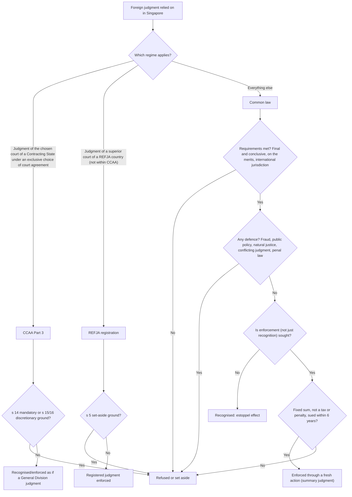

# LAW302 Commercial Conflict of Laws: Week 13

## Foreign Judgments (Part II): Defences, Anti-Enforcement Injunctions and the Choice of Court Agreements Act 2016

### Learning Journey + MCQ Bank (every option has a right/wrong explanation)

> **Built from:** Week 13 handout (AY2026-27), FJ Part 2 slides (Dr Adeline Chong), Chong & Yip Ch 5 (B.4.f, E, G), and every case and statute on the Week 13 reading list. Week 12 materials are used only for the prerequisite recap in Stage 0.
>
> **Abbreviations:** C&Y = Chong & Yip, *Singapore Private International Law: Commercial Issues and Practice*; CCAA = Choice of Court Agreements Act 2016; REFJA = Reciprocal Enforcement of Foreign Judgments Act 1959; RECJA = Reciprocal Enforcement of Commonwealth Judgments Act (now repealed); CLA = Civil Law Act 1909; LA = Limitation Act 1959; AEI = anti-enforcement injunction; ASI = anti-suit injunction; PP = public policy; SG = Singapore. Paragraph pinpoints are in [square brackets].

---

---

## PART A: BUILD NOTES

This file uses the shared LAW302 content model, format 2 (lessons with the questions inside them). `tools/law302_import.py` turns it into the app's data.

- **Journey structure:** Stages (0 to 6) are made up of Modules. A stage with no modules is one lesson; a stage's introduction before its first module is an overview lesson; each module is a lesson.
- **Inside a lesson** (in this order, roughly):
  - `**Objective:**` and an optional `**Big idea:**`.
  - **Steps** (`##### Title`). Each step teaches one idea: a `> **ELI5:**` analogy, plain-English body paragraphs, a `**The law**` list with pinpoints, optional `> **Example:**`, `> **Why it matters:**` or `> **Exam tip:**` callouts, and a `**Check:**` line naming the question(s) answered at that point.
  - `**Key takeaways**`, `**Traps**`, and a final `**Practice:**` round. Practice questions are also answered on the lesson page.
  - Status badges at the end of a bullet: `[Open]` (amber: not settled in Singapore), `[Obiter]` and `[Academic view]` (grey: not binding), `[Missing reading]` (red: where the missing secondary readings would most likely add commentary).
- **Question bank structure:** Sets are made up of Questions. Each question has: ID, Set, Level, Tags; Prompt; Options A–D; Correct answer; Feedback for every option (✓ right / ✗ wrong); Hint; Source. Every question appears in exactly one Check or Practice line.
- **Levels:** L1 Foundations; L2 Rules & cases; L3 Apply; L4 Traps & critique.

---

## PART B: SOURCE COVERAGE CHECK

### B1. Week 13: complete (every required reading is in the project)

- CCAA ss 2(1), 13, 14, 15, 16, 19, 20, 21 ✓
- LA s 6(1)(a) and s 6(3) ✓
- *Merck Sharp & Dohme Corp v Merck KGaA* [2021] 1 SLR 1102 (CA) [36]–[38], [58]–[61] ✓
- *Ong Han Nam v Borneo Ventures Pte Ltd* [2021] 1 SLR 1248 (CA) [48]–[56] ✓
- *Ee Hoong Liang v Panirvelcan s/o Kaliannan* [2022] SGHC(A) 40 [10]–[19] ✓
- *Israel Discount Bank of New York v Hadjipateras* [1984] 1 WLR 137: the case itself is not in the project, but the handout says the video or textbook explanation is enough. It is covered by C&Y 5.83 and slide 4 ✓
- *Poh Soon Kiat v Desert Palace Inc* [2010] 1 SLR 1129 (CA) [36]–[54], [120]–[121] ✓
- *Venetian Macau v Hu* [2026] SGHC 180 [26]–[56], [59]–[60] ✓
- *Paulus Tannos v Heince Tombak Simanjuntak* [2020] 2 SLR 1061 (CA) ✓
- *Sang Cheol Woo v Spackman, Charles Choi* [2022] SGHC 298 [68]–[101] ✓
- *Alberto Justo Rodriguez Licea v Curacao Drydock Co, Inc* [2015] 4 SLR 172 [28]–[30] ✓
- *The Republic of the Philippines v Maler Foundation* [2014] 1 SLR 1389 [68] ✓
- *Sun Travels & Tours Pvt Ltd v Hilton International Manage (Maldives) Pvt Ltd* [2019] 1 SLR 732 (CA) [88]–[114] ✓
- C&Y Ch 5, Sections B.4.f (found inside the "A, B, D" file), E and G ✓
- FJ Part 2 slides ✓
- Optional readings not in the project (not needed): C&Y (2019) 15 JPIL 97 at 123–128; Yeo, "Foreign Judgments and Contracts: The Anti-Enforcement Injunction".

### B2. Week 12: not complete

- Two required secondary readings are missing: Yeo, "Common Law Developments Relating to Foreign Judgments" (9th YPH Lecture, 2016) and Yeo, "The Changing Global Landscape for Foreign Judgments" (YPH Lecture, 2021).
- The Week 12 cases, statutes, C&Y Ch 5 A/B/D and slides are all present. Stage 0 below relies on these. The companion Week 12 file covers that week in full, and marks where the two missing lectures would most likely add commentary.

### B3. Note on the handout

- The Week 13 seminar outline cites REFJA "s 5(3)(b)" for proceedings brought in breach of a dispute-resolution agreement. In the current Act (the version in the project) and on slide 6, the provision is **s 5(4)(b)**. This file uses s 5(4)(b).

### B4. Textbook enrichment (this edition)

- The lessons were expanded with in-scope material from **C&Y Ch 5**: Sections A (introduction, corrected as in B3), B.1–B.6 (the common law rules, defences, severance and estoppel), D (REFJA), E (CCAA Part 3) and G (anti-enforcement injunctions).
- Mentioned only, not tested: B.7 (judgments in rem beyond the in personam / in rem distinction), C (the repealed RECJA, where the cases still refer to it) and F (the Hague Judgments Convention 2019).
- Left out as outside the course: H (the Singapore Convention on Mediation).
- Where the textbook (2023) and the course materials differ, the lessons follow the handout, the slides and the later cases.

---

## PART C: LEARNING JOURNEY

### STAGE 0: Prerequisite recap (Week 12 in one page)

**Objective:** Know what must already be true before any "defence" becomes relevant.

**Big idea:** Check the requirements first and the defences second. A judgment that fails a requirement never needs a defence.

##### Requirements first, defences second

> **ELI5:** Imagine a friend won a prize from a school in another town and wants your school to honour it. Before anyone argues "they cheated", your school checks the basics: was that other school allowed to judge your friend at all, and is its decision finished, not a draft? Only after those boxes are ticked do complaints come in. So the order is always: requirements first, defences second.

This week is about the complaints, which lawyers call **defences**. They matter only once a judgment has passed the basic checks from Week 12. Here is that week in one page, told through Mei, who has won a judgment against Bob in Country X and wants a Singapore court to give it effect.

At common law the test has three limbs: two **requirements** about the judgment, then the absence of any **defence**. "Final and conclusive" means the court that gave the judgment treats it as settled and cannot reopen it. To **recognise** a judgment is to accept what it decided as binding; to **enforce** it is to make the debtor pay.

The **burden of proof** (the job of proving a point) follows the same split: Mei proves the requirements, Bob proves any defence. If Mei fails on a requirement, Bob never needs a defence.

**The law**
- **The regimes.** There are three today: the common law, REFJA (registration) and CCAA Part 3. RECJA has been repealed (FJ Part 1 slide 2; *Venetian Macau* [29]).
- **Common law recognition** (*Ong Han Nam* [48], citing *Humpuss*). The judgment must be:
  - (a) a final and conclusive judgment (on the merits),
  - (b) of a court with international jurisdiction under Singapore's private international law,
  - (c) with no defence available.
- **Reciprocity** (giving effect only to judgments of countries that would do the same for Singapore) as a requirement was left open in *Merck* [39] (C&Y 5.20). [Open]
- **Burden of proof:** the party relying on the judgment proves the requirements. The **judgment debtor** proves any defence (C&Y 5.65; in *Sang Cheol Woo* [69], counsel accepted this for natural justice).

**Check:** Q13-0.1, Q13-0.4

##### Was Country X's court entitled to judge Bob?

> **ELI5:** A club's referee can send off anyone playing on the club's pitch, and anyone who signed up to the club's rules. He cannot fine a passer-by who never came in. Country X's court is in the same position: Bob is bound if he was in X when the case was served on him, or if he accepted the court.

This requirement, **international jurisdiction**, is measured by **Singapore's** private international law (its rules for cases with a foreign element), not by Country X's own rules. For a judgment *in personam* (one that binds the parties, such as an order that Bob pay Mei), the grounds fall into two families: Bob was **there**, or Bob **accepted** the court, by conduct (such as defending the case on its merits) or by agreement.

**The law**
- **International jurisdiction** at common law is judged by Singapore's rules, not by the foreign court's own rules:
  - **Presence or residence.** Natural persons: presence. Corporations: the "fixed place of business" test in *Adams v Cape*.
    - Whether residence without presence is enough is unsettled (C&Y 5.36–5.37). [Open]
  - **Submission by conduct** (*WSG Nimbus*; contrast *Henry v Geoprosco*).
  - **Submission by agreement or consent**, which may be implied (*Vizcaya v Picard*).
    - Whether Singapore will accept an implied agreement remains to be seen (C&Y 5.58). [Open]
  - **Are the categories closed?** *Schibsby v Westenholz* treats them as closed. Contrast Canada's "real and substantial connection" test in *Beals v Saldanha*.

**Check:** Q13-0.3

##### Enforcing means suing on a debt

> **ELI5:** Mei's foreign judgment works like an IOU written abroad. Singapore's bailiffs will not act on a foreign IOU. Mei has to sue Bob on it here, and it is the Singapore judgment she obtains that the bailiffs then act on.

At common law, the foreign judgment is treated as creating a debt that Bob owes under Singapore law. Mei sues on that debt in a **new action**, and it is the Singapore judgment she obtains that is enforced. Strictly, then, "enforcing a foreign judgment" is a misnomer (C&Y 5.12). Because only a debt can be sued on this way, the judgment must be a **fresh money judgment for a fixed sum**.

The action is usually decided by **summary judgment**, a quick judgment without a full trial where the defendant has no real defence. This is where Week 13 comes in: Bob uses the defences to show he has one.

**The law**
- **Common law enforcement adds two things:**
  - the judgment must be a fresh money judgment for a fixed sum that is not a tax, fine or penalty (*Poh Soon Kiat* [25]–[34]; slides 5–6);
  - enforcement is a **new action** on the implied debt the judgment creates, usually decided by summary judgment (*Poh Soon Kiat* [41]–[42]).
- On summary judgment, the creditor must show that it should be granted. The debtor obtains leave to defend by showing a fair or reasonable chance of a real or bona fide defence (C&Y 5.13).

**Check:** Q13-0.2

##### Recognition: the judgment as a shield

> **ELI5:** A judgment can be a shield as well as a sword. Suppose Bob sued Mei in Country X and lost, and now sues her again in Singapore on the same claim. Mei does not want money. She holds up the X judgment and says: "This has already been decided."

Mei simply pleads the X judgment in her defence. Because nobody is suing on a debt, neither the money-judgment requirement nor the six-year limitation period applies. A recognised judgment is **res judicata** ("a matter already judged") and works through **estoppels**, rules that stop a party reopening what has been decided: on the same claim (cause of action estoppel) or on the same point (issue estoppel). Separately, the *Henderson v Henderson* doctrine of **abuse of process** stops a party raising points that could and should have been raised before.

The defences still apply. Limb (c) governs recognition as much as enforcement. *Ong Han Nam*, one of this week's fraud cases, was exactly that: a Malaysian judgment relied on as res judicata and met with an allegation of fraud (*Ong Han Nam* [48]).

**The law**
- **Effects of recognition:** cause of action estoppel, issue estoppel (with the *Merck* requirements), and *Henderson v Henderson* abuse of process.
- A non-money judgment can be recognised, for example to found an estoppel (C&Y 5.09, 5.20). Recognition needs no special procedure (C&Y 5.10) and is not time-barred (C&Y 5.98).

**Check:** Q13-0.5

**Key takeaways**
- Three regimes: the common law, REFJA and CCAA Part 3. The RECJA has been repealed.
- Common law: final and conclusive on the merits, international jurisdiction by Singapore's rules, and no defence. Enforcement adds a fixed-sum money judgment, sued on as a debt.
- The creditor proves the requirements; the debtor proves the defences, which apply to recognition too.

**Traps**
- The money-judgment requirement applies to *enforcement* only. A non-money judgment can still be *recognised*, for example to found an estoppel.
- International jurisdiction is judged by **Singapore's** rules, not by the foreign court's own rules.
- Lack of international jurisdiction is not a "defence" for Bob to prove. It is a requirement for the party relying on the judgment.

**Practice:** Q13-0.6

### STAGE 1: Map of the defences

**Objective:** Locate every defence before learning the detail of each.

**Big idea:** The enforcing court is **not an appeal court** for the foreign judgment. It will not re-examine the merits. The defences are narrow exceptions that protect three things: Singapore's procedural standards, Singapore's public policy, and Singapore's own judgments.

##### Not a second appeal

> **ELI5:** Singapore's court is like a referee shown a result from another stadium. It does not replay the match. It only checks a short list of serious problems. Was the result rigged (fraud)? Was one side never told the game was on (natural justice)? Would accepting it break one of our own deepest rules (public policy)? Do we already have our own result for the same match (conflicting judgments)? If none of these apply, the result stands.

The Singapore court does not review the **merits**: who was right on the facts and the law. If it did, every foreign judgment could be argued twice and litigation would never end. Two values sit behind this. **Comity** is the respect that courts of different countries owe one another's decisions; *Hong Pian Tee* warned against "judicial chauvinism", the assumption that the home court always knows better. **Finality** means a case fought and decided should stay decided (C&Y 5.66).

So every defence this week is a narrow exception. Each identifies something worse than a wrong answer: deception, a hearing Bob never fairly had, a result Singapore cannot accept on principle, or a clash with Singapore's own decisions.

**The law**
- **No review of the merits.** *Hong Pian Tee* [28], [31] (quoted in *Sang Cheol Woo* [94]); C&Y 5.66; for the CCAA, s 13(3)(a).
- "The enforcement forum is not an appellate tribunal vis-à-vis the foreign judgment" (*Hong Pian Tee* [28]; C&Y 5.73).

**Check:** Q13-1.1

##### Nine headings, three things protected

> **ELI5:** The defences are the short list of objections a referee will actually listen to. "The other referee made a bad call" is not on the list. "The other team bribed the referee" is.

Most defences protect one of the three things in the big idea. Natural justice protects Singapore's **procedural standards**: Bob must have been told of the case and given a chance to argue it. Public policy protects Singapore's **public policy**. The rule against enforcing foreign penal, revenue and other public laws is a close relative: Singapore will not act as another State's enforcer (Module 2.7). The conflicting-judgments rule protects Singapore's **own judgments**. Fraud is special: the foreign court was misled rather than mistaken (Module 2.2). Satisfaction and limitation are practical: nothing is left to enforce, or Mei waited too long.

Two headings are not established defences. Mistake is not a defence at all, subject to an open question about errors of Singapore law. Breach of an agreement to resolve disputes elsewhere is undecided at common law.

**The law**
- **The common law defences** (C&Y 5.65–5.102; slides 2–7):
  1. Mistake: **not** a defence (but see the open question about errors of Singapore law).
  2. Fraud: the distinction between extrinsic and intrinsic fraud.
  3. Public policy.
  4. Natural justice.
  5. Res judicata and conflicting judgments.
  6. Breach of an agreement to settle disputes elsewhere: **open** at common law. [Open]
  7. Foreign penal, revenue and other public laws.
  8. Satisfaction (the judgment has been paid).
  9. Limitation (affects enforcement only).

**Check:** Q13-1.6

##### Developing in step with the statutes

> **ELI5:** Singapore's common law and its two statutes are three rulebooks for the same game. The Court of Appeal wants the common law rulebook to stay broadly in line with the other two, especially the one that many countries signed up to.

In *Merck*, the Court of Appeal said the common law defences should develop broadly consistently with REFJA and the CCAA, especially the CCAA. The CCAA enacts the Hague Convention on Choice of Court Agreements, so it reflects a transnational consensus. Notice the word "broadly": this is a direction of travel, not a wholesale copy. It is a leading argument wherever the common law is still open, such as proceedings brought in breach of a jurisdiction agreement (Module 2.6).

**The law**
- **Convergence.** *Merck* [37]: common law defences should develop "broadly" consistently with the CCAA and REFJA, especially the CCAA, which reflects a transnational consensus.
- The common law "should … generally be developed in a manner that is compatible and consistent with legislation which covers a broadly similar area" (*Merck* [37], quoted in C&Y 5.65).

**Check:** Q13-1.2

##### Three doors, and two tools that are not defences

> **ELI5:** There are three doors into the same room, and each door has its own checklist. Which door Mei uses decides which complaints Bob can raise.

Before asking "which defence?", ask "which regime?". The CCAA comes first: it covers judgments of the **chosen court** of a Contracting State under an exclusive choice of court agreement (an agreement that only that court will hear the dispute). REFJA comes next, for judgments from countries gazetted under the Act. Everything else goes to the common law. The lists differ. Under REFJA, Bob applies to set aside the registration on the grounds in s 5. Under the CCAA, the grounds are an **exhaustive** list, such as recognition being "manifestly" incompatible with Singapore public policy (s 14(c)). Only at common law does Stage 2's list apply in full.

Two tools are easily mistaken for defences. **Severance** lets the court cut out an objectionable part of a judgment, such as a penalty, and give effect to the rest. An **anti-enforcement injunction** (AEI) is an order addressed to Mei personally, forbidding her from enforcing the judgment abroad as well, in named countries or even worldwide. A defence stops the judgment working only in Singapore; an AEI reaches much further, which is why it is kept for exceptional cases (Stage 3).

**Analysis flowchart**

**The law**
- **Related tools:**
  - **Severance** lets the court enforce the unobjectionable part of a judgment.
  - An **anti-enforcement injunction** is a remedy, not a defence. It restrains the creditor from enforcing abroad, in named countries or worldwide (C&Y 5.207).
- **The CCAA's grounds** for refusal (ss 14–16) are exhaustive (C&Y 5.186).
- **Relationship between the regimes.** REFJA bars a common law enforcement action for judgments within its scope, and the CCAA prevails over REFJA. But the CCAA does **not** bar the common law route, unless pursuing it would be an abuse of process (C&Y 5.173, 5.200–5.201).

**Check:** Q13-1.7

**Key takeaways**
- The Singapore court does not re-examine the merits; the defences are narrow exceptions.
- Nine common law headings, of which mistake and breach of a dispute-resolution agreement are not established defences.
- *Merck* [37]: the common law should develop broadly in line with REFJA and especially the CCAA.
- Identify the regime first. Severance and AEIs are tools, not defences.

**Traps**
- An AEI is not a defence. It is an injunction against the creditor personally (Stage 3).
- Under the CCAA, the grounds for refusal are an **exhaustive** list (C&Y 5.186). You cannot add common law defences to it.

**Practice:** Q13-1.8

### STAGE 2: Common law defences

#### Module 2.1: Mistake and errors of Singapore law

**Objective:** Explain why a foreign court's mistake is not a defence, and state accurately what *Merck* left open.

**Big idea:** Finality matters more than correctness. Two competent courts can reach different answers, and the enforcing court does not decide which one is "right".

##### Being wrong is not a defence

> **ELI5:** If a teacher at another school marks a right answer as wrong, your school will not re-mark the test. Otherwise every test could be re-marked forever. Being wrong is not enough.

Suppose the Country X court misread a contract, believed the wrong witness or misunderstood its own law. Bob may well be right that the judgment is wrong. In Singapore, that does not matter: a mistake of fact or law by the foreign court is irrelevant (*Godard v Gray*; *Ralli v Anguilla*).

The reason is the rule from Stage 1: the Singapore court does not review the merits. If the loser could reopen every foreign judgment by arguing that it was wrong, one of the main aims of recognising foreign judgments, the **finality** of litigation, would be lost (C&Y 5.66). Correcting the foreign court's errors is a job for Country X's own appeal courts, not for Singapore.

The traditional rule went further than you might expect. It applied even where the mistake concerned the law of the **enforcing** court itself: for an English court asked to enforce a foreign judgment, a mistake about English law (C&Y 5.66). That is the part of the rule *Merck* has unsettled, at least for Singapore law.

**The law**
- **The general rule.** A mistake of fact or law by the foreign court is irrelevant (*Godard v Gray*; *Ralli v Anguilla*). Traditionally this held even where the mistake concerned the law of the enforcing court (C&Y 5.66; slide 2).
- **Why:** reviewing the merits would defeat the finality of litigation, one of the underlying objectives of recognising and enforcing foreign judgments (C&Y 5.66).

**Check:** Q13-1.9, Q13-1.3

##### *Merck*: a door left ajar for errors of Singapore law

> **ELI5:** Now the open question: what if the other teacher got *our* rulebook badly wrong? Our school is the keeper of its own rulebook, and letting a misreading stand could quietly change the rules. But re-marking other schools' tests is exactly what we said we would not do. The Court of Appeal saw both sides and did not choose.

*Merck* was an issue estoppel case: did a foreign court's decision on a particular point bind the parties in Singapore? While mapping the "outer limits" of that doctrine, the Court of Appeal made two sets of remarks that matter here.

First, at [58], it accepted that issue estoppel may be denied where giving effect to the foreign judgment would conflict with Singapore public policy. It said this could "conceivably" extend to judgments that are perverse, or that contain a sufficiently serious and material error, but it left that open.

Second, at [59]–[61], it asked whether a judgment resting on a wrong application of **Singapore** law deserves special treatment. Two values pull against each other. Comity says Singapore should not second-guess a foreign court. But the Singapore court is also the "guardian or custodian" of Singapore law, which suggests it should not condone patent errors about that law (C&Y 5.67). The court rejected both easy answers, that a foreign ruling on Singapore law can **never** found an estoppel and that it **always** can, and left the question for a future case.

**The law**
- ***Merck* [58]: public policy and issue estoppel.** Where a foreign judgment conflicts with Singapore public policy, issue estoppel may be denied. The court said this could "conceivably" extend to judgments that are perverse or contain a sufficiently serious and material error, but left that open. [Open]
- ***Merck* [59]–[61]: errors of Singapore law.** The court left open whether a judgment resting on an erroneous application of Singapore law deserves special treatment, whether framed as public policy or as a standalone limit on issue estoppel. [Open]
  - It rejected both extremes: (i) that a foreign ruling on Singapore law can **never** found an estoppel, and (ii) that it **always** can.
  - It described the balance as comity on one side, and the Singapore court's role as "guardian or custodian" of Singapore law on the other.

**Check:** Q13-1.10

##### Existent and retrospective errors

> **ELI5:** There are two kinds of wrong answer. In one, the other teacher ignored a rule printed clearly in our rulebook. In the other, our rulebook said nothing on the point, the teacher made a careful and sensible guess, and only later did we add a page saying something different. The first looks like carelessness. The second is bad luck.

*Merck* [61] floated a way of separating the cases that might matter from those that should not. An **existent error** is one where the foreign court clearly erred in applying Singapore law as it stood at the time. A **retrospective error** arises where a point of Singapore law was uncertain, with no clear Singapore decision, and the foreign court took a considered position (for example, after expert evidence on Singapore law) that a later Singapore decision contradicted. The foreign court was not wrong about the law as it then stood; it simply anticipated wrongly how that law would develop.

The court's language suggests that, if errors of Singapore law ever matter, existent errors are the candidates and retrospective errors should be left alone. But it did not decide even that. The test is about timing: ask what Singapore law was **when the foreign court decided**, not what it is today.

> **Example:** Mei relies on a Country X judgment to estop Bob on a point of Singapore contract law. When the X court decided, the point was unsettled; it weighed expert evidence and took a reasonable view. Two years later, Singapore's Court of Appeal goes the other way. That is a retrospective error, the kind least likely to stop the estoppel.

**The law**
- *Merck* [61] floated a distinction between two kinds of error:
  - **Existent errors:** the foreign court clearly erred on Singapore law as it stood at the time.
  - **Retrospective errors:** the foreign court took a defensible view of an unsettled point, which a later Singapore decision then contradicted.
- The court did not decide whether either kind justifies refusing recognition or an estoppel. [Open]

**Check:** Q13-1.4, Q13-1.5

##### What Chong & Yip suggest, and the *Arnold* question

> **ELI5:** Even if our school decides that misreadings of its own rulebook do matter, it should step in only for howlers, not close calls. Otherwise it would be back to re-marking everyone's tests.

Chong & Yip think a ground of refusal for errors of Singapore law could be justified: enforcing such a judgment could upset the coherence of Singapore law and sit uneasily with the court's role as its guardian. But they would limit it to **patent** errors, meaning obvious ones, not merely arguable ones. The public policy threshold should stay high, and a narrow ground avoids the impression of the Singapore court acting as an appeal court over the foreign one (C&Y 5.84). That is an academic view, though it matches the court's apparent preference.

The slides add a related question: is there an "*Arnold* exception" for foreign judgments? Domestically, that exception lets an issue estoppel be reopened in special circumstances. Whether and how it applies to foreign judgments was left open in *Merck*, as you saw in Week 12.

**The law**
- **Academic view (C&Y 5.84):** if this ground is ever accepted, it should be limited to **patent** errors, to keep the public policy threshold high. [Academic view]
  - The ground could be justified because enforcing such a judgment would upset the coherence of Singapore law and conflict with the court's role as guardian of Singapore law. [Academic view]
  - Limiting it to patent errors avoids the impression of the court acting as an appellate court vis-à-vis the foreign court (C&Y 5.84).
- **Slide 2 prompt ("Arnold exception?"):** a discussion point on whether something like the domestic special-circumstances exception to issue estoppel could apply to foreign judgments. *Merck* left it open (*Merck* [62]–[65]; C&Y 5.123). [Open]

**Check:** Q13-1.12

**Key takeaways**
- A foreign court's mistake of fact or law is not a defence (*Godard v Gray*; *Ralli v Anguilla*). The policy is finality.
- *Merck* [58]–[61] left open whether an error of **Singapore** law can defeat recognition or an issue estoppel, through public policy or as a standalone limit.
- It rejected both extremes and floated a distinction between existent and retrospective errors.
- Chong & Yip suggest that any such ground be limited to patent errors.

**Traps**
- Do not write "mistake is a defence".
- Do not write that *Merck* **decided** that an error of Singapore law defeats recognition. It left the point open.
- Do not call an error "existent" just because a later Singapore decision shows the foreign court was wrong. Ask what Singapore law was when the foreign court decided.

**Practice:** Q13-1.11

#### Module 2.2: Fraud

**Objective:** Classify alleged fraud as extrinsic or intrinsic, apply the correct test to each, and recognise when fraud cannot be raised at all.

**Big idea:** Fraud is an exception to the rule against reviewing the merits because the foreign court was **misled, not mistaken** (*Abouloff v Oppenheimer*, in C&Y 5.68). Singapore limits the exception for fraud that goes to the merits, out of comity.

##### Misled, not mistaken

> **ELI5:** Module 2.1 said Singapore will not re-mark another school's test. So why listen to "they cheated"? If a student smuggled in the answers, the teacher marked honestly but was fooled. Looking into that is not re-marking; it asks a question the teacher never had the chance to answer.

A fraud defence looks awkward next to the rule against reviewing the merits: to decide whether Mei deceived the Country X court, Singapore must look at evidence. The English Court of Appeal resolved this in *Abouloff v Oppenheimer*. Where the foreign decision was caused by fraud, the foreign court was **misled, not mistaken**, so the enforcing court is not reviewing anything the foreign court actually decided (C&Y 5.68).

English law takes that reasoning a long way: Bob needs no new evidence, and it does not matter that the foreign court rejected the allegation or that he never raised it there. Courts have voiced doubts, and the Privy Council has hinted at a more nuanced approach, but *Takhar*, a later UK Supreme Court decision on domestic judgments, may suggest that the rule is becoming further entrenched in English law (C&Y 5.68).

**The law**
- **The English *Abouloff* rule** (C&Y 5.68). Fraud can be raised at the enforcement stage:
  - without new evidence;
  - even if fraud was alleged before, and rejected by, the foreign court;
  - even if the debtor could have raised it abroad but did not.
- The Privy Council: "a nuanced approach might be required, depending on the reliability of the foreign legal system, the scope for challenge in the foreign court and the type of fraud alleged" (*Altimo Holdings v Kyrgyz Mobil Tel* [116]; C&Y 5.68).
- *Takhar v Gracefield Developments* (UKSC): a party setting aside a **domestic** judgment for fraud generally need not show that the fraud could not have been uncovered with reasonable diligence. This may further entrench *Abouloff* in English law (C&Y 5.68).

**Check:** Q13-2.1

##### Singapore's line: *Hong Pian Tee*

> **ELI5:** Singapore splits cheating into two kinds. Cheating *outside* the game (hiding the match invitation, bribing the referee) can simply be complained about. Cheating *inside* the game, a lie the other side argued against and the referee ruled on, will be re-examined only on brand-new proof that would probably have changed the result. England is more generous to the complaining side.

In *Hong Pian Tee* (2002), the Court of Appeal rejected the generous English approach and adopted the Canadian and Australian distinction between **extrinsic fraud** (outside the trial) and **intrinsic fraud** (within the trial, going to the merits). Its reasons were comity and finality: the enforcing court is not an appeal court, and *Abouloff* would invite endless litigation.

The result is a compromise: Singapore keeps the *Abouloff* approach for extrinsic fraud but adds a fresh-evidence hurdle for intrinsic fraud. English courts draw no such distinction.

**The law**
- **Singapore: *Hong Pian Tee* (CA, 2002)** adopted the Canadian and Australian distinction instead (C&Y 5.69–5.71).
- **Reasons:** *Abouloff* would encourage "endless litigation" (*Hong Pian Tee* [27]) and "judicial chauvinism"; "the enforcement forum is not an appellate tribunal vis-à-vis the foreign judgment" ([28]). "No one court should sit in judgment over the final decision of a competent court of another jurisdiction" ([31]) (C&Y 5.73–5.74).
- The Court of Appeal has since confirmed the *Hong Pian Tee* approach for foreign judgments (*Ong Han Nam*; C&Y 5.74).

**Check:** Q13-2.8

##### Extrinsic fraud: outside the trial

Extrinsic fraud happens **outside the trial**, or goes to the foreign court's jurisdiction. The common thread is that Bob was deprived of a fair contest, or the process was corrupted from outside, sometimes by the court itself (which overlaps with natural justice, Module 2.4).

Because Bob never had a fair chance to meet this kind of fraud in Country X, Singapore keeps the *Abouloff* approach: he can simply plead it, without fresh evidence.

> **Example:** Mei secretly pays Bob's own lawyer to abandon his defence, and the X court enters judgment against Bob. Bob never had a real contest. That is extrinsic fraud, and he can raise it in Singapore without any fresh-evidence hurdle.

**The law**
- **Extrinsic fraud** happens outside the trial, or goes to the court's jurisdiction (C&Y 5.69–5.70). Examples:
  - the defendant was never served;
  - the defendant was fraudulently persuaded to let judgment go by default (*Hong Pian Tee* [21]);
  - bribery of a solicitor, counsel or witness; collusion (*Ong Han Nam* [49]);
  - perjury during discovery, which the defendant had no chance to test (*Ong Han Nam* [49]; *Ee Hoong Liang* [16]);
  - fraud by the court itself (C&Y 5.69). This overlaps with natural justice: slide 5 links bias of the foreign court with fraud by the court.
- **The *Abouloff* approach still applies**, so extrinsic fraud can simply be pleaded (*Ong Han Nam* [49]; C&Y 5.71).

**Check:** Q13-2.3

##### Intrinsic fraud: the fresh-evidence test

> **ELI5:** If Bob already had his chance to call Mei's witness a liar in Country X, and the judge heard both sides and decided, Singapore will not run the argument again. It will listen only if Bob turns up something genuinely new: evidence he could not have found with reasonable effort, and strong enough that it would probably have changed the result.

In legal terms, *Hong Pian Tee* [30] allows a challenge for intrinsic fraud only on fresh evidence that meets two **cumulative** requirements. The first is about diligence: could Bob have found the evidence in time? The second is about materiality: would it have mattered? Materiality means the fraud must be shown to have **produced** the judgment (C&Y 5.71).

The test applies **even to default judgments**, where Bob took no part abroad and so never raised fraud there. Simply failing to defend bars a fraud argument at the enforcement stage, unless there is new evidence that reasonable diligence could not have found at the time (C&Y 5.72). Bob had his chance to contest the claim and chose not to take it.

> **Example:** After a full trial in Country X, at which Bob argued that Mei's key witness was lying, the judge believed the witness. In Singapore, Bob repeats the allegation on the same evidence. That is intrinsic fraud with no fresh evidence, so it fails.

**The law**
- **Intrinsic fraud** happens within the trial and goes to the merits. Example: false statements at trial, "met by counter-statements", that the other side contested and the court adjudicated on (*Hong Pian Tee* [20]; *Ong Han Nam* [49]).
- It can be raised **only if** there is fresh evidence that (i) reasonable diligence would not have uncovered **and** (ii) would likely have made a difference to the result (*Hong Pian Tee* [30]; *Ong Han Nam* [49], [55]). The two requirements are cumulative (C&Y 5.71).
- The intrinsic-fraud test applies **even to default judgments** (C&Y 5.72).

**Check:** Q13-2.2

##### Where the line falls: a chance to contest

> **ELI5:** The line is not "was there a full trial?" but "did Bob get a fair chance to argue the point?". A written test with a box for Bob's answer is still a contest, even if Bob leaves the box empty.

*Ee Hoong Liang* shows how the line is drawn. A US court entered judgment against Ee on a summary judgment motion. He asked for more time to respond but never filed anything. Resisting enforcement in Singapore, he said the creditors had hidden settlement payouts that should have reduced the award, and that this was extrinsic fraud because there had been no trial.

The Appellate Division disagreed. Domestic cases on setting aside judgments for fraud did not help him, because comity applies to foreign judgments. And the deciding question was whether he had an **opportunity to contest** the point. He could have contested the motion, so the alleged non-disclosure, which went to quantum (the amount awarded), was intrinsic fraud, and he had to meet the reasonable-diligence requirement.

Contrast *Boxsentry*, which the court distinguished. There the non-disclosure was made in an uncontested default-judgment application itself, not in a claim the debtor could have defended, so it was extrinsic (*Ee Hoong Liang* [17]). The question is whether the debtor could contest the point the fraud concerns, not whether there was a trial.

Singapore's line has its critics: it can be hard to draw, and it has been said to favour the fraudster over his careless opponent (C&Y 5.73).

**The law**
- ***Ee Hoong Liang* [10]–[19]:**
  - Domestic setting-aside cases (*Façade*; *Takhar*) are irrelevant to foreign judgments, because comity and "not an appellate tribunal" considerations apply ([11]–[13]).
  - The deciding question is whether the debtor had an **opportunity to contest** the point. A summary judgment motion that the debtor could have contested counts as a contest. So hidden settlement payouts that went to quantum were **intrinsic** fraud ([16]–[18]), and the reasonable-diligence requirement applied ([19]).
  - Contrast *Boxsentry*: non-disclosure in an **uncontested default-judgment application** was treated as extrinsic fraud ([17]).
- **Critique** (C&Y 5.73):
  - *Hong Pian Tee* "takes the side of the fraudster against his negligent opponent" (Briggs). [Academic view]
  - The line between extrinsic and intrinsic fraud is hard to draw.
  - The Supreme Court of Canada has advocated discontinuing the distinction.

**Check:** Q13-2.4

##### The fraud must have produced the judgment

> **ELI5:** Suppose the winning team did cheat, by faking one throw-in, but won 10–0 with goals that had nothing to do with it. The cheating was real, but it did not produce the result.

Whatever its type, the fraud must have **caused** the judgment. That holds even for extrinsic fraud, where no fresh evidence is needed.

*Ong Han Nam* is the leading illustration. The Singapore High Court refused to recognise a Malaysian judgment after listing facts that the winning party had not disclosed to the Malaysian court. The Court of Appeal reversed. The Malaysian court had appreciated the key facts, so the alleged fraud had not produced its judgment. The Singapore judge had simply taken a different view of those facts, which is "a difference of opinion", not fraud.

There is also a threshold for getting started. Bob cannot just assert fraud; he needs plausible evidence disclosing a **prima facie** case, meaning enough, on its face, to call for an answer.

**The law**
- **Causation.** The fraud must have **produced** the judgment (*Ong Han Nam* [50]; slide 3). A Singapore judge simply taking a different view of the evidence is not fraud (*Ong Han Nam* [51]). On intrinsic fraud, the evidence in *Ong Han Nam* was discoverable and immaterial ([55]).
- **Threshold.** There must be plausible evidence disclosing a prima facie case of fraud (*Owens Bank v Bracco*; slide 3). The judgment debtor bears the burden of proving the defence (C&Y 5.65).

**Check:** Q13-2.14, Q13-2.5

##### When fraud cannot be raised at all

> **ELI5:** For cheating outside the game, Bob may normally repeat his complaint in Singapore even if the foreign referee brushed it aside during the match. But suppose that after the match he took a separate complaint about the cheating to the home league's own tribunal, had a hearing and lost. Then he has had his day on that very question, and he cannot bring the same complaint again in Singapore.

Singapore will not entertain an allegation of fraud at all where pleading it is an **abuse of process** (a misuse of the court's procedure), or where an **issue estoppel on fraud** has arisen.

The second comes from *House of Spring Gardens v Waite*. An Irish court gave judgment against three defendants. Two of them brought a separate action in Ireland to set it aside for the plaintiffs' fraud, and lost. When the plaintiffs sought to enforce in England, the defendants raised the fraud again. *Abouloff* seemed to allow that, but the English Court of Appeal distinguished it: in none of the earlier cases had fraud been litigated in a **separate, second action** in the court of origin. All three defendants were estopped, the third as a privy (someone so closely connected with a party that he is bound too) (C&Y 5.75).

In Singapore, such an estoppel would realistically arise only for **extrinsic** fraud, because intrinsic fraud already needs fresh evidence before it can be raised at all (C&Y 5.75).

**The law**
- **When fraud cannot be raised at all** (C&Y 5.75):
  - **Abuse of process.**
  - **Issue estoppel on fraud** (*House of Spring Gardens v Waite*). The fraud had already been litigated, and rejected, in a **separate second action** in the court of origin. The third defendant was bound as a privy. In Singapore this will realistically arise only for extrinsic fraud (C&Y 5.75).

**Check:** Q13-2.6

##### Fraud under REFJA and the CCAA

> **ELI5:** The two statutes have their own checklists. REFJA's just says "fraud", leaving it unclear whether Singapore's two-kinds-of-cheating line applies. The CCAA's mandatory fraud ground covers only cheating with the process itself, roughly the outside-the-game kind.

Under REFJA, registration **must** be set aside if the judgment was obtained by fraud, but because the Act says only "fraud", it is unclear whether the common law split applies. Chong & Yip note a twist: *Merck* described the common law taking its cue from the statutes, so reading REFJA in line with *Hong Pian Tee* would run the other way, but would still serve the aim of convergence.

Under the CCAA, the mandatory fraud ground covers only fraud "in connection with a matter of procedure": deliberately serving at the wrong address, giving the defendant false hearing details, bribing a judge, juror or witness, or deliberately concealing key evidence. That roughly equals extrinsic fraud. Fraud on the substance (intrinsic fraud, in common law terms) could potentially be argued under s 14(c), public policy, where recognition must be "manifestly" incompatible with it, a deliberately high bar (C&Y 5.191).

**The law**
- **Statutory regimes:**
  - **REFJA s 5(1)(a)(iv)** says only "obtained by fraud". It is unclear whether the extrinsic/intrinsic distinction applies (C&Y 5.168). [Open]
    - Adopting the common law approach under REFJA would reverse the direction described in *Merck* [37], but would be in line with its desire for convergence (C&Y 5.168). [Academic view]
  - **CCAA s 14(b)** covers only "fraud in connection with a matter of procedure", which is roughly extrinsic fraud (C&Y 5.190). Substantive fraud might be argued under s 14(c), public policy (C&Y 5.190–5.191).

**Check:** Q13-2.13

**Key takeaways**
- Fraud is allowed despite the no-review rule because the foreign court was misled, not mistaken.
- Extrinsic fraud can simply be pleaded. Intrinsic fraud needs fresh, undiscoverable and material evidence (*Hong Pian Tee* [30]), even against a default judgment.
- The dividing line is the opportunity to contest (*Ee Hoong Liang*), and any fraud must have produced the judgment (*Ong Han Nam* [50]).
- Abuse of process and issue estoppel (*House of Spring Gardens*) can bar fraud altogether.

**Traps**
- Do not apply *Abouloff* to intrinsic fraud in Singapore.
- Do not treat "there was no full trial" as automatically meaning extrinsic fraud. The question is whether there was an opportunity to contest (*Ee Hoong Liang*).
- Do not drop causation for extrinsic fraud. No fresh evidence is needed, but the fraud must still have produced the judgment.
- Do not say CCAA s 14(b) covers all fraud. It covers procedural fraud only.

**Practice:** Q13-2.7, Q13-2.9 to Q13-2.12

---

#### Module 2.3: Public policy

**Objective:** Apply the higher threshold of public policy, identify what must offend it, and trace the gambling cases in order from *Star City* to *Venetian Macau* (2026).

**Big idea:** Only Singapore's most fundamental public policy can block a foreign judgment: statutory policy, which *Poh Soon Kiat* puts at the top, or the common law's **"higher" (international)** policy, never mere domestic policy. At common law and under the REFJA, what must offend is the **effect of enforcing the judgment** here, not the underlying claim as such.

##### A narrow door: the higher threshold

> **ELI5:** Every household has everyday rules (shoes off at the door) and a few deep ones (no violence, ever). A guest who keeps their shoes on is just different, and nobody throws them out. A guest who breaks a deep rule is shown the door. Singapore treats foreign judgments the same way: different is fine, deeply offensive is not.

**Public policy** is the set of values a legal system treats as fundamental. As a defence, it lets Singapore refuse to give effect to a foreign judgment that would offend those values. But almost every foreign judgment applies some rule that Singapore law does not share. If "different from our law" were enough, the defence would swallow the rule against reviewing the merits, and **comity** (the respect courts of different countries show each other's decisions) would mean little.

So the bar is high: a narrower, "higher" standard applies than in a domestic case, measured by Singapore's values, not the foreign country's. The indicators below describe something that shocks, not something that merely surprises, and in practice the defence rarely succeeds.

**The law**
- A **narrower, "higher" standard** of public policy applies than in a domestic case (C&Y 5.80).
- The relevant public policy is that of the **enforcing forum**. A difference between foreign and Singapore public policy is not itself a breach (C&Y 5.82).
- **Indicators that public policy is engaged** (*Poh Soon Kiat* [89], [111], applied in *Sang Cheol Woo* [97]). Enforcement would:
  - offend a fundamental principle of justice or a deep-rooted tradition;
  - offend the general community;
  - offend fundamental ideas of morality, decency, human liberty or justice; or
  - go against a rule whose purpose is to protect the public interest.
- **CCAA s 14(c)** requires that recognition be **manifestly** incompatible with Singapore public policy. "Manifestly" signals a high threshold, matching the common law, where the defence rarely succeeds (C&Y 5.191).

**Check:** Q13-3.1, Q13-3.9

##### Where public policy comes from: the *Poh Soon Kiat* hierarchy

> **ELI5:** Picture a stack of rulebooks. Parliament's written rules sit on top, because a statute overrides judge-made law. The judge-made book has two chapters: a short one of deep values that hold even across borders ("higher" or international policy), and a long one of everyday preferences that apply only at home (domestic policy).

Public policy can come from **statute** or from the **common law**, meaning judge-made law. *Poh Soon Kiat* ranked the sources: statute first, because statute takes precedence over the common law; then common law policy, split into "higher" international and domestic policy, of which only the higher kind counts against a foreign judgment. *Venetian Macau* [54] applied this hierarchy to the gambling statute you will meet below.

Chong & Yip accept the split within the common law, but find statute's place at the top potentially misleading, since a statute can express a merely domestic policy too (C&Y 5.81).

> **Why it matters:** The hierarchy decides the gambling cases. If statutory policy automatically outranks international policy, a Singapore statute barring the collection of gambling debts can block a foreign casino's judgment. On Chong & Yip's approach, you would first ask whether that statute's policy is of the "higher" kind and meant to reach the situation.

**The law**
- **The *Poh Soon Kiat* hierarchy** (C&Y 5.80; *Poh Soon Kiat* [112]–[113]):
  - common law public policy divides into "higher" international policy and domestic policy;
  - statutory public policy **prevails** over "higher" international policy (*Poh Soon Kiat* [113], said obiter, that is, in passing; applied in *Venetian Macau* [54]).
- **C&Y critique** (5.81): putting statute at the top is misleading. Only statutory policy of an equivalent "higher" level, and intended to reach the situation, should count. Whether a statute is meant to apply to foreign situations is a matter of statutory interpretation. [Academic view]

**Check:** Q13-3.3

##### What must offend: the judgment's effect, not the claim

> **ELI5:** Singapore usually asks: "What would *we* be doing if we made Bob pay on this judgment?" It does not usually ask: "Would we have allowed Mei's claim if she had started it here?" The next steps show where the second question creeps back in: egregious claims and gambling debts.

At common law, the question is whether the **effect of enforcing the foreign judgment** would offend Singapore's public policy. This keeps the enquiry on Singapore's own act of giving the judgment force, and stops it turning into a retrial of the claim.

The now-repealed RECJA (the old scheme for registering Commonwealth judgments) asked a different question. Its public policy ground looked at the **cause of action**, meaning the legal claim the foreign court decided. The REFJA follows the common law instead: its ground is about **enforcement of the judgment**. Keep this contrast in mind. It is the key to *Venetian Macau*.

**The law**
- **Common law:** the **effect of enforcing the judgment** must offend (C&Y 5.83; *Merck* [58], quoting the Hague report).
- **Former RECJA s 3(2)(f):** the test looked at the **cause of action** instead (*Venetian Macau* [29]; C&Y 5.83).
- **REFJA s 5(1)(a)(v):** registration shall be set aside if **enforcement of the judgment** would be contrary to Singapore public policy. In line with the common law, and in contrast with the RECJA, the defence operates against the foreign judgment (C&Y 5.169).
  - The reference ought to be to Singapore's **international** public policy, as at common law (C&Y 5.169). [Academic view]

**Check:** Q13-3.10

##### When the claim infects the judgment

> **ELI5:** Usually Singapore looks at the judgment, not the deal behind it. But some deals are so rotten that the smell carries into any judgment built on them. A contract signed at gunpoint is the classic example.

The "effect, not cause" rule has a limit. A cause of action can be so egregious that it **infects** the judgment based on it. Chong & Yip's example is a contract concluded under **extreme physical duress** (citing *Royal Boskalis*). The English Court of Appeal has also said it would go behind a foreign judgment enforcing a **drug trafficking** contract (*ED & F Man v Yani Haryanto (No 2)*) (C&Y 5.83). Enforcing such a judgment would make Singapore's courts an instrument of the wrong.

*Israel Discount Bank v Hadjipateras* went further. It suggested that a judgment based on an agreement obtained by **undue influence**, an equitable doctrine, may be refused. Chong & Yip's two criticisms, below, come straight from the two ideas you have just learned: what must offend, and at what level.

**The law**
- A **particularly egregious cause of action** can "infect" the judgment, e.g. an action on a contract concluded under extreme physical duress (C&Y 5.83).
- ***Israel Discount Bank*** (slide 4, quoting p 143): a judgment based on an agreement obtained by undue influence may be refused as contrary to "the distinctive public policy of this country".
  - **C&Y critique** (5.83): normally it is the judgment, not the cause of action, that must offend; and undue influence may engage only domestic public policy. [Academic view]

**Check:** Q13-3.2, Q13-3.7

##### Other examples, and how estoppel fits in

> **ELI5:** If Singapore's court has told Mei not to sue Bob abroad and she does it anyway, Singapore will not reward her by enforcing her win. And Bob cannot keep a point up his sleeve abroad, then pull it out for the first time in Singapore.

An **anti-suit injunction** (ASI) is a Singapore court order forbidding a party to bring or continue proceedings abroad. A foreign judgment obtained in breach of one is an established example of a judgment contrary to public policy: enforcing it would reward defiance of the Singapore court.

Public policy also meets **estoppel**, a rule that stops a party reopening a matter already decided. A foreign court's finding on **its own** public policy creates no estoppel on Singapore's, because public policy is unique to each State. But a fact that **should have been** raised abroad cannot be held back and raised for the first time here: the defence is not a second chance for a debtor who stayed silent.

**The law**
- **Breach of a Singapore ASI:** an established example (C&Y 5.85).
- **An error of Singapore law:** possibly; *Merck* [59]–[61] left the point open (Module 2.1). [Open]
  - If it is accepted, it should be limited to **patent** errors (C&Y 5.84). [Academic view]
- **Estoppel and public policy** (C&Y 5.82):
  - A foreign court's finding about **its own** public policy creates no estoppel on Singapore public policy (compare *India v DT* [86], quoted in *Gonzalo Gil White* [90], from Week 12).
  - But a fact that **should have been raised** abroad, and was not, cannot be raised at the enforcement stage.
- **Not contrary to public policy:** a 20% Korean statutory interest rate payable to the private creditor and aimed at deterring delay (*Sang Cheol Woo* [99]–[101]).

**Check:** Q13-3.8

##### The gambling cases (1): *Star City* and *Burswood*

> **ELI5:** Singapore's courts will not help anyone collect a gambling win. The puzzle is what happens when a foreign casino first wins a judgment abroad, then brings the judgment, not the bet, to Singapore. Four cases answer the puzzle in turn.

The starting point is s 5(2) of the Civil Law Act 1909 (CLA): "No action shall be brought or maintained in the court for recovering any sum of money or valuable thing alleged to be won upon any wager or which has been deposited in the hands of any person to abide the event on which any wager has been made" (C&Y 5.85). A **wager** is a bet. The section targets the **action** to recover the winnings.

In ***Star City***, a foreign casino sued in Singapore directly on the gambling debt, and s 5(2) barred the claim. ***Burswood*** moved from the bet to a **judgment**: a Western Australian judgment on a gambling debt, registered under the RECJA. The Court of Appeal classed s 5(2) as merely **domestic** policy, which cannot block a foreign judgment, so registration was allowed.

**The law**
- **CLA s 5(2)** bars any action to recover money won on a wager (C&Y 5.85).
- ***Star City*** (direct claim in Singapore): s 5(2) applies. The courts will not act as "gambling debt collectors for foreign casinos". The section stops enforcement but does not make the contract invalid (*Venetian Macau* [37]–[38]; C&Y 5.86).
- ***Burswood*** (registration under the RECJA): s 5(2) reflects only domestic public policy, so registration was allowed (*Venetian Macau* [39]–[40]; C&Y 5.86).
  - Later High Court cases under the RECJA still treated *Burswood* as binding (*Venetian Macau* [45]).

**Check:** Q13-3.11, Q13-3.12

##### The gambling cases (2): *Poh Soon Kiat*'s obiter

> **ELI5:** Sometimes a court decides a case on one simple point, then adds a long "and by the way" about something else. The "by the way" is worth hearing, but it does not bind later courts. *Poh Soon Kiat* is the gambling cases' big "by the way".

The **ratio** of a case is the reasoning necessary to its decision, and it binds later courts. **Obiter** remarks go beyond what was necessary; they can persuade but do not bind.

In *Poh Soon Kiat*, the claimant sued at common law on a Californian judgment based on a Nevadan gambling debt. The ratio was narrow: the Californian judgment was not a **fresh money judgment**. Everything the Court of Appeal said about gambling, listed below, was obiter, though emphatic.

Two remarks need unpacking. At [120], the court tentatively said that a judgment that would not have been registrable should also be unenforceable at common law. RECJA policy targeted the cause of action, while common law policy targets the judgment, so this implies that the gambling cause of action **infects** the judgment (C&Y 5.87). At [121], the court left open whether an action on the judgment could be **re-characterised** as a direct claim for the gambling debt. Traditionally, a foreign judgment creates a new and independent obligation to pay, so the common law action is on that obligation, not on the bet. If the court may look through it, s 5(2) clearly applies (C&Y 5.88).

**The law**
- ***Poh Soon Kiat*** (common law action on a Californian judgment):
  - **Ratio:** the Californian judgment was not a fresh money judgment (*Venetian Macau* [41]; C&Y 5.85).
  - **Obiter:** [Obiter]
    - *Burswood* is "unsound";
    - gambling in general, especially unregulated gambling and gambling on credit, is contrary to Singapore public policy, as the retention of s 5 of the CLA shows; the court pointed to the extensive regulation of legalised gambling and to surveys of public views ([97]; C&Y 5.86);
    - statutory public policy prevails over "higher" international policy [113];
    - tentatively, a judgment that would not have been registrable should also be unenforceable at common law [120], implying that the s 5(2) policy infects the judgment (C&Y 5.87);
    - possibly, the action could be **re-characterised** as a direct action to recover a gambling debt; left open [121] (C&Y 5.88). [Open]

**Check:** Q13-3.6

##### The gambling cases (3): *Venetian Macau* (2026)

> **ELI5:** The casino's argument ran: "Singapore bars suing on the *bet*, but we are only registering a *judgment*." The High Court's answer: a gambling debt dressed up as a judgment is still a gambling debt, and Singapore will not collect it.

In *Venetian Macau v Hu* [2026] SGHC 180, a casino operator registered a Hong Kong judgment for a gambling debt under the REFJA. The High Court held that enforcing it was contrary to Singapore public policy under REFJA s 5(1)(a)(v). *Burswood* was no obstacle: it concerned a provision that tested the cause of action and had a different legislative origin (the UK Acts of 1920 and 1933). And counsel could not explain why a direct claim on the debt should be barred but a judgment on the same debt enforced.

> **Exam tip:** Identify the regime first. Under the REFJA, apply *Venetian Macau*. For a common law action on a foreign gambling judgment, build on *Poh Soon Kiat*'s obiter at [120]–[121] and support it with *Venetian Macau*'s reasoning that s 5(2) draws no distinction between direct claims and judgments [59]. Rely on *Burswood* for neither.

**The law**
- ***Venetian Macau v Hu* [2026] SGHC 180** (REFJA registration of a Hong Kong judgment on a gambling debt):
  - *Burswood* is **not binding**, because its ratio concerned RECJA s 3(2)(f), a different provision from REFJA s 5(1)(a)(v), with a different legislative origin [27]–[33];
  - enforcing a foreign judgment founded on a gambling debt **is contrary to Singapore public policy**, which is embodied in CLA s 5(2) [56], applying the *Poh Soon Kiat* hierarchy [54];
  - s 5(2) makes no distinction between direct claims and the enforcement of foreign judgments [59];
  - registration counts as an "action": ROC 2021 defines "action" broadly, and REFJA registration is commenced by originating application [60].
- C&Y 5.86 predates this decision and treats *Burswood* as live. Follow *Venetian Macau*, which also confirms that the RECJA has been repealed [29].

**Check:** Q13-3.4, Q13-3.5

**Key takeaways**
- Merely domestic policy, or mere difference from Singapore law, is never enough; the policy must be of the "higher" kind or statutory.
- At common law and under the REFJA, the effect of enforcing the judgment must offend; the RECJA looked at the cause of action. A particularly egregious cause of action can infect the judgment.
- Statute sits at the top of the *Poh Soon Kiat* hierarchy, though Chong & Yip say only "higher" statutory policy should count.
- After *Venetian Macau*, enforcing a foreign gambling judgment under the REFJA is contrary to the public policy embodied in CLA s 5(2), and *Burswood* is not binding.

**Traps**
- Do not cite *Burswood* as settled law for a REFJA or common law case.
- Do not describe *Poh Soon Kiat*'s comments on gambling as its ratio. The ratio was that the Californian judgment was not a fresh money judgment.
- Do not apply domestic public policy as the test.
- Do not read "no estoppel on Singapore public policy" as permission to raise facts the debtor held back abroad.

**Practice:** Q13-3.13 to Q13-3.15

---

#### Module 2.4: Natural justice

**Objective:** Apply the two core limbs of the defence, know who decides whether it is made out, and handle the "substantial justice" argument.

**Big idea:** The defendant must have had **notice** of the proceedings and an **opportunity to present its case**. A defendant who knew and chose to stay away has no complaint.

##### The two limbs: notice and a chance to be heard

> **ELI5:** Fair play has two simple parts. You must be **told** the game is on, and you must get a **turn to speak**. If you were told and chose to stay home, you cannot later complain that you missed your turn.

**Natural justice** here means basic procedural fairness in the foreign proceedings. Traditionally it has two limbs: the foreign court must have given the defendant **notice** of the proceedings and, having done so, an **opportunity** to defend itself (C&Y 5.76, citing *Jacobson v Frachon*). Why does Singapore insist on this, when it otherwise refuses to look behind foreign judgments? Because a judgment against someone who was never heard is not really a decision between two sides, and enforcing it would put Singapore's authority behind a one-sided process.

The limbs protect the *chance* to be heard, not its use. A **default judgment** (one given because the defendant did not respond) is no breach if the documents were properly served: the defendant chose to let judgment go by default. And **due notice** means notice of the proceedings, not of the steps needed to defend them.

**The law**
- **The core test:** notice and an opportunity to substantially present one's case (*Tannos* [28], [42]; quoted in *Sang Cheol Woo* [70]).
- A default judgment given after proper service is **not** a breach (C&Y 5.76).
- **Due notice** means notice of the proceedings, not of the steps needed to defend them. A defendant who knew of the proceedings cannot rely on lack of due notice (*Sang Cheol Woo* [70], citing Cheshire).

**Check:** Q13-4.1

##### Whose standards, and when to wait

> **ELI5:** Singapore uses its own measuring stick for fairness. But if the other country's appeal court is already looking at the same complaint, Singapore may wait to see whether that court fixes the problem itself.

Whether there was a breach is for the Singapore court alone, by its own standards. Otherwise a foreign court could certify its own fairness. Comity points the other way on timing. If an appeal against the alleged breach is pending abroad, the foreign court may correct the violation itself, so Singapore should not rush in. In *Tannos*, the Court of Appeal first checked whether any recourse in Indonesia was actually being pursued, and found that none was.

**The law**
- Whether there was a breach is for the **Singapore court alone**, by its own standards. It is not bound by the foreign court's view (C&Y 5.77; *Tannos* [58]).
- If an appeal on the point is **pending** abroad, it may be premature for Singapore to decide (C&Y 5.77; *Tannos* holding (2), [30], [40]–[41]).

**Check:** Q13-4.2

##### *Tannos*: late participation does not cure missing notice

> **ELI5:** You are never told about the meeting where the key decision is made. You turn up to later meetings and protest, but by then the rules say that decision cannot be challenged. Turning up later did not give you a real say.

In *Paulus Tannos*, Indonesian guarantors missed the key **PKPU** hearing because they were never properly served. (PKPU is a debt restructuring process in which an order temporarily suspends the debtor's repayment obligations: C&Y 5.78.) Turning up later, and protesting throughout, did not help: by then Indonesian procedure no longer let them raise their objections. The opportunity to be heard must be real.

**The law**
- ***Tannos*** (majority: Menon CJ and Tay JA; Woo Bih Li J dissenting; C&Y 5.78):
  - **Facts:** Indonesian guarantors were not properly served with the PKPU (debt restructuring) application and missed the 9 January hearing.
  - **Holding:** their later attendance at creditors' meetings and the bankruptcy hearing, protesting about service throughout, did **not** cure the defect, because Indonesian procedure no longer let them raise their objections. The respondents could not prove valid service, and the majority declined to infer that the guarantors had actual knowledge. The Indonesian orders were **not recognised**.
  - **Dissent:** Woo Bih Li J would have inferred knowledge, because the guarantors signed powers of attorney on 11 January and their accounts of how they learned of the proceedings were inconsistent.

**Check:** Q13-4.3

##### *Sang Cheol Woo*: the defendant who chose to stay away

> **ELI5:** Bob gets the invitation to the match, reads it, decides the other side's case is silly, and stays home. He loses. That is not unfair. It was his choice.

*Sang Cheol Woo* is the mirror image of *Tannos*. Spackman was personally served with the Korean appeal documents and a notice of the hearing date, but stayed away because he thought the claim frivolous. He had notice and an opportunity to be heard, and "simply chose not to" attend. His complaint that nobody warned him Korea's "deemed confession" rule would be applied failed too: due notice concerns the proceedings, not the steps needed to defend them.

The case also shows what happens when a complaint about the merits is **repackaged** as natural justice: it runs straight into the rule that the enforcing court does not review the merits.

> **Example:** Mei sues Bob in Country X. Bob is served, receives the hearing date, and ignores both. Judgment goes against him. In Singapore he says he did not realise what he needed to file. That is a complaint about the steps to defend, not about notice of the proceedings, so it fails (*Sang Cheol Woo* [70]).

**The law**
- ***Sang Cheol Woo* [68]–[95]:**
  - Spackman was personally served and received notice of the hearing, but **chose** not to attend. There was no breach of natural justice [70]–[72].
  - Korean law did not require advance notice of the deemed confession rule [83].
  - Repackaging a merits complaint as "natural justice" runs into *Hong Pian Tee* [28], [31] (*Sang Cheol Woo* [94]).

**Check:** Q13-4.4

##### Beyond notice: "substantial justice" and foreign procedural slips

> **ELI5:** Some people say fair play means more than being told and being heard: the referee must also do the job properly. English courts accepted a version of this; Singapore has not. And a referee who slips up on his own league's rulebook has not, for that reason alone, played unfairly.

In *Adams v Cape*, a US judge did not objectively assess the plaintiffs' damages. He adopted counsel's proposal of an average award for all of them. The English Court of Appeal held that natural justice is not limited to notice and opportunity. It also covers a breach of English views of **"substantial justice"**, and these facts fell within it (C&Y 5.79). Two limits came with it. Mere procedural irregularity under the foreign court's own rules is not a defence. And where a defect could be corrected within the foreign system, the defendant is generally expected to seek recourse there first. (The *Adams* defendants had not, but that did not count against them, because they had no knowledge of any basis for seeking relief from the US court: C&Y 5.79.)

Singapore has not adopted the extension. *Tannos* left it open, and in *Sang Cheol Woo* no authority or principled basis was offered for it, and there was no breach on the facts anyway. A related point from the slides: **bias** of the foreign court overlaps with the idea of fraud by the court, which Module 2.2 treats as extrinsic fraud.

**The law**
- ***Adams v Cape***: natural justice also covers a breach of English views of "substantial justice" (C&Y 5.79). But:
  - mere procedural irregularity under the foreign court's own rules is not a defence (567G–568A);
  - the possibility of correcting the error **within the foreign system** must be considered (570C; *Sang Cheol Woo* [92]).
- **Singapore:** the "substantial justice" extension is **not established**. *Tannos* [29] left it open, and in *Sang Cheol Woo* no authority or principled basis was offered for it (C&Y 5.79; *Sang Cheol Woo* [73]–[95]). [Open]
- **Bias** of the foreign court overlaps with the idea of fraud by the court (slide 5).

**Check:** Q13-4.7, Q13-4.5

##### The statutory versions: REFJA and CCAA

> **ELI5:** The statutes add a rule about turning up. Under the REFJA, if Bob appeared in the foreign court at all, he cannot use the notice ground in Singapore. Under the CCAA, if Bob appeared, could have complained about late notice there, but argued the case instead, he cannot save the complaint for Singapore.

**REFJA s 5(1)(a)(iii)** applies where the debtor "did not (notwithstanding that process may have been duly served on him in accordance with the law of the country of the original court) receive notice of those proceedings in sufficient time to enable him to defend the proceedings and did not appear". So valid service under the foreign law is not the end of the matter: what counts is whether the debtor actually received notice in time. But the ground is narrower than the common law, because the debtor must also not have appeared (C&Y 5.167).

The **CCAA** is more forgiving. Appearing does not by itself defeat s 14(a). The ground is lost only if the law of the State of origin allowed notification to be challenged and the defendant appeared and presented its case without challenging it: it was expected to raise the point before the chosen court (C&Y 5.188–5.189). The discretionary service ground in s 15(1)(c) comes from a Hague provision written for States that treat service of a foreign writ on their territory as a sovereign act. Singapore does not, so it will rarely matter here (C&Y 5.194).

**The law**
- **REFJA s 5(1)(a)(iii)** is **narrower** than the common law: the debtor must not have received notice in time **and** must **not have appeared**. Registration shall then be set aside, even if process was duly served under the foreign law (C&Y 5.167).
- **CCAA s 14(a)** is a mandatory ground (no notification of the document instituting the proceedings, including the essential elements of the claim, in time to defend). It is lost if the law of the State of origin allowed a challenge to notification and the defendant appeared and presented its case without making that challenge (C&Y 5.188–5.189).
- **CCAA s 14(c)** includes proceedings incompatible with fundamental principles of procedural fairness, and overlaps with s 14(a) (C&Y 5.191).
- **CCAA s 15(1)(c)** (service incompatible with Singapore's fundamental principles on service) is discretionary and, for the sovereignty reason above, rarely relevant in Singapore (C&Y 5.194).

**Check:** Q13-4.8, Q13-4.6

**Key takeaways**
- Natural justice means notice of the proceedings and a real opportunity to present one's case.
- Singapore decides the question by its own standards, but may wait for a pending foreign appeal.
- A defendant who knew and stayed away (*Sang Cheol Woo*) has no complaint; one who never had a real chance (*Tannos*) does.
- "Substantial justice" is not established in Singapore, and mere foreign procedural irregularity is never enough.
- Under the REFJA, a debtor who appeared abroad cannot use the notice ground at all; under the CCAA, one who appeared and argued without challenging notification, where the law of origin allowed a challenge, loses s 14(a).

**Traps**
- "Default judgment" does not equal "breach of natural justice".
- "The foreign court broke its own procedural rules" does not equal "breach of natural justice".
- Valid service under the foreign law does not by itself defeat REFJA s 5(1)(a)(iii); actual notice in time is what counts.
- Do not present Woo Bih Li J's dissent in *Tannos* as the holding.

**Practice:** Q13-4.9, Q13-4.10

---

#### Module 2.5: Res judicata and conflicting judgments

**Objective:** Decide which judgment wins when judgments conflict, at common law and under the REFJA and the CCAA.

**Big idea:** At common law, between two foreign judgments the **first in time** wins, and against a **Singapore** judgment the foreign judgment loses, whenever it was given. The REFJA and the CCAA give the court a discretion instead.

##### Two foreign judgments: first in time wins

> **ELI5:** If two foreign courts give opposite answers to the same dispute, Singapore takes the one that came first. Otherwise the loser could keep trying new courts until one said yes, and nothing would ever be final.

**Res judicata** ("a matter already judged") is the principle that a final decision between the same parties should not be reopened. Its tools are **cause of action estoppel** (the same claim cannot be brought again), **issue estoppel** (an issue already decided cannot be re-argued) and the wider rule in *Henderson v Henderson* against abuse of process (C&Y 5.103). A conflict arises when two judgments, each capable of founding such an estoppel, point in opposite directions.

When both are foreign, Singapore recognises the earlier one. This promotes **finality** and discourages **satellite litigation**: fresh proceedings elsewhere aimed at undermining a judgment already given.

**The law**
- ***Merck* [36(a)]:** of two competing foreign judgments, the **first in time** is recognised. This promotes finality, discourages satellite litigation, and matches CCAA s 15(1)(e) and REFJA s 5(1)(b) (C&Y 5.94).
- Slide 6 also cites *First Global Funds v PT Bank JTrust* on conflicts between two foreign judgments (see C&Y 5.94).

**Check:** Q13-5.1

##### A Singapore judgment always wins

> **ELI5:** Singapore's own answer beats any foreign answer, whether ours came first or second. A legal system that enforced two opposite answers to the same question would contradict itself.

If the foreign judgment is inconsistent with a **Singapore** judgment, the foreign judgment is not recognised, whether the Singapore judgment came before or after it. The reasons differ with timing. Preferring an **earlier** Singapore judgment protects finality, the policy behind res judicata. That reason self-evidently cannot explain preferring a **later** one. Two other reasons do: the party relying on the foreign judgment should have raised it in the Singapore proceedings, and preferring the local judgment keeps Singapore's legal system internally coherent (C&Y 5.93).

> **Example:** Mei wins against Bob in Country X in 2024. Bob then sues Mei in Singapore on the same dispute. Mei never mentions the Country X judgment, and Bob wins in 2025. Mei cannot now ask Singapore to recognise her 2024 judgment. She should have raised it in the Singapore case.

**The law**
- ***Merck* [36(b)]:** an inconsistent **Singapore** judgment prevails, whether it came before or after the foreign one. This matches CCAA s 15(1)(d).
  - Why even a **later** Singapore judgment prevails: the party relying on the foreign judgment should have raised it in the Singapore proceedings, and preferring the local judgment keeps the legal system internally coherent (C&Y 5.93).

**Check:** Q13-5.8

##### A foreign judgment that arrives mid-race

> **ELI5:** Two races on the same course are running, one here and one abroad, and the foreign one finishes first. Should its result count? The Court of Appeal has not said.

Suppose Singapore proceedings are under way when a foreign court gives judgment on the same matter. The worry is **strategic, pre-emptive litigation**: a party races to a quick judgment abroad to head off the Singapore case. The Court of Appeal in *Merck* left the question open, but suggested that this worry could be handled by looking at all the circumstances. For comparison only, the Hague Judgments Convention 2019 (Art 7(2)) lets the court addressed postpone or refuse recognition where it was seised before the court of origin and the dispute is closely connected with its own country (C&Y 5.95).

**The law**
- ***Merck* [38]:** whether a foreign judgment handed down while Singapore proceedings on the same or substantially the same matter are **pending** will be recognised was left open. [Open]
  - Prof Yeo suggested it may still be recognised.
  - The worry about strategic, pre-emptive litigation can be handled by having regard to all the circumstances, such as undue haste or a deliberate attempt to pre-empt recognition.
- Compare Hague Judgments Convention Art 7(2) (C&Y 5.95).

**Check:** Q13-5.3

##### Cross-estoppel: a promise not to rely on the judgment

> **ELI5:** Bob wins abroad, then tells Mei: "Forget that judgment. Let's fight it out in Singapore." Mei takes him at his word. Bob cannot later wave the judgment at her.

A foreign judgment can be met by an estoppel of a different kind. An **estoppel by representation** holds a party to what it represented. So a party who has represented that it would not rely on a foreign judgment may be prevented from raising res judicata at all. This meeting of an estoppel arising from a judgment (estoppel per rem judicatam) with an estoppel by representation is called **cross-estoppel**.

**The law**
- **Cross-estoppel:** an estoppel by representation can prevent a party from relying on a foreign judgment, for example where it represented that it would not rely on it (*Merck* [36]; C&Y 5.103).

**Check:** Q13-5.6

##### The statutes: a discretion, not a fixed rule

> **ELI5:** The statutes write down versions of the same "who wins" rules, but they let the judge choose rather than dictating the answer.

Both statutes give the court a discretion where the common law gives a fixed answer, and the REFJA's ground is narrower: it catches only a judgment given **before** the foreign judgment. Under the REFJA, an **earlier** final and conclusive judgment on the same matter, whether from Singapore or abroad, lets the court set aside registration of the later foreign judgment. Contrast grounds such as fraud and public policy, where registration "shall" be set aside (C&Y 5.168–5.169). Under the CCAA, a Singapore judgment gets more protection than another foreign one: it need not be earlier or on the same cause of action.

How could a Singapore judgment and a chosen court's judgment collide? The Hague Choice of Court Convention lets a non-chosen court hear a case on certain grounds, so parallel proceedings are possible (C&Y 5.196). Suppose the Singapore court takes jurisdiction because it finds the agreement for Country X's courts null and void under Country X law. If the chosen Country X court later gives an inconsistent judgment, Singapore may refuse it under s 15(1)(d), even if the Country X court held the agreement valid.

**The law**
- **REFJA s 5(1)(b):** a **discretion** to set aside registration where the matter in dispute had, before the date of the foreign judgment, been the subject of a final and conclusive judgment by a court having jurisdiction in the matter. It covers an earlier Singapore judgment or an earlier foreign judgment (C&Y 5.170).
- **CCAA s 15(1)(d):** an inconsistent Singapore judgment between the same parties; timing and cause of action are irrelevant (C&Y 5.195).
- **CCAA s 15(1)(e):** an inconsistent foreign judgment that is earlier, between the same parties, on the same cause of action, and recognisable in Singapore (C&Y 5.195).
- Under s 15(1)(d), it is immaterial that the chosen court held the choice of court agreement valid (C&Y 5.196).

**Check:** Q13-5.7

**Key takeaways**
- Two foreign judgments: the earlier one wins (*Merck* [36(a)]).
- A Singapore judgment beats an inconsistent foreign judgment, whatever the timing (*Merck* [36(b)]).
- A foreign judgment given while Singapore proceedings are pending is an open question (*Merck* [38]).
- A party's own representation can stop it relying on a foreign judgment (cross-estoppel).
- REFJA s 5(1)(b) and CCAA s 15(1)(d)–(e) give the court a discretion rather than a fixed rule.

**Traps**
- "First in time" decides between two **foreign** judgments, not between a foreign judgment and a Singapore one.
- Finality explains preferring an earlier Singapore judgment, but not a later one.
- Under the CCAA, the conflicting-judgment grounds are discretionary ("may"), unlike the common law rule in *Merck* [36(b)].

**Practice:** Q13-5.2, Q13-5.9

---

#### Module 2.6: Proceedings brought in breach of a dispute-resolution agreement

**Objective:** Explain why the common law position is open, how REFJA deals with the issue, and where the CCAA and anti-enforcement injunctions fit.

**Big idea:** Under REFJA, a foreign court that heard a case in breach of an agreement to resolve the dispute elsewhere is treated as having no jurisdiction, unless the debtor chose to submit to it. At common law, no court has yet decided whether the breach is a defence.

##### A broken promise about where to sue

> **ELI5:** Two flatmates agree that if they ever argue about the rent, their landlord will decide, and nobody else. When an argument comes, one of them asks a different person instead, gets a ruling in her favour, and waves it at the other. Should everyone treat that ruling as final, even though she broke the promise to go to the landlord?

A **dispute-resolution agreement** is a contract term about where disputes will be decided. The two common forms are an **exclusive jurisdiction clause** (the parties choose one country's courts, and only those) and an **arbitration agreement** (they choose private arbitrators instead of any court). Suppose Mei and Bob agreed that the Singapore courts would hear all their disputes, but Mei sues Bob in Country X, wins, and asks Singapore to enforce X's judgment.

Two values pull against each other. **Comity** (the respect that courts of different countries show each other's decisions) and finality point towards giving X's judgment effect. **Party autonomy** (the idea that commercial parties may choose their forum and should be held to that choice) points towards refusing it.

In legal terms, the common law has no answer yet: no Singapore court has considered the point (C&Y 5.96). The course slides call it "unclear", but direct you to *Merck* [37], where the Court of Appeal said the common law defences should develop broadly in step with the CCAA and REFJA.

Keep the order of analysis in mind. A defence matters only once the requirements are met. If Bob was never in X, never took part in the case and never agreed to X's courts, X's court lacked **international jurisdiction** (jurisdiction that Singapore's own rules accept, such as presence or submission), and the judgment fails before any defence is needed. The breach question bites when X's court otherwise had jurisdiction, for example because Bob was served while visiting X.

**The law**
- **Common law:** there has been no judicial consideration of whether a foreign judgment procured in breach of an agreement to settle the dispute elsewhere can be refused for that breach (C&Y 5.96). Slide 6 calls it "unclear", but note *Merck* [37] on convergence. [Open]
- Requirements come before defences. If the foreign court lacked international jurisdiction, the judgment fails on that ground and the breach point never arises (Stage 0).

**Check:** Q13-5.4

##### Four arguments for a defence

> **ELI5:** Picture Bob paying Mei $100 because of X's ruling, and Mei then paying Bob $100 in damages for breaking her promise about where to sue. The money goes out and comes straight back. It would be simpler to say at the start: "You broke the promise, so you cannot collect."

Chong & Yip put forward three reasons why the common law should accept a defence (C&Y 5.96). The course splits the second into two, giving four arguments. They are arguments about how the law should develop, not current law, but they are what you would use in an exam answer.

The first is the circularity the ELI5 describes. In Week 9 you saw that a party who sues in breach of an exclusive jurisdiction clause can be made to pay damages for the breach (*Tradewaves*; *Starlight*). So if there is no defence, Singapore enforces X's judgment for Mei, and Bob then sues Mei in Singapore for damages for breaking the clause. Depending on how the damages are calculated, they could cancel out the judgment sum. A defence would avoid enforcing a judgment only to unwind it.

The second and third arguments (C&Y's second reason) are about consistency. REFJA already deems the foreign court to lack jurisdiction in this situation (s 5(4)(b), next step). A common law defence would bring the two regimes into line, which is what *Merck* [37] asked for. The fourth argument (C&Y's third reason) is the Hague Convention on Choice of Court Agreements (HCCCA), which Singapore has enacted through the CCAA. The Convention does not forbid a country from recognising a judgment of a court that was not chosen, but refusing one would fit the Convention's underlying principle of respect for party autonomy.

**The law**
- **Arguments for a common law defence** (C&Y 5.96): [Academic view]
  - Damages for breach of a jurisdiction clause can be pursued in Singapore (see Week 9: *Tradewaves*; *Starlight*). Without a defence, the creditor enforces the judgment and the debtor then sues for damages, which may cancel the judgment sum. The result is circular.
  - **REFJA s 5(4)(b)** already deems the foreign court to lack jurisdiction in this situation.
  - *Merck* [37] calls for convergence between the common law and the statutes.
  - The HCCCA (implemented by the CCAA) reflects respect for party autonomy. It does not itself prohibit recognising a non-chosen court's judgment, but refusing to recognise one would align with that principle.

**Check:** Q13-5.10

##### REFJA: no deemed jurisdiction, unless the debtor submitted

> **ELI5:** REFJA works like a checklist. One box asks: "Did the foreign court have the right to hear this case?" A promise to take disputes elsewhere puts a cross in that box. But if Bob later walked onto X's pitch and played the match anyway, he cannot fall back on the promise.

Under REFJA, Mei **registers** the judgment (has it entered in the Singapore court's records so that it can be enforced like a local judgment), and Bob may apply to set the registration aside. One mandatory ground is that the foreign court had **no jurisdiction** (s 5(1)(a)(ii); C&Y 5.162). Section 5(3) lists when the foreign court is **deemed** (treated by law) to have had jurisdiction over Bob: voluntary appearance, being the claimant or counterclaiming, prior agreement to submit, residence (for a company, its principal place of business), or an office in X through which the transaction was done.

Section 5(4) cuts back those grounds in three situations: immovable property outside the foreign country (s 5(4)(a)), sovereign immunity (s 5(4)(c)) and, for us, s 5(4)(b). Under s 5(4)(b) the foreign court is **not** deemed to have had jurisdiction if bringing the proceedings there was contrary to an agreement to settle the dispute elsewhere (C&Y 5.166).

The exception: s 5(4)(b) does not apply where Bob **submitted** under s 5(3)(a)(i)–(iii), or where s 5(3)(c) applies (jurisdiction recognised by Singapore law, a ground C&Y call "rather obscure": C&Y 5.165). The submission grounds share one feature, Bob's own choice of X's court: he fought there, sued there, or agreed to it in advance. Residence or a place of business in X is not on the list, so a clause choosing Singapore still defeats jurisdiction that rests only on those links.

Appearing only to protect property seized or threatened with seizure, to contest the court's jurisdiction, or to invite the court not to exercise its jurisdiction, is **not** a voluntary appearance (s 5(3)(a)(i)(A)–(C); C&Y 5.162). So Bob can go to X to argue the clause without losing its protection.

**The law**
- **REFJA s 5(4)(b)** (C&Y 5.166): the foreign court is not deemed to have jurisdiction if bringing the proceedings there was contrary to an agreement under which the dispute was to be settled otherwise than by proceedings in that court. Registration must then be set aside (s 5(1)(a)(ii); C&Y 5.162).
  - **Exceptions:** the rule does not apply where the debtor **submitted** under s 5(3)(a)(i)–(iii) (voluntary appearance, being a claimant or counterclaimant, or prior agreement to submit), or where s 5(3)(c) applies.
  - Appearing only to protect seized property, to contest jurisdiction, or to invite the court to decline jurisdiction is not a voluntary appearance (s 5(3)(a)(i)(A)–(C); C&Y 5.162).
- The Week 13 seminar outline cites "s 5(3)(b)" for this rule. In the current Act, and on slide 6, the provision is **s 5(4)(b)**.

**Check:** Q13-5.11

##### The CCAA and AEIs: what the breach does not do

> **ELI5:** The CCAA is a fast lane reserved for the court the parties picked. A judgment from a court they did not pick cannot use the fast lane. It is not banned from Singapore, though: it can still join the ordinary queue, which is the common law.

CCAA Part 3 covers only judgments of the **chosen** court of a Hague Convention State, or of a court to which the chosen court transferred the case. A judgment that Mei obtains from a court the parties did not choose is outside Part 3. But the CCAA does not stop Singapore from recognising that judgment at common law, if it meets the common law requirements (C&Y 5.186; slide 10; s 21). So, unless the non-chosen court is in a REFJA country (where s 5(4)(b) applies), Mei's route is the common law, where Bob can run the open breach argument.

Bob may want more than a defence in Singapore. If Mei is enforcing in several countries, he might ask the Singapore court for an **anti-enforcement injunction** (AEI): an order forbidding Mei personally from enforcing the judgment. The Court of Appeal has made clear that breach of the clause **alone** does not justify an AEI (*Sun Travels* [98], [104]). Stage 3 explains why. Bob's other option is the claim for damages for breach of the clause.

**The law**
- **CCAA:** a judgment of a **non-chosen** court is outside Part 3. But the CCAA does **not prohibit** Singapore from recognising such a judgment at common law (C&Y 5.186; slide 10; s 21).
- **Contrast with AEIs:** breach of the clause **alone** does not justify an AEI (*Sun Travels* [98], [104]).

**Check:** Q13-5.13

**Key takeaways**
- At common law, whether breach of a dispute-resolution agreement is a defence is open (C&Y 5.96). The arguments for it (C&Y 5.96): circular damages, REFJA s 5(4)(b), *Merck* [37] convergence and party autonomy.
- Under REFJA s 5(4)(b), the foreign court is not deemed to have jurisdiction, so registration is set aside, unless the debtor submitted under s 5(3)(a)(i)–(iii) or s 5(3)(c) applies.
- A non-chosen court's judgment falls outside CCAA Part 3, but may still be recognised at common law.
- Breach of the clause alone does not justify an AEI.

**Traps**
- Do not call the breach a settled common law defence, or say it has been rejected. It is open.
- Do not forget the submission exception: a debtor who fought the case on the merits abroad loses the s 5(4)(b) protection. An appearance only to contest jurisdiction does not count as submission.
- Residence in the foreign country does not save the foreign court's jurisdiction under s 5(4)(b); only submission (or s 5(3)(c)) does.
- Do not cite "s 5(3)(b)" for this rule. In the current REFJA it is s 5(4)(b).
- Do not reach for the breach argument before checking international jurisdiction.

**Practice:** Q13-5.5, Q13-5.12, Q13-5.14

---

#### Module 2.7: Foreign penal, revenue and other public laws; severance

**Objective:** Identify a "penal" judgment, explain why sums owed to a private claimant are treated differently, and decide whether the objectionable part of a judgment can be cut out.

**Big idea:** Singapore will not help a foreign State enforce its penal, revenue or other public laws, even indirectly through a judgment. Money owed to a private claimant is generally different, and where only part of a judgment is objectionable, Singapore can cut that part off and give effect to the rest.

##### Singapore will not collect for a foreign State

> **ELI5:** If another country's tax office or police want money from Bob, they have to collect it at home. Singapore's courts will not act as their debt collector. Mei, a private person who won money from Bob in an ordinary lawsuit, is in a different position: Singapore may well help her.

Courts are used in two different ways. Sometimes a court decides a private dispute: Mei says Bob owes her money. Sometimes the State uses its courts to exercise governmental power: to punish (a **penal** law, such as a fine or forfeiture), to tax (a **revenue** law), or to vindicate some other **public law**. *Huntington v Attrill* drew the line between "a suit for penalty by a private individual in his own interest, and a suit brought by the government or people of a state for the vindication of public law" (C&Y 5.89).

In legal terms, Singapore will not enforce a foreign penal, revenue or other public law, **directly or indirectly** (*Maler* [68(a)]; C&Y 5.89). "Indirectly" is the key word here. A foreign State cannot get round the rule by obtaining a judgment at home and asking Singapore to enforce or recognise it. The question is whether giving effect to the judgment would involve **executing** the foreign penal law (*Maler* [68(d)]).

You met the same idea in Week 12's requirements. A foreign judgment can be enforced at common law only if it is for a fixed sum that is **not a tax, fine or other penalty** (C&Y 5.28). REFJA likewise excludes money judgments for taxes or similar charges, or for a fine or other penalty (C&Y 5.154).

**The law**
- ***Maler* [68(a)]:** Singapore will not enforce, directly or indirectly, a penal, revenue or public law of a foreign state (C&Y 5.89).
- ***Maler* [68(d)]:** the question is whether recognising the judgment would involve **executing** the penal law.
- **For enforcement:** the judgment must be for a sum that is not a tax, fine or other penalty (C&Y 5.28; Week 12). REFJA excludes money judgments for taxes or charges of a similar nature, or for a fine or other penalty (C&Y 5.154).

**Check:** Q13-6.7

##### Who decides what is "penal", and how

> **ELI5:** A parcel's label does not decide what is inside. Singapore opens the parcel and looks for itself. A foreign law may be called "civil", or may sit in a criminal code, but what matters is who is chasing the money and for whose benefit.

Whether a foreign law is penal is decided by the **lex fori**, the law of the forum, which here means Singapore law (*Maler* [68(b)]). Singapore does not simply adopt the foreign system's label. The broad test, taken from *Huntington v Attrill*, is whether the proceedings are in the nature of a suit **by the State for the recovery of penalties**.

So a law in a foreign criminal code is not necessarily penal (*Maler* [68(c)]), and a law applied in civil proceedings may still be penal, as *Maler* itself shows. Substance beats labels.

The English courts apply the test as a simple distinction (C&Y 5.89). If the sum, being one for the recovery of a penalty, is to be recovered at the instance of the foreign State, it is unenforceable. If it is recovered by a private litigant in its own interest, it is enforceable.

**The law**
- ***Maler* [68(b)]:** whether a law is "penal" is decided by the **lex fori**. The broad test is whether the proceedings are in the nature of a suit **by the State for the recovery of penalties** (*Huntington v Attrill*).
- ***Maler* [68(c)]:** being in the foreign criminal code is **not conclusive**.
- **The English distinction** (C&Y 5.89): a penalty recoverable at the instance of the foreign State is unenforceable; a sum recoverable by a private litigant in its own interest is enforceable.

**Check:** Q13-6.1

##### *Maler*: forfeiture to the State

> **ELI5:** Calling a confiscation a "civil claim" does not change what it is. If the government takes property from someone because the law presumes it was ill-gotten, that is the State punishing, whatever the court papers say.

*The Republic of the Philippines v Maler Foundation* is the leading Singapore example. The Supreme Court of the Philippines ordered that monies held in Switzerland be forfeited to the State, under a law on the forfeiture of property of public officials that is presumed to have been unlawfully acquired. The Republic asked the Singapore court to recognise that judgment.

The Philippine proceedings were civil in form, but that did not save them. The State pursued the proceedings, and the property was forfeited to the State. Recognising the judgment would therefore have amounted to indirectly enforcing a foreign penal law, and recognition was refused (*Maler* [68]–[69]; C&Y 5.92).

The decisive questions, as *Huntington* suggests, were who brought the proceedings and who benefited. Notice too that the rule is not limited to money judgments: it applies equally to non-money judgments, including judgments **in rem** (judgments deciding rights in property against the whole world, not only between the parties) (C&Y 5.92).

**The law**
- ***Maler* outcome:** a Philippine judgment forfeiting Swiss-held monies **to the State**, under a law on the forfeiture of public officials' property presumed to be unlawfully acquired, was refused recognition. It was civil in form, but the State pursued it and the State took the property (*Maler* [68]–[69]; C&Y 5.92).
- The exclusionary rule also covers non-money and in rem judgments (C&Y 5.92).

**Check:** Q13-6.2

##### Money for a private claimant: the interest in *Sang Cheol Woo*

> **ELI5:** A late-payment charge you pay to the shop you owe is not the same as a fine you pay to the government. The first goes to the person you kept waiting and nudges you to pay on time. The second punishes you on behalf of everyone.

*Sang Cheol Woo* sits on the private side of the line. Woo held a Korean judgment against Spackman carrying statutory interest at 20%. Spackman argued the rate was penal and contrary to Singapore public policy, relying on *Hong Leong Finance*, a Singapore case about a contractual default-interest rate.

The High Court enforced the judgment. The interest was payable to the private claimant, not to the State, and its purpose was to deter delay in paying. Citing *Lewis v Eliades*, the court said the penalty principle concerns sums payable **to the State** [100]. Nor was enforcing the rate contrary to public policy: applying the *Poh Soon Kiat* indicators of public policy [97], it did not offend fundamental principles of justice or the sentiment of the general community [99]–[101]. *Hong Leong Finance* was a contractual default-interest case decided on its own facts [99]. And there was no dispute about Korean law: both sides' experts agreed on how the rate applied.

**The law**
- ***Sang Cheol Woo* [96]–[101]:** 20% Korean statutory interest, payable to the private creditor and aimed at deterring delay, was neither penal nor contrary to public policy.
  - The penalty principle concerns sums payable **to the State** (*Lewis v Eliades*) [100].
  - Public policy was tested with the *Poh Soon Kiat* indicators [97]. *Hong Leong Finance* was distinguished as a contractual default-interest case decided on its own facts [99].

**Check:** Q13-6.4

##### Punitive damages for a private claimant: unsettled

> **ELI5:** Punitive damages are extra money, on top of the real loss, ordered to punish the defendant. When that punishment money goes to the private winner, is it an ordinary private debt or a public fine in disguise? Different countries answer differently, and Singapore has not settled it.

**Punitive** (or **exemplary**) **damages** go beyond compensation for the claimant's actual loss, to punish the defendant. They straddle the *Huntington* line: the purpose is punishment, but the money goes to a private party.

On the English (*Huntington*) distinction, they should be enforceable, because a private litigant recovers them in its own interest (C&Y 5.89). *Schnabel v Lui* is sometimes seen as the opposite of the English approach (C&Y 5.90). In that case the Supreme Court of New South Wales refused to enforce part of a Californian judgment that punished the defendant for failing to comply with the Californian court's orders, although it was payable to a private party. In *Benefit Strategies v Prider*, the South Australian Full Court said in obiter (in passing, not as part of its decision) that the *Schnabel* award had "an obvious 'public' connotation" because it punished disobedience of court orders; punitive damages for a defendant's brazen and fraudulent conduct had no public element and would not be caught (C&Y 5.90).

Singapore's position is **uncertain** (C&Y 5.91). The Court of Appeal has adopted the *Huntington* understanding (*Maler* [68]–[69]), so it seems fairly clear that non-compensatory damages awarded to a foreign State would not be enforced. But the High Court in *Rodriguez Licea* left open whether US RICO treble damages awarded to a private litigant offend the rule [29]–[30]. Two further points pull in opposite directions. Singapore courts can themselves award punitive damages, at least in tort (*ACB v Thomson Medical*), so refusing a foreign award looks anomalous. Yet the statutes now limit non-compensatory awards, and C&Y suggest the courts may take their cue from them.

Under REFJA (as amended), damages beyond compensation for the creditor's actual loss, including punitive damages, can be registered only for the compensatory amount, and the court must consider whether, and how far, the damages cover the costs and expenses of the foreign proceedings (s 4(5)–(6); C&Y 5.155). CCAA s 16 has the same costs point, framed as a discretion to refuse (C&Y 5.199).

**The law**
- **Punitive damages awarded to a private litigant** (C&Y 5.89–5.91):
  - The English (*Huntington*) distinction suggests these are enforceable.
  - *Schnabel v Lui* (NSW) refused a punitive component even though it was payable to a private party (C&Y 5.90).
  - *Benefit Strategies* treated that award as having a "public" element, because it punished non-compliance with the court's orders (C&Y 5.90). [Obiter]
  - The Singapore position is **uncertain**. The Court of Appeal adopted the *Huntington* understanding (*Maler* [68]–[69]), but the court left open whether RICO treble damages offend the rule (*Rodriguez Licea* [29]–[30]). [Open]
  - Punitive damages are available in Singapore for tortious claims at least (*ACB v Thomson Medical*), which makes refusing a foreign award look anomalous (C&Y 5.91). [Academic view]
  - The statutes point towards a limit: REFJA (as amended) caps registration at the compensatory amount (s 4(5)–(6); C&Y 5.155), and **CCAA s 16** gives a discretion (C&Y 5.199).
  - The courts may prefer to take their point of reference from the statutes (C&Y 5.91). [Academic view]
  - In *Sang Cheol Woo* [100], the penalty principle was said to concern sums payable **to the State** (citing *Lewis v Eliades*).

**Check:** Q13-6.8, Q13-6.9

##### Severance: cutting out the bad part

> **ELI5:** If one slice of a cake is burnt, you cut it off and serve the rest. You do not throw the whole cake away, as long as the burnt slice comes away cleanly. But if the burnt part runs right through the cake, slicing will not save it.

**Severance** means the court divides a judgment into its objectionable and unobjectionable parts and gives effect only to the latter, provided the parts can be identified and separated (C&Y 5.99). It usually arises with the penal-law rule. In *Rodriguez Licea* [28], the High Court severed the punitive damages in a US judgment and enforced the compensatory damages. A judgment has also been severed into its unambiguous and ambiguous parts (C&Y 5.99).

Is severance available **only** where the penal-law rule is engaged? In *Giant Light*, a Chinese judgment ordered the seller to refund the price and pay damages, and the buyer to return the goods. The money order was enforceable on its own terms (Week 12, Module 3.3). The High Court added, in obiter, that severance would not have been appropriate, because the non-money order did not engage the penal-law rule ([78]; C&Y 5.100).

Chong & Yip disagree (C&Y 5.101–5.102). Severance makes more foreign judgments enforceable, so why should the penal-law rule be its only trigger? It has been allowed on other grounds before. They accept the *Giant Light* result could be justified differently: both sides' experts agreed the obligations were to be performed simultaneously, so the orders were inter-dependent ([71]). But that was not the court's reason. The two points fit together. The court enforced the money order without severance, because the buyer had already made the goods available for collection ([68]–[71]). That is why its comments on severance were obiter. Their preferred rule: severance should be possible whenever the money and non-money orders are **not inter-dependent**, so that a money order meeting the criteria for enforcement can be enforced.

Both statutes provide for severance. REFJA permits registration of only those parts of a judgment that meet its requirements (s 4(10); C&Y 5.154). Under the CCAA, s 19 **requires** the court to recognise a severable part.

**The law**
- **Severance** (C&Y 5.99): the court may enforce the unobjectionable part of a judgment if it can be clearly identified and separated (*Rodriguez Licea* [28]: punitive damages severed, compensatory damages enforced).
- In *Giant Light*, the court thought severance inappropriate where the non-money order did not engage the penal-law rule ([78]; C&Y 5.100). [Obiter]
- C&Y 5.101–5.102 argue severance should be available wherever the money and non-money orders are not inter-dependent. In *Giant Light* the obligations were to be performed simultaneously ([71]), which could have justified the result, though it was not the court's reason. [Academic view]
- **REFJA:** only the parts of a judgment that meet the Act's requirements may be registered (s 4(10); C&Y 5.154).
- **CCAA:** s 19 **requires** the court to recognise a severable part.

**Check:** Q13-6.3

**Key takeaways**
- Singapore will not enforce, directly or indirectly, a foreign penal, revenue or other public law (*Maler* [68]).
- Singapore law decides what is penal. The test is whether the proceedings are in substance a suit by the State for penalties; form, labels and the criminal code are not decisive.
- Sums payable to a private claimant, such as statutory interest, are generally not penal (*Sang Cheol Woo* [100]). Punitive damages for a private claimant remain an open question in Singapore.
- Severance lets the court enforce the clean part of a judgment (*Rodriguez Licea* [28]); whether it reaches beyond penal-law cases is debated.

**Traps**
- Do not decide penal character by the foreign label, the criminal code or the civil form of the proceedings. Ask who sued and who benefits.
- Do not say that punitive damages awarded to a private claimant are settled as enforceable, or as unenforceable, in Singapore.
- Do not treat a high interest rate payable to a private creditor as a penalty just because it is high.
- Do not refuse a whole judgment when the penal part can be cleanly severed.

**Practice:** Q13-6.10, Q13-6.11, Q13-6.12

---

#### Module 2.8: Satisfaction and limitation

**Objective:** Get the time limits right under each regime, and know when a paid judgment can no longer be enforced.

**Big idea:** At common law, enforcing a foreign judgment means suing on an implied debt, so the six-year limitation period applies, running from when the judgment became final and conclusive. Recognition, REFJA and the CCAA each work differently.

##### Satisfaction: nothing left to collect

> **ELI5:** Once an IOU has been paid, there is nothing left to collect. Mei cannot ask a second court to make Bob pay the same debt again.

A judgment is **satisfied** when the debtor has paid it. A judgment that has been paid cannot be enforced (slide 7). Enforcement exists to make the debtor pay, and there is nothing left to pay.

REFJA spells this out. A judgment cannot be registered if, at the date of the application, it has been wholly satisfied or discharged, or could not be enforced in the country of the original court (s 4(3)). If it has been partly satisfied, it can be registered only for the balance still payable at that date (s 4(9)). A registration that breaks these rules must be set aside, because the judgment does not meet the Act's requirements (s 5(1)(a)(i); C&Y 5.160).

**The law**
- **Satisfaction.** A judgment that has been paid cannot be enforced (slide 7).
- **REFJA** (C&Y 5.160):
  - a judgment that, at the date of the application, has been wholly satisfied, discharged, or could not be enforced in the country of the original court cannot be registered (s 4(3));
  - a partly satisfied judgment can be registered only for the balance remaining payable at that date (s 4(9));
  - otherwise registration must be set aside (s 5(1)(a)(i)).

**Check:** Q13-6.13

##### Six years, not twelve: *Poh Soon Kiat*

> **ELI5:** At common law, a foreign judgment works like an IOU: the loser owes the money, and Mei sues on the IOU in Singapore. An IOU claim has a six-year deadline. The longer twelve-year deadline is for Singapore's own judgments, which carry the authority of a Singapore court.

A **limitation period** is the deadline for bringing a legal action. The Limitation Act (LA) sets six years under s 6(1)(a) and twelve years for an action on a judgment under s 6(3). Which applies when Mei sues on a foreign judgment at common law?

The High Court judge in *Poh Soon Kiat* said twelve years, because a judgment is a judgment. The Court of Appeal disagreed: the period is **six years** under s 6(1)(a) ([41]–[54]). Its reasons connect to ideas you already know. A foreign judgment has no standing in Singapore until a Singapore court recognises it; treating it as if it were a Singapore judgment would let a foreign State exercise sovereign power in Singapore [41]. At common law, Mei is not executing the foreign judgment but suing on the **implied debt** it creates (Bob's obligation to pay the sum) [42]. REFJA's six-year window for registration points the same way [44]. The LA is a domestic statute, so "judgment" in s 6(3) means a Singapore judgment [45]. And the English courts reached the same answer on the equivalent English provisions in *Berliner Industriebank* [49]–[53].

**The law**
- **Common law limitation** (*Poh Soon Kiat* [41]–[54]): the period is **6 years under LA s 6(1)(a)**, not 12 years under s 6(3). The High Court judge's 12-year view was rejected. The reasons:
  - a foreign judgment has no standing in Singapore unless recognised; treating it as a domestic judgment would let a foreign State exercise sovereign power in Singapore [41];
  - at common law the action is on an **implied debt** [42];
  - REFJA's 6-year window for registration is consistent with this [44];
  - the LA is a domestic statute, so "judgment" in s 6(3) means a domestic judgment [45];
  - *Berliner Industriebank* decided the same point on the equivalent English provisions [49]–[53].

**Check:** Q13-6.5

##### When does the clock start? When the judgment becomes final

> **ELI5:** The clock starts when the IOU is final, not when someone first writes it down in pencil. If the foreign country's law says a judgment is settled only once the last appeal is over, the clock starts then.

*Sang Cheol Woo* answers the timing question. The Seoul High Court gave judgment in September 2011, and the judgment could be provisionally executed. Spackman appealed, and the Korean Supreme Court dismissed the appeal on 31 October 2013. Under Korean law, a judgment becomes **res judicata** (finally decided and binding, so it cannot be reopened) only when appeals are exhausted. Woo sued in Singapore in February 2019: more than six years after the 2011 judgment, but less than six years after the 2013 dismissal.

The High Court held the action was **not** time-barred. The six years ran from when the judgment became final and conclusive under Korean law, in October 2013 [43]–[48]. Provisional enforceability did not make the judgment final, because it could be reversed if the appeal succeeded [44]. This matches REFJA s 4(1)(b), which lets an appellate judgment be registered after the last judgment in the appeal, and the *Merck* [37] call for convergence [46]–[47]. Whether a judgment is final is a question for the foreign court's own law, proved by expert evidence (Week 12, Module 3.6).

Chong & Yip state that time runs from the date the foreign judgment was rendered (C&Y 5.97). The course follows *Sang Cheol Woo*: look for the date on which the judgment became final and conclusive under the foreign law.

**The law**
- **When time starts.** The six years run from when the foreign judgment became **final and conclusive** under the foreign law (*Sang Cheol Woo* [43]–[48]).
  - A Korean judgment of September 2011 became res judicata only when the Korean Supreme Court ruled on 31 October 2013; provisional enforceability did not make it final [44]. The February 2019 action was not time-barred.
  - This is consistent with REFJA s 4(1)(b) and the *Merck* [37] call for convergence [46]–[47].
- C&Y 5.97 says time runs from the date of the foreign judgment. Follow *Sang Cheol Woo*.

**Check:** Q13-6.14

##### No clock for recognition; the statutory regimes

> **ELI5:** The six-year deadline is for using the IOU as a sword, to make Bob pay. Using a judgment as a shield, to stop someone re-arguing a case that has already been decided, has no deadline, because nobody is suing on a debt.

Recall the difference between **recognition** (treating the foreign judgment as having decided the matter, for example to raise an **estoppel** that stops a party re-litigating it) and **enforcement** (making the debtor pay). The six-year bar exists because the enforcement action is on an implied debt. Recognition sues on no debt, so it is not time-barred. The same goes for a foreign judgment **in rem** that declares the parties' rights in property (C&Y 5.98).

The statutes have their own rules. Under REFJA, Mei must apply to register within six years of the judgment (s 4(1)(a), noted in *Poh Soon Kiat* [44]). Where there has been an appeal, the appellate judgment may be registered at any time after the last judgment in the appeal (s 4(1)(b)). The High Court has said, in obiter (a remark made in passing, not part of the decision), that the six-year period should apply in that situation too (C&Y 5.150).

The CCAA sets **no limitation period**, and the implied-debt reasoning does not apply to judgments within it (C&Y 5.181). But that does not mean timing never matters. A CCAA judgment is recognised only if it has effect in the State of origin, and enforced only if it is enforceable there (s 13(2)). So if enforcement has become time-barred under the law of the State of origin, Singapore cannot enforce it either. The same applies to a final injunction that was stated to last for a period that has now passed (C&Y 5.181, 5.183).

**The law**
- **Recognition is different.** Relying on a judgment as an estoppel is not suing on an implied debt, so it is not time-barred. Nor is an in rem declaratory judgment (C&Y 5.98).
- **REFJA:** registration within 6 years of the judgment (s 4(1)(a), noted in *Poh Soon Kiat* [44]). An appellate judgment may be registered at any time after the last appellate judgment (s 4(1)(b)).
  - The High Court has said the 6-year period should apply to appellate judgments too (C&Y 5.150). [Obiter]
- **CCAA:** the Act sets **no limitation period**. But the judgment must have effect, or be enforceable, in the State of origin (s 13(2); C&Y 5.181, 5.183). A judgment that is time-barred or has expired there cannot be enforced in Singapore.

**Check:** Q13-6.15

**Key takeaways**
- A judgment that has been paid cannot be enforced. Under REFJA a wholly satisfied judgment cannot be registered, and a partly satisfied one only for the balance.
- A common law action on a foreign judgment must be brought within 6 years (LA s 6(1)(a)), not 12, because it is an action on an implied debt (*Poh Soon Kiat*).
- The 6 years run from when the judgment became final and conclusive under the foreign law (*Sang Cheol Woo*).
- Recognition (estoppel) is not time-barred. REFJA allows 6 years to register. The CCAA has no limitation period, but the judgment must still be enforceable in the State of origin.

**Traps**
- Do not apply the 12-year period in LA s 6(3) to a foreign judgment.
- Do not start the clock on a date when the judgment was not yet final under the foreign law, even if it could be provisionally executed.
- Do not apply the six-year bar to recognition.
- Do not say the CCAA imposes six years, or that "no limitation period" means timing is irrelevant under the CCAA (s 13(2)).

**Practice:** Q13-6.16, Q13-6.6

---

### STAGE 3: Anti-enforcement injunctions (AEIs)

**Objective:** State the extra threshold an AEI must meet, the recognised categories, and the caveats.

**Big idea:** An AEI stops the creditor from enforcing a foreign judgment, in named countries or worldwide, on pain of contempt. That comes close to **nullifying** a judgment that only the foreign court can set aside, so it needs **exceptional circumstances tied to unconscionability**, over and above the usual requirements for an ASI.

##### What an AEI is, and what it is not

> **ELI5:** An anti-enforcement injunction is Singapore telling the winner: "You may not use your foreign win, in the places we name or anywhere at all." It does not speak to the foreign court; it speaks to the person who won. The effect is almost like tearing up another court's decision, so it is kept for exceptional cases. Where the picture breaks down: the judgment itself is not torn up. It still exists, and only the foreign court can set it aside.

An **injunction** is a court order telling a person to do, or not to do, something. An **anti-enforcement injunction** (AEI) forbids a successful judgment creditor, such as Mei, from taking enforcement proceedings on her foreign judgment in a particular country, in several countries, or worldwide. It acts **in personam**: against Mei personally, not against any foreign court. If she disobeys, she faces contempt of court proceedings in the court that granted it (C&Y 5.207).

Compare an **anti-suit injunction** (ASI), which restrains a party from bringing or continuing proceedings in a foreign court, while the foreign case is still to come or still running. An AEI comes after judgment. A **defence** is different again: if Bob pleads fraud or public policy to resist enforcement in Singapore, he protects himself in Singapore only. An AEI is a remedy, not a defence, and can reach enforcement elsewhere.

The starting principle is that each country's courts decide for themselves whether a foreign judgment deserves recognition and enforcement, so an AEI is exceptional (C&Y 5.207). The leading case is the Court of Appeal's decision in *Sun Travels & Tours v Hilton International Manage (Maldives)*.

**The law** (*Sun Travels* [88]–[114]; C&Y 5.207–5.209; slide 8)
- An AEI prohibits the judgment creditor from pursuing enforcement proceedings in a particular country or countries, or worldwide. Non-compliance is punishable by contempt proceedings in the court that granted it (C&Y 5.207).
- It operates against the party personally, not against the foreign court.
- Generally, each court decides for itself whether a foreign judgment is entitled to recognition and enforcement under its own laws; an AEI is exceptional (C&Y 5.207).
- An AEI is not a defence. A defence resists enforcement in Singapore only; an AEI restrains the creditor from enforcing elsewhere.

**Check:** Q13-7.6

##### Why the bar is higher than for an anti-suit injunction

> **ELI5:** Stopping a race before it starts is one thing. Stopping the winner from collecting the prize after the race is over is much bigger: it comes close to cancelling the result. It also takes away every other referee's chance to judge the result for themselves.

*Sun Travels* starts from the position that once a foreign judgment exists, an AEI should generally be refused. If the applicant had a real complaint about the foreign proceedings, why wait until they were over? Applying only after judgment suggests undue delay almost by definition [89]. The courts urge "great caution", even more than for ASIs [90].

The deeper reason is **comity**, the respect that courts of different countries owe each other's decisions. An AEI raises comity concerns beyond those of an ASI [97]–[98]. It takes away the power of other foreign courts to decide for themselves whether to recognise the judgment. It indirectly interferes with execution in the country that gave the judgment. And it is akin to "nullifying the foreign judgment or stripping the judgment of any legal effect when only the foreign court can set aside or vary its own judgments" ([98]; C&Y 5.208). Because the effect is so far-reaching, the applicant must show exceptional circumstances over and above the usual requirements for an ASI (C&Y 5.208).

**The law**
- **Starting point.** Once a foreign judgment exists, an AEI should generally be refused. Applying only after judgment suggests undue delay almost by definition [89]. The courts urge "great caution", even more than for ASIs [90].
- **Extra comity concerns** beyond those raised by an ASI [97]–[98]:
  - (i) an AEI takes away other foreign courts' power to decide for themselves whether to recognise the judgment;
  - (ii) it indirectly interferes with execution in the country that gave the judgment;
  - (iii) it is akin to stripping the judgment of legal effect, when only the foreign court can set aside or vary its own judgments.
- So the applicant must show **exceptional circumstances** over and above the usual ASI requirements (C&Y 5.208).

**Check:** Q13-7.1

##### Breach of a clause is not enough

> **ELI5:** A broken promise about where to sue is a good reason to stop a race before it starts. Once the race has been run and the result declared, the broken promise on its own is not enough to stop the winner collecting the prize.

Two things are not enough, on their own, for an AEI: a breach of the applicant's legal right, and vexatious or oppressive conduct by the other side [98]. The obvious example of a breach of legal right is a foreign suit brought in breach of an exclusive jurisdiction or arbitration agreement. The Court of Appeal noted, citing *Ecobank*, that no AEI has been granted simply because the foreign proceedings breached such a clause [98]. It confirmed that a judgment obtained in breach of a choice of court agreement does not, in and of itself, justify an AEI ([104]; C&Y 5.209). This is the point flagged in Module 2.6: the breach may help Bob resist enforcement or claim damages, but it does not by itself let him stop Mei enforcing abroad.

**The law**
- **What is not enough:** a breach of a legal right on its own, or vexatious or oppressive conduct on its own. **No AEI has been granted simply because the foreign proceedings breached an exclusive jurisdiction or arbitration clause** [98], citing *Ecobank*.
- Breach of a choice of court agreement does not, in and of itself, entitle a party to an AEI ([104]; C&Y 5.209).

**Check:** Q13-7.2

##### What is enough: fraud, or no knowledge until judgment

> **ELI5:** Two situations change the picture. If Mei cheated to win, it would be wrong to let her keep using the win. And if Bob never knew there was a race until the result was announced, nobody can blame him for not objecting sooner.

An injunction is an **equitable** remedy: one the court grants as a matter of conscience and fairness, looking at how both parties have behaved. So the exceptional circumstances for an AEI must be tied to **unconscionability**, meaning conduct that it would be against conscience to let a party benefit from ([105]; C&Y 5.208). *Sun Travels* identified two categories, both rooted in equity [100]–[101], [105]–[111].

The first is **fraud**. Following *Ellerman Lines v Read*, a creditor who obtained a judgment by fraud is "in conscience bound" not to enforce it. The second is **lack of knowledge**: the applicant did not know of the foreign proceedings until judgment was given. Such a party cannot have been dilatory, because it had no chance to act earlier. Each category answers the starting-point worry about delay in its own way. Fraud makes the creditor's conduct unconscionable; lack of knowledge explains why the applicant did not act before judgment.

**The law**
- **Recognised exceptional circumstances**, both rooted in equity [100]–[101], [105]–[111]:
  - **Fraud** (*Ellerman Lines v Read*). The creditor is "in conscience bound" not to enforce a judgment obtained by fraud.
  - **No knowledge** of the foreign proceedings until the judgment was rendered. A party who did not know cannot have been dilatory.
- The exceptional circumstances must be tied to unconscionability ([105]; C&Y 5.208).

**Check:** Q13-7.3

##### Delay, and how *Arkhangelsky* fits

> **ELI5:** Time passing is not the same as dragging your feet. You drag your feet only if you knew you should act, or if your waiting hurt someone.

Because delay is the central worry, the court explained what counts. The passage of time alone is not enough. Delay matters when coupled with **knowledge** (the applicant knew of the proceedings and sat back) and/or **prejudice** (someone was harmed by the wait), which can include prejudice to third parties such as the foreign court [108].

The Court of Appeal also explained an earlier case that might have looked like a third category. In *Bank St Petersburg v Arkhangelsky*, an AEI was granted after the parties agreed exclusive English jurisdiction **after** the foreign judgment. Commentators had read it as creating a new category for jurisdiction agreements made after judgment. The Court of Appeal disagreed. The agreement did not itself justify the AEI. The case is explained by the absence of delay by the applicant and by the allegations of fraud, which place it in the *Ellerman* category [102]–[104].

**The law**
- **Delay** [108]: the passage of time alone is not enough. It must be coupled with **knowledge** and/or **prejudice**, and prejudice can include prejudice to third parties such as the foreign court.
- ***Arkhangelsky* reinterpreted** [102]–[104]. In that case, an AEI was granted after the parties agreed exclusive English jurisdiction *after* the judgment. The Court of Appeal said this is **not** a new category for post-judgment jurisdiction agreements. It is explained by the absence of delay and by the allegations of fraud (the *Ellerman* category).

**Check:** Q13-7.8

##### Both sides' conduct, and a list that is not closed

> **ELI5:** Someone who asks for fairness must have acted fairly. If Bob knew Mei was cheating and kept quiet, hoping to win anyway, he cannot complain as loudly afterwards.

Because the remedy is equitable, the applicant's conduct matters as well as the creditor's (C&Y 5.209). If Bob knew of Mei's fraud while the foreign case was running, said nothing, lost, and only then sought an AEI, the equities may shift against him. The Court of Appeal left that scenario for a suitable case [112].

Nor are fraud and lack of knowledge the only possible categories. In the court's words: "while there is no closed list of exceptional circumstances where an anti-enforcement injunction may be warranted notwithstanding that a foreign judgment had been issued, any new category would only be recognised when the equities of the case are in favour of granting the anti-enforcement injunction: either as a response to unconscionable conduct (as in the case of fraud), or when the applicant has not lost its entitlement to equitable relief on account of unconscionable delay (such as when the applicant had no knowledge of the foreign proceedings until the judgment was rendered)" [113]. Each case calls for a close examination of its circumstances.

**The law**
- **Caveat** [112]: if the applicant **knew of the fraud** before judgment and kept silent, the equities may shift against it. The court left this scenario open. [Open]
- **No closed list** [113]: a new category will be recognised only where the equities favour it, either as a response to unconscionable conduct or where the applicant has not lost its entitlement through unconscionable delay. A close examination of the circumstances of each case is needed (C&Y 5.208).

**Check:** Q13-7.9, Q13-7.4

**Key takeaways**
- An AEI restrains the creditor personally from enforcing a foreign judgment, in named countries or worldwide, on pain of contempt. It is a remedy, not a defence.
- Because it comes after judgment and raises extra comity concerns, it needs exceptional circumstances tied to unconscionability, beyond the usual ASI requirements (*Sun Travels* [89]–[98], [105]; C&Y 5.208).
- Breach of a jurisdiction or arbitration clause alone is not enough [98], [104].
- The recognised categories are fraud (*Ellerman Lines*) and no knowledge of the proceedings until judgment. The list is not closed, but new categories must rest on the equities [113].
- Delay counts only with knowledge and/or prejudice [108]; the applicant's own conduct, such as silence about known fraud, may tilt the equities against it [112].

**Traps**
- "The judgment was obtained in breach of the clause, so we get an AEI" is wrong. Breach alone is not enough.
- Do not confuse **resisting** enforcement in Singapore (a defence, which only works in Singapore) with an **AEI** (a remedy that restrains the creditor from enforcing anywhere).
- Do not describe an AEI as setting aside the foreign judgment or binding the foreign court. It binds the creditor personally.
- Do not read *Arkhangelsky* as creating a category for post-judgment jurisdiction agreements.

**Practice:** Q13-7.5, Q13-7.7, Q13-7.10

---

### STAGE 4: Choice of Court Agreements Act 2016, Part 3

**Objective:** Decide whether a judgment falls within Part 3 of the CCAA, explain how it takes effect in Singapore, and apply the mandatory and discretionary grounds for refusal.

**Big idea:** This is the third core principle of the Hague Convention: a judgment of the **chosen** court must be recognised and enforced in other Contracting States, subject to an **exhaustive** list of grounds for refusal (C&Y 5.177, 5.186).

##### What the CCAA is and why Singapore joined

> **ELI5:** The countries in the Hague Convention made a deal about one kind of contract clause: the clause in which business people pick one court to hear their disputes. Each member promises three things. The chosen court will hear the case. Other courts will stay out. And every member will honour the chosen court's judgment, checking it against only a short, closed list of problems.

The Choice of Court Agreements Act 2016 (CCAA) enacts the Hague Convention on Choice of Court Agreements 2005 (the HCCCA, or "the Convention") into Singapore law, with effect from 1 October 2016 (C&Y 5.174). The Convention is built around the **exclusive choice of court agreement**: a clause in which the parties agree that one court, and no other, will decide their disputes.

Why did Singapore join? Because of the Singapore International Commercial Court (SICC), established on 5 January 2015. Singapore signed the Convention on 25 March 2015, as part of a wider liberalisation aimed at making SICC judgments easier to enforce abroad (C&Y 5.02, 5.174).

In legal terms, the three promises in the ELI5 are the Convention's three core principles, binding each Contracting State (a country that has joined the Convention). The first two concern jurisdiction, meaning which court hears the case. Part 3 of the CCAA implements only the third.

> **Why it matters:** The CCAA also shapes the common law. In *Merck* [37] the Court of Appeal said the common law defences should develop broadly consistently with the statutes, especially the CCAA, because it reflects a transnational consensus.

**The law**
- **Three core principles** (C&Y 5.177): (1) the chosen court must hear the case; (2) a non-chosen court must refuse to hear it; (3) a judgment of the chosen court must be recognised and enforced in other Contracting States. **Part 3 implements the third.**
- The Singapore courts treat the Convention's Explanatory Report (the Hartley and Dogauchi Report) as authoritative on interpretation (C&Y 5.177).

**Check:** Q13-8.11

##### Which judgments are covered

> **ELI5:** Part 3 is a fast lane reserved for judgments of the court the parties picked, or of the court that court handed the case on to. A judgment from any other court, even one in a member country, must queue in the ordinary lanes. And the fast lane does not care which rule the court used to take the case: the parties' pick is what counts.

Part 3 asks who gave the judgment and what kind of decision it is. On **who**, Mei need not prove, as she must at common law, that the Country X court had international jurisdiction over Bob by Singapore's standards (presence or submission). The parties' choice does that work, whatever ground the chosen court actually relied on. On **what**, the definition is wide and includes **non-money judgments**, unlike common law enforcement, which needs a fixed sum. Interim relief, such as a freezing order, and procedural rulings are left out, because they are not decisions on the merits.

A **judicial settlement** is a civil law device with no exact common law twin: a contract between the parties, approved by or concluded before the court during the proceedings, which ends them and is recorded by the court in an official document. It is not a consent order, and not an out-of-court settlement. The CCAA lets it be enforced but says nothing about recognising it (C&Y 5.180).

> **Example:** Mei and Bob's exclusive choice of court agreement named the courts of Country X, a Contracting State. X's court grants Mei a freezing injunction (outside Part 3), then gives final judgment ordering Bob to deliver goods and to pay her costs (both inside). Had they settled before the X court, which recorded the settlement officially, Mei could enforce it under s 20.

**The law**
- **Which courts** (s 2(1); C&Y 5.178; slide 9): the **chosen court** of a Contracting State (other than Singapore), or a court to which it **transferred** the case under that State's internal rules. The basis of jurisdiction the chosen court relied on is irrelevant.
- **"Judgment"** (s 2(1); C&Y 5.179): a final decision on the merits, a consent order or judgment, a default judgment, or a costs determination. Non-money judgments are included.
  - **Excluded:** interim measures such as Mareva injunctions (s 10, per slide 9), and procedural rulings.
- **Judicial settlements** (a civil law concept) of the chosen court can be **enforced** under s 20, with the same procedure and grounds of refusal as judgments (C&Y 5.178, 5.182). They do not include consent orders. Recognition is left to the common law, for example as a contractual defence to a claim on the merits (C&Y 5.180).

**Check:** Q13-8.1, Q13-8.12

##### How a CCAA judgment takes effect

> **ELI5:** Think of a gift card from a store chain. The Singapore branch accepts it at face value, with no fresh paperwork, but only for what it would buy at home: if it has expired where it was issued, it is expired here too. The analogy has a limit: Singapore can still refuse the card on a few listed grounds, covered next.

At common law, Mei must bring a fresh action on the implied debt the foreign judgment creates. Under the CCAA she simply applies, and the judgment is treated like a Singapore one, but never with more effect than it has at home (in the "State of origin"). So a final injunction that has expired at home cannot be enforced here (C&Y 5.183). There is no implied-debt action, so the six years in LA s 6(1)(a) do not apply, but a judgment time-barred at home cannot be enforced here either (C&Y 5.181).

The Singapore court also respects the chosen court's work. It does not review the merits, and it is bound by the chosen court's jurisdictional **findings of fact**, but not by its **legal evaluation** of them. C&Y's example: an agreement may be concluded by any means of communication that makes the information accessible for later reference. If the chosen court found the agreement was made by email, Singapore is bound by that fact, but decides for itself whether email meets the legal requirement of accessibility (C&Y 5.185).

> **Exam tip:** Keep two "binding" rules apart. Under s 13(3)(b), jurisdictional facts bind, but not the legal evaluation, and not in a default judgment. Under s 15(1)(a), a ruling that the agreement is **valid** binds even in a default judgment, legal evaluation included.

**The law**
- **Procedure and effect** (s 13; C&Y 5.181–5.184): the creditor applies to the General Division (O 37 ROC 2021). **No fresh action** is needed. The judgment is recognised and enforced "in the same manner and to the same extent" as a General Division judgment, and the order may be served out of jurisdiction without leave.
- Recognised only if it has effect, and enforced only if it is enforceable, in the State of origin (s 13(2); C&Y 5.183).
- The Act sets **no limitation period**, but a judgment time-barred in the State of origin cannot be enforced (C&Y 5.181).
- **No review of the merits** (s 13(3)(a)), except so far as needed to apply Part 3 (C&Y 5.183).
- **Binding findings** (s 13(3)(b); C&Y 5.185): findings of fact on which the chosen court assumed jurisdiction bind, unless the judgment was by default. Only findings of fact bind; the chosen court's **legal evaluation** of those facts does not.
  - C&Y suggest that findings of fact could also cover consent to the agreement (though consent can raise a legal question too, such as whether silence is acceptance), whether the agreement is exclusive, which court was chosen, whether the matter is civil or commercial, and whether the case is "international" under s 4 (C&Y 5.185). [Academic view]
- A non-money remedy that Singapore procedure cannot give need not be enforced, but the judgment should be given as much effect as possible (C&Y 5.184).

**Check:** Q13-8.2, Q13-8.3

##### The mandatory grounds: s 14

> **ELI5:** Some problems are so serious that Singapore **must** say no: Bob was not told about the case in time to defend it, Mei cheated in the way the case was run, or honouring the judgment would clearly offend Singapore's basic values. But late notice is "use it or lose it": if Bob turned up and argued his case without complaining when he could have, it is too late to complain in Singapore.

Section 14 says "must"; s 15 says "may". Two points about s 14 go beyond its bare wording.

**Notice:** use it or lose it. The ground protects the defendant, but expects it to complain in the right place (C&Y 5.189). Compare REFJA s 5(1)(a)(iii), which C&Y describe as narrower than the common law defence: the debtor must not have received notice in time **and** must not have appeared, so any appearance defeats it (C&Y 5.167).

**Fraud:** only procedural fraud counts. That roughly equates to **extrinsic** fraud at common law: fraud outside the trial, which the other side had no fair chance to answer. **Intrinsic** fraud, such as lying about the merits at a contested trial, is not covered by s 14(b), though it might at most be argued under s 14(c) (C&Y 5.190–5.191).

> **Example:** Mei wins in the chosen court of Country X after bribing a witness. That is one of C&Y's examples of procedural fraud, so Singapore must refuse under s 14(b). If Mei's witnesses had simply lied about the merits and Bob had fought the point at trial, s 14(b) would not help him.

**The law**
- **Exhaustive grounds:** a judgment within the CCAA cannot be refused on any ground outside the Act, so common law defences cannot be added (C&Y 5.186).
- Under s 14 the court **must** refuse, or must set aside an order recognising or enforcing the judgment (C&Y 5.187).
- **s 14(a) Notice:** the defendant was not notified of the document instituting the proceedings in time to defend. **Excluded** if the law of origin allowed a challenge to notification **and** the defendant appeared and presented its case without making it (C&Y 5.188–5.189).
- **s 14(b) Procedural fraud:** "fraud in connection with a matter of procedure", roughly extrinsic fraud. Examples: deliberately serving at the wrong address; giving false hearing details; bribing a judge, juror or witness; deliberately concealing key evidence (C&Y 5.190).
  - Substantive (intrinsic) fraud might at most be argued under s 14(c) (C&Y 5.191).
- **s 14(c) Public policy:** recognition would be **manifestly** incompatible with Singapore public policy, including fundamental principles of procedural fairness. "Manifestly" signals a high threshold, consistent with the common law, where the defence rarely succeeds. It overlaps with s 14(a) (C&Y 5.191).

**Check:** Q13-8.15, Q13-8.6

##### The discretionary grounds: s 15

> **ELI5:** Other problems let Singapore say no but do not force it to: the choice of court agreement was invalid, a party lacked capacity to make it, the judgment clashes with a Singapore judgment or an earlier foreign one, or an appeal is still pending at home. "May" means the judge weighs it up.

Three features of s 15 need care.

**Validity and capacity:** these are tested by two different laws, and a ruling by the chosen court that the agreement is valid binds Singapore more strongly than s 13(3)(b) findings do (C&Y 5.192–5.193).

**Conflicting judgments:** Singapore protects its own judgments more than other countries'. A clash is possible because the Convention lets a non-chosen court hear a case on certain grounds. If Singapore took jurisdiction because the agreement was void under the chosen State's law, it may refuse the chosen court's later inconsistent judgment under (d), even if the chosen court held the agreement valid (C&Y 5.196). At common law an inconsistent Singapore judgment **always** prevails (*Merck* [36](b)); under the CCAA it is a discretion.

**Service:** this ground was written for States that treat service of a foreign claim on their territory as a sovereign act. Singapore does not, so it will rarely matter here (C&Y 5.194).

**The law**
- **s 15(1)(a) Validity:** the agreement is null and void under the law of the chosen court's State (including that State's choice of law rules), **unless the chosen court has determined it valid**. That determination binds **even if the judgment was by default**, and binds as to the legal evaluation as well as the facts. If the chosen court did not consider validity, Singapore may examine it (C&Y 5.192).
- **s 15(1)(b) Capacity:** a party lacked capacity under **Singapore** law (including Singapore's choice of law rules). So incapacity is tested by both the chosen court's law (via (a)) and Singapore law (C&Y 5.193).
- **s 15(1)(c) Service:** incompatible with Singapore's fundamental principles on service. Rarely relevant in Singapore (C&Y 5.194).
- **s 15(1)(d) Inconsistent Singapore judgment** between the same parties. The **timing does not matter**, and it need **not** be on the same cause of action (C&Y 5.195).
- **s 15(1)(e) Inconsistent foreign judgment** of another State. It must be **earlier**, between the **same parties**, on the **same cause of action**, and **recognisable** in Singapore (C&Y 5.195).
- **s 15(2)–(3) Pending review or appeal** in the State of origin, or time for one not expired: the court may refuse, set aside or postpone, and the creditor may apply again later (C&Y 5.197).
- **s 15(4) Transfers:** see the transfers step.

**Check:** Q13-8.4, Q13-8.17, Q13-8.19

##### Damages beyond compensation, and severance

> **ELI5:** Imagine a bill for a meal plus a "punishment surcharge". Singapore may refuse to collect the surcharge but will still collect for the meal. Before striking it out, though, it checks whether the "surcharge" really pays for something, such as the costs of the case abroad.

Some legal systems award damages beyond the claimant's actual loss, such as exemplary or punitive damages. Singapore may refuse the excess, but must first look at whether it in fact covers the costs of the foreign proceedings, so a "punitive" label is not decisive. Whatever happens to the excess, the rest survives through **severance**: cutting out the objectionable part of a judgment and giving effect to the rest.

Compare: at common law, whether punitive damages payable to a private litigant can be enforced is uncertain in Singapore (*Rodriguez Licea* [29]–[30]), though severance is available where the good part can be clearly separated (*Rodriguez Licea* [28]). REFJA caps registration at the compensatory amount.

**The law**
- **s 16(1):** the court may refuse to the extent that the damages (including exemplary or punitive damages) exceed compensation for the actual loss or harm (C&Y 5.199).
- **s 16(2):** it must consider whether, and to what extent, the damages cover the costs and expenses of the foreign proceedings (C&Y 5.199).
- **s 19 (severance):** the court **must** recognise a severable part of the judgment.

**Check:** Q13-8.8

##### Transfers: the Stockholm and Göteborg examples

> **ELI5:** Mei and Bob booked one particular referee, and the association moved the match to another. If Bob protested in time and then lost, Singapore may let him off: he never agreed to that referee. If Bob asked for the switch, or won anyway, he has nothing to complain about. And if they had booked "any referee from the association", there was no real switch at all.

A transferee court's judgment is still within Part 3, but a transfer can take a party to a court it never chose. The standard examples, from the Hartley and Dogauchi Report, use a clause choosing "the Stockholm district court" and a discretionary transfer to Göteborg. P is the claimant and D the defendant. For each, ask whom the judgment is against, and whether that party objected.

**The law**
- **s 15(4):** where the chosen court had a **discretion** to transfer and did so, recognition may be refused **against a party who objected to the transfer in time** (C&Y 5.198).
- **The examples** (slide 11; C&Y 5.198):
  - (a) D asked for the transfer, P objected in time, and judgment was **for D**. Recognition **may be refused against P**.
  - (b) Same facts, but judgment was **for P**. It is against D, who did not object (D asked for the transfer), so s 15(4) gives D nothing and it must be recognised unless another ground applies.
  - (c) The court transferred on its own motion; D objected and P did not; judgment was **for P**. Recognition **may be refused against D**.
  - If the clause had chosen "the courts of Sweden", a Göteborg judgment would be as much a judgment of the chosen court as a Stockholm one, even after a transfer, and is entitled to recognition under the CCAA (C&Y 5.198).
- **Implication for Singapore judgments** (slide 10 prompt): transfers between the General Division and the SICC raise the same question abroad. Whether a transferred judgment is still the "chosen court's" judgment turns on what court the clause designates (compare the "courts of Sweden" point). This links to the Week 10 discussion.

> **Exam tip:** Ask three questions in order. Did the clause name one specific court, or a State's courts generally? Was the transfer discretionary? Did the party the judgment is against object in time?

**Check:** Q13-8.7, Q13-8.21

##### How the CCAA fits with REFJA and the common law

> **ELI5:** Picture three doors into the same room. If the CCAA door fits your judgment, you must use it rather than the REFJA door, and if the CCAA door is shut in your face, you cannot walk round to the REFJA door. The common law door stays open, but not for arguing the same points again.

The CCAA sits at the top: a CCAA refusal cannot be side-stepped by switching to REFJA. The common law stays open, subject to abuse of process (an unfair use of the court's procedure, such as relitigating the same issues). In practice the CCAA will almost always suit the creditor better, because the procedure is simpler and non-money judgments can be enforced (C&Y 5.201, n 499).

**The law**
- The CCAA **prevails over REFJA**. If a judgment falls within both, the creditor must use the CCAA. If the CCAA route is refused, the creditor cannot then register under REFJA (C&Y 5.200).
- The CCAA does **not** bar the **common law** route, unless pursuing it would be an abuse of process, such as re-ventilating the same issues (C&Y 5.201).
- REFJA bars a common law action for judgments within its scope, but REFJA does not apply to judgments within the CCAA (C&Y 5.173).
- **s 21:** the Act is not exclusive. Other law still governs judgments and agreements outside it.
- A **non-chosen** court's judgment, even one given in breach of an exclusive agreement for a Contracting State's court, is outside Part 3 but may be recognised at common law (C&Y 5.186; slide 10; s 21). Whether the breach is itself a common law defence is open (C&Y 5.96). [Open]

**Check:** Q13-8.22

**Key takeaways**
- Part 3 covers only judgments (and judicial settlements) of the **chosen** court of a Contracting State, or of a court it transferred the case to. Non-money judgments are included.
- The judgment is recognised and enforced on application, like a General Division judgment, but never with more effect than it has at home.
- The grounds are exhaustive. Section 14 (notice, procedural fraud, manifest public policy) is mandatory; ss 15 and 16 are discretionary.
- Jurisdictional findings of fact bind (not in default; not the legal evaluation). A ruling that the agreement is valid binds even in default.
- The CCAA shuts out REFJA but not the common law.

**Traps**
- Do not apply common law defences under the CCAA. Its grounds are exhaustive.
- Section 14(b) does not cover all fraud.
- Section 15(1)(d) has **no** timing requirement or same-cause requirement. Section 15(1)(e) has both.
- Do not apply the six-year limitation period to a CCAA application. Ask whether the judgment is still enforceable in the State of origin.
- Do not say the CCAA bars the common law route. It bars REFJA.

**Practice:** Q13-8.13, Q13-8.14, Q13-8.5, Q13-8.16, Q13-8.18, Q13-8.9, Q13-8.20, Q13-8.10

---

### STAGE 5: Side-by-side comparison of the three regimes

**Objective:** Compare the defences and grounds of refusal under the common law, REFJA and the CCAA, explain why they differ, and choose the ground that fits a set of facts under the right regime.

**Big idea:** All three regimes protect the same three things (fair procedure, Singapore's public policy and Singapore's own judgments), and none lets the Singapore court re-try the merits. They differ in the wording of each ground, in whether refusal is mandatory or discretionary, and in whether the list is still developing (common law) or closed (CCAA).

##### Same complaints, three rulebooks

> **ELI5:** There are three doors into the same room. The **CCAA** door is for judgments of chosen courts in Hague Convention countries, and has the shortest checklist. The **REFJA** door is for listed countries: you simply register the judgment. The **common law** door is for everyone else: you start a fresh case in Singapore on the foreign judgment. Whichever door Mei uses, Bob can make much the same complaints, but each door has its own rulebook.

At common law the defences are judge-made and still developing, and the Court of Appeal wants them to develop "broadly" consistently with the statutes, especially the CCAA, which reflects a transnational consensus (*Merck* [37]). REFJA lists its grounds in s 5 as reasons to set aside a registration. Most are mandatory; a couple give the court a discretion (C&Y 5.159). The CCAA has a closed list: s 14 says the court **must** refuse, s 15 says it **may**, and s 16 deals with damages beyond compensation. Nothing outside the list counts (C&Y 5.186). That closed list is part of the Convention bargain: every Contracting State (a country that has joined the Convention) gives effect to the chosen court's judgment, subject only to the agreed exceptions (C&Y 5.177).

One rule is constant: the Singapore court is not an appeal court. It will not re-examine the merits, so a foreign court's mistake of fact or law is not a defence under any regime. The reason is finality: if every judgment could be re-argued when the winner tried to enforce it, litigation would never end (C&Y 5.66). The open edges are the ones *Merck* left undecided: whether a judgment resting on an error of **Singapore** law deserves special treatment ([59]–[61]), and whether public policy might reach a judgment that is perverse or contains a sufficiently serious and material error ([58]).

**The law**
- **No review of the merits:** at common law (*Hong Pian Tee* [28], [31]; C&Y 5.66), under REFJA, and under the CCAA (s 13(3)(a)).
- Whether a judgment resting on an error of Singapore law deserves special treatment at common law was left open (*Merck* [59]–[61]). [Open]
- Whether public policy could reach a perverse judgment, or one with a sufficiently serious and material error, was also left open (*Merck* [58]). [Open]

**Check:** Q13-10.1

##### Procedure, time and pending appeals

> **ELI5:** The doors also differ in how Mei gets through and how long she has. The common law door means a whole new case within six years. The REFJA door means registering within six years; once Mei has registered, Bob may apply to have the registration set aside. The CCAA door means an application with no deadline in the Act, as long as the judgment still works at home. And if Bob has appealed back home, every door lets Singapore wait.

The procedure tells you where Bob complains: as defences to Mei's fresh action at common law, by applying to set aside the registration under REFJA (s 5), and by resisting Mei's s 13 application (or applying to set aside the order) under the CCAA (C&Y 5.187).

The time limits differ for a reason. At common law Mei sues on an **implied debt** (the obligation to pay that the judgment creates), so the six-year period in LA s 6(1)(a) applies, not the twelve years for Singapore judgments (*Poh Soon Kiat* [41]–[54]). Time runs from when the judgment became final and conclusive under the foreign law (*Sang Cheol Woo* [43]–[48]; Week 12 Module 3.6). C&Y 5.97 dates it from the judgment itself; the course follows *Sang Cheol Woo*. Holding the judgment up as a shield is not suing on a debt, so recognition is not time-barred (C&Y 5.98). The CCAA, which involves no implied debt, sets no limitation period at all (C&Y 5.181).

A pending appeal in the country of origin is not automatically fatal under any regime, but each regime gives the court a way to wait. That balances two concerns: Singapore should not enforce a judgment that may soon be overturned, but Bob should not be able to hold Mei off simply by appealing.

**The law**
- **Time under the statutes:** REFJA, 6 years to register (s 4(1)(a)); CCAA, none, but the judgment must be enforceable in the State of origin (s 13(2); C&Y 5.181).
- **Pending appeal at common law:** a judgment under appeal can still be final, and enforcement may be stayed (C&Y 5.59); an appeal pending on a natural justice point may make it premature for Singapore to decide that point (C&Y 5.77; *Tannos*).
- **Pending appeal under the statutes:** REFJA s 6 (C&Y 5.157); CCAA s 15(2)–(3) (C&Y 5.197).

**Check:** Q13-10.2

##### Notice and fraud: protecting a fair process

> **ELI5:** Two complaints are about how the game was run: "nobody told me it was on" and "the other side cheated". The common law hears both, using Singapore's own idea of fairness. The statutes are narrower. REFJA's notice ground helps only a debtor who got no notice in time **and** stayed away. The CCAA's fraud ground covers cheating in the procedure, not lies about the facts.

**Natural justice** (the basic rules of fair procedure) at common law requires notice of the proceedings and an opportunity to present one's case, judged by Singapore's standards, not the foreign court's (*Tannos* [28], [42]; C&Y 5.77). REFJA's version is narrower: Bob must not have received notice in time to defend, and must also not have appeared, though the ground applies even if he was duly served under the foreign law (C&Y 5.167). The CCAA's s 14(a) is lost if the law of origin allowed Bob to challenge the notification and he appeared and argued his case without doing so (C&Y 5.189). The thread running through both statutes is "use it or lose it": a defendant who turns up abroad is expected to complain there.

Fraud has the same shape. At common law, **extrinsic fraud** (fraud outside the trial, such as bribing a witness or keeping the proceedings from the defendant) can simply be pleaded. **Intrinsic fraud** (lies at trial that the court has already weighed) needs fresh evidence that reasonable diligence would not have found and that would likely have changed the result (*Hong Pian Tee* [30]; *Ong Han Nam* [49]). REFJA says only "obtained by fraud". The CCAA's s 14(b) covers only "fraud in connection with a matter of procedure", roughly extrinsic fraud; substantive fraud may fall under s 14(c) (C&Y 5.190–5.191). At common law and under the CCAA, fraud about the procedure gets the easiest hearing, because hearing a complaint about fraud on the merits comes close to re-trying the merits. Whether REFJA draws the same line is unclear (C&Y 5.168).

**The law**
- **Notice at common law:** the "substantial justice" extension is unsettled (*Tannos* [28]–[29], [42]; *Sang Cheol Woo* [68]–[95]).
- **Notice under the CCAA:** besides s 14(a) (C&Y 5.188–5.189), s 14(c) covers procedural fairness, and s 15(1)(c) on service is rarely relevant in Singapore (C&Y 5.194).
- C&Y suggest that REFJA could adopt the common law approach to fraud, in line with *Merck*'s call for convergence (C&Y 5.168). [Academic view]

**Check:** Q13-10.3

##### Public policy and penal laws: Singapore's house rules

> **ELI5:** Every door has a house-rules check. Singapore will not let a foreign judgment make it break its deepest values, or turn it into a debt collector for a foreign government. The words differ from door to door, but the bar is high at each.

At common law only the narrower, "higher" (international) public policy counts, and what must offend it is the **effect** of giving effect to the judgment (C&Y 5.80, 5.83; *Merck* [58]). REFJA s 5(1)(a)(v) likewise asks whether **enforcement** of the judgment would be contrary to public policy, so it operates against the judgment (C&Y 5.169). That wording mattered in *Venetian Macau*: *Burswood*, decided under the former RECJA provision that looked at the cause of action, did not bind the High Court, which held that enforcing a foreign judgment founded on a gambling debt is contrary to the public policy embodied in CLA s 5(2) (*Venetian Macau* [27]–[33], [56]). The CCAA's s 14(c) requires **manifest** incompatibility with Singapore public policy, a word meant to signal a high threshold (C&Y 5.191).

Penal laws and punitive damages show the statutes tidying up an uncertain common law. At common law Singapore will not enforce a foreign penal, revenue or other public law (*Huntington*; *Maler* [68]). Whether **punitive damages** (damages meant to punish rather than compensate) payable to a private claimant fall foul of this is uncertain, but the court can use **severance** (cutting off the objectionable part) and enforce the compensatory part (*Rodriguez Licea* [28]–[30]; C&Y 5.89–5.91). REFJA fixes a cap: damages beyond compensation are registered only up to the compensatory amount. The CCAA gives a discretion instead: the court may refuse the excess (s 16), and must recognise any severable part (s 19; C&Y 5.199).

**The law**
- **Penal and punitive damages under REFJA:** judgments for taxes, fines and penalties are excluded (s 2(1); C&Y 5.154), the registrable part of a judgment can be severed (s 4(10); C&Y 5.154), and non-compensatory damages are registered only up to the compensatory amount, taking costs into account (s 4(5)–(6); C&Y 5.155).

**Check:** Q13-10.4

##### Conflicting judgments and broken promises

> **ELI5:** Two more complaints: "Singapore has already decided this differently" and "Mei promised to sue somewhere else". Singapore's own judgments get strong protection at every door, though the timing rules differ. A broken promise about where to sue is where the three doors differ most.

At common law an inconsistent **Singapore** judgment prevails whether it came before or after the foreign one (*Merck* [36]). Even a later local judgment wins, because the party relying on the foreign judgment should have raised it in the Singapore proceedings, and because preferring local judgments keeps Singapore's legal system coherent (C&Y 5.93). REFJA's s 5(1)(b) speaks only of a judgment given **before** the foreign judgment, whether by a Singapore or a foreign court (C&Y 5.170). The CCAA protects a Singapore judgment whatever its timing, but another foreign judgment only if it is earlier and meets further conditions (C&Y 5.195).

Breach of an agreement to resolve disputes elsewhere shows the widest spread. At common law no court has yet decided whether it is a defence (C&Y 5.96). REFJA deals with it through jurisdiction: the foreign court is not deemed to have jurisdiction if the proceedings breached such an agreement, unless the debtor submitted by appearing voluntarily, by suing or counterclaiming, or by agreeing in advance (C&Y 5.166). Residence is not among those exceptions. Under the CCAA, a non-chosen court's judgment is simply outside Part 3, although Singapore may still recognise it at common law (C&Y 5.186). Separately, whatever the regime, breach of the clause on its own will not earn an **anti-enforcement injunction** (an order restraining the creditor from enforcing the judgment anywhere) (*Sun Travels* [98]).

**The law**
- **Breach of a dispute-resolution agreement at common law:** not yet considered by the courts (C&Y 5.96). [Open]
- C&Y argue for recognising a defence: damages for the breach are available anyway, REFJA s 5(4)(b) already deals with it, *Merck* calls for convergence, and the CCAA reflects party autonomy (C&Y 5.96). [Academic view]
- **Breach under the statutes:** REFJA s 5(4)(b) applies unless the debtor submitted under s 5(3)(a)(i)–(iii) or s 5(3)(c) applies (C&Y 5.166); a non-chosen court's judgment is outside CCAA Part 3 but may be recognised at common law (C&Y 5.186; s 21).

**Check:** Q13-10.5

##### The full comparison

Each issue below lists the regimes in the same order: **CL** (common law) | **REFJA** | **CCAA**. Use it to revise, and to check that an answer uses the right column.

**Comparison table**
- **Procedure**
  - CL: a fresh action on the implied debt, usually decided by summary judgment.
  - REFJA: registration (s 4), with set-aside applications under s 5.
  - CCAA: an application under s 13 (O 37 ROC 2021).
- **Time limit**
  - CL: 6 years under LA s 6(1)(a) for enforcement, running from when the judgment became final and conclusive under the foreign law (*Sang Cheol Woo* [43]–[48]); none for recognition.
  - REFJA: registration within 6 years of the judgment (s 4(1)(a), noted in *Poh Soon Kiat* [44]).
  - CCAA: no limitation period, but the judgment must be enforceable in the State of origin.
- **Review of the merits or mistake**
  - CL: no review of the merits, so mistake is not a defence. The *Merck* points on errors of Singapore law and on perverse or seriously erroneous judgments are open.
  - REFJA: no review of the merits, so mistake is not a ground for setting aside.
  - CCAA: no review of the merits (s 13(3)(a)), so mistake is not a ground for refusal.
- **Fraud**
  - CL: the extrinsic/intrinsic distinction (*Hong Pian Tee*).
  - REFJA: s 5(1)(a)(iv) "obtained by fraud". Whether the distinction applies is unclear.
  - CCAA: s 14(b), procedural fraud only; s 14(c) possibly covers substantive fraud.
- **Notice and natural justice**
  - CL: notice and opportunity; "substantial justice" is unsettled.
  - REFJA: s 5(1)(a)(iii): no notice in time **and** the debtor did not appear.
  - CCAA: s 14(a) (lost if the law of origin allowed a challenge to notification and the defendant appeared and argued its case without making it); s 14(c) procedural fairness; s 15(1)(c) service.
- **Public policy**
  - CL: higher public policy; the **effect** of enforcing the judgment must offend.
  - REFJA: s 5(1)(a)(v): **enforcement** contrary to public policy (*Venetian Macau*).
  - CCAA: s 14(c), "manifestly incompatible".
- **Conflicting judgments**
  - CL: the earlier of two foreign judgments wins; a Singapore judgment, earlier or later, always wins (*Merck* [36]).
  - REFJA: s 5(1)(b), a discretion where an earlier final and conclusive judgment exists.
  - CCAA: s 15(1)(d) (Singapore judgment, any timing) and s 15(1)(e) (earlier foreign judgment, same cause of action).
- **Breach of a dispute-resolution agreement**
  - CL: open.
  - REFJA: s 5(4)(b), unless the debtor submitted under s 5(3)(a)(i)–(iii) or s 5(3)(c) applies.
  - CCAA: a non-chosen court's judgment is outside Part 3; s 15(1)(a) deals with the validity of the agreement.
- **Penal and punitive damages; severance**
  - CL: the *Huntington* and *Maler* test; severance (*Rodriguez Licea*).
  - REFJA: registration is limited to the compensatory amount; judgments for taxes, fines and penalties are excluded, and registrable parts can be severed (C&Y 5.154–5.155).
  - CCAA: s 16 discretion; s 19 severance is mandatory.
- **Pending appeal in the State of origin**
  - CL: can still be final and conclusive if the foreign law treats it as res judicata (finally decided between the parties); enforcement may be stayed (C&Y 5.59; *Sang Cheol Woo*); a pending appeal may make a natural justice challenge premature.
  - REFJA: s 6 (set aside or adjourn).
  - CCAA: s 15(2)–(3) (refuse, set aside or postpone, with a later application allowed).
- **Exclusivity of the grounds**
  - CL: the list of defences is developing (*Merck* [37] urges convergence).
  - REFJA: the grounds are listed in s 5.
  - CCAA: an exhaustive list.
- **Relationship between the regimes**
  - CL: excluded for a judgment within REFJA; not excluded by the CCAA.
  - REFJA: excludes the common law action (s 7(1)); does not apply to a judgment within the CCAA.
  - CCAA: prevails over REFJA; does not exclude the common law (s 21).

**Key takeaways**
- No regime reviews the merits, so a foreign court's mistake is not a defence (subject to the points *Merck* left open at common law). The common law list is developing; the CCAA's is closed.
- The statutes are narrower: REFJA's notice ground needs non-appearance, and CCAA s 14(b) covers procedural fraud only.
- Singapore judgments are protected everywhere, but REFJA s 5(1)(b) covers only earlier judgments.
- Breach of an agreement to sue elsewhere is open at common law, a jurisdiction rule under REFJA (s 5(4)(b)), and a scope question under the CCAA.

**Traps**
- Do not add common law defences to the CCAA's closed list.
- Do not assume that REFJA's notice ground helps a debtor who appeared.
- Do not treat CCAA s 14(b) as covering all fraud.
- Do not treat a pending appeal as automatically fatal under any regime.
- Do not assume that residence saves a REFJA judgment given in breach of an agreement to sue elsewhere.

**Practice:** Q13-10.6, Q13-10.7

---

### STAGE 6: Wrap-up, the whole topic as one story (ELI5)

**Objective:** Combine both weeks into one order of analysis (regime, requirements, defences, remedies) and apply it to problem questions that mix several issues.

**Big idea:** Work in a fixed order inside the right regime: requirements, then defences, then remedies. A judgment that fails a requirement never needs a defence, and a defence protects only assets in Singapore; only an anti-enforcement injunction reaches further.

> **ELI5:** Mei wins a judgment against Bob in Country X and wants Singapore to make Bob pay.
>
> 1. **Which door?** A chosen court in a Hague Convention country means the CCAA. A listed country means REFJA. Anyone else means the common law (Stage 5).
> 2. **Basic checks** (Week 12): Was Bob present in X, or did he agree to take part? Is the decision finished and about who is right? Is it a fixed sum of money?
> 3. **Bob's complaints** (this week): Did Mei cheat (fraud)? Was Bob never told about the case (natural justice)? Would paying offend Singapore's deepest rules (public policy)? Is this a fine owed to a government (penal law)? Has Singapore already decided the matter differently (conflicting judgments)? Is it too late (limitation)?
> 4. **Bigger weapons, rarely available:** if Mei cheated, or Bob only found out after the judgment, Bob might even stop Mei using the win anywhere (an anti-enforcement injunction, Stage 3).
>
> If you can explain each step in your own words, you understand the topic. The practice round at the end of this lesson lets you check yourself.

##### Sort every complaint before you argue it

> **ELI5:** Bob will throw several complaints at Mei's judgment at once. Before arguing any of them, sort them into three boxes. "The judgment fails a basic check" is for Mei to answer, because she must prove the checks. "The judgment has a recognised defect" is for Bob to prove. "The foreign court got it wrong" goes in the bin, because it is not a defence at all.

At common law a foreign judgment is recognised if it is a final and conclusive judgment on the merits, given by a court with international jurisdiction, and no defence is available (*Ong Han Nam* [48]). The party relying on the judgment proves the requirements; the judgment debtor proves any defence (Stage 0; C&Y 5.65). The order matters. If Bob was never in Country X and never took part, the judgment fails at the jurisdiction stage, and Bob does not need an uncertain defence such as breach of a jurisdiction clause, though he may raise it in the alternative.

Then sort the defences themselves. Is the alleged fraud extrinsic or intrinsic? Is the "unfairness" really a complaint about the merits dressed up as natural justice (*Sang Cheol Woo* [94])? Is the "error" just a mistake, which is never a defence?

**The law**
- **Common law recognition** (*Ong Han Nam* [48], citing *Humpuss*): a final and conclusive judgment on the merits, of a court with international jurisdiction under Singapore's rules, with no defence available. Enforcement adds a fresh money judgment for a fixed sum that is not a tax, fine or penalty (*Poh Soon Kiat* [25]–[34]).
- **Burden:** the party relying on the judgment proves the requirements in *Ong Han Nam* [48] (Stage 0); the judgment debtor proves any defence (C&Y 5.65).
- **No review of the merits:** mistake is not a defence, and a merits complaint cannot be repackaged as natural justice (*Hong Pian Tee* [28], [31]; *Sang Cheol Woo* [94]).

**Check:** Q13-9.5

##### Resist in Singapore, or stop enforcement everywhere?

> **ELI5:** A defence is a shield Bob holds up in Singapore's court. It protects his assets here and nowhere else. An anti-enforcement injunction is an order telling Mei herself not to use her judgment anywhere. Because that comes close to cancelling another court's judgment, it is kept for exceptional cases: Mei cheated to win, or Bob never knew about the case until it was over, so he cannot be blamed for not objecting sooner.

An **anti-enforcement injunction** (AEI) is a remedy, not a defence. It restrains the creditor personally, on pain of contempt of court, from enforcing the judgment (C&Y 5.207). Because that is close to stripping the judgment of legal effect, the applicant must show exceptional circumstances, over and above what an **anti-suit injunction** (an order restraining a party from suing abroad) requires (*Sun Travels* [97]–[98]; C&Y 5.208). Those circumstances must be tied to **unconscionability**, equity's idea that it would be against conscience to let a party insist on its strict legal rights. Two categories are recognised. Fraud by the creditor is a response to unconscionable conduct. A debtor who did not know of the proceedings until judgment cannot have lost the right to equitable relief through unconscionable delay (*Sun Travels* [100]–[101], [105]–[111], [113]; C&Y 5.208).

So, in a problem, separate the two tools. First ask whether Bob can resist in Singapore. Then ask whether he needs, and can justify, an order that reaches Mei's enforcement elsewhere.

**The law**
- An AEI restrains the creditor from enforcing the judgment, in a particular country or worldwide; a defence works only in Singapore (C&Y 5.207).
- **Exceptional circumstances tied to unconscionability:** fraud (*Ellerman Lines v Read*), or no knowledge of the proceedings until judgment (*Sun Travels* [100]–[101], [105]–[111]). The categories are not closed ([113]).
- **Not enough on its own:** breach of an exclusive jurisdiction or arbitration clause (*Sun Travels* [98]). Delay counts against the applicant when coupled with knowledge or prejudice ([108]), and silence about a known fraud may tilt the equities against it ([112]).

**Check:** Q13-9.6

##### Same facts, different door

> **ELI5:** The same complaint can win at one door and lose at another, because each door has its own rulebook. Before you argue a point, check which door you are standing at.

Take a judgment given in breach of an exclusive Singapore jurisdiction clause, where Bob was never in Country X and took no part. At common law his best point is that X lacked international jurisdiction over him; the breach itself is only an open defence. Under REFJA the breach removes X's deemed jurisdiction unless Bob submitted (s 5(4)(b)), even if he lived there. Now change the facts: the parties' exclusive choice of court agreement named a court of a Contracting State, and Mei sued there. Bob's complaint that he was never in that country now gets him nowhere: under the CCAA, Singapore does not ask how the chosen court took jurisdiction, and it refuses only on the closed list in ss 14–16 (C&Y 5.178, 5.186).

> **Exam tip:** Use one structure for every answer: (1) the regime and why; (2) the requirements, in that regime's terms; (3) Bob's defences or grounds of refusal under that regime; (4) any wider remedy, such as an AEI; (5) time limits, and what the judgment can do once recognised. Where the regime is unclear on the facts, answer in the alternative.

**Check:** Q13-9.7

**Key takeaways**
- Identify the regime first. It fixes the procedure, the requirements and the grounds for refusal.
- Requirements come before defences. Mei proves the requirements, Bob proves the defences, and mistake is no defence.
- A defence protects assets in Singapore only. An AEI reaches further but needs exceptional circumstances tied to unconscionability.
- Time limits bite only on enforcement: six years at common law and for REFJA registration; none in the CCAA itself, though the judgment must still be enforceable in the State of origin; and none for recognition.

**Traps**
- Do not jump to a defence when a requirement fails first.
- Do not seek an AEI on breach of a jurisdiction clause alone.
- Do not apply common law reasoning on presence and submission to a CCAA judgment.

**Practice:** Q13-9.1 to Q13-9.4, Q13-9.8

---

## PART D: MCQ BANK (134 questions)

> Each question uses the same structure: Set, Level, Tags, Prompt, Options, Correct, Feedback for every option (✓/✗), Hint, Source.

---

### SET 13.0: Warm-up (Week 12 essentials)

#### Q13-0.1
- **Set:** 13.0 Warm-up · **Level:** L1 Foundations · **Tags:** recognition, requirements
- **Prompt:** At common law, which combination must be satisfied before a foreign judgment is recognised in Singapore?
- **Options:**
  - **A.** The foreign country recognises Singapore judgments, and the foreign court applied the correct law
  - **B.** It is final and conclusive, and it orders a fixed sum that is not a tax, fine or penalty
  - **C.** The foreign court had jurisdiction under its own law, and the defendant is a national of that country
  - **D.** It is final and conclusive, the court had jurisdiction by Singapore's rules, and no defence applies
- **Correct:** D
- **Feedback per option:**
  - **A — ✗ Wrong.** Reciprocity was left open in *Merck* [39]. Checking whether the "correct law" was applied would mean reviewing the merits.
  - **B — ✗ Wrong.** The fixed-sum requirement applies to *enforcement*, not recognition, and this option leaves out international jurisdiction. A non-money judgment can still found an estoppel.
  - **C — ✗ Wrong.** International jurisdiction is judged by Singapore's rules, not the foreign court's own rules, and nationality is not a recognised basis.
  - **D — ✓ Right.** This is the three-part test in *Ong Han Nam* [48] (citing *Humpuss*): the judgment is final and conclusive (on the merits), the foreign court had international jurisdiction under Singapore's conflict rules, and no defence applies. Defences are the third limb, which is what Week 13 covers.
- **Hint:** Requirements first, then defences.
- **Source:** *Ong Han Nam* [48]; FJ Part 1 slides 3, 6.

#### Q13-0.2
- **Set:** 13.0 · **Level:** L1 · **Tags:** enforcement, implied debt
- **Prompt:** Why is it a slight misnomer to speak of "enforcing a foreign judgment" at common law?
- **Options:**
  - **A.** Because only the courts of the country of origin can ever enforce the judgment
  - **B.** Because the Sheriff executes foreign judgments directly, without any court proceedings
  - **C.** Because the foreign judgment must first be converted into Singapore dollars before suit
  - **D.** Because the creditor sues afresh on the implied debt and obtains a Singapore judgment
- **Correct:** D
- **Feedback per option:**
  - **A — ✗ Wrong.** Singapore courts do give effect to foreign judgments, through the common law action or through statute.
  - **B — ✗ Wrong.** That describes executing a *Singapore* judgment.
  - **C — ✗ Wrong.** Currency is a side issue. It does not explain the nature of the action.
  - **D — ✓ Right.** A foreign judgment has no standing in Singapore unless recognised. At common law it is treated as an implied obligation to pay (an implied debt), sued on in a fresh action in Singapore and usually decided by summary judgment, so what the creditor obtains is a Singapore judgment (*Poh Soon Kiat* [41]–[42]).
- **Hint:** What exactly is the creditor suing on?
- **Source:** *Poh Soon Kiat* [41]–[42]; FJ Part 1 slide 2.

#### Q13-0.3
- **Set:** 13.0 · **Level:** L2 Rules & cases · **Tags:** international jurisdiction
- **Prompt:** For an in personam foreign judgment, which grounds of international jurisdiction does Singapore common law accept?
- **Options:**
  - **A.** The contract sued on was made, or was to be performed, in the foreign country
  - **B.** A real and substantial connection between the foreign court and the cause of action sued on
  - **C.** The defendant's presence or residence in that country, or its submission to the court
  - **D.** The defendant's nationality of, or domicile in, the foreign country when it was sued
- **Correct:** C
- **Feedback per option:**
  - **A — ✗ Wrong.** Links to the contract may justify a court taking jurisdiction under its own rules, but they are not grounds of *international* jurisdiction for recognition purposes.
  - **B — ✗ Wrong.** That is Canada's approach (*Beals v Saldanha*). Singapore treats the categories as closed (slide 13).
  - **C — ✓ Right.** Presence or residence in the foreign country (*Adams v Cape*), and submission, by conduct or by prior agreement or consent (*WSG Nimbus*; *Vizcaya*, where consent may be implied).
  - **D — ✗ Wrong.** Nationality and domicile are not among the recognised grounds (see the four grounds listed in *India v Deutsche Telekom* [65]).
- **Hint:** There are two families of grounds.
- **Source:** FJ Part 1 slides 7–13.

#### Q13-0.4
- **Set:** 13.0 · **Level:** L1 · **Tags:** burden of proof
- **Prompt:** Who bears the burden of proving a defence to recognition or enforcement?
- **Options:**
  - **A.** The Singapore court, of its own motion
  - **B.** Whichever party first pleads foreign law
  - **C.** The judgment creditor, who must show that no defence applies
  - **D.** The judgment debtor
- **Correct:** D
- **Feedback per option:**
  - **A — ✗ Wrong.** Defences must be raised and proved by the party relying on them.
  - **B — ✗ Wrong.** This mixes up the rules on pleading foreign law with the burden on defences.
  - **C — ✗ Wrong.** The creditor proves the requirements, not the absence of defences.
  - **D — ✓ Right.** C&Y 5.65. In *Sang Cheol Woo* [69], counsel accepted that the debtor bore the burden of proving a breach of natural justice.
- **Hint:** Who wants the judgment kept out?
- **Source:** C&Y 5.65; *Sang Cheol Woo* [69].

#### Q13-0.5
- **Set:** 13.0 · **Level:** L3 · **Tags:** recognition, estoppel, defences
- **Prompt:** Bob sued Mei in Country X for US$1m and lost; the X court declared that she owed him nothing. Eight years later, Bob sues Mei in Singapore on the same claim, and Mei pleads the X judgment as res judicata. Bob replies that (i) Mei won in X by bribing a witness, and (ii) the X judgment is too old and orders no payment. Which is correct?
- **Options:**
  - **A.** Neither point helps Bob, because a final foreign judgment used only as a shield cannot be challenged
  - **B.** Point (i) can be raised, as recognition also needs no defence to apply; point (ii) does not matter
  - **C.** Point (ii) defeats Mei, as only a money judgment can be recognised, and only within six years
  - **D.** Point (i) does not matter, because the defences apply only to enforcement and not to recognition
- **Correct:** B
- **Feedback per option:**
  - **A — ✗ Wrong.** Limb (c) of the common law test, that no defence applies, governs recognition as well as enforcement (*Ong Han Nam* [48]). A judgment obtained by fraud cannot be used as a shield either.
  - **B — ✓ Right.** Recognition requires a final and conclusive judgment, international jurisdiction and no defence (*Ong Han Nam* [48]), so Bob may try to prove fraud; the burden is his (C&Y 5.65). The fresh-money-judgment requirement applies only to enforcement (C&Y 5.09, 5.20), and the six-year limit does not apply to recognition, because no debt is being sued on (C&Y 5.98).
  - **C — ✗ Wrong.** A non-money judgment can be recognised, for example to found an estoppel (C&Y 5.09), and recognition is not subject to the six-year time bar (C&Y 5.98).
  - **D — ✗ Wrong.** The defences are the third limb of the test for recognition itself (*Ong Han Nam* [48]). *Ong Han Nam* concerned an allegation of fraud against a judgment relied on as res judicata.
- **Hint:** Is Mei using the judgment as a sword or as a shield, and which requirements depend on that?
- **Source:** *Ong Han Nam* [48]; C&Y 5.09–5.10, 5.20, 5.65, 5.98.

#### Q13-0.6
- **Set:** 13.0 · **Level:** L1 · **Tags:** requirements v defences, burden of proof
- **Prompt:** Which of these is a **requirement** for recognising a foreign judgment at common law, rather than a defence?
- **Options:**
  - **A.** The foreign proceedings did not breach natural justice
  - **B.** The judgment was not obtained by fraud practised on the foreign court
  - **C.** The foreign court had international jurisdiction over the defendant
  - **D.** Recognising the judgment would not offend Singapore public policy
- **Correct:** C
- **Feedback per option:**
  - **A — ✗ Wrong.** Natural justice is a defence, so the judgment debtor must prove the breach (C&Y 5.65; *Sang Cheol Woo* [69]).
  - **B — ✗ Wrong.** Fraud is a defence, raised and proved by the judgment debtor (C&Y 5.65).
  - **C — ✓ Right.** International jurisdiction is limb (b) of the test in *Ong Han Nam* [48]. The party relying on the judgment must establish it, by Singapore's rules, before any defence is reached.
  - **D — ✗ Wrong.** Public policy is a defence for the judgment debtor to prove (C&Y 5.65).
- **Hint:** Which item would the party relying on the judgment have to prove?
- **Source:** *Ong Han Nam* [48]; C&Y 5.20, 5.65.

---

### SET 13.1: The defence landscape and mistake

#### Q13-1.1
- **Set:** 13.1 · **Level:** L1 · **Tags:** no review of merits
- **Prompt:** Which starting principle shapes every common law defence?
- **Options:**
  - **A.** The enforcing court must defer to the foreign court on every issue, including public policy
  - **B.** The enforcing court is not an appellate tribunal and will not re-examine the merits
  - **C.** The foreign judgment must be consistent with Singapore domestic law on the same issue
  - **D.** The Singapore court will review the merits on the debtor's application, as on an appeal
- **Correct:** B
- **Feedback per option:**
  - **A — ✗ Wrong.** This goes too far. Singapore applies its **own** public policy and its own standards of natural justice (C&Y 5.77, 5.82).
  - **B — ✓ Right.** *Hong Pian Tee* [28], [31] (quoted in *Sang Cheol Woo* [94]); C&Y 5.66. The enforcing court is not an appellate tribunal for the foreign judgment and does not re-examine the merits. CCAA s 13(3)(a) puts the same idea in statute.
  - **C — ✗ Wrong.** A foreign judgment may differ from Singapore domestic law. Only the higher standard of public policy matters (C&Y 5.80).
  - **D — ✗ Wrong.** Reviewing the merits is exactly what the courts refuse to do.
- **Hint:** Think about comity and "judicial chauvinism".
- **Source:** *Hong Pian Tee* [28], [31]; C&Y 5.66.

#### Q13-1.2
- **Set:** 13.1 · **Level:** L2 · **Tags:** Merck, convergence
- **Prompt:** In *Merck* [37], how did the Court of Appeal say the common law defences should develop?
- **Options:**
  - **A.** By adopting the English *Abouloff* approach across all the defences
  - **B.** By adopting the Hague Judgments Convention wholesale, as a transnational consensus
  - **C.** Independently of statute, to preserve the flexibility of the common law
  - **D.** Broadly in line with the CCAA and REFJA, and especially with the CCAA
- **Correct:** D
- **Feedback per option:**
  - **A — ✗ Wrong.** Singapore has rejected *Abouloff* for intrinsic fraud (*Hong Pian Tee*).
  - **B — ✗ Wrong.** *Merck* referred to the CCAA (the Hague *Choice of Court* Convention), not a wholesale adoption of the Hague Judgments Convention. The transnational consensus it mentioned is the one the CCAA reflects.
  - **C — ✗ Wrong.** The Court said the opposite: courts should have regard to developments in legislation.
  - **D — ✓ Right.** The common law should generally be developed "in a manner that is compatible and consistent with legislation which covers a broadly similar area". The Court singled out the CCAA because it reflects a transnational consensus.
- **Hint:** Which statutes does the paragraph name?
- **Source:** *Merck* [37]; C&Y 5.65.

#### Q13-1.3
- **Set:** 13.1 · **Level:** L2 · **Tags:** mistake
- **Prompt:** A Country X court misread the evidence and misapplied Country X law. Can the judgment debtor resist enforcement in Singapore on that ground?
- **Options:**
  - **A.** Yes, if the debtor proves the correct answer with expert evidence
  - **B.** Yes, if the error is obvious
  - **C.** Only if the debtor appealed in Country X and lost
  - **D.** No: a foreign court's mistake of fact or law is not a defence
- **Correct:** D
- **Feedback per option:**
  - **A — ✗ Wrong.** Proving the "right answer" would mean re-trying the merits.
  - **B — ✗ Wrong.** How obvious the error is does not matter for errors of fact or foreign law.
  - **C — ✗ Wrong.** An unsuccessful appeal does not create a defence. If anything, it reinforces finality.
  - **D — ✓ Right.** *Godard v Gray*; *Ralli v Anguilla* (C&Y 5.66; slide 2). The policy is finality in litigation.
- **Hint:** The court is not an appeal court.
- **Source:** C&Y 5.66; FJ Part 2 slide 2.

#### Q13-1.4
- **Set:** 13.1 · **Level:** L2 · **Tags:** Merck, error of Singapore law, open question
- **Prompt:** What did *Merck* decide about a foreign judgment that rests on an erroneous application of **Singapore** law?
- **Options:**
  - **A.** It left the point open, floating a distinction between "existent" and "retrospective" errors
  - **B.** Such a judgment must be refused as contrary to public policy, at least for a patent error
  - **C.** It can never create an issue estoppel, because Singapore courts are the final authority on Singapore law
  - **D.** It always creates an issue estoppel if the usual elements are met, out of comity
- **Correct:** A
- **Feedback per option:**
  - **A — ✓ Right.** *Merck* [61] traced the considerations but did not decide the point. It rejected both extremes, balanced comity against the court's role as "guardian or custodian" of Singapore law, and floated a distinction between "existent" and "retrospective" errors.
  - **B — ✗ Wrong.** This overstates the case. Public policy was mentioned as one possible route, but nothing was decided. Limiting any such ground to patent errors is an academic suggestion (C&Y 5.84), not a holding.
  - **C — ✗ Wrong.** This is one of the two extremes Prof Yeo cautioned against ([61]).
  - **D — ✗ Wrong.** This is the other extreme ([61]). Comity was one side of the balance the court described, not the answer it gave.
- **Hint:** Was anything actually decided?
- **Source:** *Merck* [58]–[61]; C&Y 5.67, 5.84.

#### Q13-1.5
- **Set:** 13.1 · **Level:** L3 Apply · **Tags:** Merck, existent v retrospective
- **Prompt:** In 2022, a Hong Kong court took a considered view, after hearing expert evidence, on an unsettled point of Singapore contract law. In 2024, the Singapore Court of Appeal decided that point the other way. On the *Merck* analysis, how is the Hong Kong court's error best described?
- **Options:**
  - **A.** A breach of natural justice, because the parties could not foresee the 2024 ruling
  - **B.** A "retrospective" error: a defensible view of unsettled law that later proved wrong
  - **C.** An "existent" error, because it is wrong under Singapore law as it has now been declared
  - **D.** Intrinsic fraud, because the court's conclusion has since turned out to be wrong
- **Correct:** B
- **Feedback per option:**
  - **A — ✗ Wrong.** The parties had notice and a full hearing. Being unable to foresee a later ruling does not deprive a party of either.
  - **B — ✓ Right.** *Merck* [61] describes exactly this scenario: a defensible view of Singapore law as it stood that turned out to anticipate its development wrongly. This is the kind of error least likely to justify non-recognition. C&Y 5.84 suggests that only patent errors should ever engage public policy.
  - **C — ✗ Wrong.** An existent error is one where the foreign court clearly erred on Singapore law **as it then stood**. That did not happen here.
  - **D — ✗ Wrong.** Being wrong is not being misled. There is no deception here, so there is no fraud of any kind.
- **Hint:** Ask whether Singapore law was settled at the time of the foreign decision.
- **Source:** *Merck* [61]; C&Y 5.84.

#### Q13-1.6
- **Set:** 13.1 · **Level:** L2 · **Tags:** defences, what the defences protect
- **Prompt:** Bob resists Mei's common law action on a Country X money judgment. Which objection, if proved, is a recognised defence?
- **Options:**
  - **A.** The X court applied an interest rule that differs from Singapore's ordinary rule
  - **B.** The X court misread key evidence and preferred the less reliable expert witness
  - **C.** Country X's courts have never enforced a judgment given by a Singapore court
  - **D.** A Singapore court has already given an inconsistent judgment between them
- **Correct:** D
- **Feedback per option:**
  - **A — ✗ Wrong.** Differing from Singapore's domestic law is not enough; only the narrower, higher standard of public policy counts (C&Y 5.80). In *Sang Cheol Woo* [99]–[101], 20% Korean statutory interest was not contrary to public policy.
  - **B — ✗ Wrong.** A mistake of fact is not a defence, because the court does not review the merits (*Hong Pian Tee* [28], [31]; C&Y 5.66).
  - **C — ✗ Wrong.** Reciprocity is not one of the defences, and whether it is even a requirement was left open (*Merck* [39]).
  - **D — ✓ Right.** An inconsistent Singapore judgment prevails, whether it came before or after the foreign one, and the foreign judgment is not recognised (*Merck* [36](b)). This defence protects Singapore's own judgments.
- **Hint:** Think about the three things the defences protect.
- **Source:** *Merck* [36], [39]; *Hong Pian Tee* [28], [31]; C&Y 5.66, 5.80; *Sang Cheol Woo* [99]–[101].

#### Q13-1.7
- **Set:** 13.1 · **Level:** L1 · **Tags:** AEI, defences
- **Prompt:** How does an anti-enforcement injunction (AEI) differ from a defence to enforcement?
- **Options:**
  - **A.** A defence sets the foreign judgment aside everywhere; an AEI only stops enforcement in Singapore
  - **B.** A defence works only in Singapore; an AEI can restrain the creditor from enforcing abroad too
  - **C.** An AEI is the name given to a fraud defence raised before the foreign court gives judgment
  - **D.** An AEI is a defence found only in the CCAA, whose grounds for refusal are exhaustive
- **Correct:** B
- **Feedback per option:**
  - **A — ✗ Wrong.** This reverses the position. Only the foreign court can set its own judgment aside; a defence in Singapore stops the judgment taking effect in Singapore only.
  - **B — ✓ Right.** An AEI is a remedy, not a defence. It is an injunction against the creditor personally, restraining enforcement in other countries, even worldwide, which is why it needs exceptional circumstances (*Sun Travels* [88]–[114]; C&Y 5.207–5.209).
  - **C — ✗ Wrong.** An AEI restrains enforcement of a judgment that already exists. It is a remedy, not a form of the fraud defence.
  - **D — ✗ Wrong.** An AEI is not a ground of refusal under any regime. The CCAA's grounds are in ss 14–16, and an AEI is an injunction (Stage 3).
- **Hint:** To whom is the order addressed, and how far does it reach?
- **Source:** *Sun Travels* [88]–[114]; C&Y 5.207–5.209.

#### Q13-1.8
- **Set:** 13.1 · **Level:** L3 · **Tags:** CCAA, exhaustive grounds, which regime
- **Prompt:** Mei's money judgment was given by the chosen court of Country Z, a Hague Convention Contracting State, under an exclusive choice of court agreement. She applies under the CCAA to have it recognised and enforced in Singapore. Bob argues that (i) the Z court got the merits wrong, and (ii) enforcement would offend Singapore public policy. How are his arguments assessed?
- **Options:**
  - **A.** Under the common law defences, since *Merck* [37] calls for the regimes to converge
  - **B.** Under the CCAA, but point (i) may be reviewed if the error is sufficiently obvious
  - **C.** Under the CCAA's closed list: no review of the merits, and public policy under s 14(c)
  - **D.** Under REFJA s 5, which governs any judgment of a foreign superior court
- **Correct:** C
- **Feedback per option:**
  - **A — ✗ Wrong.** *Merck* [37] is about developing the common law in line with the statutes. It does not import common law defences into the CCAA, whose grounds are exhaustive (C&Y 5.186). (Mei could have sued at common law instead, which the CCAA does not bar (C&Y 5.201), but she chose the CCAA.)
  - **B — ✗ Wrong.** The CCAA bars review of the merits, except so far as needed to apply Part 3 (s 13(3)(a); C&Y 5.183). How obvious the error is makes no difference.
  - **C — ✓ Right.** A judgment of the chosen court of a Contracting State falls under the CCAA, whose grounds are exhaustive (C&Y 5.186). Section 13(3)(a) bars review of the merits, and public policy is a mandatory ground only if recognition would be "manifestly" incompatible with it (s 14(c)).
  - **D — ✗ Wrong.** REFJA does not apply to judgments within the CCAA, and the CCAA prevails over REFJA (C&Y 5.173, 5.200).
- **Hint:** Find the right door on the flowchart first.
- **Source:** CCAA ss 13(3)(a), 14(c); C&Y 5.173, 5.183, 5.186, 5.200–5.201.

#### Q13-1.9
- **Set:** 13.1 · **Level:** L1 · **Tags:** mistake, finality
- **Prompt:** Which policy chiefly explains why a foreign court's mistake of fact or law is not a defence in Singapore?
- **Options:**
  - **A.** Reciprocity: Singapore expects foreign courts to overlook its own courts' errors
  - **B.** Finality: reopening the merits would defeat the finality of litigation
  - **C.** Deference: only the foreign court is competent to interpret its own country's law
  - **D.** Efficiency: Singapore courts lack the evidence needed to retry foreign cases
- **Correct:** B
- **Feedback per option:**
  - **A — ✗ Wrong.** Reciprocity is not the basis of the rule. Whether it is even a requirement at common law was left open (*Merck* [39]).
  - **B — ✓ Right.** The prohibition on reviewing the merits protects one of the underlying objectives of recognising foreign judgments: the finality of litigation (C&Y 5.66; *Godard v Gray*; *Ralli v Anguilla*).
  - **C — ✗ Wrong.** The rule traditionally applied even where the foreign court erred on the law of the **enforcing** court, so it cannot rest on the foreign court's expertise in its own law (C&Y 5.66).
  - **D — ✗ Wrong.** The rule does not depend on what evidence is available. It rests on the policy against reviewing the merits, which secures finality (C&Y 5.66).
- **Hint:** What would be lost if every foreign judgment could be argued again in Singapore?
- **Source:** C&Y 5.66; FJ Part 2 slide 2.

#### Q13-1.10
- **Set:** 13.1 · **Level:** L2 · **Tags:** mistake, error of forum law, Merck
- **Prompt:** Before *Merck*, what was the traditional common law position where a foreign court made a mistake about the law of the **enforcing** court itself?
- **Options:**
  - **A.** The mistake was irrelevant, just like any other mistake of fact or law
  - **B.** The judgment was refused if the mistake was patent, but not if arguable
  - **C.** The judgment was not "on the merits", so it failed the requirements
  - **D.** The judgment could be recognised, but could never found an estoppel
- **Correct:** A
- **Feedback per option:**
  - **A — ✓ Right.** Traditionally, any mistake by the foreign court, even on the law of the court addressed, was irrelevant (*Godard v Gray*; C&Y 5.66). *Merck* [59]–[61] has thrown this into doubt for errors of Singapore law, but left the point open (C&Y 5.67).
  - **B — ✗ Wrong.** A "patent errors only" limit is Chong & Yip's suggestion for a ground that may develop after *Merck* (C&Y 5.84). It was not the traditional rule.
  - **C — ✗ Wrong.** Mistake was never treated as a failure of the requirements. It was simply irrelevant, because the court does not review the merits (C&Y 5.66).
  - **D — ✗ Wrong.** "Never" is one of the two extremes that *Merck* [61] rejected, and it was not the traditional rule either.
- **Hint:** Did the traditional rule care whose law the foreign court got wrong?
- **Source:** C&Y 5.66–5.67; *Merck* [59]–[61].

#### Q13-1.11
- **Set:** 13.1 · **Level:** L3 · **Tags:** Merck, existent error, issue estoppel
- **Prompt:** Mei relies on a Country X judgment to estop Bob on a point of Singapore contract law. A Singapore Court of Appeal decision had settled that point five years before the X court decided, but the X court overlooked it and applied the opposite rule. Bob argues that there should be no estoppel. What is the best analysis?
- **Options:**
  - **A.** A "retrospective" error, because the X court's view has since been shown to be wrong
  - **B.** No issue arises: *Merck* held that foreign rulings on Singapore law always found an estoppel
  - **C.** Bob wins: *Merck* held that errors of Singapore law are contrary to Singapore public policy
  - **D.** An "existent" error, the kind most likely to matter, though *Merck* left the point open
- **Correct:** D
- **Feedback per option:**
  - **A — ✗ Wrong.** A retrospective error is a defensible view of an **unsettled** point. Here the point was settled when the X court decided, so the error is existent (*Merck* [61]).
  - **B — ✗ Wrong.** *Merck* [61] rejected the extreme that a foreign ruling on Singapore law always founds an estoppel, as well as the opposite extreme.
  - **C — ✗ Wrong.** *Merck* [59]–[61] raised public policy as a possible route but decided nothing.
  - **D — ✓ Right.** The X court clearly erred on Singapore law as it stood at the time (*Merck* [61]). If errors of Singapore law ever count, this is the candidate, and Chong & Yip would confine any such ground to patent errors (C&Y 5.84). But the point remains open.
- **Hint:** Ask what Singapore law was when the X court decided, then ask what *Merck* actually held.
- **Source:** *Merck* [58]–[61]; C&Y 5.67, 5.84.

#### Q13-1.12
- **Set:** 13.1 · **Level:** L4 · **Tags:** error of Singapore law, academic view
- **Prompt:** If Singapore courts ever accept an error of Singapore law as a ground for refusing recognition, which limit do Chong & Yip suggest, and why?
- **Options:**
  - **A.** Only errors the debtor argued and lost on abroad, mirroring the *Abouloff* approach to fraud
  - **B.** Only retrospective errors, since these show the foreign court misjudged where the law was going
  - **C.** Any error at all, since the Singapore court is the guardian of Singapore law and must correct it
  - **D.** Only patent errors, to keep the public policy threshold high and avoid acting as an appeal court
- **Correct:** D
- **Feedback per option:**
  - **A — ✗ Wrong.** Nothing in the analysis turns on whether the point was argued abroad, and *Abouloff* concerns fraud, not error.
  - **B — ✗ Wrong.** This reverses the *Merck* [61] distinction. Retrospective errors are the ones least likely to justify refusal.
  - **C — ✗ Wrong.** The guardian role helps justify the ground (C&Y 5.84), but extending it to every error would turn the Singapore court into an appeal court, which is what C&Y want to avoid.
  - **D — ✓ Right.** C&Y 5.84 (an academic view): the ground could be justified by the coherence of Singapore law and the court's guardian role, but should be limited to patent errors, because the public policy threshold ought to be high and the court should not appear to act as an appellate court.
- **Hint:** How narrow would the ground need to be to stop Singapore from re-marking foreign judgments?
- **Source:** C&Y 5.84; *Merck* [59]–[61].

---

### SET 13.2: Fraud

#### Q13-2.1
- **Set:** 13.2 · **Level:** L1 · **Tags:** Abouloff, English law
- **Prompt:** Under the English *Abouloff* rule, which statement is correct?
- **Options:**
  - **A.** Fraud can be raised without new evidence, even if it was alleged abroad and rejected there
  - **B.** Only fraud by the foreign court itself, such as bribery of the judge, counts
  - **C.** Fraud is never a defence, because considering it requires reviewing the merits
  - **D.** Fraud can be raised only with fresh evidence that could not have been found before judgment
- **Correct:** A
- **Feedback per option:**
  - **A — ✓ Right.** C&Y 5.68. Fraud can be raised at the enforcement stage without new evidence, even if it was alleged and rejected abroad, and even if it could have been raised abroad but was not. The rationale is that the foreign court was **misled, not mistaken**, so the enforcing court is not reviewing a decision the foreign court actually made.
  - **B — ✗ Wrong.** Fraud by a party is the usual case.
  - **C — ✗ Wrong.** Fraud is the classic exception to the rule against reviewing the merits.
  - **D — ✗ Wrong.** That is Singapore's *Hong Pian Tee* test for **intrinsic** fraud.
- **Hint:** "Misled, not mistaken".
- **Source:** C&Y 5.68.

#### Q13-2.2
- **Set:** 13.2 · **Level:** L2 · **Tags:** Hong Pian Tee, intrinsic fraud
- **Prompt:** Under *Hong Pian Tee*, when can a foreign judgment be challenged for **intrinsic** fraud?
- **Options:**
  - **A.** Never: out of comity, Singapore allows only extrinsic fraud to be raised as a defence
  - **B.** Only on fresh, undiscoverable evidence that would likely have changed the result
  - **C.** Only where the foreign judge was bribed or otherwise corrupted by the claimant
  - **D.** Whenever the debtor shows that the claimant lied at trial, even if the lie was contested
- **Correct:** B
- **Feedback per option:**
  - **A — ✗ Wrong.** Intrinsic fraud is allowed, but only on restricted terms. Comity explains the restriction, not a complete bar.
  - **B — ✓ Right.** *Hong Pian Tee* [30]; *Ong Han Nam* [49], [55]. Both requirements must be met: the fresh evidence must be such that reasonable diligence would not have uncovered it, and it must be likely to have made a difference to the result.
  - **C — ✗ Wrong.** Bribery of the judge is fraud of the court, which is extrinsic-type fraud and is treated more generously.
  - **D — ✗ Wrong.** That is closer to *Abouloff*, which Singapore rejected for intrinsic fraud.
- **Hint:** There are two cumulative requirements.
- **Source:** *Hong Pian Tee* [30] (via *Ong Han Nam* [49]); C&Y 5.71.

#### Q13-2.3
- **Set:** 13.2 · **Level:** L2 · **Tags:** extrinsic v intrinsic, classification
- **Prompt:** Which of these is **intrinsic** fraud?
- **Options:**
  - **A.** The claimant bribed the defendant's solicitor
  - **B.** Perjury during discovery that the defendant had no chance to test
  - **C.** A witness gave false evidence at trial, which the defendant contested and the court decided on
  - **D.** The claimant deliberately served the writ at a wrong address, so the defendant never learned of the case
- **Correct:** C
- **Feedback per option:**
  - **A — ✗ Wrong.** Bribing a solicitor is extrinsic fraud (*Ong Han Nam* [49]).
  - **B — ✗ Wrong.** Perjury during discovery is classed as extrinsic (*Ong Han Nam* [49]; *Ee Hoong Liang* [16]).
  - **C — ✓ Right.** False statements "met by counter-statements" and adjudicated on are intrinsic fraud (*Hong Pian Tee* [20]; *Ong Han Nam* [49]).
  - **D — ✗ Wrong.** This takes place outside the trial and deprives the defendant of a hearing, so it is extrinsic. Under the CCAA it would also count as procedural fraud.
- **Hint:** Did the defendant have a chance to contest the point?
- **Source:** *Ong Han Nam* [49]; *Ee Hoong Liang* [16].

#### Q13-2.4
- **Set:** 13.2 · **Level:** L3 · **Tags:** Ee Hoong Liang, summary judgment
- **Prompt:** *Ee Hoong Liang*: a US judgment was entered on a summary judgment motion. The debtor had asked the US court for more time to respond, but never filed anything. He later said the creditors had hidden settlement payouts that should have reduced the award, and argued this was **extrinsic** fraud because there had been no trial. What did the Appellate Division hold?
- **Options:**
  - **A.** Fraud cannot be raised at all against a judgment entered on a summary judgment motion
  - **B.** It was intrinsic fraud: he could have contested the motion, and it went to quantum
  - **C.** The domestic *Takhar* / *Façade* approach applies, so there is no diligence requirement
  - **D.** It was extrinsic fraud: without a trial there was no contest, as in *Boxsentry*
- **Correct:** B
- **Feedback per option:**
  - **A — ✗ Wrong.** Fraud can be raised; the question is which test applies.
  - **B — ✓ Right.** [16]–[18]. The motion could have been contested, so the alleged non-disclosure went to the merits (quantum) and was something he had the chance to challenge. Because the fraud was intrinsic, he then had to satisfy the reasonable-diligence requirement ([19]).
  - **C — ✗ Wrong.** Those cases concern domestic judgments. For foreign judgments, comity applies and the enforcing court is not an appellate tribunal ([11]–[13]).
  - **D — ✗ Wrong.** A contest need not take the form of a trial. *Boxsentry* (an uncontested default application) was distinguished ([17]).
- **Hint:** Focus on the opportunity to contest, not on the label "trial".
- **Source:** *Ee Hoong Liang* [10]–[19].

#### Q13-2.5
- **Set:** 13.2 · **Level:** L3 · **Tags:** Ong Han Nam, causation
- **Prompt:** In *Ong Han Nam*, the High Court refused to recognise a Malaysian judgment after listing facts the winning party had not disclosed to the Malaysian court. Why did the Court of Appeal reverse?
- **Options:**
  - **A.** Because the omissions were not shown to have **produced** the Malaysian judgment
  - **B.** Because fraud is never a defence to recognition, as distinct from enforcement
  - **C.** Because Malaysia is a REFJA country, so common law defences cannot apply
  - **D.** Because the debtor had submitted to the Malaysian court and so could not allege fraud
- **Correct:** A
- **Feedback per option:**
  - **A — ✓ Right.** On extrinsic fraud, the real question was whether the perjury produced the judgment [50]. The Malaysian court had appreciated the key facts and simply took a different view, so the trial judge's disagreement with it was "a difference of opinion" [51]. On intrinsic fraud, the "new" evidence was discoverable and would not have been material [55].
  - **B — ✗ Wrong.** Fraud is a recognised defence to recognition as well as to enforcement; it simply was not made out here.
  - **C — ✗ Wrong.** The Court of Appeal analysed recognition at common law for res judicata purposes [48]. In any event, REFJA s 7 only bars proceedings to *recover money* under a REFJA judgment; it does not stop a party relying on a judgment as res judicata.
  - **D — ✗ Wrong.** Submission goes to international jurisdiction, not to fraud.
- **Hint:** Did the fraud cause the outcome?
- **Source:** *Ong Han Nam* [48]–[56].

#### Q13-2.6
- **Set:** 13.2 · **Level:** L2 · **Tags:** House of Spring Gardens, issue estoppel
- **Prompt:** In *House of Spring Gardens v Waite*, why could the defendants not raise fraud in England, despite *Abouloff*?
- **Options:**
  - **A.** Because they had produced no new evidence of the fraud, as *Abouloff* requires
  - **B.** Because the fraud was intrinsic, having gone to the merits, so it could not be reopened
  - **C.** Because they had lost a second Irish action alleging fraud, creating an issue estoppel
  - **D.** Because Ireland was a treaty country, so the common law defences did not apply in England
- **Correct:** C
- **Feedback per option:**
  - **A — ✗ Wrong.** *Abouloff* does not require new evidence. The bar here came from estoppel.
  - **B — ✗ Wrong.** The English courts do not draw the extrinsic/intrinsic distinction. In Singapore, such an estoppel would realistically arise only for **extrinsic** fraud.
  - **C — ✓ Right.** C&Y 5.75. They had already brought a separate, second action in the Irish court to set the judgment aside for fraud, and lost, which created an issue estoppel on fraud. *Abouloff* was distinguished because the fraud had been litigated in that second action in the court of origin.
  - **D — ✗ Wrong.** That is not the reason given. The court considered the fraud defence and held it barred by estoppel.
- **Hint:** What had already happened in Ireland?
- **Source:** C&Y 5.75; FJ Part 2 slide 3.

#### Q13-2.7
- **Set:** 13.2 · **Level:** L4 Traps & critique · **Tags:** default judgment, intrinsic, critique
- **Prompt:** D was properly served in Country X but chose not to defend, and a default judgment was entered on a claim D says was fabricated. When the proceedings were served, D already had documents proving the fabrication. Can D resist enforcement in Singapore on the ground of fraud?
- **Options:**
  - **A.** Yes: Singapore follows *Abouloff*, so fraud needs no fresh evidence here
  - **B.** Yes, because a default judgment is never final and conclusive on the merits
  - **C.** Probably not: it is intrinsic fraud, and D's evidence was available with diligence
  - **D.** Yes: D never had a trial, so the fraud is automatically extrinsic (*Boxsentry*)
- **Correct:** C
- **Feedback per option:**
  - **A — ✗ Wrong.** Singapore applies *Abouloff* only to extrinsic fraud.
  - **B — ✗ Wrong.** Default judgments can be final and conclusive.
  - **C — ✓ Right.** The alleged fabrication goes to the merits, and D had the opportunity to contest it by defending. The *Hong Pian Tee* test applies even to default judgments, and D's evidence was available with reasonable diligence. C&Y 5.72: simply failing to defend bars a fraud argument unless there is fresh, undiscoverable evidence. The critique (C&Y 5.73, Briggs) is that this "takes the side of the fraudster against his negligent opponent".
  - **D — ✗ Wrong.** What matters is the opportunity to contest the point, not whether a trial took place (*Ee Hoong Liang* [17]). *Boxsentry* concerned non-disclosure *in* an uncontested default application, which is different from a fabricated claim that D could have defended.
- **Hint:** Could D have raised the fabrication by defending?
- **Source:** C&Y 5.72–5.73; *Ee Hoong Liang* [16]–[17].

#### Q13-2.8
- **Set:** 13.2 · **Level:** L2 · **Tags:** Hong Pian Tee, Abouloff, comity
- **Prompt:** Why did the Court of Appeal in *Hong Pian Tee* decline to follow the English *Abouloff* rule for fraud that goes to the merits?
- **Options:**
  - **A.** It invites endless litigation and judicial chauvinism; the enforcing court is not an appeal court
  - **B.** English courts had already abandoned *Abouloff*, so Singapore was simply following current English law
  - **C.** The "misled, not mistaken" reasoning was held unsound for every kind of fraud, extrinsic or intrinsic
  - **D.** REFJA's fraud ground already required fresh evidence, and the common law had to match the statute
- **Correct:** A
- **Feedback per option:**
  - **A — ✓ Right.** *Abouloff* would encourage "endless litigation" and "judicial chauvinism", and "the enforcement forum is not an appellate tribunal vis-à-vis the foreign judgment" (*Hong Pian Tee* [27]–[28]; C&Y 5.73). No one court should sit in judgment over the final decision of a competent court of another jurisdiction ([31]; C&Y 5.74).
  - **B — ✗ Wrong.** *Abouloff* remains English law. The Privy Council has suggested a nuanced approach (*Altimo*), and *Takhar* may entrench the rule further (C&Y 5.68).
  - **C — ✗ Wrong.** Singapore still applies the *Abouloff* approach to extrinsic fraud (*Ong Han Nam* [49]; C&Y 5.71).
  - **D — ✗ Wrong.** REFJA s 5(1)(a)(iv) says only "obtained by fraud", and it is unclear whether the common law distinction even applies under it (C&Y 5.168).
- **Hint:** Think about comity and the proper role of the enforcing court.
- **Source:** *Hong Pian Tee* [27]–[28], [31]; C&Y 5.68, 5.71, 5.73–5.74, 5.168.

#### Q13-2.9
- **Set:** 13.2 · **Level:** L3 · **Tags:** extrinsic fraud, default judgment, Abouloff
- **Prompt:** Mei sued Bob in Country X. On her instructions, her lawyer wrote to Bob that the claim had been settled and would be withdrawn, so Bob filed no defence, and Mei then took a default judgment. Bob has had the letter all along and never applied in Country X to set the judgment aside. Can he raise fraud when Mei sues on the judgment in Singapore?
- **Options:**
  - **A.** No: the *Hong Pian Tee* test applies to default judgments, and the letter is not fresh evidence
  - **B.** No: he should have applied in Country X to set the default judgment aside while he still could
  - **C.** Yes: tricking him into a default is extrinsic fraud, so no fresh evidence is needed
  - **D.** Yes: a default judgment is never final and conclusive, so the fraud does not even need proving
- **Correct:** C
- **Feedback per option:**
  - **A — ✗ Wrong.** The fresh-evidence test, including its application to default judgments (C&Y 5.72), is for **intrinsic** fraud. Here Bob was deceived out of contesting the case at all.
  - **B — ✗ Wrong.** For extrinsic fraud, Singapore keeps the *Abouloff* approach, under which it is irrelevant that the debtor could have raised the fraud abroad but did not (C&Y 5.68, 5.71).
  - **C — ✓ Right.** Being fraudulently persuaded to let judgment go by default is a classic example of extrinsic fraud (*Hong Pian Tee* [21]; C&Y 5.69), so it can simply be pleaded (*Ong Han Nam* [49]). Bob must still show a prima facie case and that the fraud produced the judgment (*Ong Han Nam* [50]).
  - **D — ✗ Wrong.** A default judgment can be final and conclusive (C&Y 5.59). Bob needs a defence, and he bears the burden of proving it (C&Y 5.65).
- **Hint:** Did Bob ever get a fair chance to contest the claim?
- **Source:** *Hong Pian Tee* [21]; *Ong Han Nam* [49]–[50]; C&Y 5.59, 5.65, 5.68–5.72.

#### Q13-2.10
- **Set:** 13.2 · **Level:** L3 · **Tags:** intrinsic fraud, materiality, Hong Pian Tee
- **Prompt:** After a full trial in Country X, Mei won US$2m against Bob. Bob argued at trial that her witness was lying, and lost. A year later, he finds an email, which no reasonable search could have uncovered before trial, proving that the witness lied about the date of a minor meeting. The X court's reasoning did not depend on that meeting. Can Bob resist enforcement for fraud?
- **Options:**
  - **A.** Yes: the email is fresh evidence that reasonable diligence would not have uncovered
  - **B.** No: the fraud is intrinsic, and the email would not likely have changed the result
  - **C.** Yes: lying to a court is extrinsic fraud, so *Abouloff* applies without fresh evidence
  - **D.** No: once fraud is alleged and rejected abroad, it can never be raised in Singapore
- **Correct:** B
- **Feedback per option:**
  - **A — ✗ Wrong.** That satisfies only the first limb. The *Hong Pian Tee* requirements are cumulative: the fresh evidence must also be likely to have made a difference to the result (*Hong Pian Tee* [30]; C&Y 5.71).
  - **B — ✓ Right.** False evidence at trial that was contested and adjudicated on is intrinsic fraud (*Ong Han Nam* [49]). The email passes the diligence limb but fails the materiality limb: the lie did not produce the judgment (*Hong Pian Tee* [30]; *Ong Han Nam* [50], [55]; C&Y 5.71).
  - **C — ✗ Wrong.** False statements at trial, "met by counter-statements" and decided on, are the standard example of intrinsic fraud (*Hong Pian Tee* [20]).
  - **D — ✗ Wrong.** The *Hong Pian Tee* test exists for allegations already considered abroad: they can be revived with fresh evidence that meets both limbs. A separate action on the fraud in the court of origin would be different (*House of Spring Gardens*; C&Y 5.75).
- **Hint:** Count the limbs of the *Hong Pian Tee* test.
- **Source:** *Hong Pian Tee* [20], [30]; *Ong Han Nam* [49]–[50], [55]; C&Y 5.71, 5.75.

#### Q13-2.11
- **Set:** 13.2 · **Level:** L3 · **Tags:** causation, extrinsic fraud, Ong Han Nam
- **Prompt:** During discovery in Country X, Mei's manager swore a false affidavit about a shipping record, and Bob had no chance to test it. At trial, the X court found for Mei solely on Bob's own signed admission of the debt and never referred to the shipping record. Bob raises fraud in Singapore. Which is the correct analysis?
- **Options:**
  - **A.** The defence fails: even extrinsic fraud must have produced the judgment, and this did not
  - **B.** The defence succeeds: perjury in discovery is extrinsic, so causation need not be shown
  - **C.** The defence fails: Bob has no fresh evidence that reasonable diligence would not have found
  - **D.** The defence succeeds: any fraud by a party makes enforcement contrary to public policy
- **Correct:** A
- **Feedback per option:**
  - **A — ✓ Right.** Perjury in discovery that the defendant could not test is extrinsic fraud (*Ong Han Nam* [49]), but the real question is still whether it produced the judgment (*Ong Han Nam* [50]; slide 3). Here the judgment rested on Bob's own admission.
  - **B — ✗ Wrong.** Extrinsic fraud needs no fresh evidence, but causation is still required (*Ong Han Nam* [50]).
  - **C — ✗ Wrong.** The fresh-evidence hurdle applies to intrinsic fraud. Perjury in discovery is classed as extrinsic (*Ong Han Nam* [49]; *Ee Hoong Liang* [16]).
  - **D — ✗ Wrong.** Fraud is a defence with its own requirements, including causation (*Ong Han Nam* [50]). Public policy is a separate defence with a higher threshold (C&Y 5.80).
- **Hint:** Did the lie make any difference to the outcome?
- **Source:** *Ong Han Nam* [49]–[51]; *Ee Hoong Liang* [16]; C&Y 5.80; FJ Part 2 slide 3.

#### Q13-2.12
- **Set:** 13.2 · **Level:** L3 · **Tags:** issue estoppel on fraud, House of Spring Gardens
- **Prompt:** Bob says Mei obtained her Country X judgment by bribing his solicitor. He brought a separate action in Country X to set the judgment aside on that ground, and after a hearing the X court dismissed it. When Mei sues on the judgment in Singapore, Bob raises the same bribery allegation. Can he?
- **Options:**
  - **A.** Yes: bribery is extrinsic fraud, so it does not matter that it was alleged and rejected abroad
  - **B.** Yes, but only with fresh evidence that reasonable diligence would not have uncovered earlier
  - **C.** Yes: a foreign ruling on fraud cannot bind Singapore, just as one on public policy cannot
  - **D.** No: the dismissal of his separate set-aside action creates an issue estoppel on the fraud
- **Correct:** D
- **Feedback per option:**
  - **A — ✗ Wrong.** This is the trap. *House of Spring Gardens* distinguished *Abouloff* because the fraud had been litigated in a separate, second action in the court of origin (C&Y 5.75).
  - **B — ✗ Wrong.** The fresh-evidence test is for intrinsic fraud, and in any case the estoppel bars the allegation (C&Y 5.75).
  - **C — ✗ Wrong.** A foreign court's finding on **its own** public policy creates no estoppel, because the issue in Singapore (Singapore's public policy) is a different one (C&Y 5.82). Whether there was fraud is the same issue in both courts.
  - **D — ✓ Right.** *House of Spring Gardens v Waite*: fraud already rejected in a separate action in the court of origin cannot be raised again at the enforcement stage. In Singapore, such an estoppel will realistically arise only for extrinsic fraud, as here (C&Y 5.75).
- **Hint:** What happened in Country X after the judgment was given?
- **Source:** *House of Spring Gardens v Waite*; C&Y 5.75, 5.82.

#### Q13-2.13
- **Set:** 13.2 · **Level:** L4 · **Tags:** REFJA, fraud, convergence
- **Prompt:** Mei registers a Country Y judgment under REFJA. Bob applies to set the registration aside under s 5(1)(a)(iv), alleging that Mei's witness lied at trial. He has no fresh evidence, and the Y court heard and rejected the same allegation. Which statement best reflects the current position?
- **Options:**
  - **A.** Registration must be set aside: the Act says only "obtained by fraud", so *Abouloff* applies
  - **B.** Bob must fail: *Merck* [37] held that REFJA's fraud ground follows *Hong Pian Tee*
  - **C.** It is unclear whether *Hong Pian Tee*'s limits apply, though convergence favours them
  - **D.** Bob must fail: fraud is not a REFJA set-aside ground, so only public policy is left
- **Correct:** C
- **Feedback per option:**
  - **A — ✗ Wrong.** The blanket wording leaves the question open; it does not settle it in Bob's favour (C&Y 5.168).
  - **B — ✗ Wrong.** *Merck* [37] said the common law should take its cue from the statutes. It did not decide how REFJA's fraud ground should be read.
  - **C — ✓ Right.** Given the blanket reference to "fraud", it is unclear whether the extrinsic/intrinsic division applies under the Act. Adopting the common law approach would reverse the direction described in *Merck* [37], but would be in line with its desire for convergence (C&Y 5.168).
  - **D — ✗ Wrong.** Registration **shall** be set aside if the judgment was obtained by fraud (REFJA s 5(1)(a)(iv); C&Y 5.168).
- **Hint:** Read the statutory words, then ask which way *Merck*'s convergence runs.
- **Source:** REFJA s 5(1)(a)(iv); C&Y 5.168; *Merck* [37].

#### Q13-2.14
- **Set:** 13.2 · **Level:** L2 · **Tags:** fraud, threshold, burden of proof
- **Prompt:** What must a judgment debtor show before a Singapore court will entertain an allegation that the foreign judgment was obtained by fraud?
- **Options:**
  - **A.** Plausible evidence that discloses a prima facie case of fraud
  - **B.** Proof of the fraud beyond reasonable doubt, as at a criminal trial
  - **C.** A finding of fraud already made by a court in the country of origin
  - **D.** Only a sworn denial, after which the creditor must disprove fraud
- **Correct:** A
- **Feedback per option:**
  - **A — ✓ Right.** *Owens Bank v Bracco*; slide 3. The judgment debtor bears the burden of proving the defence (C&Y 5.65).
  - **B — ✗ Wrong.** The authorities do not demand criminal-standard proof before fraud can be raised. The threshold is plausible evidence disclosing a prima facie case (*Owens Bank v Bracco*).
  - **C — ✗ Wrong.** No prior foreign finding is needed. Under the *Abouloff* approach, which Singapore keeps for extrinsic fraud, fraud can be raised even if the foreign court rejected it (C&Y 5.68, 5.71).
  - **D — ✗ Wrong.** The burden of proving a defence lies on the judgment debtor, not the creditor (C&Y 5.65).
- **Hint:** What does Bob need before the court will even look into the allegation?
- **Source:** *Owens Bank v Bracco*; FJ Part 2 slide 3; C&Y 5.65, 5.68.

---

### SET 13.3: Public policy

#### Q13-3.1
- **Set:** 13.3 · **Level:** L1 · **Tags:** public policy, threshold
- **Prompt:** What kind of public policy can defeat recognition or enforcement of a foreign judgment?
- **Options:**
  - **A.** Singapore's domestic public policy, so any Singapore rule that differs from the foreign law
  - **B.** A narrower, "higher" (international) standard of Singapore public policy
  - **C.** The public policy of the country where the underlying contract was made
  - **D.** The public policy of the foreign court of origin, whose judgment is in issue
- **Correct:** B
- **Feedback per option:**
  - **A — ✗ Wrong.** Mere difference from Singapore law is not enough; otherwise every foreign judgment would be at risk.
  - **B — ✓ Right.** C&Y 5.80: a "higher standard of public policy" applies, narrower than domestic public policy.
  - **C — ✗ Wrong.** The place of contracting is irrelevant to this defence.
  - **D — ✗ Wrong.** The relevant policy is the **enforcing forum's** (C&Y 5.82).
- **Hint:** Domestic or international?
- **Source:** C&Y 5.80, 5.82.

#### Q13-3.2
- **Set:** 13.3 · **Level:** L2 · **Tags:** effect of judgment v cause of action
- **Prompt:** At common law, what must be contrary to public policy?
- **Options:**
  - **A.** The underlying cause of action, whatever the foreign judgment says about it
  - **B.** The size of the award, compared with what a Singapore court would award
  - **C.** The effect of recognising or enforcing the foreign judgment in Singapore
  - **D.** The foreign court's reasoning, if a Singapore judge would find it offensive
- **Correct:** C
- **Feedback per option:**
  - **A — ✗ Wrong.** Looking at the cause of action was the approach under the former RECJA s 3(2)(f) (*Venetian Macau* [29]).
  - **B — ✗ Wrong.** A smaller or larger award is not, by itself, a public policy issue.
  - **C — ✓ Right.** C&Y 5.83; *Merck* [58], quoting the Hague report that it is "the effect of the foreign judgment" that must offend. A particularly egregious cause of action can, however, "infect" the judgment.
  - **D — ✗ Wrong.** Examining the reasoning would be reviewing the merits.
- **Hint:** Compare the wording of REFJA s 5(1)(a)(v) with the old RECJA s 3(2)(f).
- **Source:** C&Y 5.83; *Merck* [58]; *Venetian Macau* [29].

#### Q13-3.3
- **Set:** 13.3 · **Level:** L4 · **Tags:** Poh Soon Kiat hierarchy, critique
- **Prompt:** *Poh Soon Kiat* set out a hierarchy of public policy. Which statement captures both the hierarchy and Chong & Yip's critique of it?
- **Options:**
  - **A.** Statute outranks common law policy; C&Y count only statutes of "higher" policy meant to reach the case
  - **B.** Domestic policy outranks international policy; C&Y say this best protects Singapore's own core rules
  - **C.** Common law "higher" policy outranks statute, as *Poh Soon Kiat* held; C&Y fully agree with that order
  - **D.** There is no hierarchy, as all public policy ranks equally; C&Y say the court should create one
- **Correct:** A
- **Feedback per option:**
  - **A — ✓ Right.** C&Y 5.80–5.81. Statutory public policy outranks common law public policy, which divides into "higher" international and domestic policy. C&Y say putting statute at the top can mislead: only statutory policy of an equivalent "higher" level, intended to reach the situation, should count. Whether a statute is meant to apply to foreign situations is a question of statutory interpretation.
  - **B — ✗ Wrong.** Domestic policy is the weakest category for conflict of laws purposes, and C&Y make no such point.
  - **C — ✗ Wrong.** The hierarchy runs the other way (*Poh Soon Kiat* [113], applied in *Venetian Macau* [54]). C&Y's critique only qualifies which statutes should count.
  - **D — ✗ Wrong.** The court expressly set out a hierarchy; C&Y criticise that hierarchy rather than calling for one.
- **Hint:** Statute or common law: which comes first?
- **Source:** C&Y 5.80–5.81; *Venetian Macau* [54].

#### Q13-3.4
- **Set:** 13.3 · **Level:** L3 · **Tags:** Venetian Macau, Burswood, stare decisis
- **Prompt:** *Venetian Macau v Hu* [2026] SGHC 180: a casino operator registered a Hong Kong judgment for a gambling debt under the REFJA. Why did the High Court hold that it was **not bound** by *Burswood* (which had allowed registration of an Australian gambling judgment)?
- **Options:**
  - **A.** Because *Burswood* turned on the former RECJA s 3(2)(f), a different provision from REFJA s 5(1)(a)(v)
  - **B.** Because Hong Kong judgments fall outside the REFJA, so *Burswood*'s statutory ruling was irrelevant
  - **C.** Because *Poh Soon Kiat* had already overruled *Burswood* by calling it "unsound"
  - **D.** Because *Burswood* concerned a Malaysian judgment, so its facts were distinguishable
- **Correct:** A
- **Feedback per option:**
  - **A — ✓ Right.** [27]–[33]. *Burswood*'s ratio concerned RECJA s 3(2)(f), which asked whether the **cause of action** could be entertained, while REFJA s 5(1)(a)(v) asks whether **enforcing the judgment** is contrary to public policy. The two provisions also have different legislative origins (the UK Acts of 1920 and 1933).
  - **B — ✗ Wrong.** The Hong Kong judgment in this case **was** registered under the REFJA.
  - **C — ✗ Wrong.** *Poh Soon Kiat* called *Burswood* "unsound", but only in obiter ([41]). Later High Court cases under RECJA still treated *Burswood* as binding ([45]).
  - **D — ✗ Wrong.** *Burswood* concerned a Western Australian judgment.
- **Hint:** Which provision was each case about?
- **Source:** *Venetian Macau* [26]–[33], [41], [45].

#### Q13-3.5
- **Set:** 13.3 · **Level:** L3 · **Tags:** Venetian Macau, CLA s 5(2), "action"
- **Prompt:** The casino in *Venetian Macau* argued that registering a foreign judgment is not an "action", so CLA s 5(2) ("no action shall be brought or maintained … for recovering any sum … won upon any wager") could not apply. What did the court decide?
- **Options:**
  - **A.** It accepted the argument: registration is an administrative step, so s 5(2) cannot apply
  - **B.** It left the point open, as the Rules of Court do not define what an "action" is
  - **C.** It rejected the argument, but only because Hong Kong law also bars the recovery of gambling debts
  - **D.** It rejected the argument: the ROC 2021 uses "action" broadly enough to cover REFJA registration
- **Correct:** D
- **Feedback per option:**
  - **A — ✗ Wrong.** No authority supported this, and the Rules of Court point the other way ([60]).
  - **B — ✗ Wrong.** The court decided the point, relying on the broad definition of "action" in the Rules of Court ([60]).
  - **C — ✗ Wrong.** Hong Kong law was irrelevant to the reasoning. The decision rests on **Singapore** public policy.
  - **D — ✓ Right.** [56], [59]–[60]. "Action" covers proceedings started by originating claim or originating application, and REFJA registration starts by originating application. Section 5(2) draws no distinction between direct claims and enforcing foreign judgments, so enforcement was contrary to public policy under REFJA s 5(1)(a)(v). Counsel could not explain why a direct claim would be barred but enforcing a judgment on the same debt would not ([59]).
- **Hint:** How do the Rules of Court define "action"?
- **Source:** *Venetian Macau* [56], [59]–[60].

#### Q13-3.6
- **Set:** 13.3 · **Level:** L2 · **Tags:** Poh Soon Kiat, ratio v obiter
- **Prompt:** In *Poh Soon Kiat v Desert Palace*, what was the actual reason the Californian judgment could not be enforced, and what did the court say about gambling only in obiter?
- **Options:**
  - **A.** Ratio: not a fresh money judgment. Obiter: *Burswood* was unsound; gambling offends public policy
  - **B.** Ratio: the claim was time-barred under LA s 6(3). Obiter: gambling offends Singapore public policy
  - **C.** Ratio: gambling debts offend public policy. Obiter: the judgment was not a fresh money judgment
  - **D.** Ratio: breach of natural justice. Obiter: *Burswood* was unsound and should not be followed
- **Correct:** A
- **Feedback per option:**
  - **A — ✓ Right.** *Poh Soon Kiat* [120]–[121]; C&Y 5.85–5.88. The Californian judgment was not a fresh money judgment enforceable by a common law action. In obiter the court said *Burswood* was unsound; gambling (especially unregulated gambling and gambling on credit) is contrary to Singapore public policy; and such judgments may be unenforceable, or the action may be re-characterised as a direct gambling claim. Statutory public policy prevails over "higher" international policy ([113]).
  - **B — ✗ Wrong.** The court rejected s 6(3) altogether. The limitation period is 6 years under s 6(1)(a). The obiter half is accurate, but the ratio is not.
  - **C — ✗ Wrong.** This reverses the ratio and the obiter (*Venetian Macau* [41]).
  - **D — ✗ Wrong.** Natural justice was not the basis of the decision. The obiter half is accurate, but the ratio is not.
- **Hint:** What was enough to dispose of the case?
- **Source:** *Venetian Macau* [41]; *Poh Soon Kiat* [120]–[121]; C&Y 5.85–5.88.

#### Q13-3.7
- **Set:** 13.3 · **Level:** L4 · **Tags:** Israel Discount, undue influence, critique
- **Prompt:** *Israel Discount Bank v Hadjipateras* suggested that a foreign judgment based on a contract obtained by undue influence may be refused on public policy grounds. Which is a criticism made by Chong & Yip?
- **Options:**
  - **A.** It deferred too readily to the foreign court's own findings on whether undue influence was proved
  - **B.** It ignored that undue influence is a criminal offence, which would engage statutory public policy
  - **C.** It wrongly applied the REFJA's public policy ground instead of the common law test
  - **D.** It looked at the cause of action, not the judgment, and at what may be merely domestic policy
- **Correct:** D
- **Feedback per option:**
  - **A — ✗ Wrong.** This is not the criticism made.
  - **B — ✗ Wrong.** Undue influence is an equitable doctrine, not a crime, and this is not the criticism.
  - **C — ✗ Wrong.** This was an English common law case.
  - **D — ✓ Right.** C&Y 5.83 makes both points: at common law it is generally the judgment, not the underlying cause of action, that must offend public policy; and undue influence may engage only domestic, not "higher", public policy.
- **Hint:** Two criticisms: what is targeted, and at what level of public policy?
- **Source:** C&Y 5.83; FJ Part 2 slide 4.

#### Q13-3.8
- **Set:** 13.3 · **Level:** L3 · **Tags:** public policy examples, estoppel
- **Prompt:** Which statement about public policy and foreign judgments is correct?
- **Options:**
  - **A.** A judgment obtained in breach of a Singapore anti-suit injunction is an established example of one contrary to public policy
  - **B.** Facts the debtor chose not to raise abroad can always be raised for the first time in Singapore under the public policy defence
  - **C.** If the foreign court held that its judgment does not offend its own public policy, the debtor is estopped from raising Singapore public policy
  - **D.** A high statutory interest rate in a foreign judgment (e.g. 20%) is automatically penal and contrary to public policy
- **Correct:** A
- **Feedback per option:**
  - **A — ✓ Right.** C&Y 5.85 gives a foreign judgment obtained in breach of an anti-suit injunction issued by the Singapore court as an example.
  - **B — ✗ Wrong.** A fact that should have been raised before the foreign court cannot be raised at the enforcement stage (C&Y 5.82).
  - **C — ✗ Wrong.** The question of **Singapore** public policy is a different issue, so no estoppel arises (C&Y 5.82).
  - **D — ✗ Wrong.** In *Sang Cheol Woo* [99]–[101], 20% interest payable to the private creditor and aimed at deterring delay was **not** contrary to public policy.
- **Hint:** One option names a forum order being defied.
- **Source:** C&Y 5.82, 5.85; *Sang Cheol Woo* [99]–[101].

#### Q13-3.9
- **Set:** 13.3 · **Level:** L1 · **Tags:** public policy, threshold, indicators
- **Prompt:** Mei sues Bob in Singapore on a Country X judgment. Which of these would point to Singapore public policy being engaged?
- **Options:**
  - **A.** The Country X court applied a rule of law that Singapore does not have
  - **B.** Enforcing the judgment would offend fundamental ideas of morality or justice
  - **C.** The award is much larger than a Singapore court would have given
  - **D.** The Country X judge preferred Mei's witness to Bob's on a disputed fact
- **Correct:** B
- **Feedback per option:**
  - **A — ✗ Wrong.** A difference between foreign law and Singapore law is not a breach of Singapore public policy. A narrower, "higher" standard applies (C&Y 5.80, 5.82).
  - **B — ✓ Right.** This is one of the *Poh Soon Kiat* indicators, applied in *Sang Cheol Woo* [97]: enforcement would offend fundamental ideas of morality, decency, human liberty or justice.
  - **C — ✗ Wrong.** The size of an award is not, by itself, a public policy issue. Only a deep offence to Singapore's values engages the defence (C&Y 5.80).
  - **D — ✗ Wrong.** That is a complaint of mistake on the merits, which the Singapore court does not review (C&Y 5.66).
- **Hint:** Look for a deep offence, not a mere difference.
- **Source:** *Poh Soon Kiat* [89], [111]; *Sang Cheol Woo* [97]; C&Y 5.66, 5.80, 5.82.

#### Q13-3.10
- **Set:** 13.3 · **Level:** L2 · **Tags:** REFJA s 5(1)(a)(v), effect of judgment, international public policy, academic view
- **Prompt:** Under REFJA s 5(1)(a)(v), registration shall be set aside if enforcement of the judgment would be contrary to Singapore public policy. Which description of this ground matches Chong & Yip's reading of it?
- **Options:**
  - **A.** Singapore's international public policy, aimed at the effect of enforcing the judgment
  - **B.** Singapore's domestic public policy, aimed at the effect of enforcing the judgment
  - **C.** Singapore's international public policy, aimed at the cause of action decided abroad
  - **D.** The public policy of the court of origin, aimed at the cause of action decided abroad
- **Correct:** A
- **Feedback per option:**
  - **A — ✓ Right.** C&Y 5.169 (an academic view): the reference ought to be to Singapore's international public policy, and, as at common law, the defence operates against the judgment. *Venetian Macau* [27]–[33] supports the second point by contrasting the RECJA's focus on the cause of action.
  - **B — ✗ Wrong.** Domestic policy is not enough against a foreign judgment. The higher standard applies under the REFJA, as at common law (C&Y 5.80, 5.169).
  - **C — ✗ Wrong.** Testing the cause of action was the approach of the former RECJA s 3(2)(f), which *Venetian Macau* [27]–[33] distinguished for that reason.
  - **D — ✗ Wrong.** The relevant policy is that of the enforcing forum, Singapore (C&Y 5.82). And the REFJA ground looks at enforcement, not the cause of action.
- **Hint:** Two questions: which level of policy, and aimed at what?
- **Source:** REFJA s 5(1)(a)(v); C&Y 5.80, 5.82, 5.169; *Venetian Macau* [27]–[33].

#### Q13-3.11
- **Set:** 13.3 · **Level:** L1 · **Tags:** CLA s 5(2), Star City, gambling
- **Prompt:** CLA s 5(2) provides that "no action shall be brought or maintained" to recover money won upon a wager. As explained in *Star City*, what does the section do?
- **Options:**
  - **A.** It makes every gambling contract illegal and void in Singapore
  - **B.** It bars claims by foreign-licensed casinos but not by local ones
  - **C.** It bars an action to recover the debt, without making the bet invalid
  - **D.** It applies only to bets placed in Singapore, not to bets placed abroad
- **Correct:** C
- **Feedback per option:**
  - **A — ✗ Wrong.** The section stops enforcement but does not make the contract invalid (*Venetian Macau* [37]–[38]).
  - **B — ✗ Wrong.** The section targets the claim (money won upon a wager), not the identity or licence of the claimant (CLA s 5(2); C&Y 5.85).
  - **C — ✓ Right.** *Star City*, as explained in *Venetian Macau* [37]–[38]: s 5(2) bars the action, and the courts will not act as "gambling debt collectors for foreign casinos".
  - **D — ✗ Wrong.** Section 5(2) clearly catches claims brought in Singapore to enforce a **foreign** gambling debt (C&Y 5.86, citing *Star City*).
- **Hint:** Does the section attack the contract or the claim?
- **Source:** CLA s 5(2); *Venetian Macau* [37]–[38]; C&Y 5.85–5.86.

#### Q13-3.12
- **Set:** 13.3 · **Level:** L2 · **Tags:** Burswood, RECJA, domestic public policy
- **Prompt:** In *Burswood*, the Court of Appeal allowed a Western Australian judgment on a gambling debt to be registered under the RECJA. What was its reasoning?
- **Options:**
  - **A.** Registering a judgment is not an "action", so CLA s 5(2) did not apply
  - **B.** The RECJA contained no public policy ground for refusing registration at all
  - **C.** Gambling is not contrary to Singapore public policy of any kind
  - **D.** CLA s 5(2) reflects only domestic policy, so it cannot block registration
- **Correct:** D
- **Feedback per option:**
  - **A — ✗ Wrong.** That was the casino's argument in *Venetian Macau*, and the High Court rejected it ([60]). It was not *Burswood*'s reasoning.
  - **B — ✗ Wrong.** The RECJA had a public policy ground, s 3(2)(f), which looked at the cause of action (*Venetian Macau* [29]).
  - **C — ✗ Wrong.** *Burswood* accepted that s 5(2) expresses a policy but classed it as domestic. *Poh Soon Kiat* later said, in obiter, that gambling, especially unregulated gambling and gambling on credit, is contrary to Singapore public policy (C&Y 5.86).
  - **D — ✓ Right.** *Venetian Macau* [39]–[40]; C&Y 5.86. Only "higher" policy defeats a foreign judgment, so a merely domestic policy did not bar registration.
- **Hint:** Which level of public policy did the court assign to s 5(2)?
- **Source:** *Venetian Macau* [29], [39]–[40], [60]; C&Y 5.86.

#### Q13-3.13
- **Set:** 13.3 · **Level:** L3 · **Tags:** egregious cause of action, duress, effect of judgment
- **Prompt:** Mei sues Bob at common law in Singapore on a Country X judgment for the price under a contract. The Country X court found that Bob signed the contract under extreme physical duress, but held that this was no defence under Country X law. Bob raises public policy. Mei replies that at common law only the judgment, never the underlying claim, is tested. Who has the better argument?
- **Options:**
  - **A.** Mei, because once a judgment exists the underlying contract is irrelevant
  - **B.** Bob, because a cause of action this egregious can infect the judgment on it
  - **C.** Mei, because Bob's objection is really a complaint about the merits of the case
  - **D.** Bob, because any defence under Singapore law makes enforcement offensive
- **Correct:** B
- **Feedback per option:**
  - **A — ✗ Wrong.** The general rule is that the effect of enforcing the judgment must offend, but a particularly egregious cause of action can infect the judgment (C&Y 5.83).
  - **B — ✓ Right.** C&Y 5.83 (citing *Royal Boskalis*) gives exactly this example: an action on a contract concluded under extreme physical duress may infect the judgment based on it.
  - **C — ✗ Wrong.** Bob is not asking Singapore to re-decide the facts; the Country X court itself found the duress. The question is whether enforcing a judgment built on that contract offends Singapore's higher public policy (C&Y 5.83).
  - **D — ✗ Wrong.** Mere difference from Singapore law is not enough; only "higher" public policy counts (C&Y 5.80). What matters here is how extreme the duress was.
- **Hint:** Is the "effect, not cause" rule absolute?
- **Source:** C&Y 5.80, 5.83.

#### Q13-3.14
- **Set:** 13.3 · **Level:** L4 · **Tags:** Poh Soon Kiat, RECJA v common law, infection, critique
- **Prompt:** In *Poh Soon Kiat*, the Court of Appeal tentatively said that a foreign gambling judgment that would not have been registrable under the RECJA should also be unenforceable at common law [120]. Why do Chong & Yip read this as implying that the policy in CLA s 5(2) "infects" such a judgment?
- **Options:**
  - **A.** Because s 5(2) expressly mentions actions that are brought on foreign gambling judgments
  - **B.** Because both regimes test the cause of action, so their results must always match
  - **C.** Because the RECJA tests the cause of action, but the common law tests the judgment
  - **D.** Because the RECJA's repeal means that the common law must now follow the REFJA
- **Correct:** C
- **Feedback per option:**
  - **A — ✗ Wrong.** Section 5(2) speaks of actions to recover money "won upon any wager" and does not mention judgments. Compare *Venetian Macau* [59], which held that s 5(2) draws no distinction between direct claims and the enforcement of foreign judgments.
  - **B — ✗ Wrong.** Only the RECJA tested the cause of action. At common law, the effect of enforcing the judgment must offend (C&Y 5.83).
  - **C — ✓ Right.** C&Y 5.87. To carry an objection to the cause of action (the RECJA test) over to the judgment-focused common law test, the gambling cause of action must be treated as tainting the judgment itself.
  - **D — ✗ Wrong.** The point concerns how the two public policy tests differ, not which statute is in force. *Poh Soon Kiat* spoke of registrability under the RECJA itself.
- **Hint:** Compare what each regime's public policy test looks at.
- **Source:** *Poh Soon Kiat* [120]; C&Y 5.83, 5.87; *Venetian Macau* [59].

#### Q13-3.15
- **Set:** 13.3 · **Level:** L3 · **Tags:** public policy, estoppel, facts not raised abroad
- **Prompt:** Bob defended Mei's claim in Country X on the merits. He knew of a fact that, he now says, shows that enforcing the judgment would breach Singapore public policy, but he chose not to raise it in Country X, although he could have. Mei sues on the judgment in Singapore at common law. Can Bob rely on that fact?
- **Options:**
  - **A.** Yes, because no estoppel can arise from foreign proceedings on Singapore public policy
  - **B.** Yes, because Singapore public policy belongs to the forum and can never be lost
  - **C.** No, because the Country X judgment is conclusive on public policy in Singapore
  - **D.** No, because a fact that should have been raised abroad cannot be raised now
- **Correct:** D
- **Feedback per option:**
  - **A — ✗ Wrong.** That rule is real but different: a foreign court's finding on **its own** public policy creates no estoppel on Singapore public policy. It does not let a debtor hold back facts (C&Y 5.82).
  - **B — ✗ Wrong.** The defence protects Singapore's values, but a fact that should have been raised before the foreign court, and was not, cannot be raised at the enforcement stage (C&Y 5.82).
  - **C — ✗ Wrong.** Singapore public policy is a different issue from anything the Country X court could decide, so no estoppel arises on it (C&Y 5.82; *India v DT* [86], quoted in *Gonzalo Gil White* [90]).
  - **D — ✓ Right.** C&Y 5.82. Bob knew the fact and could have raised it in Country X, so he cannot hold it back and produce it for the first time in Singapore.
- **Hint:** Separate two things: what a foreign court decides about public policy, and what a debtor chooses not to tell the foreign court.
- **Source:** C&Y 5.82; *Gonzalo Gil White* [90].

---

### SET 13.4: Natural justice

#### Q13-4.1
- **Set:** 13.4 · **Level:** L1 · **Tags:** natural justice, core
- **Prompt:** What is the core content of the natural justice defence at Singapore common law?
- **Options:**
  - **A.** The defendant had due notice and an opportunity to substantially present its case
  - **B.** The foreign court complied exactly with every one of its own procedural rules
  - **C.** Judgment was given after a full trial on the merits, rather than by default
  - **D.** The defendant was represented by counsel of its own choice throughout the proceedings
- **Correct:** A
- **Feedback per option:**
  - **A — ✓ Right.** *Tannos* [28], [42] (via *Sang Cheol Woo* [70]): due notice of the proceedings, and an opportunity to substantially present one's case.
  - **B — ✗ Wrong.** Mere procedural irregularity under the foreign court's own rules is not a defence (*Adams v Cape* 567G–568A; *Sang Cheol Woo* [78], [82]).
  - **C — ✗ Wrong.** A default judgment after proper service is not a breach (C&Y 5.76).
  - **D — ✗ Wrong.** Representation is not required.
- **Hint:** Two words: notice and opportunity.
- **Source:** *Sang Cheol Woo* [70]; C&Y 5.76.

#### Q13-4.2
- **Set:** 13.4 · **Level:** L2 · **Tags:** whose standards, pending appeal
- **Prompt:** Whose standards decide whether there was a breach of natural justice, and what happens if an appeal on that very point is pending abroad?
- **Options:**
  - **A.** Singapore's own standards; a pending appeal on the point may make it premature to decide
  - **B.** Singapore's own standards; a pending appeal abroad must be ignored, as the decision is Singapore's
  - **C.** The foreign court's standards, unless they fall manifestly below a basic minimum of fairness
  - **D.** The foreign court's standards, since it knows its own procedure; a pending appeal is irrelevant
- **Correct:** A
- **Feedback per option:**
  - **A — ✓ Right.** C&Y 5.77. Singapore decides by its own standards and is not bound by the foreign court's view; but if an appeal on the alleged breach is pending abroad, it may be premature to decide. In *Tannos*, the court first checked whether recourse in Indonesia was actually being pursued ([30], [40]–[41]).
  - **B — ✗ Wrong.** A pending appeal can make the Singapore challenge premature, because the foreign court may correct the error itself.
  - **C — ✗ Wrong.** The standards are Singapore's, not the foreign court's: the Singapore court decides for itself whether there was a breach and is not bound by the foreign court's view (C&Y 5.77).
  - **D — ✗ Wrong.** Singapore is not bound by the foreign court's view (C&Y 5.77).
- **Hint:** Whose idea of fairness is it, and when should Singapore wait?
- **Source:** C&Y 5.77; *Tannos* holding (2).

#### Q13-4.3
- **Set:** 13.4 · **Level:** L3 · **Tags:** Tannos, application
- **Prompt:** *Paulus Tannos*: Indonesian guarantors say they were never properly served with the PKPU (debt restructuring) application, so they missed the 9 January hearing. They later attended creditors' meetings and the bankruptcy hearing, objecting to service throughout. The respondents argued that this later participation cured any defect. What did the majority hold?
- **Options:**
  - **A.** Premature: an Indonesian appeal on the service point was still pending
  - **B.** No breach: their later participation cured any defect in service, so recognition of the orders stood
  - **C.** No breach: they had actual knowledge of the hearing and chose not to attend it
  - **D.** Breach: after that hearing, Indonesian procedure no longer let them raise their objections
- **Correct:** D
- **Feedback per option:**
  - **A — ✗ Wrong.** The court found no avenue of recourse was actually being pursued (holding (2)).
  - **B — ✗ Wrong.** The majority rejected this argument (holdings (3)–(4)).
  - **C — ✗ Wrong.** This was **Woo Bih Li J's dissent**, based on the guarantors signing powers of attorney on 11 January and giving inconsistent accounts. The majority declined to draw that inference.
  - **D — ✓ Right.** *Tannos* holdings (3)–(5); C&Y 5.78. After the PKPU hearing, attending later did not give them a real opportunity to be heard, and service was not proved, so there was a breach of natural justice. The Indonesian orders were not recognised.
- **Hint:** What could they still argue after the first hearing?
- **Source:** *Tannos* (headnote holdings 2–9); C&Y 5.78.

#### Q13-4.4
- **Set:** 13.4 · **Level:** L3 · **Tags:** Sang Cheol Woo, due notice
- **Prompt:** *Sang Cheol Woo*: Spackman was personally served with the Korean appeal documents and a notice of the hearing date, but stayed away because he thought the claim was frivolous. Was there a breach of natural justice?
- **Options:**
  - **A.** Yes, because he was never warned that Korea's deemed confession rule would be applied
  - **B.** No: he knew of the proceedings and had a chance to be heard, but chose not to attend
  - **C.** Yes, because the Korean court of first instance had ruled in his favour, so he had no need to attend
  - **D.** Yes, because the appeal judgment was in effect a default judgment against an absent party
- **Correct:** B
- **Feedback per option:**
  - **A — ✗ Wrong.** Korean law did not require advance notice of that rule ([83]), and the question is notice of the proceedings, not of the steps needed to defend ([70]).
  - **B — ✓ Right.** [70]–[72]: he had notice of the proceedings and an opportunity to be heard, but "simply chose not to" attend. Due notice concerns notice of the proceedings, not of the steps needed to defend them.
  - **C — ✗ Wrong.** The court called this a "highly unusual claim" ([87]).
  - **D — ✗ Wrong.** A default judgment after proper notice is not a breach.
- **Hint:** Did he know about the proceedings?
- **Source:** *Sang Cheol Woo* [70]–[72], [83], [87].

#### Q13-4.5
- **Set:** 13.4 · **Level:** L4 · **Tags:** substantial justice, Adams v Cape
- **Prompt:** *Adams v Cape* suggested that natural justice also covers breaches of the forum's views of "substantial justice". What is the status of that extension in Singapore after *Sang Cheol Woo*?
- **Options:**
  - **A.** Limited: it applies only to REFJA judgments, as an extra ground for setting aside registration
  - **B.** Rejected: the Court of Appeal ruled it out in *Tannos*, and *Sang Cheol Woo* followed that
  - **C.** Not established: *Tannos* left it open, and *Sang Cheol Woo* was offered no basis for it
  - **D.** Established: it covers any breach of the foreign court's own procedural rules
- **Correct:** C
- **Feedback per option:**
  - **A — ✗ Wrong.** The issue arose at common law.
  - **B — ✗ Wrong.** *Tannos* [29] noted the point but left it open.
  - **C — ✓ Right.** C&Y 5.79; *Sang Cheol Woo* [76], [82], [86], [92]; *Adams* 567G–568A and 570C. In *Sang Cheol Woo* no authority or principled basis was offered, and there was no breach on the facts anyway. Even *Adams* said mere procedural irregularity is not enough, and the possibility of correcting errors within the foreign system must be considered.
  - **D — ✗ Wrong.** This is doubly wrong: the extension is not established, and it would not cover mere procedural irregularity anyway.
- **Hint:** Open or closed?
- **Source:** C&Y 5.79; *Sang Cheol Woo* [73]–[95].

#### Q13-4.6
- **Set:** 13.4 · **Level:** L4 · **Tags:** REFJA, CCAA, notice comparison
- **Prompt:** Compare the statutory protections for lack of notice. Which statement is correct?
- **Options:**
  - **A.** CCAA s 14(a) applies even if the defendant fought the merits without ever objecting to notification
  - **B.** REFJA s 5(1)(a)(iii) is narrower: the debtor must have lacked timely notice **and** not have appeared
  - **C.** REFJA s 5(1)(a)(iii) is wider than the common law, because it applies even if the debtor appeared
  - **D.** Neither statute deals with notice, so the common law natural justice defence fills the gap
- **Correct:** B
- **Feedback per option:**
  - **A — ✗ Wrong.** Where the law of the State of origin allowed notification to be challenged, the proviso in s 14(a)(i)–(ii) takes away the ground from a defendant who appeared and presented its case without challenging notification (C&Y 5.188–5.189).
  - **B — ✓ Right.** C&Y 5.167 (REFJA) and 5.188–5.189 (CCAA). By contrast, CCAA s 14(a) is lost if the law of origin allowed a challenge to notification and the defendant appeared and presented its case without making that challenge. The difference matters: under REFJA any appearance removes the ground, whereas under the CCAA appearing removes it only if the law of origin allowed a challenge to notification and the defendant presented its case without making one.
  - **C — ✗ Wrong.** The REFJA ground requires that the debtor "did not appear".
  - **D — ✗ Wrong.** Both statutes deal with notice expressly.
- **Hint:** What happens if the defendant appeared?
- **Source:** REFJA s 5(1)(a)(iii); CCAA s 14(a); C&Y 5.167, 5.188–5.189.

#### Q13-4.7
- **Set:** 13.4 · **Level:** L2 · **Tags:** Adams v Cape, substantial justice, recourse abroad
- **Prompt:** *Adams v Cape* extended natural justice to breaches of English views of "substantial justice". What had the US court done, and what is a defendant generally expected to do about such a defect?
- **Options:**
  - **A.** Took counsel's average award instead of assessing damages; seek correction abroad first
  - **B.** Entered judgment without serving the defendants at all; raise the defect only in England
  - **C.** Took counsel's average award instead of assessing damages; skip any remedy abroad
  - **D.** Took counsel's average award instead of assessing damages; first prove the award was fraudulent
- **Correct:** A
- **Feedback per option:**
  - **A — ✓ Right.** C&Y 5.79. The US judge adopted counsel's proposal of an average award instead of objectively assessing damages. Where a defect might be corrected within the foreign system, the defendant is generally expected to seek recourse there first (*Adams* 570C; *Sang Cheol Woo* [92]).
  - **B — ✗ Wrong.** Lack of service falls under the traditional notice limb, not the "substantial justice" extension, and it is not what happened in *Adams* (C&Y 5.79).
  - **C — ✗ Wrong.** The facts are right but the consequence is not: the defendant is generally expected first to seek recourse before the foreign court if the error could be corrected there (C&Y 5.79; *Adams* 570C).
  - **D — ✗ Wrong.** The facts are right, but no fraud is needed. The defect in *Adams* was a breach of substantial justice, and the defendant is generally expected first to seek correction within the foreign system (C&Y 5.79; *Adams* 570C).
- **Hint:** How were the damages fixed, and where should the defendant complain first?
- **Source:** C&Y 5.79; *Adams v Cape* 570C; *Sang Cheol Woo* [92].

#### Q13-4.8
- **Set:** 13.4 · **Level:** L2 · **Tags:** CCAA s 15(1)(c), service, sovereignty
- **Prompt:** CCAA s 15(1)(c) lets the court refuse recognition where the defendant was notified in a manner incompatible with Singapore's fundamental principles on service of documents. Why do Chong & Yip expect this ground to be rarely used in Singapore?
- **Options:**
  - **A.** Section 14(a) already makes every defect in service a mandatory ground of refusal
  - **B.** It applies only where the defendant appeared and argued the merits in the foreign court
  - **C.** It is a mandatory ground, so courts prefer to rely on the discretionary grounds
  - **D.** Singapore does not regard service of a foreign writ here as infringing its sovereignty
- **Correct:** D
- **Feedback per option:**
  - **A — ✗ Wrong.** Section 14(a) is about notification in sufficient time to defend, not every defect in service. C&Y 5.194 says it is unclear what s 15(1)(c) covers beyond the proper notification that s 14(a) deals with.
  - **B — ✗ Wrong.** There is no such condition. Appearing and presenting a case without objecting is what removes the s 14(a) ground (s 14(a)(ii); C&Y 5.189).
  - **C — ✗ Wrong.** Section 15 grounds, including s 15(1)(c), are discretionary: the court "may" refuse (C&Y 5.194).
  - **D — ✓ Right.** C&Y 5.194: the Hague provision caters for States that regard service of a foreign writ on their territory as a sovereign act. Singapore does not, so the ground will rarely be used here.
- **Hint:** Why might a State object to foreign court documents being served on its territory?
- **Source:** CCAA ss 14(a), 15(1)(c); C&Y 5.189, 5.194.

#### Q13-4.9
- **Set:** 13.4 · **Level:** L3 · **Tags:** REFJA s 5(1)(a)(iii), notice, due service
- **Prompt:** Mei registers under the REFJA a Country X judgment against Bob. Country X law allowed process to be served by leaving it at Bob's last known address, and Mei did so. Bob had moved away, learned of the case only after judgment, and never appeared. Can Bob have the registration set aside?
- **Options:**
  - **A.** No, because process was duly served on him under Country X law
  - **B.** No, because the REFJA leaves notice complaints to the common law
  - **C.** Yes: he had no notice in time to defend, and he did not appear
  - **D.** Yes, but only if he also proves that Mei served him fraudulently
- **Correct:** C
- **Feedback per option:**
  - **A — ✗ Wrong.** Section 5(1)(a)(iii) applies "notwithstanding that process may have been duly served on him in accordance with the law of the country of the original court" (C&Y 5.167). What matters is actual notice in time.
  - **B — ✗ Wrong.** The REFJA deals with notice expressly, in s 5(1)(a)(iii).
  - **C — ✓ Right.** Both conditions of s 5(1)(a)(iii) are met: no notice in sufficient time to defend, and no appearance. Registration shall then be set aside (C&Y 5.167).
  - **D — ✗ Wrong.** Fraud is a separate ground (s 5(1)(a)(iv)). Lack of notice plus non-appearance is enough on its own.
- **Hint:** Read the words in brackets in s 5(1)(a)(iii).
- **Source:** REFJA s 5(1)(a)(iii); C&Y 5.167.

#### Q13-4.10
- **Set:** 13.4 · **Level:** L3 · **Tags:** procedural irregularity, opportunity to be heard, recourse abroad
- **Prompt:** Country X's rules required 28 days' notice of trial. Bob received 21 days' notice, attended with his lawyer, argued his case and lost. Country X law let him appeal on the short notice, but he did not. When Mei sues on the judgment in Singapore at common law, Bob says the irregularity breached natural justice. Is he right?
- **Options:**
  - **A.** Yes, because any breach of the foreign court's own procedural rules is a breach
  - **B.** No: he had notice and a real hearing, and mere irregularity is not enough
  - **C.** Yes, because Singapore judges fairness by Country X's procedural rules
  - **D.** Yes, unless Mei proves that the short notice caused Bob no prejudice
- **Correct:** B
- **Feedback per option:**
  - **A — ✗ Wrong.** Mere procedural irregularity under the foreign court's own rules is not a defence (*Adams v Cape* 567G–568A; *Sang Cheol Woo* [78], [82]).
  - **B — ✓ Right.** Bob had notice and an opportunity to substantially present his case (*Tannos* [28], [42]). The possibility of correcting the error within Country X's system must also be considered, and he did not use it (*Adams* 570C; *Sang Cheol Woo* [92]).
  - **C — ✗ Wrong.** The Singapore court decides by its own standards, not the foreign court's (C&Y 5.77).
  - **D — ✗ Wrong.** No such burden falls on Mei. The test is notice and an opportunity to present one's case, and Bob had both (*Tannos* [28], [42]).
- **Hint:** Did Bob actually get his turn to speak?
- **Source:** *Tannos* [28], [42]; *Adams v Cape* 567G–568A, 570C; *Sang Cheol Woo* [78], [82], [92]; C&Y 5.77.

---

### SET 13.5: Conflicting judgments and dispute-resolution agreements

#### Q13-5.1
- **Set:** 13.5 · **Level:** L2 · **Tags:** Merck, competing foreign judgments
- **Prompt:** Two foreign judgments between the same parties conflict, and each would otherwise be recognised. Which one does Singapore recognise for estoppel purposes?
- **Options:**
  - **A.** The later one, as the most up-to-date view
  - **B.** The earlier one
  - **C.** Whichever comes from the court more closely connected to the dispute
  - **D.** Neither; both are disregarded
- **Correct:** B
- **Feedback per option:**
  - **A — ✗ Wrong.** Preferring the later judgment would reward satellite litigation aimed at undermining the first one.
  - **B — ✓ Right.** *Merck* [36(a)]: this promotes finality and is consistent with CCAA s 15(1)(e) and REFJA s 5(1)(b). See also C&Y 5.94.
  - **C — ✗ Wrong.** This is a natural forum idea, not the rule for recognition.
  - **D — ✗ Wrong.** The court resolves the conflict instead of ignoring both judgments.
- **Hint:** First in time.
- **Source:** *Merck* [36(a)]; C&Y 5.94.

#### Q13-5.2
- **Set:** 13.5 · **Level:** L3 · **Tags:** local judgment priority
- **Prompt:** A Singapore court gave judgment in 2025. A conflicting foreign judgment between the same parties was handed down in 2024. Can the 2024 foreign judgment be recognised?
- **Options:**
  - **A.** Yes, unless the Singapore judgment is under appeal and so not yet final
  - **B.** Only if the foreign court had exclusive jurisdiction over the dispute
  - **C.** No: an inconsistent Singapore judgment prevails, even one given later
  - **D.** Yes: between conflicting judgments, the first in time is recognised
- **Correct:** C
- **Feedback per option:**
  - **A — ✗ Wrong.** No such qualification appears in the authorities.
  - **B — ✗ Wrong.** The basis of the foreign court's jurisdiction is not what decides this.
  - **C — ✓ Right.** *Merck* [36(b)]: the Singapore judgment prevails whether it came before or after the foreign judgment. Rationale (C&Y 5.93): the party relying on the foreign judgment should have raised it in the Singapore proceedings, and the local legal system must stay coherent. Compare CCAA s 15(1)(d), where timing is also irrelevant.
  - **D — ✗ Wrong.** "First in time" decides between two **foreign** judgments, not between a foreign judgment and a Singapore one.
- **Hint:** Local judgments come first.
- **Source:** *Merck* [36(b)]; C&Y 5.93.

#### Q13-5.3
- **Set:** 13.5 · **Level:** L4 · **Tags:** Merck [38], pending local proceedings, open question
- **Prompt:** A foreign judgment is handed down while Singapore proceedings on substantially the same subject matter are already pending. What did *Merck* [38] say?
- **Options:**
  - **A.** The foreign judgment automatically prevails, because it was given before any Singapore judgment
  - **B.** The Singapore proceedings must be struck out as an abuse once the foreign judgment exists
  - **C.** The question was left open, with Prof Yeo suggesting it may still be recognised
  - **D.** The foreign judgment must be refused, to protect the pending Singapore proceedings
- **Correct:** C
- **Feedback per option:**
  - **A — ✗ Wrong.** Nothing was decided either way.
  - **B — ✗ Wrong.** The court said nothing of the kind.
  - **C — ✓ Right.** [38]; C&Y 5.95 (compare the Hague Judgments Convention's rule based on which court was seised first). Concerns about strategic pre-emptive litigation could be handled by looking at all the circumstances (e.g. undue haste).
  - **D — ✗ Wrong.** A rule of automatic refusal could encourage parties to start local proceedings just to block recognition.
- **Hint:** Open question, with a suggested approach.
- **Source:** *Merck* [38]; C&Y 5.95.

#### Q13-5.4
- **Set:** 13.5 · **Level:** L2 · **Tags:** breach of dispute-resolution agreement, common law, open
- **Prompt:** At common law, is it a defence that the foreign judgment was obtained in breach of an exclusive jurisdiction or arbitration agreement?
- **Options:**
  - **A.** Yes: it is a settled common law defence, mirroring REFJA s 5(4)(b)
  - **B.** No: the courts have expressly rejected it, leaving the debtor to sue for damages
  - **C.** Only if the chosen forum was Singapore, since only then is Singapore policy engaged
  - **D.** It is unsettled: there has been no judicial consideration of the point yet
- **Correct:** D
- **Feedback per option:**
  - **A — ✗ Wrong.** There is no authority deciding the point. REFJA s 5(4)(b) is only an argument for such a defence.
  - **B — ✗ Wrong.** Nor has it been rejected.
  - **C — ✗ Wrong.** Whether the chosen forum was Singapore or another country is a point for discussion, not a settled rule.
  - **D — ✓ Right.** C&Y 5.96; slide 6 ("unclear … but note comments in *Merck* [37]"). Arguments for the defence include REFJA s 5(4)(b), *Merck*'s call for convergence, the availability of damages for breach, and the Hague Convention's respect for party autonomy.
- **Hint:** Settled or open?
- **Source:** C&Y 5.96; FJ Part 2 slide 6.

#### Q13-5.5
- **Set:** 13.5 · **Level:** L3 · **Tags:** REFJA s 5(4)(b), submission
- **Prompt:** A sues B in the superior court of a REFJA country, in breach of an exclusive Singapore jurisdiction clause. B voluntarily appears, fights the case on the merits, and loses. A registers the judgment under the REFJA. Can B have the registration set aside because of the breach of the clause?
- **Options:**
  - **A.** No: s 5(4)(b) does not apply where the debtor submitted by voluntarily appearing (s 5(3)(a)(i))
  - **B.** Yes: s 5(4)(b) always removes jurisdiction where the proceedings breached a jurisdiction agreement
  - **C.** Yes, because enforcing a judgment won in breach of the clause is contrary to public policy
  - **D.** No, because the REFJA says nothing about jurisdiction agreements, leaving it to the common law
- **Correct:** A
- **Feedback per option:**
  - **A — ✓ Right.** The foreign court is therefore deemed to have had jurisdiction. Fighting on the merits is a voluntary appearance that falls outside the protected purposes (protecting seized property, contesting jurisdiction, or asking the court to decline jurisdiction). See C&Y 5.166.
  - **B — ✗ Wrong.** Section 5(4)(b) expressly excludes the s 5(3)(a)(i)–(iii) submission cases (and s 5(3)(c)).
  - **C — ✗ Wrong.** No authority treats breach of a clause as, in itself, contrary to public policy.
  - **D — ✗ Wrong.** Section 5(4)(b) deals with exactly this.
- **Hint:** Check the exceptions listed in s 5(4)(b).
- **Source:** REFJA s 5(3)(a)(i), s 5(4)(b); C&Y 5.166.

#### Q13-5.6
- **Set:** 13.5 · **Level:** L3 · **Tags:** cross-estoppel, estoppel by representation
- **Prompt:** Bob won a Country X judgment dismissing Mei's claim. Afterwards he wrote to Mei that he would not rely on that judgment and would have the dispute decided afresh in Singapore. Relying on this, Mei sued in Singapore. Bob now pleads the Country X judgment as a cause of action estoppel. What is Mei's best answer?
- **Options:**
  - **A.** Bob may be prevented from relying on it by an estoppel by representation
  - **B.** None: a cause of action estoppel is absolute, so the letter is irrelevant
  - **C.** She must show that Bob obtained the Country X judgment by fraud
  - **D.** She can win only if a Singapore judgment on the dispute already exists
- **Correct:** A
- **Feedback per option:**
  - **A — ✓ Right.** This is cross-estoppel: an estoppel arising from a judgment is met by an estoppel by representation (*Merck* [36]; C&Y 5.103).
  - **B — ✗ Wrong.** A cause of action estoppel is absolute as to the points decided (C&Y 5.104), but a party may still be prevented from raising res judicata at all if it represented that it would not rely on the judgment (C&Y 5.103).
  - **C — ✗ Wrong.** Fraud is a separate defence. Mei's point rests on Bob's own representation, which needs no fraud (C&Y 5.103).
  - **D — ✗ Wrong.** An inconsistent Singapore judgment is a different ground for refusing recognition (*Merck* [36(b)]). Cross-estoppel needs no Singapore judgment.
- **Hint:** Can Bob's own words stop him using his judgment?
- **Source:** *Merck* [36]; C&Y 5.103–5.104.

#### Q13-5.7
- **Set:** 13.5 · **Level:** L3 · **Tags:** REFJA s 5(1)(b), earlier judgment, discretion
- **Prompt:** Mei registers under the REFJA a 2025 judgment of Country X's superior court against Bob. In 2023, a court of Country Y with jurisdiction in the matter had given a final and conclusive judgment for Bob on the same matter in dispute. Bob applies to set the registration aside. What is the position?
- **Options:**
  - **A.** The registration must be set aside, as for fraud or public policy
  - **B.** Nothing can be done, as only an earlier Singapore judgment counts
  - **C.** The later Country X judgment prevails as the most recent decision
  - **D.** The court may set it aside, as s 5(1)(b) gives it a discretion
- **Correct:** D
- **Feedback per option:**
  - **A — ✗ Wrong.** Fraud and public policy (s 5(1)(a)(iv)–(v)) are grounds on which registration "shall" be set aside. Section 5(1)(b) gives a discretion (C&Y 5.168–5.170).
  - **B — ✗ Wrong.** Section 5(1)(b) covers an earlier conflicting foreign judgment as well as an earlier Singapore judgment (C&Y 5.170).
  - **C — ✗ Wrong.** The statute favours the earlier judgment, consistent with the common law's "first in time" rule (*Merck* [36(a)]).
  - **D — ✓ Right.** REFJA s 5(1)(b): where the matter in dispute had, before the date of the foreign judgment, been the subject of a final and conclusive judgment by a court having jurisdiction, the registering court has a discretion to set aside the registration (C&Y 5.170).
- **Hint:** Does s 5(1)(b) say "shall", or does it give a discretion?
- **Source:** REFJA s 5(1)(b); C&Y 5.168–5.170; *Merck* [36(a)].

#### Q13-5.8
- **Set:** 13.5 · **Level:** L2 · **Tags:** local judgment priority, rationale, Merck
- **Prompt:** At common law, an inconsistent Singapore judgment prevails over a foreign judgment even if the Singapore judgment came **later** (*Merck* [36(b)]). Which reason supports preferring a later Singapore judgment?
- **Options:**
  - **A.** Finality: res judicata protects the first decision against later attack
  - **B.** A later judgment is likely to rest on fuller and more recent evidence
  - **C.** The party relying on the foreign judgment should have raised it here
  - **D.** Singapore courts are better placed than foreign courts to find facts
- **Correct:** C
- **Feedback per option:**
  - **A — ✗ Wrong.** Finality explains preferring an **earlier** Singapore judgment, but it self-evidently cannot justify preferring a later one (C&Y 5.93).
  - **B — ✗ Wrong.** If later were better, a later foreign judgment would beat an earlier one. Between two foreign judgments, the first in time wins (*Merck* [36(a)]).
  - **C — ✓ Right.** C&Y 5.93. Preferring the local judgment regardless of timing also keeps the Singapore legal system internally coherent.
  - **D — ✗ Wrong.** The enforcing court does not review the merits of foreign judgments, and comparing fact-finding ability plays no part in the rule (C&Y 5.66, 5.93).
- **Hint:** Finality explains only half the rule.
- **Source:** *Merck* [36]; C&Y 5.66, 5.93.

#### Q13-5.9
- **Set:** 13.5 · **Level:** L4 · **Tags:** CCAA s 15(1)(d), validity of agreement, conflicting judgments
- **Prompt:** Mei and Bob agreed on the exclusive jurisdiction of the courts of Country X, a Hague Convention Contracting State. Bob sued in Singapore, which took jurisdiction because the agreement was null and void under Country X law, and gave judgment for Bob. Mei then sued in Country X, which held the agreement valid and gave an inconsistent judgment for Mei. Mei seeks recognition under the CCAA. What is the position?
- **Options:**
  - **A.** Singapore must recognise it, because the chosen court's ruling on validity binds it
  - **B.** Singapore may refuse under s 15(1)(d), whatever the chosen court said on validity
  - **C.** Singapore must refuse it, because a Singapore judgment always prevails
  - **D.** Singapore may refuse only if its judgment was earlier and on the same cause
- **Correct:** B
- **Feedback per option:**
  - **A — ✗ Wrong.** The chosen court's ruling on validity binds Singapore for the purposes of s 15(1)(a), but it is immaterial under s 15(1)(d) (C&Y 5.192, 5.196).
  - **B — ✓ Right.** C&Y 5.196 gives this example. Section 15(1)(d) gives a discretion where the judgment is inconsistent with a Singapore judgment between the same parties, and it is immaterial that the chosen court found the agreement valid.
  - **C — ✗ Wrong.** That is the common law rule (*Merck* [36(b)]). Under the CCAA, the s 15 grounds are discretionary: the court "may" refuse (C&Y 5.195).
  - **D — ✗ Wrong.** Those conditions belong to s 15(1)(e), which deals with an earlier foreign judgment. Under s 15(1)(d), timing and cause of action are irrelevant (C&Y 5.195).
- **Hint:** Which paragraph of s 15(1) deals with Singapore judgments, and what does it require?
- **Source:** CCAA s 15(1)(a), (d), (e); C&Y 5.192, 5.195–5.196.

#### Q13-5.10
- **Set:** 13.5 · **Level:** L2 · **Tags:** breach of dispute-resolution agreement, damages, academic view
- **Prompt:** Chong & Yip argue that the availability of damages for breach of a jurisdiction clause supports a common law defence based on that breach. What is the argument?
- **Options:**
  - **A.** Damages make a defence unnecessary, since the debtor can always claw back the full judgment sum later
  - **B.** Without one, the creditor enforces, then the debtor sues for damages that may cancel the judgment sum
  - **C.** A Singapore damages award would be a conflicting local judgment, which always prevails under *Merck*
  - **D.** Damages can be recovered only once the foreign judgment is refused, so a defence must come first
- **Correct:** B
- **Feedback per option:**
  - **A — ✗ Wrong.** This turns the argument upside down. C&Y use the damages point to support a defence, and whether the damages would cancel the judgment sum depends on how they are calculated (C&Y 5.96).
  - **B — ✓ Right.** C&Y 5.96: damages for breach of a jurisdiction clause can be pursued in Singapore (*Tradewaves*; *Starlight*). Without a defence, the judgment is enforced and then, depending on how damages are calculated, effectively unwound. A defence avoids that circular result.
  - **C — ✗ Wrong.** C&Y do not frame the point as one about conflicting judgments. Their argument is about avoiding a circular round trip of payments (C&Y 5.96).
  - **D — ✗ Wrong.** There is no such condition. C&Y's point is precisely that the debtor can sue for damages even though the foreign judgment is enforced (C&Y 5.96).
- **Hint:** Follow the money: who pays whom, and then who pays it back?
- **Source:** C&Y 5.96; *Tradewaves* [289]–[293].

#### Q13-5.11
- **Set:** 13.5 · **Level:** L1 · **Tags:** REFJA s 5(4)(b), deemed jurisdiction
- **Prompt:** A judgment is registered under the REFJA. The debtor shows that the foreign proceedings were brought contrary to an agreement that the dispute would be settled elsewhere, and that he never submitted to the foreign court. What follows?
- **Options:**
  - **A.** The foreign court is not deemed to have had jurisdiction, so the registration must be set aside
  - **B.** The court has a discretion to set the registration aside if that would be just and convenient
  - **C.** The registration stands, but the debtor may counterclaim for damages for breach of the agreement
  - **D.** The judgment stays registered, but only for the compensatory part of any damages awarded
- **Correct:** A
- **Feedback per option:**
  - **A — ✓ Right.** REFJA s 5(4)(b) cuts back the deemed-jurisdiction grounds where the proceedings breached such an agreement, and lack of jurisdiction is a mandatory set-aside ground (s 5(1)(a)(ii); C&Y 5.162, 5.166).
  - **B — ✗ Wrong.** "Just and convenient" is the test for registering non-money judgments (s 4(4)(a); C&Y 5.156). Lack of jurisdiction is a mandatory ground, not a discretionary one (C&Y 5.162).
  - **C — ✗ Wrong.** The REFJA deals with the breach directly: the foreign court is not deemed to have had jurisdiction (s 5(4)(b); C&Y 5.166).
  - **D — ✗ Wrong.** That describes the cap on non-compensatory damages (s 4(5); C&Y 5.155), which has nothing to do with jurisdiction.
- **Hint:** Is this a mandatory or a discretionary set-aside ground, and why?
- **Source:** REFJA s 5(1)(a)(ii), s 5(4)(b); C&Y 5.162, 5.166.

#### Q13-5.12
- **Set:** 13.5 · **Level:** L3 · **Tags:** REFJA s 5(4)(b), residence, contesting jurisdiction
- **Prompt:** Mei and Bob agreed that the Singapore courts would have exclusive jurisdiction. Mei sued Bob in Country X, a REFJA country where Bob lives. Bob appeared only to contest X's jurisdiction, relying on the clause; he lost, took no further part, and judgment was entered against him. Mei registers it in Singapore. Can Bob have the registration set aside?
- **Options:**
  - **A.** No: Bob's residence in X gives deemed jurisdiction under s 5(3)(a)(iv), whatever the clause says
  - **B.** No: by appearing in X at all, Bob voluntarily submitted and so lost the s 5(4)(b) protection
  - **C.** Yes: s 5(4)(b) overrides residence, and appearing only to contest jurisdiction is not submission
  - **D.** Yes, but only if he also shows that enforcing the judgment would be contrary to public policy
- **Correct:** C
- **Feedback per option:**
  - **A — ✗ Wrong.** The exceptions to s 5(4)(b) cover only submission under s 5(3)(a)(i)–(iii) and s 5(3)(c). Residence under s 5(3)(a)(iv) is not among them (C&Y 5.166).
  - **B — ✗ Wrong.** An appearance to contest the court's jurisdiction is expressly not a voluntary appearance (s 5(3)(a)(i)(B); C&Y 5.162).
  - **C — ✓ Right.** The proceedings breached the clause and Bob did not submit, so X's court is not deemed to have had jurisdiction, and setting aside is mandatory (s 5(1)(a)(ii), s 5(4)(b); C&Y 5.162, 5.166).
  - **D — ✗ Wrong.** The jurisdiction ground is enough on its own. In any case, no authority treats breach of a clause as, in itself, contrary to public policy.
- **Hint:** Which grounds of deemed jurisdiction survive a broken forum agreement?
- **Source:** REFJA s 5(1)(a)(ii), s 5(3)(a), s 5(4)(b); C&Y 5.162, 5.166.

#### Q13-5.13
- **Set:** 13.5 · **Level:** L3 · **Tags:** CCAA scope, non-chosen court, common law
- **Prompt:** Mei and Bob's contract gave the courts of Country Z exclusive jurisdiction. Mei sued Bob in Country Y instead, and won. Y and Z are both parties to the Hague Choice of Court Convention, and neither is a REFJA country. Bob has assets in Singapore. How can Mei proceed?
- **Options:**
  - **A.** Under CCAA Part 3, because Y is a Contracting State and its judgment is final
  - **B.** Not under Part 3, but she may sue at common law, where the breach point is open
  - **C.** She cannot: the CCAA bars Singapore from recognising a non-chosen court's judgment
  - **D.** Under CCAA Part 3, subject to Bob's discretionary objection under s 15(1)(a)
- **Correct:** B
- **Feedback per option:**
  - **A — ✗ Wrong.** Part 3 covers only judgments of the chosen court, or of a court to which the chosen court transferred the case. A Contracting State court that was not chosen is outside it (s 2(1); C&Y 5.178).
  - **B — ✓ Right.** The CCAA does not prohibit recognition of such a judgment at common law if it meets the common law requirements (C&Y 5.186; s 21; slide 10). Bob can then argue the breach defence, which is open (C&Y 5.96).
  - **C — ✗ Wrong.** The CCAA is not exclusive and does not forbid this (C&Y 5.186; s 21).
  - **D — ✗ Wrong.** Section 15(1)(a) concerns an agreement that is null and void under the law of the chosen court's State, and applies to a chosen court's judgment within Part 3 (C&Y 5.192). This judgment is not within Part 3 at all.
- **Hint:** Whose judgments does Part 3 cover?
- **Source:** CCAA s 2(1), s 21; C&Y 5.96, 5.178, 5.186.

#### Q13-5.14
- **Set:** 13.5 · **Level:** L4 · **Tags:** breach of dispute-resolution agreement, presence, order of analysis
- **Prompt:** Mei and Bob agreed on exclusive Singapore jurisdiction. Mei sued Bob in Country X (not a REFJA or Hague Convention country) and served him while he was visiting X. Bob ignored the case, and X entered a default judgment. Mei sues on it in Singapore at common law. Which advice to Bob is most accurate?
- **Options:**
  - **A.** Argue that X lacked international jurisdiction, because Bob never submitted to X's courts
  - **B.** Argue natural justice: the point is unsettled, but Bob had no hearing on the merits
  - **C.** Rely on the breach of the clause, which REFJA s 5(4)(b) makes a settled defence
  - **D.** Argue the breach as a defence: the point is open, but REFJA and convergence support it
- **Correct:** D
- **Feedback per option:**
  - **A — ✗ Wrong.** Presence is a ground of international jurisdiction in its own right (Stage 0). Voluntary presence when served suffices, even if temporary (*Adams v Cape*; C&Y 5.34–5.35), so submission is not needed.
  - **B — ✗ Wrong.** This is not unsettled. A default judgment given after proper service is not a breach of natural justice: Bob chose to let it go by default (C&Y 5.76).
  - **C — ✗ Wrong.** Section 5(4)(b) applies to REFJA registration. At common law the point has had no judicial consideration (C&Y 5.96).
  - **D — ✓ Right.** X had international jurisdiction through presence, so the breach is Bob's best argument. It is open at common law, but C&Y 5.96 supports it with REFJA s 5(4)(b), *Merck* [37] convergence, the circularity of damages and party autonomy.
- **Hint:** Check the requirements first, then ask which defence is left.
- **Source:** C&Y 5.34–5.35, 5.76, 5.96; *Merck* [37].

---

### SET 13.6: Penal laws, severance and limitation

#### Q13-6.1
- **Set:** 13.6 · **Level:** L2 · **Tags:** penal laws, Maler, Huntington
- **Prompt:** How does a Singapore court decide whether a foreign law is "penal" for the purposes of the rule against enforcing foreign penal laws?
- **Options:**
  - **A.** By whether the foreign proceedings were brought in criminal rather than civil form
  - **B.** By the foreign system's own label, such as whether the law sits in its criminal code
  - **C.** By the law governing the underlying contract, since that law defines the obligation
  - **D.** By the lex fori, asking if the proceedings are in the nature of a State suit for penalties
- **Correct:** D
- **Feedback per option:**
  - **A — ✗ Wrong.** Form is not decisive. In *Maler* itself the proceedings were civil in form.
  - **B — ✗ Wrong.** The forum, not the foreign system, does the characterisation, and being part of a criminal code is not conclusive (*Maler* [68](c)).
  - **C — ✗ Wrong.** This is irrelevant. The characterisation is made by the lex fori, not by the law governing the contract.
  - **D — ✓ Right.** *Maler* [68](b)–(c), following *Huntington v Attrill*: the broad test is whether the proceedings are in the nature of a suit by the State for the recovery of penalties. Being part of a criminal code is not conclusive.
- **Hint:** Who brought the proceedings, and for whose benefit?
- **Source:** *Maler* [68]; C&Y 5.89.

#### Q13-6.2
- **Set:** 13.6 · **Level:** L3 · **Tags:** Maler, forfeiture, in rem
- **Prompt:** The Philippine Supreme Court ordered that monies held in Switzerland be forfeited to the State, under a law forfeiting property of public officials that is presumed to have been unlawfully acquired. The proceedings were civil in form under Philippine law. Would Singapore recognise the forfeiture judgment?
- **Options:**
  - **A.** Yes, because Singapore always cooperates with foreign States in recovering public funds
  - **B.** No, but only because a non-money judgment such as a forfeiture order cannot be recognised
  - **C.** Yes, because the proceedings were civil in form under Philippine law, not criminal
  - **D.** No, because recognising it would amount to indirectly enforcing a foreign penal law
- **Correct:** D
- **Feedback per option:**
  - **A — ✗ Wrong.** There is no such general principle in the conflict of laws.
  - **B — ✗ Wrong.** A non-money judgment can still be **recognised**. The obstacle here was the penal-law rule.
  - **C — ✗ Wrong.** The civil form was not decisive.
  - **D — ✓ Right.** *Maler* [68]–[69]; C&Y 5.92. The State pursued the proceedings and the property was forfeited to the State, so recognition would indirectly enforce a foreign penal law. The rule also applies to non-money and in rem judgments.
- **Hint:** Who benefits from the forfeiture?
- **Source:** *Maler* [68]–[69]; C&Y 5.92.

#### Q13-6.3
- **Set:** 13.6 · **Level:** L3 · **Tags:** severance, punitive damages, RICO
- **Prompt:** A US judgment awards a private claimant both compensatory and punitive damages. What did the High Court do in *Rodriguez Licea*?
- **Options:**
  - **A.** It severed the clearly separable punitive part and enforced the compensatory damages
  - **B.** It refused to enforce the whole judgment, because the punitive part tainted the rest
  - **C.** It enforced only the punitive part, as that sum was payable to a private claimant
  - **D.** It enforced everything, holding that punitive damages paid to private parties are never penal
- **Correct:** A
- **Feedback per option:**
  - **A — ✓ Right.** [28]–[30]; C&Y 5.91 and 5.99. The court enforced the compensatory damages and left open whether RICO treble damages offend the penal-law rule. Compare CCAA s 16 and s 19.
  - **B — ✗ Wrong.** Severance avoided the need to refuse the whole judgment.
  - **C — ✗ Wrong.** This is the reverse of what happened: the punitive part was the part severed.
  - **D — ✗ Wrong.** The court expressly left the RICO question open.
- **Hint:** Cut out the objectionable part.
- **Source:** *Rodriguez Licea* [28]–[30]; C&Y 5.91, 5.99.

#### Q13-6.4
- **Set:** 13.6 · **Level:** L3 · **Tags:** Sang Cheol Woo, interest, public policy
- **Prompt:** *Sang Cheol Woo*: the Korean judgment carried 20% statutory interest. The debtor argued this was penal and contrary to public policy. What was the outcome?
- **Options:**
  - **A.** Enforcement was refused: Singapore treats rates above 18% as penalties (*Hong Leong Finance*)
  - **B.** The judgment was enforced: the interest goes to the private claimant and deters delay
  - **C.** The interest was severed as a penalty, and only the principal sum was enforced
  - **D.** Enforcement was refused: the creditor failed to prove how Korean law applies the rate
- **Correct:** B
- **Feedback per option:**
  - **A — ✗ Wrong.** *Hong Leong Finance* was a contractual default-interest case decided on its own facts ([99]).
  - **B — ✓ Right.** [99]–[101]. The interest is payable to the private claimant, not the State, and is meant to deter delay, so it does not offend fundamental principles or community sentiment. The court applied the *Poh Soon Kiat* indicators of public policy ([97]) and the point from *Lewis v Eliades* that penalties concern sums payable to the State ([100]).
  - **C — ✗ Wrong.** There was no objectionable part to sever.
  - **D — ✗ Wrong.** Both sides' Korean law experts agreed on how the rate applies.
- **Hint:** Who receives the interest, and why does it exist?
- **Source:** *Sang Cheol Woo* [96]–[101].

#### Q13-6.5
- **Set:** 13.6 · **Level:** L2 · **Tags:** limitation, Poh Soon Kiat
- **Prompt:** What limitation period applies to a common law action on a foreign judgment, and why?
- **Options:**
  - **A.** Whatever period the foreign country's law prescribes for enforcing its own judgments
  - **B.** 12 years under LA s 6(3), because a foreign judgment is still a judgment for that purpose
  - **C.** 6 years under LA s 6(1)(a), because the creditor is suing on an implied debt
  - **D.** None, because the LA is a domestic statute that does not reach foreign judgments
- **Correct:** C
- **Feedback per option:**
  - **A — ✗ Wrong.** This is an action in Singapore on an implied debt, and Singapore's LA applies.
  - **B — ✗ Wrong.** This was the High Court judge's view, which the Court of Appeal rejected ([41]–[45]). "Judgment" in s 6(3) means a domestic judgment.
  - **C — ✓ Right.** *Poh Soon Kiat* [41]–[54]. The reasons: sovereignty (a foreign judgment has no standing unless recognised); the implied-debt analysis; consistency with the REFJA 6-year window; the LA being a domestic statute, so that "judgment" in s 6(3) means a domestic judgment; and *Berliner Industriebank*. The six years run from when the judgment became final and conclusive under the foreign law (*Sang Cheol Woo* [43]–[48]); C&Y 5.97 speaks of the date of the foreign judgment.
  - **D — ✗ Wrong.** The action is subject to the 6-year limit. The domestic-statute point only means that "judgment" in s 6(3) is a domestic judgment; it does not take the action outside the LA.
- **Hint:** What is the creditor actually suing on?
- **Source:** *Poh Soon Kiat* [41]–[54]; *Sang Cheol Woo* [43]–[48]; C&Y 5.97.

#### Q13-6.6
- **Set:** 13.6 · **Level:** L4 · **Tags:** limitation, recognition, CCAA
- **Prompt:** Which statement about time limits is correct?
- **Options:**
  - **A.** Once six years have passed, a foreign judgment cannot even be relied on as an estoppel
  - **B.** The six-year bar applies to enforcement, not recognition, and the CCAA sets no limit
  - **C.** REFJA registration has no time limit, because registration is not an action on a debt
  - **D.** CCAA applications must be brought within six years, as LA s 6(1)(a) still applies
- **Correct:** B
- **Feedback per option:**
  - **A — ✗ Wrong.** Recognition is not an action on a debt (C&Y 5.98).
  - **B — ✓ Right.** C&Y 5.98 and 5.181; CCAA s 13(2). The bar does not touch recognition, because no implied debt is being sued on. Under the CCAA there is no limitation period, but the judgment must still be enforceable in the State of origin.
  - **C — ✗ Wrong.** Registration must be within 6 years of the judgment (REFJA s 4(1)(a), noted in *Poh Soon Kiat* [44]).
  - **D — ✗ Wrong.** The implied-debt reasoning does not apply under the CCAA (C&Y 5.181).
- **Hint:** Distinguish recognition from enforcement, and the common law from statute.
- **Source:** C&Y 5.98, 5.181; *Poh Soon Kiat* [44].

#### Q13-6.7
- **Set:** 13.6 · **Level:** L1 · **Tags:** revenue law, Maler, enforcement requirements
- **Prompt:** Country X's tax authority obtained a judgment in X ordering Bob to pay unpaid income tax. Bob now lives in Singapore. Can the X tax authority enforce the judgment against him in Singapore?
- **Options:**
  - **A.** Yes, at common law, because the judgment is for a fixed and ascertainable sum
  - **B.** Yes, at common law, if Bob was present in X when the proceedings were served
  - **C.** No: Singapore will not enforce a foreign revenue law, directly or indirectly
  - **D.** Yes, by registration under the REFJA, if X is a gazetted country
- **Correct:** C
- **Feedback per option:**
  - **A — ✗ Wrong.** A fixed sum is necessary but not sufficient. For enforcement the sum must not be a tax, fine or other penalty (C&Y 5.28).
  - **B — ✗ Wrong.** International jurisdiction does not cure the problem. The rule against enforcing foreign revenue laws applies even where the foreign court had jurisdiction (*Maler* [68(a)]).
  - **C — ✓ Right.** *Maler* [68(a)]: Singapore will not enforce, directly or indirectly, a foreign penal, revenue or other public law. Enforcing this judgment would indirectly enforce X's tax law (C&Y 5.89).
  - **D — ✗ Wrong.** The REFJA also excludes money judgments for taxes or charges of a similar nature, or for a fine or other penalty (C&Y 5.154).
- **Hint:** Who is the claimant, and what kind of law is it enforcing?
- **Source:** *Maler* [68]; C&Y 5.28, 5.89, 5.154.

#### Q13-6.8
- **Set:** 13.6 · **Level:** L2 · **Tags:** punitive damages, Schnabel, Benefit Strategies
- **Prompt:** In *Schnabel v Lui* (NSW), part of a Californian judgment was refused as penal even though it was payable to a private claimant. How did the South Australian Full Court in *Benefit Strategies v Prider* explain that result?
- **Options:**
  - **A.** It punished disobedience of the Californian court's orders, which gave it a "public" connotation
  - **B.** Any punitive award is penal whoever receives it, so *Schnabel* was plainly correct on that basis
  - **C.** The award was in fact payable to the State of California, not to the private claimant
  - **D.** Whether an award is penal is decided by the law of the court that made the award
- **Correct:** A
- **Feedback per option:**
  - **A — ✓ Right.** C&Y 5.90: in obiter, *Benefit Strategies* [72] said the *Schnabel* damages had "an obvious 'public' connotation" because they were granted for non-compliance with the court's orders. Punitive damages for brazen and fraudulent conduct had no public element and would not be caught ([68]).
  - **B — ✗ Wrong.** *Benefit Strategies* said the opposite for punitive damages awarded for brazen and fraudulent conduct: no public element, so not caught (C&Y 5.90).
  - **C — ✗ Wrong.** In *Schnabel* the sum was payable to a private litigant. That is what makes the case notable (C&Y 5.90).
  - **D — ✗ Wrong.** The explanation turned on why the award was made, not on which law characterises it. In Singapore, characterisation is for the lex fori (*Maler* [68(b)]; C&Y 5.89).
- **Hint:** What was the defendant being punished for?
- **Source:** C&Y 5.90; *Benefit Strategies* [68], [72].

#### Q13-6.9
- **Set:** 13.6 · **Level:** L2 · **Tags:** punitive damages, Singapore position, open
- **Prompt:** According to Chong & Yip, why can it not be said with certainty that punitive damages awarded to a private claimant are enforceable at common law in Singapore?
- **Options:**
  - **A.** Because the Court of Appeal rejected the *Huntington v Attrill* distinction in *Maler*
  - **B.** Because the RICO point was left open, and the statutes now limit non-compensatory awards
  - **C.** Because *Sang Cheol Woo* held that any sum above compensation is a penalty
  - **D.** Because Singapore law never awards punitive damages, so enforcing them offends public policy
- **Correct:** B
- **Feedback per option:**
  - **A — ✗ Wrong.** The Court of Appeal adopted the *Huntington* understanding of penal damages (*Maler* [68]–[69]; C&Y 5.91).
  - **B — ✓ Right.** C&Y 5.91: *Rodriguez Licea* [29]–[30] left open whether RICO treble damages offend the rule; the REFJA caps registration at the compensatory amount and CCAA s 16 gives a discretion to refuse; the courts may take their cue from the statutes.
  - **C — ✗ Wrong.** *Sang Cheol Woo* went the other way: the penalty principle concerns sums payable to the State, and the 20% interest was enforced ([100]).
  - **D — ✗ Wrong.** Punitive damages are available in Singapore for tortious claims at least (*ACB v Thomson Medical*). C&Y say this makes refusing a foreign award look anomalous (C&Y 5.91).
- **Hint:** Look for what pulls against the *Huntington* private-litigant limb in Singapore.
- **Source:** C&Y 5.91; *Maler* [68]–[69]; *Rodriguez Licea* [29]–[30].

#### Q13-6.10
- **Set:** 13.6 · **Level:** L3 · **Tags:** REFJA, punitive damages, compensatory cap
- **Prompt:** Mei obtains a judgment in Country X, a REFJA country, awarding her $200,000 for her actual loss and $600,000 in punitive damages against Bob. She applies to register it in Singapore. What is the likely result?
- **Options:**
  - **A.** Registration for the full $800,000, because the punitive damages are payable to a private claimant
  - **B.** Registration refused altogether, because part of the judgment is penal in character
  - **C.** Registration for the compensatory sum, considering whether the extra covers X's litigation costs
  - **D.** Registration for $800,000, with enforcement of the punitive part stayed until a court reviews it
- **Correct:** C
- **Feedback per option:**
  - **A — ✗ Wrong.** That is the *Huntington*-style common law argument, but the amended REFJA limits registration of damages exceeding compensation, including punitive damages, to the compensatory amount (s 4(5); C&Y 5.155).
  - **B — ✗ Wrong.** The Act does not refuse the whole judgment. It registers the compensatory amount (s 4(5)), and only parts of a judgment that meet its requirements may be registered (s 4(10); C&Y 5.154).
  - **C — ✓ Right.** REFJA s 4(5)–(6): registration only for the amount of compensation, and the court must take into account whether, and how far, the damages serve to cover the costs and expenses of the foreign proceedings (C&Y 5.155).
  - **D — ✗ Wrong.** There is no such procedure. The cap applies at registration (s 4(5); C&Y 5.155).
- **Hint:** The REFJA was amended to deal with exactly this.
- **Source:** REFJA s 4(5)–(6), s 4(10); C&Y 5.154–5.155.

#### Q13-6.11
- **Set:** 13.6 · **Level:** L3 · **Tags:** severance, penal laws, Giant Light
- **Prompt:** A court in Country X (not a REFJA or Hague Convention country) ordered Bob to pay Mei $150,000 in damages for breach of contract. In a separate order in the same judgment, it fined Bob $50,000, payable to the State of X, for contempt of court. Mei sues on the judgment in Singapore at common law. What should the Singapore court do?
- **Options:**
  - **A.** Refuse the whole judgment, because one of its orders enforces a penal law
  - **B.** Refuse to sever, since *Giant Light* doubted that severance is available at common law
  - **C.** Enforce the $150,000 only if the State of X first agrees to waive its fine
  - **D.** Sever the fine and enforce the $150,000, as the two orders are clearly separable
- **Correct:** D
- **Feedback per option:**
  - **A — ✗ Wrong.** Severance avoids refusing the whole judgment where the objectionable part can be identified and separated (*Rodriguez Licea* [28]; C&Y 5.99).
  - **B — ✗ Wrong.** *Giant Light*'s obiter doubt concerned a non-money order that did **not** engage the penal-law rule ([78]). Here the fine does engage it, which is the usual setting for severance (C&Y 5.99–5.100).
  - **C — ✗ Wrong.** No such condition exists. Severance is the Singapore court's own tool (C&Y 5.99).
  - **D — ✓ Right.** The fine is payable to the State, so enforcing it would indirectly enforce a foreign penal law (*Maler* [68]). The damages are a separate, identifiable part and can be enforced (*Rodriguez Licea* [28]; C&Y 5.99).
- **Hint:** Can the bad part be cut out cleanly?
- **Source:** *Rodriguez Licea* [28]; *Giant Light* [78]; *Maler* [68]; C&Y 5.99–5.100.

#### Q13-6.12
- **Set:** 13.6 · **Level:** L4 · **Tags:** severance, Giant Light, academic view
- **Prompt:** In *Giant Light*, the High Court said in obiter that severance would not be appropriate because the Chinese non-money order did not engage the penal-law rule. What is Chong & Yip's view?
- **Options:**
  - **A.** Severance should stay confined to penal, revenue and public-law cases, as the court said
  - **B.** Severance should be abolished at common law, because it involves reviewing the merits
  - **C.** Severance should be available only under the REFJA and the CCAA, which expressly provide for it
  - **D.** Severance should be possible whenever the money and non-money orders are not inter-dependent
- **Correct:** D
- **Feedback per option:**
  - **A — ✗ Wrong.** C&Y question why the penal-law prohibition should be the sole criterion that brings severance into play (C&Y 5.101).
  - **B — ✗ Wrong.** C&Y favour wider severance, because it prevents a whole judgment failing when part of it qualifies for enforcement (C&Y 5.101).
  - **C — ✗ Wrong.** C&Y argue for severance at common law too, and the common law already uses it (*Rodriguez Licea* [28]; C&Y 5.99, 5.102).
  - **D — ✓ Right.** C&Y 5.102. They add that the *Giant Light* result could be justified because the obligations there were inter-dependent (to be performed simultaneously, [71]), although that was not the court's reason (C&Y 5.101).
- **Hint:** When should a money order be able to stand alone?
- **Source:** C&Y 5.99–5.102; *Giant Light* [71], [78].

#### Q13-6.13
- **Set:** 13.6 · **Level:** L2 · **Tags:** satisfaction, REFJA registration
- **Prompt:** Mei holds a money judgment against Bob from a REFJA country for $500,000. Before she applies to register it in Singapore, Bob pays her $200,000. What can she register?
- **Options:**
  - **A.** The $300,000 balance remaining payable at the date of her application
  - **B.** Nothing, because a partly satisfied judgment cannot be registered at all
  - **C.** The full $500,000, leaving Bob to apply to have it set aside in part
  - **D.** The full $500,000, less any further sums Bob pays after registration
- **Correct:** A
- **Feedback per option:**
  - **A — ✓ Right.** A partly satisfied judgment can be registered only for the balance remaining payable at the date of the application (REFJA s 4(9); C&Y 5.160).
  - **B — ✗ Wrong.** Only a **wholly** satisfied judgment cannot be registered (s 4(3)). A partly satisfied one can be registered for the balance (s 4(9); C&Y 5.160).
  - **C — ✗ Wrong.** Registration is limited to the balance from the start (s 4(9); C&Y 5.160).
  - **D — ✗ Wrong.** The relevant figure is the balance at the date of the application for registration (s 4(9); C&Y 5.160).
- **Hint:** Does part payment wipe out the judgment, or only reduce it?
- **Source:** REFJA s 4(3), s 4(9); C&Y 5.160.

#### Q13-6.14
- **Set:** 13.6 · **Level:** L3 · **Tags:** limitation, finality, Sang Cheol Woo
- **Prompt:** A first-instance court in Country X gave judgment for Mei against Bob in March 2016. Bob appealed, and X's highest court dismissed the appeal in May 2018. Under X law, a judgment becomes final and conclusive (res judicata) only when appeals are exhausted. Mei sues on the judgment in Singapore at common law in April 2023. Is the action time-barred?
- **Options:**
  - **A.** Yes: the six years ran from March 2016, the date of the first-instance judgment
  - **B.** No: the twelve-year period for actions on judgments in LA s 6(3) applies
  - **C.** No: the six years ran from May 2018, when the judgment became final under X law
  - **D.** No: an action on a foreign judgment is not subject to any limitation period
- **Correct:** C
- **Feedback per option:**
  - **A — ✗ Wrong.** This takes "the date of the judgment" literally (as C&Y 5.97 puts it). *Sang Cheol Woo* [43]–[48] held that time runs from when the judgment became final and conclusive under the foreign law.
  - **B — ✗ Wrong.** Section 6(3) refers to domestic judgments. The common law action is on an implied debt, subject to six years under s 6(1)(a) (*Poh Soon Kiat* [41]–[45]).
  - **C — ✓ Right.** *Sang Cheol Woo* [43]–[48]: where the foreign law treats a judgment as res judicata only once appeals are exhausted, the six years run from then. This is consistent with REFJA s 4(1)(b) and *Merck* [37].
  - **D — ✗ Wrong.** Enforcement at common law is subject to the six-year limit (*Poh Soon Kiat* [54]; C&Y 5.97).
- **Hint:** When does X's own law treat the judgment as settled?
- **Source:** *Sang Cheol Woo* [43]–[48]; *Poh Soon Kiat* [41]–[54]; C&Y 5.97.

#### Q13-6.15
- **Set:** 13.6 · **Level:** L3 · **Tags:** limitation, recognition, estoppel
- **Prompt:** In 2015, Bob sued Mei in Country X and lost: X's court held on the merits that Mei owed him nothing. In 2025, Bob sues Mei in Singapore on the same cause of action. Mei pleads the X judgment as res judicata. Bob replies that more than six years have passed since the X judgment. Who is right?
- **Options:**
  - **A.** Mei: using the judgment as an estoppel is recognition, and no implied debt is sued on
  - **B.** Bob: the six-year limit in LA s 6(1)(a) applies to every use of a foreign judgment
  - **C.** Bob: Mei had to register or sue on the X judgment within six years to keep it alive here
  - **D.** Mei: the twelve-year period for judgments in LA s 6(3) has not yet expired
- **Correct:** A
- **Feedback per option:**
  - **A — ✓ Right.** C&Y 5.98: the six-year bar applies to enforcement, which is an action on an implied debt. Recognition sues on no debt, so it is not time-barred.
  - **B — ✗ Wrong.** The six-year limit applies to the enforcement action on the implied debt, not to recognition (C&Y 5.98).
  - **C — ✗ Wrong.** Mei had nothing to enforce. Recognition by way of defence needs no special procedure; the normal pleading rules apply (C&Y 5.10, 5.98).
  - **D — ✗ Wrong.** Section 6(3) refers to domestic judgments (*Poh Soon Kiat* [45]). Mei's answer does not depend on any limitation period.
- **Hint:** Is Mei suing on a debt, or using the judgment as a shield?
- **Source:** C&Y 5.10, 5.98; *Poh Soon Kiat* [45].

#### Q13-6.16
- **Set:** 13.6 · **Level:** L3 · **Tags:** CCAA, limitation, effect in State of origin
- **Prompt:** Under an exclusive choice of court agreement, the chosen court of a Hague Convention State granted Mei a final injunction against Bob, stated to last for two years from the date of judgment. Three years after the judgment, Mei applies under the CCAA to enforce the injunction in Singapore. What is the position?
- **Options:**
  - **A.** It can be enforced: the CCAA sets no limitation period, so timing is irrelevant
  - **B.** It can be enforced, because three years is well within the six years in LA s 6(1)(a)
  - **C.** It cannot be enforced, because non-money judgments fall outside the CCAA
  - **D.** It cannot be enforced, because it is no longer enforceable in the State of origin
- **Correct:** D
- **Feedback per option:**
  - **A — ✗ Wrong.** True, the CCAA sets no limitation period, but a judgment is enforced only if it is enforceable in the State of origin (s 13(2); C&Y 5.181, 5.183).
  - **B — ✗ Wrong.** The implied-debt reasoning behind the six-year period does not apply under the CCAA (C&Y 5.181). The real obstacle is s 13(2).
  - **C — ✗ Wrong.** A CCAA "judgment" includes non-money judgments of the chosen court (C&Y 5.179).
  - **D — ✓ Right.** C&Y 5.183 gives this example: a final injunction stated to have effect for a period that has passed is no longer enforceable in the State of origin, so it cannot be enforced in Singapore under the CCAA (s 13(2)).
- **Hint:** "No limitation period" does not end the timing question.
- **Source:** CCAA s 13(2); C&Y 5.179, 5.181, 5.183.

---

### SET 13.7: Anti-enforcement injunctions

#### Q13-7.1
- **Set:** 13.7 · **Level:** L2 · **Tags:** AEI, comity, threshold
- **Prompt:** Why does an anti-enforcement injunction (AEI) need more than an ordinary anti-suit injunction?
- **Options:**
  - **A.** Because AEIs can be granted only against States, where comity concerns are at their highest
  - **B.** Because AEIs are available only where the foreign suit breached an arbitration agreement
  - **C.** Because an AEI nearly nullifies the judgment and stops other courts ruling on recognition
  - **D.** Because an AEI cannot issue without the consent of the foreign court that gave the judgment
- **Correct:** C
- **Feedback per option:**
  - **A — ✗ Wrong.** AEIs are granted against private litigants.
  - **B — ✗ Wrong.** AEIs are not confined to arbitration cases.
  - **C — ✓ Right.** *Sun Travels* [89], [97]–[98], [114(c)]; C&Y 5.208. Once judgment has been given, delay is implicit. An AEI stops other courts deciding for themselves whether to recognise the judgment, indirectly interferes with execution in the State of origin, and comes close to nullifying the judgment.
  - **D — ✗ Wrong.** The injunction operates against the party personally, not the foreign court.
- **Hint:** Think about what has already happened, and who else is affected.
- **Source:** *Sun Travels* [89]–[98], [114].

#### Q13-7.2
- **Set:** 13.7 · **Level:** L2 · **Tags:** AEI, breach of clause
- **Prompt:** Is breach of an exclusive jurisdiction or arbitration agreement, on its own, enough to justify an AEI?
- **Options:**
  - **A.** Yes, but only if the agreement chose Singapore as the forum or the seat
  - **B.** Yes, if the injunction is worldwide, since only then is the breach fully remedied
  - **C.** No: there must be exceptional circumstances tied to unconscionability
  - **D.** Yes, because enforcing a judgment won in breach of the clause is itself vexatious
- **Correct:** C
- **Feedback per option:**
  - **A — ✗ Wrong.** Which forum was chosen is not the test.
  - **B — ✗ Wrong.** A worldwide injunction would raise even greater comity concerns.
  - **C — ✓ Right.** [98], [104]; C&Y 5.209. Neither a breach of a legal right nor vexatious or oppressive conduct is enough on its own.
  - **D — ✗ Wrong.** Vexatious or oppressive conduct is not enough on its own, and *Ecobank* found no case granting an AEI simply because the proceedings breached such a clause ([98]).
- **Hint:** Breach alone ≠ AEI.
- **Source:** *Sun Travels* [98], [104]; C&Y 5.209.

#### Q13-7.3
- **Set:** 13.7 · **Level:** L2 · **Tags:** AEI, exceptional circumstances
- **Prompt:** Which circumstances did *Sun Travels* identify as exceptional enough to justify an AEI?
- **Options:**
  - **A.** The foreign judgment was plainly wrong on the merits, so enforcing it is unconscionable
  - **B.** The foreign court applied the wrong governing law to the parties' contract
  - **C.** The applicant having delayed for less than 12 months after the judgment
  - **D.** Fraud, and the applicant not knowing of the foreign proceedings until judgment
- **Correct:** D
- **Feedback per option:**
  - **A — ✗ Wrong.** That would mean reviewing the merits.
  - **B — ✗ Wrong.** Same problem as the "wrong on the merits" option: it would mean reviewing the merits.
  - **C — ✗ Wrong.** There is no fixed time rule. Delay matters when it is coupled with knowledge and/or prejudice ([108]).
  - **D — ✓ Right.** [100]–[101], [105], [110]–[111], [113]. The fraud category comes from *Ellerman Lines v Read*. Both categories are rooted in equity and unconscionability, and the list is not closed.
- **Hint:** Unconscionable conduct, or no chance to act earlier.
- **Source:** *Sun Travels* [100]–[113].

#### Q13-7.4
- **Set:** 13.7 · **Level:** L3 · **Tags:** AEI, silence, equities
- **Prompt:** The applicant knew the creditor was committing fraud in the foreign proceedings, but stayed silent until after judgment and then sought an AEI. How does *Sun Travels* treat this?
- **Options:**
  - **A.** Silence is irrelevant, because comity forbids AEIs altogether once judgment is given
  - **B.** The silence may shift the equities against the applicant; the point was left open
  - **C.** Fraud always justifies an AEI (*Ellerman Lines v Read*), whatever the applicant knew
  - **D.** The applicant is automatically barred by issue estoppel, having kept silent abroad
- **Correct:** B
- **Feedback per option:**
  - **A — ✗ Wrong.** AEIs are possible in exceptional cases.
  - **B — ✓ Right.** [112]; C&Y 5.209. The court left this scenario to be decided in a suitable case.
  - **C — ✗ Wrong.** Fraud is a recognised category, but the applicant's own conduct is relevant.
  - **D — ✗ Wrong.** Issue estoppel requires an issue actually decided; this is about the equities of the applicant's conduct.
- **Hint:** "He who seeks equity…"
- **Source:** *Sun Travels* [112].

#### Q13-7.5
- **Set:** 13.7 · **Level:** L4 · **Tags:** Arkhangelsky, delay
- **Prompt:** How did the Court of Appeal in *Sun Travels* explain *Bank St Petersburg v Arkhangelsky*, where an AEI was granted after the parties agreed exclusive English jurisdiction **after** the judgment?
- **Options:**
  - **A.** As creating a new exception for exclusive jurisdiction agreements made after the judgment
  - **B.** As explained by the absence of delay and the fraud allegations, not as a new exception
  - **C.** As wrongly decided, because the applicant there had delayed until after the judgment
  - **D.** As confined to Russian judgments, and so of no wider relevance in Singapore
- **Correct:** B
- **Feedback per option:**
  - **A — ✗ Wrong.** This is the commentators' reading, which the Court of Appeal did not adopt ([104]).
  - **B — ✓ Right.** [102]–[104]. The post-judgment agreement did not itself justify the AEI. The case is explained by the absence of delay by the applicant and by the fraud allegations (the *Ellerman* category). Also note [108]: delay alone does not bar relief unless it is coupled with knowledge and/or prejudice.
  - **C — ✗ Wrong.** The court explained the case; it did not reject it. The absence of delay was part of that explanation.
  - **D — ✗ Wrong.** The case is not limited in that way.
- **Hint:** Does party autonomy gain priority just because it came after the judgment?
- **Source:** *Sun Travels* [102]–[104], [108].

#### Q13-7.6
- **Set:** 13.7 · **Level:** L1 · **Tags:** AEI, definition, in personam
- **Prompt:** What does an anti-enforcement injunction (AEI) granted by the Singapore court do?
- **Options:**
  - **A.** It sets aside the foreign judgment, so that the judgment no longer binds the parties
  - **B.** It directs the foreign court to stay execution of its own judgment pending review
  - **C.** It gives the debtor a defence when the creditor sues on the judgment in Singapore
  - **D.** It orders the creditor not to enforce the judgment in named countries, or worldwide
- **Correct:** D
- **Feedback per option:**
  - **A — ✗ Wrong.** Only the foreign court can set aside or vary its own judgment. An AEI is **akin** to nullifying the judgment in effect, which is why it is exceptional (*Sun Travels* [98]; C&Y 5.208).
  - **B — ✗ Wrong.** The injunction operates against the party personally, not against the foreign court (C&Y 5.207).
  - **C — ✗ Wrong.** An AEI is a remedy, not a defence. A defence resists enforcement in Singapore only; an AEI restrains the creditor from enforcing elsewhere (C&Y 5.207; Stage 3 Traps).
  - **D — ✓ Right.** C&Y 5.207: an AEI prohibits the judgment creditor from pursuing enforcement proceedings in a particular country or countries, or worldwide, on pain of contempt proceedings in the court that granted it.
- **Hint:** Who is ordered to do, or not do, something?
- **Source:** C&Y 5.207–5.208; *Sun Travels* [98].

#### Q13-7.7
- **Set:** 13.7 · **Level:** L3 · **Tags:** AEI, breach of arbitration agreement, delay with knowledge
- **Prompt:** Bob and Mei agreed to arbitrate in Singapore. Mei sued Bob in Country X instead. Bob knew of the X proceedings from the start but did nothing until X gave judgment for Mei two years later. He now seeks an AEI, relying on the breach of the arbitration agreement. Is he likely to succeed?
- **Options:**
  - **A.** Yes: breach of an arbitration agreement is a recognised ground for an AEI
  - **B.** No: breach alone is not enough, and his delay was coupled with knowledge
  - **C.** Yes, if the AEI is limited to countries other than Country X itself
  - **D.** No, because an AEI is available only where the creditor committed fraud
- **Correct:** B
- **Feedback per option:**
  - **A — ✗ Wrong.** No AEI has been granted simply because the foreign proceedings breached an arbitration or exclusive jurisdiction clause (*Sun Travels* [98], citing *Ecobank*; [104]).
  - **B — ✓ Right.** Breach alone does not justify an AEI ([98], [104]). Applying only after judgment suggests undue delay [89], and here the delay is coupled with knowledge [108]. The no-knowledge category does not help someone who knew all along [105]–[111].
  - **C — ✗ Wrong.** Narrowing the countries covered does not remove the need for exceptional circumstances; any AEI interferes with other courts' power to decide recognition for themselves [97]–[98].
  - **D — ✗ Wrong.** Fraud is one recognised category, but lack of knowledge until judgment is another, and the list is not closed [100]–[101], [113].
- **Hint:** Breach plus a knowing wait: what is missing?
- **Source:** *Sun Travels* [89], [97]–[98], [104]–[113]; C&Y 5.209.

#### Q13-7.8
- **Set:** 13.7 · **Level:** L3 · **Tags:** AEI, delay, no knowledge
- **Prompt:** Mei sued Bob in Country X, but Bob was never told of the proceedings. He first learned of them when X gave judgment, 18 months after the case began, and applied promptly for an AEI. Nothing suggests that anyone was prejudiced by the timing. Mei argues that, after so long, Bob is too late. How should the Singapore court treat her argument?
- **Options:**
  - **A.** As decisive, because any application made after judgment is barred by delay
  - **B.** As decisive, because 18 months is longer than the period allowed for seeking an AEI
  - **C.** As weak, because time alone is not enough: it must come with knowledge or prejudice
  - **D.** As weak, because delay never matters once the applicant alleges any wrongdoing
- **Correct:** C
- **Feedback per option:**
  - **A — ✗ Wrong.** Applying after judgment suggests delay "almost by definition" [89], but that is a starting point. A party with no knowledge until judgment cannot have been dilatory, which is a recognised exceptional circumstance [105]–[111].
  - **B — ✗ Wrong.** There is no fixed time limit. The question is whether the delay is coupled with knowledge and/or prejudice [108].
  - **C — ✓ Right.** *Sun Travels* [108]: the passage of time alone is not enough; delay counts when coupled with knowledge and/or prejudice, which can include prejudice to third parties such as the foreign court. Bob had no knowledge.
  - **D — ✗ Wrong.** Delay remains relevant, and so does the applicant's own conduct: for example, silence about known fraud may shift the equities against the applicant [108], [112].
- **Hint:** Did Bob know, and was anyone prejudiced?
- **Source:** *Sun Travels* [89], [105]–[112]; C&Y 5.208.

#### Q13-7.9
- **Set:** 13.7 · **Level:** L2 · **Tags:** AEI, new categories, equity
- **Prompt:** Bob seeks an AEI on a ground that is neither fraud nor lack of knowledge of the foreign proceedings. According to *Sun Travels*, when may a new category of exceptional circumstance be recognised?
- **Options:**
  - **A.** When the equities favour it: against unconscionable conduct, or absent unconscionable delay
  - **B.** Never: the categories are closed, and are confined to fraud and lack of knowledge until judgment
  - **C.** Whenever the foreign proceedings were vexatious or oppressive to the applicant in some way
  - **D.** Whenever the Singapore court would itself refuse to recognise or enforce the foreign judgment
- **Correct:** A
- **Feedback per option:**
  - **A — ✓ Right.** *Sun Travels* [113] (quoted in C&Y 5.208): there is no closed list, but a new category needs the equities in its favour, either as a response to unconscionable conduct or where the applicant has not lost its entitlement through unconscionable delay. Each case calls for close examination.
  - **B — ✗ Wrong.** The court said expressly that there is no closed list [113].
  - **C — ✗ Wrong.** Vexatious or oppressive conduct on its own is not enough for an AEI [98].
  - **D — ✗ Wrong.** Generally each court decides for itself whether to recognise a foreign judgment (C&Y 5.207). An AEI needs exceptional circumstances tied to unconscionability ([105]; C&Y 5.208).
- **Hint:** An injunction is an equitable remedy.
- **Source:** *Sun Travels* [98], [105], [113]; C&Y 5.207–5.208.

#### Q13-7.10
- **Set:** 13.7 · **Level:** L4 · **Tags:** AEI v defence, comity, public policy
- **Prompt:** Mei holds a Country X judgment against Bob on a gambling debt. Assume a Singapore court would refuse to enforce it here as contrary to public policy. Mei is also enforcing it in Countries Y and Z, whose courts treat such debts as enforceable. There is no suggestion of fraud, and Bob defended the X case. Bob asks the Singapore court for an AEI covering Y and Z. What is the best assessment?
- **Options:**
  - **A.** Likely granted: a judgment contrary to Singapore public policy must be stopped everywhere
  - **B.** Likely refused: Y and Z decide recognition for themselves, and nothing is unconscionable
  - **C.** Likely granted, provided Bob applies promptly once he learns of the enforcement steps
  - **D.** Likely refused, because an AEI can never be granted once a foreign judgment exists
- **Correct:** B
- **Feedback per option:**
  - **A — ✗ Wrong.** A Singapore defence protects Singapore's own legal system; it does not let Singapore decide for other courts. Generally each court decides for itself whether to recognise a foreign judgment (C&Y 5.207), and an AEI would take that power from Y and Z (*Sun Travels* [97]–[98]).
  - **B — ✓ Right.** An AEI needs exceptional circumstances tied to unconscionability, such as fraud or no knowledge of the proceedings until judgment ([100]–[101], [105], [113]). Neither is present, and a ground of refusal in Singapore is not one.
  - **C — ✗ Wrong.** Promptness only means Bob has not lost his entitlement through delay. It does not itself supply an exceptional circumstance ([108], [113]).
  - **D — ✗ Wrong.** AEIs after judgment are exceptional, not impossible ([89], [100]–[101]).
- **Hint:** Separate a defence that works in Singapore from a remedy that reaches other countries.
- **Source:** C&Y 5.207–5.208; *Sun Travels* [97]–[98], [100]–[113].

---

### SET 13.8: CCAA Part 3

#### Q13-8.1
- **Set:** 13.8 · **Level:** L1 · **Tags:** CCAA scope
- **Prompt:** Which of these falls within Part 3 of the CCAA?
- **Options:**
  - **A.** A judgment of a non-chosen Contracting State court that found strong cause to hear the case anyway
  - **B.** A judgment of the court chosen in an exclusive choice of court agreement in a Contracting State
  - **C.** An interim freezing injunction granted by the chosen court in support of the claim on the merits
  - **D.** Any judgment of a Contracting State court, whether or not it was the court the parties chose
- **Correct:** B
- **Feedback per option:**
  - **A — ✗ Wrong.** A non-chosen court's judgment is outside Part 3, whatever reason it gave for hearing the case. It may still be recognised at common law (C&Y 5.186; s 21).
  - **B — ✓ Right.** CCAA s 2(1) ("foreign judgment"); C&Y 5.178. Part 3 also covers a judgment of a court to which the chosen court transferred the case under its internal rules, and it does not matter what ground of jurisdiction the court actually relied on.
  - **C — ✗ Wrong.** Interim measures are excluded (s 10, per slide 9), even when granted by the chosen court. A "judgment" means a final decision on the merits, a consent or default judgment, or a costs determination (s 2(1)).
  - **D — ✗ Wrong.** The judgment must come from the **chosen** court (or a court it transferred the case to).
- **Hint:** "Chosen".
- **Source:** CCAA s 2(1); C&Y 5.178–5.179; FJ Part 2 slide 9.

#### Q13-8.2
- **Set:** 13.8 · **Level:** L2 · **Tags:** CCAA procedure, limitation
- **Prompt:** How is a CCAA judgment recognised or enforced in Singapore?
- **Options:**
  - **A.** By application to the General Division, as if it were a General Division judgment
  - **B.** By application, but only once the chosen court has issued a certificate of reciprocity
  - **C.** By a fresh common law action on the implied debt, brought within six years of judgment
  - **D.** By registration under the REFJA, with any set-aside application made under s 5
- **Correct:** A
- **Feedback per option:**
  - **A — ✓ Right.** CCAA s 13(1)–(2); C&Y 5.181, 5.183. The creditor applies under O 37 ROC 2021, and no fresh action is needed: the judgment is recognised and enforced as if it were a General Division judgment. The Act sets no limitation period, but the judgment must have effect or be enforceable in the State of origin.
  - **B — ✗ Wrong.** No such certificate exists.
  - **C — ✗ Wrong.** That describes the common law route, not the CCAA procedure. The CCAA does not bar the common law route (C&Y 5.201), but a CCAA judgment is recognised and enforced under s 13 by application, with no fresh action and no limitation period in the Act.
  - **D — ✗ Wrong.** That is the REFJA route, and the CCAA prevails over the REFJA (C&Y 5.200).
- **Hint:** "In the same manner and to the same extent as…"
- **Source:** CCAA s 13; C&Y 5.181–5.183.

#### Q13-8.3
- **Set:** 13.8 · **Level:** L2 · **Tags:** CCAA, binding findings
- **Prompt:** Under the CCAA, which findings of the chosen court bind the Singapore court?
- **Options:**
  - **A.** None; the Singapore court re-examines the facts, the law and the merits of the case for itself
  - **B.** Its jurisdictional fact-findings (unless by default) and its ruling that the agreement is valid
  - **C.** Only its findings on damages; its findings on liability may be re-examined in Singapore
  - **D.** Its legal evaluation of the jurisdictional facts always, but its ruling on the agreement's validity never
- **Correct:** B
- **Feedback per option:**
  - **A — ✗ Wrong.** Section 13(3)(a) forbids reviewing the merits, and s 13(3)(b) makes certain findings binding.
  - **B — ✓ Right.** Findings of fact on which the chosen court assumed jurisdiction bind unless the judgment was by default (s 13(3)(b)); only the findings of fact bind, not the legal evaluation (C&Y 5.185). The chosen court's determination that the agreement is valid binds even in a default judgment, including its legal evaluation (s 15(1)(a); C&Y 5.192).
  - **C — ✗ Wrong.** There is no such rule. Liability is part of the merits, which s 13(3)(a) forbids reviewing.
  - **D — ✗ Wrong.** This reverses both rules.
- **Hint:** Two different rules for two different kinds of finding.
- **Source:** CCAA s 13(3), s 15(1)(a); C&Y 5.185, 5.192.

#### Q13-8.4
- **Set:** 13.8 · **Level:** L2 · **Tags:** CCAA, mandatory v discretionary
- **Prompt:** Which ground is **discretionary** (the court "may" refuse) rather than mandatory under the CCAA?
- **Options:**
  - **A.** Recognition would be manifestly incompatible with Singapore public policy (s 14(c))
  - **B.** The judgment is inconsistent with a Singapore judgment between the same parties (s 15(1)(d))
  - **C.** The defendant was not notified in sufficient time to defend (s 14(a))
  - **D.** The judgment was obtained by fraud in connection with a matter of procedure (s 14(b))
- **Correct:** B
- **Feedback per option:**
  - **A — ✗ Wrong.** Also mandatory under s 14.
  - **B — ✓ Right.** Section 15 grounds are discretionary. Compare the common law, where an inconsistent local judgment always prevails (*Merck* [36(b)]).
  - **C — ✗ Wrong.** This is mandatory under s 14.
  - **D — ✗ Wrong.** Also mandatory under s 14.
- **Hint:** Section 14 says "must"; s 15 says "may".
- **Source:** CCAA ss 14–15.

#### Q13-8.5
- **Set:** 13.8 · **Level:** L3 · **Tags:** CCAA fraud
- **Prompt:** In a CCAA case, the debtor alleges that the claimant's witnesses lied about the merits at trial. Which ground, if any, is available?
- **Options:**
  - **A.** At most s 14(c) public policy, since s 14(b) covers only procedural fraud
  - **B.** Section 15(1)(c), service incompatible with Singapore's fundamental principles
  - **C.** Section 14(b), because it is a mandatory ground that covers all fraud
  - **D.** None, because fraud is not on the CCAA's exhaustive list of grounds
- **Correct:** A
- **Feedback per option:**
  - **A — ✓ Right.** C&Y 5.190–5.191. Section 14(b) is limited to procedural fraud (roughly extrinsic fraud, e.g. serving at a wrong address or bribing a judge). Fraud on the substance might at most be argued under s 14(c), manifest incompatibility with public policy.
  - **B — ✗ Wrong.** That ground is about how the defendant was served, not about fraud.
  - **C — ✗ Wrong.** The section says "fraud in connection with a matter of procedure".
  - **D — ✗ Wrong.** The list is exhaustive, but s 14(b) expressly covers procedural fraud.
- **Hint:** Read the words "matter of procedure".
- **Source:** CCAA s 14(b)–(c); C&Y 5.190–5.191.

#### Q13-8.6
- **Set:** 13.8 · **Level:** L3 · **Tags:** CCAA s 14(a), waiver
- **Prompt:** D was notified late, but the law of the State of origin allowed D to challenge notification. D appeared and argued the merits without objecting to the late notice. Can D rely on s 14(a) in Singapore?
- **Options:**
  - **A.** Yes, because s 14(a) is a mandatory ground and D was in fact notified late
  - **B.** Yes, but only if D also shows that the late notice was procedural fraud
  - **C.** No: the law of origin let D object, but D argued the merits without doing so
  - **D.** Only under s 15(1)(c), which covers notice that came too late to defend
- **Correct:** C
- **Feedback per option:**
  - **A — ✗ Wrong.** The ground is mandatory, but it carries a built-in exception.
  - **B — ✗ Wrong.** Fraud is a separate ground.
  - **C — ✓ Right.** CCAA s 14(a)(i)–(ii); C&Y 5.189. Section 14(a) does not apply where the law of origin allowed the challenge and D appeared and presented its case without challenging notification. D was expected to raise the complaint before the chosen court.
  - **D — ✗ Wrong.** Section 15(1)(c) concerns the manner of service being incompatible with Singapore's fundamental principles, not late notice, which is a different point.
- **Hint:** Use it in the foreign court or lose it.
- **Source:** CCAA s 14(a); C&Y 5.188–5.189.

#### Q13-8.7
- **Set:** 13.8 · **Level:** L3 · **Tags:** CCAA s 15(4), transfer
- **Prompt:** The agreement chose "the Stockholm district court". P sued there. D asked for a transfer to Göteborg; P objected in time, but the court used its discretion to transfer. Göteborg gave judgment for D, with costs against P. D now seeks recognition in Singapore against P. What is the CCAA position?
- **Options:**
  - **A.** Recognition may be refused against P, who objected in time to a discretionary transfer
  - **B.** It falls outside the CCAA, as Göteborg was not chosen, so only the common law can apply
  - **C.** It must be recognised, because Göteborg is a court of the same Contracting State, Sweden
  - **D.** It must be refused, because only the Stockholm court was chosen and Göteborg was not
- **Correct:** A
- **Feedback per option:**
  - **A — ✓ Right.** Section 15(4); C&Y 5.198; slide 11 example (a). The chosen court transferred the case in its discretion, and the judgment is against a party who objected in time. If Göteborg had found **for P**, the judgment would be against D, who asked for the transfer, and s 15(4) would not help D.
  - **B — ✗ Wrong.** A judgment of a transferee court is within the s 2(1) definition of "foreign judgment".
  - **C — ✗ Wrong.** The clause chose a specific court, not "the courts of Sweden".
  - **D — ✗ Wrong.** Refusal under s 15(4) is discretionary, not mandatory, and a transferee court's judgment is still within s 2(1).
- **Hint:** Who objected, and whom is the judgment against?
- **Source:** CCAA s 2(1), s 15(4); C&Y 5.198; FJ Part 2 slide 11.

#### Q13-8.8
- **Set:** 13.8 · **Level:** L2 · **Tags:** CCAA s 16, s 19, punitive damages
- **Prompt:** A judgment of the chosen court includes punitive damages. What may the Singapore court do under the CCAA?
- **Options:**
  - **A.** It may refuse insofar as the damages exceed compensation, but must recognise a severable part
  - **B.** It may refuse only if the damages are payable to a State, as in *Huntington v Attrill*
  - **C.** It must refuse the whole judgment, since the punitive element taints the compensatory part
  - **D.** It must enforce everything, because s 13(3)(a) of the CCAA bars any review of the judgment's merits
- **Correct:** A
- **Feedback per option:**
  - **A — ✓ Right.** Section 16(1)–(2) and s 19; C&Y 5.199. The court may refuse to the extent that the damages exceed compensation for the actual loss, taking into account whether they cover the costs of the foreign proceedings; and it must recognise any severable part.
  - **B — ✗ Wrong.** That is the common law *Huntington* idea. Section 16 is wider.
  - **C — ✗ Wrong.** Severance under s 19 avoids refusing the whole judgment.
  - **D — ✗ Wrong.** Section 16 is an express exception.
- **Hint:** Compensation plus costs.
- **Source:** CCAA ss 16, 19; C&Y 5.199.

#### Q13-8.9
- **Set:** 13.8 · **Level:** L4 · **Tags:** CCAA s 15(1)(d) v (e)
- **Prompt:** Which statement correctly contrasts CCAA s 15(1)(d) and s 15(1)(e)?
- **Options:**
  - **A.** Under (d) the Singapore judgment must be earlier in time; under (e) the foreign one may come at any time
  - **B.** Both require the other judgment to be earlier in time, between the same parties and on the same cause of action
  - **C.** For (d), a Singapore judgment, same parties suffice; (e) also needs the same cause, an earlier date and recognisability
  - **D.** Neither applies unless the parties and the causes of action in the two judgments are identical
- **Correct:** C
- **Feedback per option:**
  - **A — ✗ Wrong.** This reverses the timing rules.
  - **B — ✗ Wrong.** That describes only (e).
  - **C — ✓ Right.** C&Y 5.195. Under (d), the conflicting judgment is a **Singapore** judgment, and the only requirement is the same parties (timing and cause of action are irrelevant). Under (e), it is **another foreign** judgment, which must be between the same parties, on the same cause of action, earlier, and recognisable in Singapore. Example (C&Y 5.196): Singapore may refuse a later judgment of the chosen court that conflicts with a Singapore judgment, even if the chosen court had held the agreement valid.
  - **D — ✗ Wrong.** Paragraph (d) does not require the same cause of action.
- **Hint:** Local judgments get more protection.
- **Source:** CCAA s 15(1)(d)–(e); C&Y 5.195–5.196.

#### Q13-8.10
- **Set:** 13.8 · **Level:** L4 · **Tags:** relationship between regimes
- **Prompt:** A judgment falls within both the CCAA and the REFJA. Which statement is correct?
- **Options:**
  - **A.** The creditor may choose REFJA registration if it prefers, since the two statutes run in parallel
  - **B.** A common law action is barred, as it is for REFJA judgments, but REFJA registration stays open
  - **C.** The creditor must use the CCAA and cannot fall back on the REFJA, but the common law stays open
  - **D.** The creditor must enforce under all three regimes at once, or it risks an abuse of process
- **Correct:** C
- **Feedback per option:**
  - **A — ✗ Wrong.** The CCAA prevails over the REFJA.
  - **B — ✗ Wrong.** This reverses the position.
  - **C — ✓ Right.** C&Y 5.200–5.201. Only the CCAA route is available, and if recognition is refused under the CCAA, the creditor cannot then register under the REFJA. The common law route is not barred, subject to abuse of process. Separately, the REFJA bars common law actions for judgments within its own scope, but it does not apply to CCAA judgments (C&Y 5.173).
  - **D — ✗ Wrong.** That is not how the regimes interact.
- **Hint:** The CCAA prevails; the common law remains as a back-up route.
- **Source:** C&Y 5.173, 5.200–5.201.

#### Q13-8.11
- **Set:** 13.8 · **Level:** L1 · **Tags:** CCAA background, HCCCA core principles
- **Prompt:** The Hague Convention on Choice of Court Agreements rests on three core principles. Which one does Part 3 of the CCAA give effect to?
- **Options:**
  - **A.** The court chosen in the agreement must hear the case when it is brought there
  - **B.** A court that was not chosen must refuse to hear the case when it is brought there
  - **C.** A judgment of the chosen court must be recognised and enforced in other Contracting States
  - **D.** Every judgment of a Contracting State court must be enforced in all other Contracting States
- **Correct:** C
- **Feedback per option:**
  - **A — ✗ Wrong.** This is the first core principle. It concerns jurisdiction (which court hears the case), not the recognition of judgments, so it is not the subject of Part 3 (C&Y 5.177).
  - **B — ✗ Wrong.** This is the second core principle, also about jurisdiction. Part 3 deals with what happens after the chosen court has given judgment (C&Y 5.177).
  - **C — ✓ Right.** Part 3 implements the third core principle: a judgment of the chosen court must be recognised and enforced in other Contracting States, subject to an exhaustive list of grounds for refusal (C&Y 5.177, 5.186).
  - **D — ✗ Wrong.** The obligation covers only judgments of the **chosen** court, or of a court it transferred the case to. A non-chosen court's judgment is outside Part 3 (s 2(1); C&Y 5.178, 5.186).
- **Hint:** Two of the principles are about which court hears the case. Which one is about what happens afterwards?
- **Source:** CCAA s 2(1); C&Y 5.177–5.178, 5.186.

#### Q13-8.12
- **Set:** 13.8 · **Level:** L2 · **Tags:** CCAA scope, judicial settlement, s 20
- **Prompt:** Which statement about judicial settlements under the CCAA is correct?
- **Options:**
  - **A.** A consent judgment given by the chosen court is one kind of judicial settlement
  - **B.** The CCAA provides for both their recognition and their enforcement, as for judgments
  - **C.** Approval by any Contracting State court will do, whether or not it was the chosen court
  - **D.** The CCAA provides only for enforcing them; recognition is left to the common law
- **Correct:** D
- **Feedback per option:**
  - **A — ✗ Wrong.** The definition expressly excludes a consent order or consent judgment (s 2(1)). A consent judgment of the chosen court is a "judgment" in its own right instead (C&Y 5.179–5.180).
  - **B — ✗ Wrong.** Section 20 provides only for the **enforcement** of judicial settlements. The CCAA does not provide for their recognition, which is left to the common law (C&Y 5.180, 5.182).
  - **C — ✗ Wrong.** Only judicial settlements approved by, or concluded before, the chosen court (or a court it transferred the case to) fall within the CCAA (C&Y 5.178).
  - **D — ✓ Right.** A judicial settlement is a civil law device: a contract approved by or concluded before the court in the course of proceedings, which ends them and is recorded by the court in an official document. The CCAA provides only for its enforcement (s 20), but the Singapore court is free to recognise it at common law, for example as a contractual defence to a claim on the merits (C&Y 5.180).
- **Hint:** Section 20 is about one of the two effects a foreign decision can have. Which one?
- **Source:** CCAA ss 2(1), 20; C&Y 5.178–5.180, 5.182.

#### Q13-8.13
- **Set:** 13.8 · **Level:** L3 · **Tags:** CCAA effect, s 13, non-money remedy
- **Prompt:** The chosen court of Country X, a Contracting State, gave Mei a final judgment granting her a non-money remedy against Bob. The remedy is unknown to Singapore law, and Singapore procedure has no way to grant it. Mei applies to enforce the judgment in Singapore under the CCAA. What is the position?
- **Options:**
  - **A.** The court must refuse, because only money judgments can be enforced under the CCAA
  - **B.** The court need not grant that remedy, but should give the judgment what effect it can
  - **C.** The court must grant the remedy as ordered, since s 13 gives the judgment the same effect
  - **D.** The court may refuse, but only if Bob shows the remedy offends Singapore public policy
- **Correct:** B
- **Feedback per option:**
  - **A — ✗ Wrong.** Non-money judgments of the chosen court are within the CCAA's wide definition of "judgment" (s 2(1); C&Y 5.179). That is one of the CCAA's advantages over common law enforcement (C&Y 5.201, n 499).
  - **B — ✓ Right.** The Singapore court is not obliged to enforce a non-money remedy that cannot be granted under Singapore procedural law, such as one unknown to Singapore law. But it is expected to give the foreign judgment as much effect as is possible under Singapore law (C&Y 5.184).
  - **C — ✗ Wrong.** Section 13(2) caps the judgment's effect at what it has in the State of origin. It does not force Singapore to grant a remedy its own procedure cannot give (C&Y 5.183–5.184).
  - **D — ✗ Wrong.** Section 14(c) is mandatory, not discretionary, and needs **manifest** incompatibility with public policy. An unfamiliar remedy is not a public policy problem; it is dealt with by the rule that the court gives the judgment as much effect as it can (C&Y 5.184, 5.187, 5.191).
- **Hint:** Think about what Singapore's own procedure can do, and what follows where it cannot.
- **Source:** CCAA ss 2(1), 13, 14(c); C&Y 5.179, 5.183–5.184, 5.187, 5.191, 5.201.

#### Q13-8.14
- **Set:** 13.8 · **Level:** L4 · **Tags:** CCAA s 13(3)(b), findings of fact, legal evaluation
- **Prompt:** An exclusive choice of court agreement may be concluded or documented by any means of communication that makes the information accessible for later reference. In a contested case, the chosen court found that Mei and Bob concluded their agreement by email, and held that this met the accessibility requirement. In Singapore, Bob argues that email does not meet that requirement. What is the position under s 13(3)(b)?
- **Options:**
  - **A.** Singapore is bound both by the finding that email was used and by the ruling on accessibility
  - **B.** Singapore is bound by neither, since both go to whether the CCAA applies to the judgment at all
  - **C.** Singapore is bound by the ruling on accessibility, but may decide how the agreement was made
  - **D.** Singapore is bound by the finding that email was used, but may decide accessibility for itself
- **Correct:** D
- **Feedback per option:**
  - **A — ✗ Wrong.** Only findings of **fact** on which the chosen court assumed jurisdiction bind. Its legal evaluation of those facts does not (C&Y 5.185, following the Hartley and Dogauchi Report). Do not borrow the s 15(1)(a) rule: that concerns a ruling that the agreement is not null and void under the chosen State's law. Whether the accessibility requirement is met is a jurisdictional question under s 13(3)(b), on which only the facts bind (C&Y 5.185, 5.192).
  - **B — ✗ Wrong.** Section 13(3)(b) applies precisely to the findings of fact on which the chosen court assumed jurisdiction. The judgment was not given in default, so the finding that email was used binds (C&Y 5.185).
  - **C — ✗ Wrong.** This reverses the distinction. The fact (email was used) binds; the legal evaluation (whether that is accessible enough) does not (C&Y 5.185).
  - **D — ✓ Right.** This is C&Y's own example. That the agreement was concluded by email is a finding of fact, and it binds because the judgment was not given in default. Whether email satisfies the legal requirement of accessibility is for the Singapore court to evaluate (s 13(3)(b); C&Y 5.185).
- **Hint:** Separate what happened from what it means in law.
- **Source:** CCAA ss 13(3)(b), 15(1)(a); C&Y 5.185, 5.192.

#### Q13-8.15
- **Set:** 13.8 · **Level:** L2 · **Tags:** CCAA s 14(c), public policy
- **Prompt:** CCAA s 14(c) requires refusal where recognition or enforcement would be "manifestly" incompatible with Singapore public policy. What does the word "manifestly" signal?
- **Options:**
  - **A.** A high threshold, in line with the common law, where the defence rarely succeeds
  - **B.** That ordinary domestic public policy is enough, as long as the conflict is obvious
  - **C.** That refusal on this ground is discretionary, unlike the other grounds in s 14
  - **D.** That only unfair procedure counts, and never the substance of the judgment
- **Correct:** A
- **Feedback per option:**
  - **A — ✓ Right.** "Manifestly" is intended to signal a high threshold. That accords with the common law, where the public policy defence rarely succeeds (C&Y 5.191).
  - **B — ✗ Wrong.** The word raises the bar rather than lowering it (C&Y 5.191). Even at common law only the narrower, higher standard of public policy applies, not domestic policy (C&Y 5.80).
  - **C — ✗ Wrong.** All three s 14 grounds are mandatory: if one is made out, the court must refuse, or must set aside an order recognising the judgment (C&Y 5.187).
  - **D — ✗ Wrong.** Proceedings incompatible with fundamental principles of procedural fairness are included, but the ground is wider. Fraud as to the substance of the case could potentially fall under it (C&Y 5.191).
- **Hint:** Does the word make refusal easier or harder?
- **Source:** CCAA s 14(c); C&Y 5.80, 5.187, 5.191.

#### Q13-8.16
- **Set:** 13.8 · **Level:** L3 · **Tags:** CCAA s 14(b), procedural fraud
- **Prompt:** Mei sued Bob in the chosen court of Country X. She deliberately had the claim served at an address she knew Bob had left, and Bob learned of the case only after a default judgment was entered. Mei now seeks to enforce the judgment in Singapore under the CCAA. What should the Singapore court do?
- **Options:**
  - **A.** Enforce it, because s 13(3)(a) bars any review of how the judgment was obtained
  - **B.** Refuse only if Bob has fresh evidence that reasonable diligence would not have found
  - **C.** Refuse it, because deliberate service at a wrong address is procedural fraud
  - **D.** Decide in its discretion, because fraud is a s 15 ground on which it "may" refuse
- **Correct:** C
- **Feedback per option:**
  - **A — ✗ Wrong.** The no-review rule applies except so far as needed to apply Part 3, and s 14(b) is one of Part 3's own grounds (C&Y 5.183, 5.190).
  - **B — ✗ Wrong.** That is the common law test for **intrinsic** fraud (*Hong Pian Tee* [30]). The CCAA has its own exhaustive grounds, and this fraud happened outside the trial in any case (C&Y 5.186, 5.190).
  - **C — ✓ Right.** Deliberately serving the claim at the wrong address is one of C&Y's examples of fraud "in connection with a matter of procedure", roughly extrinsic fraud. Refusal under s 14(b) is mandatory. Bob, who was not notified in time and never appeared, could also rely on s 14(a) (C&Y 5.188, 5.190).
  - **D — ✗ Wrong.** Procedural fraud is a **mandatory** ground in s 14, not a discretionary s 15 ground (C&Y 5.187, 5.190).
- **Hint:** Did this fraud happen inside or outside the trial, and does s 14 say "must" or "may"?
- **Source:** CCAA ss 13(3)(a), 14(a)–(b); C&Y 5.183, 5.186–5.190; *Hong Pian Tee* [30].

#### Q13-8.17
- **Set:** 13.8 · **Level:** L2 · **Tags:** CCAA s 15(1)(a), validity of agreement
- **Prompt:** Under CCAA s 15(1)(a), what is the position if the chosen court gave judgment without ever considering whether the exclusive choice of court agreement was valid?
- **Options:**
  - **A.** The Singapore court must treat the agreement as valid, since the chosen court acted on it
  - **B.** The Singapore court may examine validity itself, under the law of the chosen court's State
  - **C.** The Singapore court may examine validity itself, applying Singapore law as the forum's law
  - **D.** The Singapore court must refuse recognition, since validity was never established abroad
- **Correct:** B
- **Feedback per option:**
  - **A — ✗ Wrong.** The chosen court's view binds only if it actually determined that the agreement is valid. If it never considered the question, the Singapore court is free to examine it (C&Y 5.192).
  - **B — ✓ Right.** Section 15(1)(a) lets the court refuse if the agreement is null and void under the law of the chosen court's State, including that State's choice of law rules, unless the chosen court has determined it valid. Where the chosen court did not consider the issue, Singapore may examine it (C&Y 5.192).
  - **C — ✗ Wrong.** Singapore law is the test for **capacity** under s 15(1)(b). Validity under s 15(1)(a) is tested by the law of the chosen court's State (C&Y 5.192–5.193).
  - **D — ✗ Wrong.** Section 15 grounds are discretionary, and this one is made out only if the agreement is actually null and void under the relevant law, not merely because the chosen court was silent (C&Y 5.192).
- **Hint:** Is there a ruling to defer to, and whose law decides validity?
- **Source:** CCAA s 15(1)(a)–(b); C&Y 5.192–5.193.

#### Q13-8.18
- **Set:** 13.8 · **Level:** L4 · **Tags:** CCAA s 15(1)(b), capacity
- **Prompt:** Bob agreed to the exclusive jurisdiction of the courts of Country X, a Contracting State. Under Country X law, including its choice of law rules, he had capacity to make that agreement. Under Singapore law, including Singapore's choice of law rules, he did not. Mei obtained judgment against Bob in Country X and seeks recognition of it in Singapore under the CCAA. What is the position?
- **Options:**
  - **A.** The court may refuse under s 15(1)(b), since capacity is also tested by Singapore law
  - **B.** The court must recognise it, since only Country X law governs capacity, via s 15(1)(a)
  - **C.** The court must refuse under s 14(c), since incapacity offends Singapore public policy
  - **D.** The court may refuse under s 15(1)(a), since the agreement is void under Singapore law
- **Correct:** A
- **Feedback per option:**
  - **A — ✓ Right.** Section 15(1)(b) allows refusal if a party lacked capacity to conclude the agreement under Singapore law, including Singapore's choice of law rules. Incapacity is therefore tested both by the law of the chosen court's State (through s 15(1)(a)) and by Singapore law. Refusal is discretionary (C&Y 5.193).
  - **B — ✗ Wrong.** Country X law is relevant through s 15(1)(a), but s 15(1)(b) adds a separate test under the law of Singapore, the court asked to recognise the judgment (C&Y 5.193).
  - **C — ✗ Wrong.** Capacity has its own discretionary ground in s 15(1)(b). Section 14(c) needs manifest incompatibility with public policy, a high threshold, and nothing here suggests it is met (C&Y 5.191, 5.193).
  - **D — ✗ Wrong.** Section 15(1)(a) tests validity by the law of the chosen court's State, under which Bob had capacity. Singapore law comes in only through s 15(1)(b) (C&Y 5.192–5.193).
- **Hint:** Section 15(1)(b) names a particular law.
- **Source:** CCAA s 15(1)(a)–(b); C&Y 5.191–5.193.

#### Q13-8.19
- **Set:** 13.8 · **Level:** L2 · **Tags:** CCAA s 15(2)–(3), pending appeal
- **Prompt:** Bob has appealed against the chosen court's judgment in the State of origin, and the appeal is still pending. Mei applies to enforce the judgment in Singapore under the CCAA. What may the Singapore court do?
- **Options:**
  - **A.** It may refuse, but Mei may not apply again even after the appeal is decided
  - **B.** It must adjourn until the appeal is decided, since the judgment may yet change
  - **C.** It must enforce now, because a pending appeal is not a ground under the Act
  - **D.** It may refuse or postpone, and Mei may apply again once the appeal is decided
- **Correct:** D
- **Feedback per option:**
  - **A — ✗ Wrong.** The court may indeed refuse, but a refusal does not preclude a later application once the appeal is disposed of or the time for appealing has expired (s 15(3); C&Y 5.197).
  - **B — ✗ Wrong.** Postponing is only one option, and nothing obliges the court to take it. It may instead refuse recognition, or set aside an order already made (s 15(2); C&Y 5.197).
  - **C — ✗ Wrong.** A pending review or appeal, or an unexpired time to seek one, is an express discretionary ground (s 15(2); C&Y 5.197).
  - **D — ✓ Right.** Where the judgment is under review or appeal in the State of origin, or the time for seeking one has not expired, the court may refuse recognition, set aside an order recognising or enforcing it, or postpone. None of these prevents a later application once the appeal is disposed of or the time has expired (s 15(2)–(3); C&Y 5.197).
- **Hint:** What happens once the appeal at home has been decided?
- **Source:** CCAA s 15(2)–(3); C&Y 5.197.

#### Q13-8.20
- **Set:** 13.8 · **Level:** L3 · **Tags:** CCAA s 16, s 19, punitive damages, costs
- **Prompt:** The chosen court of Country X awarded Mei $100,000 for her actual loss plus $60,000 described as "exemplary damages". Its reasons say the $60,000 is meant to reimburse the legal costs Mei incurred in the X proceedings. Bob resists enforcement of the $60,000 in Singapore under the CCAA. What is the correct approach?
- **Options:**
  - **A.** Refuse the $60,000 automatically, since exemplary damages always exceed compensation
  - **B.** Consider whether the $60,000 in fact covers Mei's costs before deciding whether to refuse it
  - **C.** Refuse the whole judgment, since the exemplary element cannot be separated from the rest
  - **D.** Consider whether the $60,000 is payable to the State, as only State penalties may be refused
- **Correct:** B
- **Feedback per option:**
  - **A — ✗ Wrong.** Section 16(1) is discretionary and applies only to the extent the damages exceed compensation. The label "exemplary" is not decisive, because s 16(2) requires the court to consider whether the damages cover the costs of the foreign proceedings (C&Y 5.199).
  - **B — ✓ Right.** In deciding whether to refuse under s 16, the court must take into account whether, and to what extent, the damages cover costs and expenses relating to the foreign proceedings (s 16(2); C&Y 5.199). Whatever it decides about the $60,000, it must recognise the severable $100,000 (s 19).
  - **C — ✗ Wrong.** The court must recognise a severable part, so the $100,000 is not lost with the $60,000 (s 19).
  - **D — ✗ Wrong.** That is the common law penal-law idea (*Huntington*; C&Y 5.89). Section 16 is wider: it reaches damages payable to a private party, to the extent they exceed compensation for the actual loss (C&Y 5.199).
- **Hint:** What does s 16(2) tell the court to look at?
- **Source:** CCAA ss 16, 19; C&Y 5.89, 5.199.

#### Q13-8.21
- **Set:** 13.8 · **Level:** L3 · **Tags:** CCAA s 15(4), transfer, courts of Sweden
- **Prompt:** Mei and Bob's agreement gives exclusive jurisdiction to "the courts of Sweden" (a Contracting State). Mei sued in the Stockholm district court, which, over Bob's timely objection, used its discretion to transfer the case to the Göteborg district court. Göteborg gave judgment for Mei. Can Bob resist recognition in Singapore under s 15(4)?
- **Options:**
  - **A.** Yes, as he objected in time to a discretionary transfer and the judgment is against him
  - **B.** No, as the Göteborg judgment is outside the CCAA, so only the common law applies to it
  - **C.** No, as Göteborg is itself a chosen court, so there was no transfer away from the choice
  - **D.** Yes, but only if he also shows that the transfer was procedural fraud under s 14(b)
- **Correct:** C
- **Feedback per option:**
  - **A — ✗ Wrong.** That would be the answer if the clause had chosen only "the Stockholm district court" (compare slide 11, example (c)). Here the clause chose the courts of Sweden as a whole (C&Y 5.198).
  - **B — ✗ Wrong.** The Göteborg judgment is within the CCAA. It is a judgment of the chosen courts, and even a transferee court's judgment falls within s 2(1) (C&Y 5.178, 5.198).
  - **C — ✓ Right.** Where the clause designates "the courts of Sweden", a Göteborg judgment is as much a judgment of the chosen court as a Stockholm judgment, even if it resulted from a transfer. It is entitled to recognition under the CCAA (C&Y 5.198; slide 11).
  - **D — ✗ Wrong.** Nothing here suggests fraud. A transfer under the State's internal rules is not procedural fraud, and the real question is which court the parties chose (C&Y 5.190, 5.198).
- **Hint:** Read the clause. Which court, or courts, did the parties choose?
- **Source:** CCAA ss 2(1), 15(4); C&Y 5.178, 5.190, 5.198; FJ Part 2 slide 11.

#### Q13-8.22
- **Set:** 13.8 · **Level:** L3 · **Tags:** CCAA scope, non-chosen court, common law
- **Prompt:** Mei and Bob agreed on the exclusive jurisdiction of the courts of Country X, a Contracting State. In breach of that agreement, Mei sued Bob in Country Y, also a Contracting State but not a REFJA country, and won. She now wants to rely on the Y judgment in Singapore. Which statement is correct?
- **Options:**
  - **A.** Singapore must refuse it under s 14, because it was given in breach of the exclusive agreement
  - **B.** It falls within Part 3 as a Contracting State judgment, but may be refused under s 15(1)(a)
  - **C.** Singapore cannot give it effect by any route, because the CCAA forbids recognising it
  - **D.** It is outside Part 3, but may still be recognised at common law if it meets those rules
- **Correct:** D
- **Feedback per option:**
  - **A — ✗ Wrong.** Breach of the agreement is not a s 14 ground. More fundamentally, a non-chosen court's judgment is not within Part 3 at all, so s 14 never comes into play (s 2(1); C&Y 5.186).
  - **B — ✗ Wrong.** Part 3 covers only judgments of the **chosen** court, or of a court it transferred the case to. Being a court of a Contracting State is not enough (s 2(1); C&Y 5.178).
  - **C — ✗ Wrong.** The CCAA does not prohibit Singapore from recognising or enforcing such a judgment if it meets the common law requirements (C&Y 5.186; s 21; slide 10).
  - **D — ✓ Right.** The Y judgment is outside Part 3, but the CCAA does not stop Singapore recognising it at common law (C&Y 5.186; s 21; slide 10). Mei must still satisfy the common law requirements, such as international jurisdiction, and whether breach of the agreement is itself a common law defence is open (C&Y 5.96).
- **Hint:** Who gave the judgment: the chosen court or another court?
- **Source:** CCAA ss 2(1), 21; C&Y 5.96, 5.178, 5.186; FJ Part 2 slide 10.

---

### SET 13.9: Integration (problem-style)

#### Q13-9.1
- **Set:** 13.9 · **Level:** L3 · **Tags:** order of analysis, international jurisdiction, default
- **Prompt:** A and B agreed on exclusive Singapore jurisdiction. A sued B in Country Z (which is neither a REFJA country nor a party to the Hague Convention). B had no presence in Z and ignored the proceedings, and Z entered a default judgment. A now sues on the judgment in Singapore at common law. What is B's strongest point?
- **Options:**
  - **A.** Breach of the exclusive Singapore jurisdiction agreement, a settled common law defence
  - **B.** Natural justice, because a default judgment against an absent defendant always breaches it
  - **C.** Mistake, because the Z court wrongly ignored the parties' exclusive Singapore clause
  - **D.** Z lacked international jurisdiction, as B was not present in Z and did not submit
- **Correct:** D
- **Feedback per option:**
  - **A — ✗ Wrong.** The breach defence is open at common law (C&Y 5.96). Raise it only in the alternative.
  - **B — ✗ Wrong.** A default judgment after proper service is not a breach (C&Y 5.76).
  - **C — ✗ Wrong.** Mistake is not a defence.
  - **D — ✓ Right.** Check requirements before defences (Stage 0). Under Singapore's rules, B was not present or resident in Z and did not submit, so the judgment fails a requirement before any defence is needed. Ignoring the proceedings is not submission.
- **Hint:** Requirements before defences.
- **Source:** FJ Part 1 slides 7–13; C&Y 5.76, 5.96.

#### Q13-9.2
- **Set:** 13.9 · **Level:** L3 · **Tags:** gambling, REFJA, Venetian Macau
- **Prompt:** A Hong Kong judgment for a casino gambling debt has been registered in Singapore under the REFJA. The debtor wants it set aside. What is the best route?
- **Options:**
  - **A.** Sue the casino in Hong Kong for damages for the loss that the judgment has caused
  - **B.** Argue that the judgment is not final and conclusive, so it could not be registered
  - **C.** Rely on *Burswood*, which binds every case on registering a foreign gambling judgment
  - **D.** Apply under REFJA s 5(1)(a)(v), relying on public policy (*Venetian Macau v Hu*)
- **Correct:** D
- **Feedback per option:**
  - **A — ✗ Wrong.** This does nothing about the registration in Singapore.
  - **B — ✗ Wrong.** There is nothing in the facts to suggest the judgment is not final.
  - **C — ✗ Wrong.** *Burswood* concerned the former RECJA and would help the **creditor**, not the debtor. It was held not to be binding in a REFJA case.
  - **D — ✓ Right.** *Venetian Macau* [56], [59]–[60]. Enforcement is contrary to Singapore public policy as embodied in CLA s 5(2).
- **Hint:** Which statutory ground fits?
- **Source:** REFJA s 5(1)(a)(v); *Venetian Macau* [26]–[60].

#### Q13-9.3
- **Set:** 13.9 · **Level:** L4 · **Tags:** extrinsic fraud, AEI, strategy
- **Prompt:** X obtained a judgment in Country Q against Y by bribing a witness. Y learned of the proceedings only after judgment was given. X is now seeking to enforce the judgment in Singapore and in three other countries. Which advice is most accurate?
- **Options:**
  - **A.** Y can only resist in Singapore, because AEIs are never granted after judgment
  - **B.** Y should rely on mistake, as the Country Q court wrongly believed the bribed witness
  - **C.** Y can resist in Singapore and may also seek an AEI covering the other three countries
  - **D.** Y must show fresh evidence that could not have been discovered, even for bribery of a witness
- **Correct:** C
- **Feedback per option:**
  - **A — ✗ Wrong.** AEIs are possible after judgment in exceptional cases.
  - **B — ✗ Wrong.** Mistake is not a defence.
  - **C — ✓ Right.** Fraud defence: bribing a witness is extrinsic fraud, so there is no fresh-evidence hurdle (*Ong Han Nam* [49]). Natural justice: the lack of notice may also raise it (*Tannos*). AEI: fraud and no knowledge until judgment are recognised exceptional circumstances, although the court will still scrutinise the equities and comity (*Sun Travels* [100]–[101], [110]–[113]).
  - **D — ✗ Wrong.** The fresh-evidence test applies only to intrinsic fraud.
- **Hint:** Separate the defence (which works in Singapore only) from the remedy (an AEI with wider reach).
- **Source:** *Ong Han Nam* [49]; *Sun Travels* [100]–[113].

#### Q13-9.4
- **Set:** 13.9 · **Level:** L4 · **Tags:** fraud across regimes
- **Prompt:** How is fraud treated across the three regimes?
- **Options:**
  - **A.** All three expressly apply the *Hong Pian Tee* test, including its fresh-evidence rule
  - **B.** The REFJA excludes fraud as a ground, so a registered judgment cannot be attacked for it
  - **C.** The CCAA treats all fraud, procedural or substantive, as a mandatory ground under s 14(b)
  - **D.** Common law: the extrinsic/intrinsic split; REFJA: just "fraud"; CCAA: procedural fraud only
- **Correct:** D
- **Feedback per option:**
  - **A — ✗ Wrong.** Neither statute uses the *Hong Pian Tee* language.
  - **B — ✗ Wrong.** Section 5(1)(a)(iv) makes fraud a mandatory set-aside ground.
  - **C — ✗ Wrong.** Only procedural fraud is covered.
  - **D — ✓ Right.** C&Y 5.168 and 5.190. Common law: the extrinsic/intrinsic distinction (*Hong Pian Tee*). REFJA s 5(1)(a)(iv): just "fraud", and it is unclear whether the distinction applies. CCAA s 14(b): procedural fraud only. On *Merck*'s convergence logic, C&Y suggest the REFJA could adopt the common law approach.
- **Hint:** Compare the exact wording of each provision.
- **Source:** C&Y 5.168, 5.190; REFJA s 5(1)(a)(iv); CCAA s 14(b).

#### Q13-9.5
- **Set:** 13.9 · **Level:** L2 · **Tags:** order of analysis, burden of proof, integration
- **Prompt:** Mei sues Bob in Singapore at common law on a Country X judgment. Bob argues that (1) he was never present in X and never took part in the case, (2) Mei bribed a key witness, and (3) the X court misread the contract. Which statement correctly sorts these points?
- **Options:**
  - **A.** All three are defences that Bob must prove, in the order in which he raises them
  - **B.** (1) goes to a point Mei must prove; (2) is a defence for Bob; (3) is no defence
  - **C.** (1) and (3) are defences for Bob to prove; (2) is a requirement that Mei must disprove
  - **D.** (1) is a defence Bob must prove; (2) and (3) can be raised only with fresh evidence
- **Correct:** B
- **Feedback per option:**
  - **A — ✗ Wrong.** International jurisdiction is a requirement for Mei to prove, not a defence (*Ong Han Nam* [48]); only defences are for Bob to prove (C&Y 5.65). Mistake is not a defence at all (C&Y 5.66).
  - **B — ✓ Right.** The party relying on the judgment proves the requirements, including international jurisdiction; the debtor proves any defence (C&Y 5.65; *Ong Han Nam* [48]). Bribing a witness is extrinsic fraud, a defence with no fresh-evidence hurdle (*Ong Han Nam* [49]). Misreading the contract is a mistake, which is not a defence (C&Y 5.66).
  - **C — ✗ Wrong.** This mixes up the categories: jurisdiction is Mei's to prove, mistake is not a defence, and fraud is a defence that Bob must prove (C&Y 5.65–5.66; *Ong Han Nam* [48]–[49]).
  - **D — ✗ Wrong.** Jurisdiction is a requirement, not a defence. The fresh-evidence test applies only to intrinsic fraud (*Hong Pian Tee* [30]), and bribing a witness is extrinsic. Mistake is not a defence at all.
- **Hint:** Who must prove what, and is every complaint a defence?
- **Source:** C&Y 5.65–5.66; *Ong Han Nam* [48]–[49]; *Hong Pian Tee* [30].

#### Q13-9.6
- **Set:** 13.9 · **Level:** L3 · **Tags:** AEI, breach of jurisdiction clause, international jurisdiction
- **Prompt:** Mei and Bob agreed that only the Singapore courts would hear their disputes. Mei sued Bob in Country Q (not a REFJA or CCAA country). Bob, who has never been to Q, was served in Singapore, knew of the case and ignored it, and Q's court gave Mei a default judgment. Mei plans to enforce it in Singapore and in Country R. Bob asks the Singapore court for an anti-enforcement injunction (AEI). What is the best advice?
- **Options:**
  - **A.** An AEI is likely: a judgment obtained in breach of an exclusive clause is exceptional
  - **B.** An AEI is likely, because Bob had no knowledge of the judgment until Mei enforced it
  - **C.** Resist here for lack of jurisdiction; breach of the clause alone will not earn an AEI
  - **D.** Bob cannot resist in Singapore, because a default judgment after proper service binds him
- **Correct:** C
- **Feedback per option:**
  - **A — ✗ Wrong.** No AEI has been granted simply because the foreign proceedings breached an exclusive jurisdiction or arbitration clause (*Sun Travels* [98]).
  - **B — ✗ Wrong.** The no-knowledge category covers a party who did not know of the proceedings until judgment (*Sun Travels* [105]–[111]). Bob knew of the case and chose to ignore it.
  - **C — ✓ Right.** Q lacked international jurisdiction over Bob: he was never in Q and did not submit, and ignoring proceedings is not submission (*WSG Nimbus* [54]). So the judgment fails a requirement in Singapore. An AEI needs exceptional circumstances tied to unconscionability, such as fraud or no knowledge until judgment; breach of the clause alone is not enough (*Sun Travels* [98], [100]–[101]). Whether R gives effect to the judgment is generally for R's courts (C&Y 5.207).
  - **D — ✗ Wrong.** A default judgment after proper service is not a breach of natural justice, but Bob's point is jurisdiction: Q had no international jurisdiction over him, so the judgment fails a requirement.
- **Hint:** Separate the defence in Singapore from the remedy that reaches Country R.
- **Source:** *Sun Travels* [98], [100]–[101], [105]–[111]; *WSG Nimbus* [54]; C&Y 5.76, 5.207–5.209.

#### Q13-9.7
- **Set:** 13.9 · **Level:** L3 · **Tags:** CCAA, default judgment, s 14(a), integration
- **Prompt:** Mei and Bob's exclusive choice of court agreement named the courts of Country Z, a Contracting State. Bob, who has never been to Z, was notified of Mei's claim in good time but chose not to take part, and Z's court gave Mei a default money judgment. Bob resists her application under the CCAA in Singapore. What is the likely outcome?
- **Options:**
  - **A.** Enforced: Z is the chosen court, default judgments count, and Bob had notice in time
  - **B.** Refused: Bob was never present in Z and never appeared, so Z had no jurisdiction
  - **C.** Refused or set aside under s 14(a), because a default judgment means Bob had no hearing
  - **D.** Enforced, but only if Mei also proves that Z's courts enforce Singapore judgments
- **Correct:** A
- **Feedback per option:**
  - **A — ✓ Right.** A CCAA "judgment" includes a judgment given by default (s 2(1); C&Y 5.179), and it does not matter on what ground the chosen court took jurisdiction (C&Y 5.178). The judgment must be recognised and enforced unless a ground in ss 14–16 applies (s 13; C&Y 5.186), and none does on these facts.
  - **B — ✗ Wrong.** That is common law reasoning. Under the CCAA, being the chosen court is enough (s 2(1); C&Y 5.178).
  - **C — ✗ Wrong.** Section 14(a) applies where the defendant was not notified in sufficient time to defend (C&Y 5.188). Bob was notified and chose to stay away.
  - **D — ✗ Wrong.** Reciprocity is built into the CCAA, which operates between Contracting States. There is nothing further to prove.
- **Hint:** Which complaints does the CCAA's closed list accept?
- **Source:** CCAA ss 2(1), 13, 14(a); C&Y 5.178–5.179, 5.186, 5.188.

#### Q13-9.8
- **Set:** 13.9 · **Level:** L3 · **Tags:** limitation, recognition, cause of action estoppel
- **Prompt:** Bob sued Mei in Country X (not a REFJA or CCAA country) and lost after a full trial. Eight years later, Bob sues Mei in Singapore on the same cause of action. Mei pleads the X judgment. Bob argues that the judgment is too old to have any effect in Singapore. Is he right?
- **Options:**
  - **A.** Yes: an action on a foreign judgment must be brought within six years under LA s 6(1)(a)
  - **B.** No: the six-year limit applies to suing on the judgment, not to pleading an estoppel
  - **C.** Yes: a foreign judgment, like a Singapore judgment, has effect for twelve years only
  - **D.** No: limitation never applies to foreign judgments at common law, whatever the use
- **Correct:** B
- **Feedback per option:**
  - **A — ✗ Wrong.** That limit applies to an action to enforce the judgment, which is an action on an implied debt (*Poh Soon Kiat* [41]–[42]). Mei is not suing on any debt.
  - **B — ✓ Right.** Recognition is not an action on an implied debt, so it is not time-barred (C&Y 5.98). Mei pleads the judgment as a cause of action estoppel (C&Y 5.104–5.105). X's court had jurisdiction over Bob because he submitted by suing there (Week 12 Module 3.5).
  - **C — ✗ Wrong.** The twelve-year period in LA s 6(3) is for domestic judgments (*Poh Soon Kiat* [45]), and in any case recognition is not time-barred.
  - **D — ✗ Wrong.** An action to enforce a foreign judgment at common law must be brought within six years under LA s 6(1)(a) (*Poh Soon Kiat* [41]–[54]).
- **Hint:** Is Mei suing on the judgment, or holding it up as a shield?
- **Source:** LA s 6(1)(a), s 6(3); *Poh Soon Kiat* [41]–[54]; C&Y 5.98, 5.104–5.105.

---

### SET 13.10: Comparing the regimes

#### Q13-10.1
- **Set:** 13.10 · **Level:** L1 · **Tags:** no review of the merits, regimes compared
- **Prompt:** Which statement is true of all three regimes (the common law, REFJA and the CCAA)?
- **Options:**
  - **A.** The court will not review the merits, so a foreign court's mistake is no ground
  - **B.** The grounds for refusal form a closed list that the courts cannot add to
  - **C.** Every ground for refusal is mandatory once the debtor proves the facts behind it
  - **D.** Breach of an agreement to sue elsewhere is a settled ground for refusal in each
- **Correct:** A
- **Feedback per option:**
  - **A — ✓ Right.** There is no review of the merits at common law (*Hong Pian Tee* [28], [31]; C&Y 5.66), under REFJA, or under the CCAA (s 13(3)(a)), so mistake is not a defence. (Whether an error of Singapore law deserves special treatment remains open at common law: *Merck* [59]–[61].)
  - **B — ✗ Wrong.** Only the CCAA's list is exhaustive (C&Y 5.186). The common law defences are still developing (*Merck* [37]).
  - **C — ✗ Wrong.** Some grounds are discretionary, for example REFJA s 5(1)(b) and the CCAA's s 15 grounds (C&Y 5.159, 5.170, 5.192).
  - **D — ✗ Wrong.** At common law the point has not yet been considered (C&Y 5.96). REFJA deals with it expressly (s 5(4)(b)).
- **Hint:** Which principle shapes every defence?
- **Source:** *Hong Pian Tee* [28], [31]; *Merck* [37], [59]–[61]; REFJA s 5; CCAA ss 13(3)(a), 14–15; C&Y 5.66, 5.96, 5.159, 5.186.

#### Q13-10.2
- **Set:** 13.10 · **Level:** L2 · **Tags:** pending appeal, regimes compared
- **Prompt:** Bob has appealed against Mei's judgment in the country where it was given, and the appeal is still pending. Which statement is correct?
- **Options:**
  - **A.** At common law, a judgment that is under appeal can never be final and conclusive
  - **B.** Under REFJA, a pending appeal bars registration until the appeal is decided
  - **C.** Under the CCAA, the court may postpone or refuse, and Mei may apply again later
  - **D.** Under the CCAA, the court must refuse recognition until the appeal is decided
- **Correct:** C
- **Feedback per option:**
  - **A — ✗ Wrong.** A judgment subject to appeal can still be final and conclusive, though the court may stay enforcement pending the appeal (C&Y 5.59; *Nouvion v Freeman*). Whether it is final turns on the foreign law (*Sang Cheol Woo* [43]–[48]).
  - **B — ✗ Wrong.** A judgment is final even if an appeal is pending (s 3(5)). The court has a discretion to set aside the registration or adjourn the application until the appeal is disposed of (s 6; C&Y 5.157).
  - **C — ✓ Right.** Under s 15(2)–(3) the court may refuse, set aside or postpone, and that does not prevent a later application once the appeal is disposed of or the time for it has expired (C&Y 5.197).
  - **D — ✗ Wrong.** The power is discretionary ("may"), not mandatory (s 15(2); C&Y 5.197).
- **Hint:** Is a judgment under appeal still final, and what can each court do while the appeal runs?
- **Source:** CCAA s 15(2)–(3); REFJA ss 3(5), 6; C&Y 5.59, 5.157, 5.197; *Sang Cheol Woo* [43]–[48].

#### Q13-10.3
- **Set:** 13.10 · **Level:** L3 · **Tags:** REFJA s 5(1)(a)(iii), notice, natural justice
- **Prompt:** Bob has lived in Country Y (REFJA-gazetted) for years. Mei served her claim on him by substituted service at an old address, which Y's law allows. Bob did not learn of the case until after a default judgment was entered against him. Mei registers the judgment in Singapore. Can Bob have the registration set aside?
- **Options:**
  - **A.** No: Bob was resident in Y, so Y's court is deemed to have had jurisdiction over him
  - **B.** Yes: he had no notice in time to defend and did not appear, despite valid service
  - **C.** No: service complied with Y's law, so Bob cannot complain about the notice he received
  - **D.** Yes, but only if he also shows that Mei chose the old address in order to deceive him
- **Correct:** B
- **Feedback per option:**
  - **A — ✗ Wrong.** Residence does give deemed jurisdiction (s 5(3)(a)(iv)), but jurisdiction is only one ground. Lack of notice is a separate, mandatory ground (s 5(1)(a)(iii)).
  - **B — ✓ Right.** Under s 5(1)(a)(iii), registration must be set aside where the debtor did not receive notice in time to defend and did not appear. Both conditions are met (C&Y 5.167).
  - **C — ✗ Wrong.** Section 5(1)(a)(iii) applies "notwithstanding that process may have been duly served on him in accordance with the law of the country of the original court" (C&Y 5.167).
  - **D — ✗ Wrong.** Fraud is a separate ground (s 5(1)(a)(iv)). The notice ground needs no proof of deception.
- **Hint:** What two things must Bob show under REFJA's notice ground?
- **Source:** REFJA s 5(1)(a)(iii)–(iv), s 5(3)(a)(iv); C&Y 5.162, 5.167.

#### Q13-10.4
- **Set:** 13.10 · **Level:** L2 · **Tags:** public policy, regimes compared
- **Prompt:** Which statement about the public policy ground across the three regimes is correct?
- **Options:**
  - **A.** REFJA, like the former RECJA, asks whether the underlying cause of action offends policy
  - **B.** The CCAA applies Singapore's domestic public policy, because the parties chose the court
  - **C.** The common law uses domestic public policy, while the two statutes use international policy
  - **D.** All three ask whether giving effect to the judgment offends; the CCAA adds "manifestly"
- **Correct:** D
- **Feedback per option:**
  - **A — ✗ Wrong.** REFJA s 5(1)(a)(v) asks whether enforcement of the judgment would be contrary to public policy. It operates against the judgment, unlike the former RECJA provision, which looked at the cause of action (C&Y 5.169; *Venetian Macau* [29]).
  - **B — ✗ Wrong.** The CCAA requires manifest incompatibility with Singapore public policy, a word that signals a high threshold, in line with the common law (C&Y 5.191).
  - **C — ✗ Wrong.** The common law applies the narrower, "higher" (international) public policy (C&Y 5.80), and C&Y say that REFJA's reference ought likewise to be to international public policy (C&Y 5.169).
  - **D — ✓ Right.** At common law, the effect of enforcing the judgment must offend (C&Y 5.83; *Merck* [58]). Under REFJA, enforcement of the judgment (s 5(1)(a)(v); C&Y 5.169). Under the CCAA, recognition or enforcement must be "manifestly incompatible" with public policy (s 14(c); C&Y 5.191).
- **Hint:** What exactly must offend, and how high is the bar?
- **Source:** REFJA s 5(1)(a)(v); CCAA s 14(c); C&Y 5.80, 5.83, 5.169, 5.191; *Venetian Macau* [29]; *Merck* [58].

#### Q13-10.5
- **Set:** 13.10 · **Level:** L4 · **Tags:** conflicting judgments, timing, regimes compared
- **Prompt:** Mei obtained a judgment against Bob abroad in 2022. In 2024, in proceedings in which neither party mentioned the foreign judgment, a Singapore court gave a judgment between the same parties that is inconsistent with it. Mei now relies on her foreign judgment in Singapore. Under which regime or regimes does the rule on conflicting judgments cover this case?
- **Options:**
  - **A.** All three, because a Singapore judgment prevails whatever its timing under each regime
  - **B.** REFJA only, because s 5(1)(b) covers any conflicting judgment of a competent court
  - **C.** The common law and the CCAA, not REFJA's s 5(1)(b), which covers only earlier judgments
  - **D.** None of them, since under every regime only an earlier Singapore judgment can defeat it
- **Correct:** C
- **Feedback per option:**
  - **A — ✗ Wrong.** REFJA s 5(1)(b) is framed around a judgment given before the foreign judgment (C&Y 5.170).
  - **B — ✗ Wrong.** This reverses the position: s 5(1)(b) is the one rule here that is limited to earlier judgments.
  - **C — ✓ Right.** At common law a Singapore judgment prevails whether given before or after the foreign judgment (*Merck* [36]; C&Y 5.93). Under CCAA s 15(1)(d), timing is irrelevant, though refusal is discretionary (C&Y 5.195). REFJA s 5(1)(b) applies where the matter had been decided by a final and conclusive judgment **before** the date of the foreign judgment (C&Y 5.170).
  - **D — ✗ Wrong.** At common law even a later Singapore judgment prevails (*Merck* [36]), and CCAA s 15(1)(d) ignores timing.
- **Hint:** Check the timing words in each rule.
- **Source:** *Merck* [36]; REFJA s 5(1)(b); CCAA s 15(1)(d); C&Y 5.93, 5.170, 5.195.

#### Q13-10.6
- **Set:** 13.10 · **Level:** L4 · **Tags:** punitive damages, severance, regimes compared
- **Prompt:** Mei's foreign judgment awards her US$1m in compensatory damages and a further US$1m in punitive damages. Which statement correctly compares how the regimes treat the punitive part?
- **Options:**
  - **A.** REFJA caps it at compensation; a CCAA court may refuse the excess; the common law is unsettled
  - **B.** REFJA lets the court refuse the excess; the CCAA caps it at compensation; the common law enforces it all
  - **C.** All three refuse the whole judgment, because punitive damages are a penalty owed to the State
  - **D.** All three enforce it in full, because none of them allows the court to review the merits
- **Correct:** A
- **Feedback per option:**
  - **A — ✓ Right.** REFJA: damages beyond compensation are registered only up to the compensatory amount, taking account of costs (s 4(5)–(6); C&Y 5.155). CCAA: the court may refuse to the extent the damages exceed compensation, and must recognise a severable part (ss 16, 19; C&Y 5.199). Common law: whether private punitive damages offend the penal-law rule is uncertain (*Rodriguez Licea* [29]–[30]; C&Y 5.89–5.91), though punitive damages have been severed and the compensatory part enforced (*Rodriguez Licea* [28]).
  - **B — ✗ Wrong.** This swaps the statutes: the cap is REFJA's (s 4(5)) and the discretion is the CCAA's (s 16). Nor does the common law clearly enforce it all.
  - **C — ✗ Wrong.** No regime refuses the whole judgment: REFJA registers the compensatory amount, the CCAA allows severance (s 19), and at common law the compensatory part can be enforced after severance (*Rodriguez Licea* [28]).
  - **D — ✗ Wrong.** Both statutes expressly limit non-compensatory damages (REFJA s 4(5); CCAA s 16).
- **Hint:** One statute uses a cap, the other a discretion.
- **Source:** REFJA s 4(5)–(6); CCAA ss 16, 19; *Rodriguez Licea* [28]–[30]; C&Y 5.89–5.91, 5.155, 5.199.

#### Q13-10.7
- **Set:** 13.10 · **Level:** L3 · **Tags:** REFJA s 5(4)(b), breach of jurisdiction agreement, residence
- **Prompt:** Bob, who lives in Country Y (REFJA-gazetted), agreed with Mei that all their disputes would be decided only by the Singapore courts. Mei sued him in Y anyway, serving him while he was on a trip to Singapore. Bob ignored the case, and Y's court gave Mei a default judgment, which she registers in Singapore. Can Bob have the registration set aside?
- **Options:**
  - **A.** No: Bob's residence in Y is a deemed ground of jurisdiction, and he chose not to appear
  - **B.** No: breach of a jurisdiction agreement is a defence only at common law, where it is open
  - **C.** Yes, but only if he shows that enforcing a judgment given in breach of the clause offends policy
  - **D.** Yes: the proceedings breached the agreement and Bob did not submit, so residence does not help
- **Correct:** D
- **Feedback per option:**
  - **A — ✗ Wrong.** Section 5(4)(b) qualifies the deemed grounds. Where the proceedings were contrary to an agreement to settle the dispute elsewhere, the foreign court is not deemed to have jurisdiction unless the debtor submitted under s 5(3)(a)(i)–(iii) or s 5(3)(c) applies. Residence under s 5(3)(a)(iv) is not one of the exceptions (C&Y 5.166).
  - **B — ✗ Wrong.** REFJA deals with the point expressly in s 5(4)(b). It is the common law position that is open (C&Y 5.96).
  - **C — ✗ Wrong.** No public policy argument is needed. Section 5(4)(b) works through jurisdiction (C&Y 5.166).
  - **D — ✓ Right.** Bob did not appear, counterclaim or agree to Y's courts, so the exceptions in s 5(4)(b) do not apply (C&Y 5.166). Bob was not in Y when served and took no part, so neither presence nor submission, the settled common law grounds, is available to bring s 5(3)(c) (jurisdiction recognised by Singapore law) into play either (C&Y 5.165–5.166). With no deemed jurisdiction, the registration must be set aside (s 5(1)(a)(ii); C&Y 5.162).
- **Hint:** Which deemed grounds survive s 5(4)(b)?
- **Source:** REFJA s 5(1)(a)(ii), s 5(3)(a), s 5(3)(c), s 5(4)(b); C&Y 5.96, 5.162, 5.165–5.166.

---
